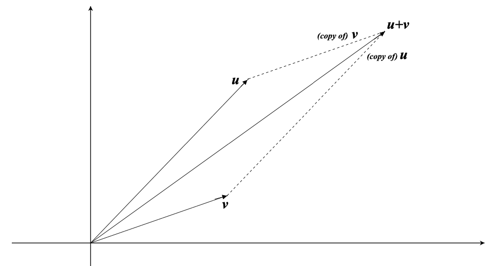
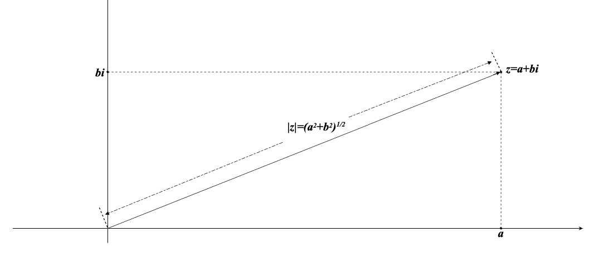
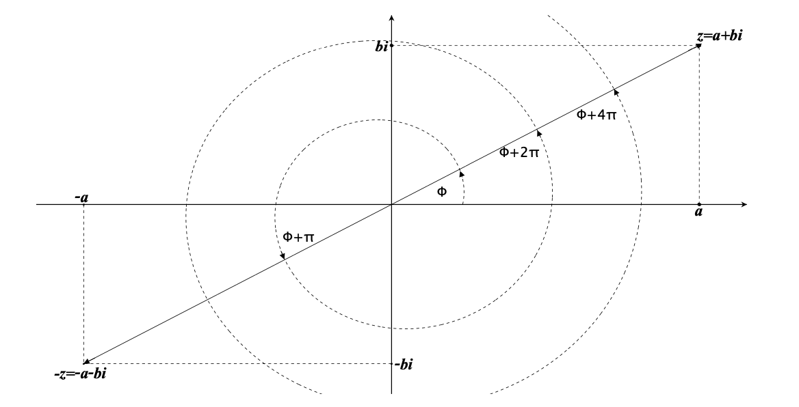
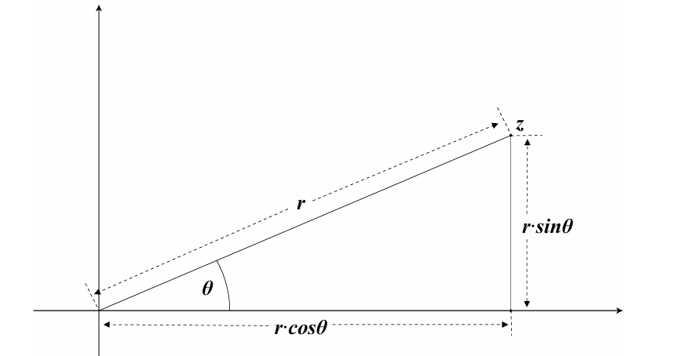

> Last Edit: 1/9/25

## 1.  Imaginary and complex numbers

- Real Number 实数，包含了Reation & Irrational Number一直以来拥有一个Fundamental Property就是 Square of any real number is always nonnegative
- 换句话来说，方程\\(x^2=-1\\)在实数域是无解的，但这并不代表这个方程无解
- 要分析这一问题，首先就需要定义\\(\sqrt{-1}\\)

###  Definition of Imaginary Number

- An imaginary number is a number of the form bi, where b is real and
$$i=\sqrt{-1}$$
- 定义指出Complex Number是形式为\\(bi\\)的数，其中b为Real Number
- 有了这定义，我们便可以为任意Real Number找到对应的Square Root，具体来说
$$(bi)^2=b^2\cdot i^2=b^2\cdot -1=-b^2$$
- 例如\\((3i)^2=-9,\sqrt{-9}=3i\\)

#### ex.

Solve the equation \\(x^2 +2x+2 = 0\\). Using the quadratic formula
$$z_1 = \frac{-2 + \sqrt{4 - 8}}{2} = -1 + i \quad \text{and} \quad z_2 = \frac{-2 - \sqrt{4 - 8}}{2} = -1 - i.
$$
### Definition of Complex Number

- A complex number is a number of the form \\(z = a+bi\\), where a and b are real numbers
- 其中a和b分别被称为z的Real & Imaginary Parts
$$a=Re(z)~和~b=Im(z)$$
- If \\(Re(z) = 0\\), then z is an imaginary number and if \\(Im(z) = 0\\), then z is a real number
- 可以发现对于上面的例子\\(z_1\\)和\\(z_2\\)，\\(Re(z_1)=Re(z_2),Im(z_1)=-Im(z_2)\\)，这并不是一个巧合，而是可以引出另一个Complex Number的特性，Complex Conjugate

### Definition of Complex Conjugate

- The complex conjugate of \\(a+bi\\) is the number \\(a-bi\\). We use a bar over the number to denote the conjugate
$$\overline{a + bi} = a - bi$$
- 对于二次方程\\(x^2 + \beta x + \gamma = 0\\) 中的\\(\beta^2 - 4\alpha\gamma < 0\\) 时，该方程没有实数解，但可以有复数解。这种情况下，解是共轭复数对。解可以通过标准的二次公式来计算：
$$a = \frac{-\beta}{2\alpha},b = \frac{\sqrt{|\beta^2 - 4\alpha\gamma|}}{2\alpha}$$
- 其中\\(a + bi\\) 和 \\(a - bi\\) 分别是这个二次方程的两个解。
- z = a 是一个实数，则它的复数共轭是它自身，即\\(\overline{z} = z\\)，这表明实数是它们自己的共轭。此外，任何复数z的共轭的共轭是z本身，即\\(\overline{\overline{z}} = z\\)

## 2. Complex Arithmetic 复数运算

- Complex numbers和Real Number一样也可以坐加减乘除运算，并且commutativity, associativity and distributivity等特性依然存在

### Addition and Sibtraction

- 要给两个Complex Numbers做加减，分别加减他们的Real and Imaginary Components
$$(a+bi)+(c+di)=(a+b)+(b+d)i$$

### Propisition 2.1 Complex Number's Conjugate

对于任何复数z，

- \\(z + \overline{z} = 2 \cdot \text{Re}(z)\\)
- \\(z - \overline{z} = 2 \cdot \text{Im}(z) \cdot i\\)
#### Proof

假设\\(z = a + bi\\)，其中a是实部，b是虚部，那么：

- \\(z + \overline{z} = (a + bi) + (a - bi) = 2a = 2 \text{Re}(z)\\)。这说明复数和其共轭的和是两倍实部
- \\(z - \overline{z} = (a + bi) - (a - bi) = 2bi = 2 \text{Im}(z) \cdot i\\)。这说明复数和其共轭的差是两倍虚部的虚数单位

### 2.2 Multiplication

$$(a +bi) (c+di) = ac+adi +cbi +bdi^2 = (ac-bd)+(ad+bc)i$$

### 2.3 Division

- Complex Number的除法可以视为乘以其逆元。复数\\(z = a + bi\\)的逆元\\(z^{-1}\\)满足\\(z \cdot z^{-1} = 1\\)。
- 给定非零复数\\(a + bi\\)，求解使得\\((a + bi)(x + yi) = 1\\)的复数\\(x + yi\\)，整理后得到：
- \\(ax - by = 1\\)
- \\(bx + ay = 0\\)
- 这两个方程可以通过以下步骤解决：
1. 将方程 (2) 乘以a，方程 (3) 乘以b，然后将两个结果相加，消去y得到\\((a^2 + b^2)x = a\\)，从而解得\\(x = \frac{a}{a^2 + b^2}\\)
2. 类似地，将方程 (2) 乘以−b，方程 (3) 乘以a，然后将两个结果相加，消去x得到\\((a^2 + b^2)y = -b\\)，从而解得\\(y = \frac{-b}{a^2 + b^2}\\)
- 这样，复数\\(a + bi\\)的乘法逆元\\(x + yi\\)可以表示为：
$$x = \frac{a}{a^2 + b^2},y = \frac{-b}{a^2 + b^2}$$
### Proposition 2.2 Complex Number's Division

- 所以当Complex Number \\(a+bi\neq 0\\)，then
$$(a + bi)^{-1} = \frac{a}{a^2 + b^2} - \frac{b}{a^2 + b^2}i$$
- 这样就可以做除法的运算了，便有
$$\frac{c + di}{a + bi} = (c + di) \cdot (a + bi)^{-1} = (c + di) \cdot \left(\frac{a}{a^2 + b^2} - \frac{b}{a^2 + b^2}i\right) = \frac{ac + bd}{a^2 + b^2} + \frac{ad - bc}{a^2 + b^2}i$$

### Proposition 2.3 Complex Number's Conjugate's Property

- 对于Complex Numbers z 和 w，
$$\overline{z+w}=\overline{z}+\overline{w},\overline{z\cdot w}=\overline{z}\cdot \overline{w},if~w\neq ~\overline{(\frac{z}{w})}=\frac{\overline{z}}{\overline{w}}$$
#### Proof
$$\begin{aligned}
\overline{(a + bi) + (c + di)}
&= \overline{(a + c) + (b + d)i} \\
&= (a + c) - (b + d)i \\
&= (a - bi) + (c - di) \\
&= \overline{(a + bi)} + \overline{(c + di)}
\end{aligned}$$
$$\begin{aligned}
\overline{(a + bi)\,(c + di)}
&= \overline{(ac - bd) + (ad + bc)\,i} \\
&= (ac - bd) - (ad + bc)\,i \\
&= (a - bi)\,(c - di) \\
&= \overline{(a + bi)} \,\cdot\, \overline{(c + di)}
\end{aligned}$$

## 3. The Geometry of Complex Numbers

- 对于Complex Number来说，其可以通过Complex Plane来表示，其中两个轴分别是Real Axis和Imaginary Axis
- 每一个复数可以被视为起始于原点的向量，而复数的加法可以通过向量加法在几何上表示出来

### 3.2 The modulus of a Complex Number

- 对于Real Number来说，其Magnitude可以通过Absolute Value\\(|a|\\)来得到，这同理也可以运用到Complex Number上

### Definition of modulus of Complex Number

- The modulus, or absolute value, of a complex number \\(z= a+ bi\\), is denoted by \\(|z|\\) and defined to be the distance in the complex plane between the point z and the point 0

### Proposition 3.1 Complex Number's Conjugate & Modulus

- For any Complex Number z
$$|z|^2=z\cdot \overline z$$
#### Proof

- 假设有Complex Number z，根据Complex Number的Modulus可以得到\\(|z|^2=a^2+b^2\\)
$$z\cdot \overline z=(a+bi)(a-bi)=a^2-abi+abi-b^2i^2=a^2+b^2=|z|^2$$
- 于是当\\(z\neq 0\\)的情况下，
$$z^{-1}=\frac{\overline z}{|z|^2}$$
- 这与上面Proposition 2.2 Complex Number's Division的内容相似

### Proposition 3.2 Commutative Property

- \\(|z\cdot w|=|z|\cdot |w|\\)
$$|z \cdot w|^2 = (z \cdot w) \cdot (\overline{z \cdot w}) = z \cdot w \cdot \overline{z} \cdot \overline{w} = |z|^2 \cdot |w|^2$$
- 两边同时取Square Root可以得到
$$|z \cdot w| = \sqrt{|z \cdot w|^2} = \sqrt{|z|^2 \cdot |w|^2} = \sqrt{|z|} \cdot \sqrt{|w|} = |z| \cdot |w|
$$
### Proposition 3.3 Inverse

- If \\(z\neq 0,then~|z^{-1}|=(|z|)^{-1}\\)

### 3.3 The Argument of a Complex Number 复数的辐角

- 如果说Modulus决定了一个Complex Number的Magnitude，他的Angle则是被Argument决定
- The argument (or phase) of \\(z= a+ bi(z\neq 0)\\)is ‘the’ angle, \\(φ\\) between the positive real axis and the line segment connecting z to 0
- The argument of z is denoted by arg(z)
- 通常情况下，复数的辐角是多值的，因为角度可以通过加上\\(2\pi\\)的整数倍来得到相同的方向
- 求的Complex Number的Argument的办法就是通过\\(\arctan\\)函数

- 在不同Quadrant下的Complex Number所得到的Argument则需要有所调整，具体来说
- 第一象限\\(a > 0, b > 0\\)，直接使用\\(\arctan(b/a)\\)，无需调整。
- 第二象限\\(a<0,b>0\\)，\\(arctan(b/a)\\) 计算的是一个负值，但实际的Argument应是\\(\pi\\)加上这个负值。所以，辐角是\\(\pi + \text{arctan}(b/a)\\)
- 第三象限\\(a<0,b<0\\)，此时\\(\text{arctan}(b/a)\\)产生正值，但由于在第三象限，所需的辐角是这个值减去\\(\pi\\)，即\\(\arctan(b/a) - \pi\\)
- 第四象限\\(a>0,b<0\\)，在此象限，\\(\arctan(b/a)\\) 本身就是正确的辐角值，因为它会给出负的角度值。
- 特殊情况a = 0 时，辐角取决于b的符号：
- 如果\\(b>0\\)，辐角是\\(\frac{\pi}{2}\\)， 如果\\(b<0\\)，辐角是\\(\frac{3\pi}{2}\\)

### 3.4 The polar-coordinate representation of complex numbers.

- 在分别求得了Complex Number的Modulus和Argument后，便可以求出Complex Number的Polar Coordinate

- 其于正常的Polar Coordinate一样，\\(Re(z)=r\cos\theta,Im(z)=r\sin \theta,z=r(\cos \theta+i\sin \theta)\\)

### Proposition 3.5 Argument's Associative Law

- \\(arg(z_1z_2)=arg(z_1)+arg(z_2)\\)
- 有\\(z_1 = r \bigl(\cos \theta + i \sin \theta\bigr), \quad z_2 = \rho \bigl(\cos \phi + i \sin \phi\bigr)\\)
$$z_1 z_2 = \bigl(r(\cos \theta + i \sin \theta)\bigr) \cdot \bigl(\rho(\cos \phi + i \sin \phi)\bigr) =r\rho \,\Bigl((\cos \theta + i \sin \theta)\,(\cos \phi + i \sin \phi)\Bigr)$$
- 其中\\((\cos \theta + i \sin \theta)\,(\cos \phi + i \sin \phi)= (\cos \theta)(\cos \phi) + (\cos \theta)(i \sin \phi) + (i \sin \theta)(\cos \phi) + (i \sin \theta)(i \sin \phi)\\)
- 当把各项一一对应起来后，就会发现
$$\cos(\theta + \phi) + i\,\sin(\theta + \phi)$$
- 所以
$$z_1 z_2 = r\rho \,\bigl(\cos(\theta + \phi) + i \sin(\theta + \phi)\bigr)$$
- 由此得出\\(\arg(z_1 z_2) = \arg(z_1) + \arg(z_2)\\)
- 同理Argument的取值范围应为\\((-\pi,\pi]\\)，所以
- 当\\(\text{arg}(z_1) + \text{arg}(z_2) > \pi\\)， 为了将结果拉回到\\((-\pi, \pi]\\)的范围内，需要从这个和中减去\\(2\pi\\)
- 当\\(\text{arg}(z_1) + \text{arg}(z_2) < -\pi\\) 为了将结果拉回到\\((-\pi, \pi]\\)的范围内，需要在这个和中加上\\(2\pi\\)

### Proposition 3.6

- 如果\\(z \neq 0\\)，且w是任意复数，那么将w乘以z：
1. 会将w的模（大小）按\\(|z|\\)进行伸缩（即缩小或放大）
2. 会将w的辐角（方向角）按\\(\text{arg}(z)\\)旋转
- 这说明复数乘法对复数的几何意义是模的缩放和角度的旋转

### 3.5 Exponential Notation Euler's formula 欧拉公式

- 对于实数\\(\theta\\)，复数可以表示为：\\(\cos\theta + i\sin\theta = e^{i\theta}\\)
- 这表明复数的极坐标表示（幅角和模）可以用指数形式表示

#### Proof 

- 对于Euler's Formula的推导从Taylor expansion开始
- 已知指数函数 exe^x 在实数域中的泰勒展开式为：
$$e^x = \sum_{n=0}^\infty \frac{x^n}{n!} = 1 + x + \frac{x^2}{2!} + \frac{x^3}{3!} + \cdots$$
- 将\\(x\\)替换为\\(i\theta\\)可以得到
$$e^{i\theta} = \sum_{n=0}^\infty \frac{(i\theta)^n}{n!}$$
- 已知Imaginary Number i在Even次Exponent下均为\\(-1\\)，可以得到
$$e^{i\theta} = \sum_{n=0}^\infty \frac{(i\theta)^n}{n!} = \sum_{n=0}^\infty \frac{(-1)^n\theta^{2n}}{(2n)!} + i \sum_{n=0}^\infty \frac{(-1)^n\theta^{2n+1}}{(2n+1)!}$$
- 这两个Series分别对应余弦和正弦的泰勒展开式，于是便有
$$e^{i\theta} = \cos\theta + i\sin\theta$$

### Proposition 3.7

- If \\(z= r > 0\\) and \\(\theta= arg(z)\\), then
$$z=r\cdot e^{\theta i}$$
- 本质上就是\\(z=r(\cos\theta +i\sin\theta)\\)，因为有Eulers' Formula

### Proposition 3.8

- For any number and any integer k
$$e^{(\theta+2k\pi)i}=e^{\theta i}$$
#### Proof

- 从Euler's Formula入手，已知\\(e^{(\theta+2k\pi )i}=e^{\theta i}\cdot e^{2k\pi i}\\)
- 令\\(2k\pi = \theta\\)，有
$$e^{(\theta+2k\pi )i}=e^{\theta}\cdot(\cos 2\pi+i\sin 2\pi)=e^{\theta}$$

## 4. Roots of polynomials

### 4.1 The fundamental theorem of algebra

- 如果P(z)是一个次数为n > 0的多项式，其形式为：
$$P(z) = c_n z^n + c_{n-1} z^{n-1} + \cdots + c_1 z + c_0$$
- 其中\\(c_n\\)为Complex Numbers
- 那么，The fundamental theorem of algebra 表明 \\(P(z) = 0\\) has a Solution in the Complex 
- 一个例子便是对于实数系数多项式\\(P(x) = x^2 + 1\\)，其has no real solutions，但在Complex Number中有两个解\\(i和-i\\)

### Propisition 4.1

- 对于任意次数\\(n \geq 1\\)的复系数多项式\\(P(z)\\)，可以表示为：
$$P(z) = c_n \cdot (z - \zeta_1)(z - \zeta_2) \cdots (z - \zeta_n)$$
- 与Real Number roots一样，并不是所有的根\\(\zeta_1, \dots, \zeta_n\\)都是不同的，某些根可能会重复，称为Reapeated Root
- 一个例子便是\\(Q(z) = z^4 - 2z^3 + 2z^2 - 2z + 1\\)，其因式分解为：
$$Q(z) = (z - 1)(z - 1)(z - i)(z + i)$$

### Proposition 4.2

如果 P(z)P(z) 是一个次数\\(n \geq 1\\)且具有复系数的多项式，那么：

- P(z) 至少有一个根（The fundamental theorem of algebra）
- P(z) 最多有n个根（Included Repeated Roots)

### 4.2 Polynomials with real coefficients

- 4.1介绍了Coefficients为Complex Numbers的情况，由于Real Number是Complex Number的Subset，所以当Coeffcients为Real Number的时候，其也有Root
- 但即使是Real Number的Coefficient，其也不保证Root为Real Number

### Proposition 4.3

- 如果\\(P(z) = a_n z^n + a_{n-1} z^{n-1} + \cdots + a_1 z + a_0\\)是一个Real Number Coefficients Polynomial，并且\\(\zeta\\)是P(z)的一个根，那么其Complex Conjugate\\(\overline{\zeta}\\)也是P(z)的一个根

#### Proof

- 假设\\(\zeta\\)是P(z)的一个根，即：
$$a_n \zeta^n + a_{n-1} \zeta^{n-1} + \cdots + a_1 \zeta + a_0 = 0$$
- 对等式两边取共轭：
$$\overline{a_n \zeta^n + a_{n-1} \zeta^{n-1} + \cdots + a_1 \zeta + a_0} = 0$$
- 利用共轭的性质
$$\overline{a_k \zeta^k} = \overline{a_k} \cdot \overline{\zeta^k} = a_k \cdot (\overline{\zeta})^k$$
- 因为\\(a_k\\)是实数，因此等式变为
$$a_n (\overline{\zeta})^n + a_{n-1} (\overline{\zeta})^{n-1} + \cdots + a_1 \overline{\zeta} + a_0 = 0$$
- 这说明\\(\overline{\zeta}\\)也是P(z)的一个根

 ## Proposition 4.4

- 如果多项式的系数是Real Number，那么其Complex Root必然成共轭对出现

### Proposition 4.5

- 对于一个Real Number Coefficient Polynomial：
$$P(z) = a_n z^n + a_{n-1} z^{n-1} + \cdots + a_1 z + a_0$$
- 其可以表示为以下因式分解形式：
$$P(z) = a_n (z - \xi_1)(z - \xi_2)\cdots(z - \xi_m) Q_1(z) Q_2(z) \cdots Q_k(z)$$
- 其中\\(\xi_1, \dots, \xi_m\\)：是所有的Real Roots
- \\(Q_j(z) = z^2 - 2\text{Re}(\zeta_j)z + |\zeta_j|^2\\)：是与复数根和其共轭对应的实系数二次多项式

### 4.3 Square roots and quadratic equations

- 想要求解General Quadratic Equation，需要先算出Complex Number的Square Roots

### Propposition 4.6

- 如果\\(u \neq 0\\)，那么复数方程\\(z^2 = u\\)的解是：
$$\zeta_1 = \sqrt{|u|} e^{i\theta/2}, \quad \zeta_2 = -\zeta_1$$
#### Proof

- 已知任何非零复数u都可以表示为\\(u = |u| e^{i\theta}\\)
- 于是可以得出其中的一个Root为\\(\zeta_1 = \sqrt{|u|} e^{i\theta/2}\\)
- 另一个解则是\\(\zeta_2 = -\zeta_1\\)

### Proposition 4.7 

- 对于二次方程：
$$az^2 + bz + c = 0$$
其解的公式为：
$$z_1 = \frac{-b + \sqrt{b^2 - 4ac}}{2a}, \quad z_2 = \frac{-b - \sqrt{b^2 - 4ac}}{2a}$$
- 其中：a, b, c 是复数（且\\(a \neq 0\\)），公式中的平方根\\(\sqrt{b^2 - 4ac}\\) 按复数的平方根规则计算。

#### Example 4.3
$$z^2 + (1 - 2i)z - 2i = 0$$
- 这里\\(a = 1，b = 1 - 2i，c = -2i\\)
$$\zeta_1 = \frac{-(1 - 2i) + \sqrt{(1 - 2i)^2 - 4(1)(-2i)}}{2}, \quad \zeta_2 = \frac{-(1 - 2i) - \sqrt{(1 - 2i)^2 - 4(1)(-2i)}}{2}$$
$$b^2 - 4ac = (1 - 2i)^2 - 4(-2i) = 1 - 4i + 4 - 8i = -3 - 4i + 8i = -3 + 4i$$
- 根据公式\\(\sqrt{|b^2 - 4ac|} e^{i\theta/2}\\)计算其复数平方根\\(\sqrt{-3 + 4i} = 1 - 2i\\)
$$\zeta_1 = \frac{-b + \sqrt{-3 + 4i}}{2} = \frac{-(1 - 2i) + (1 - 2i)}{2} = 2i$$$$\zeta_2 = \frac{-b - \sqrt{-3 + 4i}}{2} = \frac{-(1 - 2i) - (1 - 2i)}{2} = -1$$
### 4.4 The nth roots of a complex number

- 对于一个正实数\\(\alpha > 0\\)和正整数n，\\(\alpha\\)的n次根\\(\beta\\)定义为：
$$\beta^n = \alpha \quad \text{或} \quad \beta = \alpha^{1/n}$$
- 这是解决方程\\(z^n - \alpha = 0\\)的一个特定解，通常选择正实数解作为主n次根
- 若\\(u \neq 0\\)是一个复数，且n是正整数，那么方程\\(z^n = u\\)总共有n个不同的复数解，这些解可以记为\\(\zeta_1, \zeta_2, \dots, \zeta_n\\)
$$z^n - u = (z - \zeta_1)(z - \zeta_2)\cdots(z - \zeta_n)$$
### Proposition 4.8

- 对于复数\\(u \neq 0\\)，如果\\(\theta = \text{arg}(u)\\)，n是一个正整数，那么方程\\(z^n = u\\)的解为：
$$\zeta_k = \sqrt[n]{|u|} e^{i\left(\frac{\theta + 2k\pi}{n}\right)}, \quad k = 0, 1, 2, \dots, n-1$$
- 其中总共有n个不同的解，这些解在复平面上均匀分布，构成一个以原点为中心、半径为\\(\sqrt[n]{|u|}\\)的正n边形。

#### Proof

- 对于任意k来说，有
$$\zeta_k = \sqrt[n]{|u|} e^{i\left(\frac{\theta + 2k\pi}{n}\right)}$$
- 计算\\(\zeta_k^n\\)
$$\zeta_k^n = \left(\sqrt[n]{|u|}\right)^n \cdot \left(e^{i\left(\frac{\theta + 2k\pi}{n}\right)}\right)^n$$
$$\left(\sqrt[n]{|u|}\right)^n = |u|，\left(e^{i\left(\frac{\theta + 2k\pi}{n}\right)}\right)^n = e^{i\left(\theta + 2k\pi\right)} = e^{i\theta}$$
- 所以
$$\zeta_k^n = |u| e^{i\theta} = u$$
- 这表明每个\\(\zeta_k\\)都是\\(z^n = u\\)的解
- 在这之后还需要验证解是不同的\\(\zeta_k \neq \zeta_j\\)，假设\\(\zeta_k = \zeta_j\\)，那么\\(\frac{\zeta_k}{\zeta_j} = 1\\)
$$\frac{\zeta_k}{\zeta_j} = \frac{\sqrt[n]{|u|} e^{i\left(\frac{\theta + 2k\pi}{n}\right)}}{\sqrt[n]{|u|} e^{i\left(\frac{\theta + $2j\pi}{n}\right)}} = e^{i\left(\frac{2(k-j)\pi}{n}\right)}$$
- 若\\(\frac{\zeta_k}{\zeta_j} = 1\\)，则必须有：
$$\frac{2(k-j)\pi}{n} = 2m\pi \quad (m \in \mathbb{Z})$$
- 这意味着：
$$\frac{k-j}{n} = m \quad \Rightarrow \quad k-j = mn$$
- 由于\\(0 \leq k, j < n\\)，因此\\(|k-j| < n\\)，所以只有m = 0，即k = j。
- 这表明当\\(k \neq j\\)时，\\(\zeta_k \neq \zeta_j\\)
