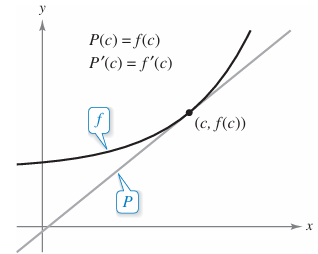
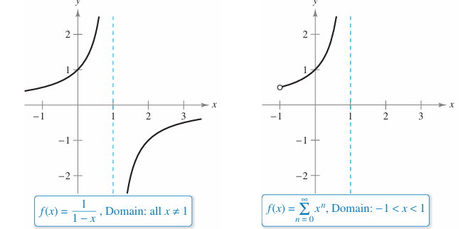

> Last Edit: 1/22/25

## Sequences

- Sequence是按照一定顺序排列的一列数。序列可以是有限的也可以是无限的，通常表示为\\(a_1, a_2, a_3, \ldots\\)，其中\\(a_n\\)表示序列的第n项

### Limit of a Sequence

- 对于一个Sequence，如果有
$$\lim_{n\rightarrow\infty}a_n=L,L\in \mathbb R$$
- 则该Sequence的Limit为L
- 如果存在这个L，也可以说Sequence是Converge 收敛的
- 如果不存在，则Sequence Diverge 发散

#### ex. Nature Number

- 找到Sequence \\(a_n = \left(1 + \frac{1}{n}\right)^n\\)的Limit
$$\lim_{n \to \infty} a_n = \lim_{n \to \infty} \left(1 + \frac{1}{n}\right)^n = e$$
### Properties of Limits of Sequences

- Let \\(\lim_{n \to \infty} a_n = L \text{ and } \lim_{n \to \infty} b_n = K\\)
$$\lim_{n \to \infty} (a_n \pm b_n) = L \pm K$$
$$\lim_{n \to \infty} c a_n = cL$$
$$\lim_{n \to \infty} (a_n b_n) = LK$$
$$\lim_{n \to \infty} \frac{a_n}{b_n} = \frac{L}{K}$$
### Squeeze Theorem for Sequences

- Squeeze Theorem也可以用来解Sequence的Convergence，其通常用在 \\((-1)^n, \sin(x)\\)等在\\(n\rightarrow \infty\\)时oscillate的函数中

#### ex. Sequence Convergence by Squeeze Theorem

- 证明Sequence \\(\{ c_n \} = \left\{ (-1)^n \frac{1}{n!} \right\}\\)收敛
- 使用两个序列\\(a_n=\frac{1}{2^n}\\)，已知Factorial的扩散速度小于Exponential，有
$$-\frac{1}{2^n} \leq (-1)^n \frac{1}{n!} \leq \frac{1}{2^n}, \quad n \geq 4$$
### Monotonic Sequences

- 当一个Sequence的每一项都单调递增或单调递减时，该Sequence被称为Monotonic Sequence

### Bounded Sequence

#### Bounded Above

- 当存在一个\\(M\in \mathbb R\\)使得\\(a_n\leq M\\)时，称该Sequence Bounded Above

#### Bounded Below

- 当存在一个\\(M\in \mathbb R\\)使得\\(a_n\geq M\\)时，称该Sequence Bounded Below

#### Bounded 

- 当一个Sequence同时Bounded Above和Below的时候，其Bounded

### Theorem - Convergent Sequence are Bounded

- 如果一个Sequence Convergent，则其一定Bounded
- 同理也可以反推，如果一个Sequence Bounded并且是Monotonic 单调的Sequence的话，该Sequence Convergent 收敛

## Series (Infinite Series)

- 对于Sequence来说，它的所有项相加的和便成为了Series
$$S_n=\sum_{n=1}^{\infty} a_n = a_1 + a_2 + a_3 + \cdots + a_n + \cdots$$

### Convergent of Series

-  对于一个Series \\(\sum^\infty_{n=1}a_n\\)来说，如果其Partial Sum（前n项之和）等于S，则该Series Converge，反则Diverge

### Telescoping Series 列项级数

- 通过将级数的两个项组合得到一个新的通项公式求得级数的解

#### ex. Finding Series Convergency by Telescoping

- 求解\\(\sum_{n=1}^{\infty} \frac{2}{4n^2 - 1}\\)
$$a_n = \frac{2}{4n^2 - 1} = \frac{2}{(2n - 1)(2n + 1)} = \frac{1}{2n - 1} - \frac{1}{2n + 1}$$
- 通过观察规律可以看出
$$S_n = \left( \frac{1}{1} - \frac{1}{3} \right) + \left( \frac{1}{3} - \frac{1}{5} \right) + \cdots + \left( \frac{1}{2n-1} - \frac{1}{2n+1} \right) = 1 - \frac{1}{2n+1}$$
- 最终得出
$$\sum_{n=1}^{\infty} \frac{2}{4n^2 - 1} = \lim_{n \to \infty} S_n = \lim_{n \to \infty} \left(1 - \frac{1}{2n+1}\right) = 1$$
### Geometric Series

- 形如\\(\sum_{n=0}^{\infty} ar^n\\)的Series被称为Geometric Series，其完整形式为
$$\sum_{n=0}^{\infty} ar^n = a + ar + ar^2 + \cdots + ar^n + \cdots, \quad a \neq 0$$
#### Convergenvce of Geometric Series

- 当Geometric Series的的敛散性高度取决于其公比r的取值
- 具体来说当\\(0<|r|<1\\) Geometric Series Converge ，当\\(|r|\geq 1\\)，其Diverge

#### The Value Geometric Series Converge to

- Geometric Sereis是很特别的一个Series，于大部分Series不同，当其Converge的时候可以简单的求出Series的值为
$$\lim_{n \to \infty} S_n = \lim_{n \to \infty} \left[ \frac{a(1 - r^n)}{1 - r} \right] = \frac{a}{1 - r} \lim_{n \to \infty} (1 - r^n) = \frac{a}{1 - r}$$
### Property of Infinite Series

- 如果\\(\sum a_n\\)和\\(\sum b_n\\)都是Converge的Series，并且分别收敛到A和B，则有
$$\sum_{n=1}^{\infty} c a_n = cA$$
$$\sum_{n=1}^{\infty} (a_n + b_n) = A + B$$
$$\sum_{n=1}^{\infty} (a_n - b_n) = A - B$$

### p-Series and Harmonic Series

$$\sum_{n=1}^{\infty} \frac{1}{n^p} = \frac{1}{1^p} + \frac{1}{2^p} + \frac{1}{3^p} + \cdots$$
### Convergence of p-Series

- 当 \\(p>1\\) 的时候Converge，\\(0<p\leq 1\\) 的时候Diverge

### Harmonic Series

- 当p=1时，p-Series变成其特殊形式，即Harmonic Series

## Alternating Series

- 到目前为止的Series都只含有Postitive的Terms
- Alternating Series 交错级数指的是一正一负（一负一正）的Terms的级数

#### Alternating Series Remainder

- 如果一个**收敛的交错级数**满足以下条件：
- \\(a_{n+1} \leq a_n\\)（即正项部分单调递减），\\(\lim_{n \to \infty} a_n = 0\\)，
- 那么，当用第N项部分和\\(S_N\\)来近似整个级数的和 SS 时，有
$$|S - S_N| = |R_N| \leq a_{N+1}$$
换句话说，误差的绝对值小于等于被忽略的第一个正项\\(a_{N+1}\\)

## Absolute and Conditional Convergence

- 有的Series可能含有正负项，但他们不已一定规律出现
- 这时候就需要利用Absolute and Conditional Convergence
- 如果一个级数 \\(\sum |a_n|\\) **Convergence Absolutly**（即级数的项的绝对值构成的级数收敛），则原级数 \\(\sum a_n\\) 也一定Converge

#### Conditionally Converge

- 对于一个Series，当\\(\sum |a_n|\\) Diverge但是\\(\sum a_n\\) converge的时候，其Conditionally Converge 条件收敛

## Tests for Convergency 

- 对于Series存在许多的判断其是否收敛的办法

### The Integral Test

- 如果函数f(x)满足以下条件：f(x)在 \\(x \geq 1\\) 上是positive，continuous，decreasing的，则：
$$\sum_{n=1}^\infty a_n与\int_{1}^\infty f(x)\, dx$$
- 的收敛性是一致的：  要么两者都收敛，要么两者都发散

### Direct Comparison Test

- 假设存在两个正项级数 \\(\sum a_n\\) 和 \\(\sum b_n\\)，并且对所有n都满足 \\(0 < a_n \leq b_n\\)，则有：

1. 如果 \\(n\sum b_n\\) **Converge**，则 \\(\sum a_n\\) 也**Converge**
2. 如果 \\(\sum a_n\\) **Diverge**，则 \\(\sum b_n\\) 也**Diverge**

### Limit Comparison Test

- 对于Direct Comparison能做的，Limit都能做到并且会更加简单
假设存在两个正项级数 \\(\sum a_n\\) 和 \\(\sum b_n\\)，并且满足：

\\(a_n > 0\\) 和 \\(b_n > 0\\) 对所有n成立，存在极限： \\(\lim_{n \to \infty} \frac{a_n}{b_n} = L\\) 其中\\(0 < L < \infty\\)

- 如果 \\(\sum b_n\\) Converge，则 \\(\sum a_n\\) 也Converge
- 如果 \\(\sum b_n\\) Diverge，则 \\(\sum a_n\\) 也Diverge

### Throrem - nth Test

- If \\(\lim_{n \to \infty} a_n \neq 0\\), then \\(\sum_{n=1}^{\infty} a_n\\) diverges

###  Alternating Series Test

- 对于形式为交错级数的两个级数：
$$\sum_{n=1}^\infty (-1)^n a_n \quad \text{和} \quad \sum_{n=1}^\infty (-1)^{n+1} a_n$$
- 如果满足以下两个条件，则级数收敛：
- \\(\lim_{n \to \infty} a_n = 0\\)，\\(a_{n+1} \leq a_n\\) 对所有n成立（即\\(\{a_n\}\\)是单调递减的正项数列）。

### Ratio Test

- Let \\(\sum a_n\\) be a series with nonzero terms
- 当\\(\lim_{n \to \infty} \left| \frac{a_{n+1}}{a_n} \right| < 1\\)，级数Converges Absolutely
- 当\\(\lim_{n \to \infty} \left| \frac{a_{n+1}}{a_n} \right| > 1 \text{ or } \lim_{n \to \infty} \left| \frac{a_{n+1}}{a_n} \right| = \infty\\)，级数Diverge
- 当\\(\lim_{n \to \infty} \left| \frac{a_{n+1}}{a_n} \right| =1\\)时，Ratio Test失效

> 简单解释一下原理就是通过转化为Geometric Series后计算公比

### The Root Test

- Let \\(\sum a_n\\) be a series with nonzero terms
- 当\\(\lim_{n \to \infty} \sqrt[n]{|a_n|} < 1\\)时，级数Converge Absolutely
- 当\\(\lim_{n \to \infty} \sqrt[n]{|a_n|} > 1 \text{ or } \lim_{n \to \infty} \sqrt[n]{|a_n|} = \infty\\)时，Diverge
- 同理\\(\lim_{n \to \infty} \sqrt[n]{|a_n|} = 1\\)时失效

## Taylor Polynomials and Approximations

- 想要通过一个Polynomial来近似一个function，首先找到一点c，其在function的domain中，再给与\\(p(c)\\)和\\(f(c)\\)相同的值，就可以说这个Polynomial是以c点为中心近似function的
- 由于过一个点的Polynomial非常之多，所以更一步的近似就是同时令function和polynomial在点c处的slope也相似，有\\(p'(c)=f'(c)\\)满足了以上两个条件，就获得了一个简单的对于function的近似

### ex. First Degree Approximation for e^x

- \\(f(x)=e^x\\) 存在一个特殊的性质，就是其derivate等于原函数，于是有
$$f(0)=f'(0)=e^0=1$$
- 现在拿出一个One degree polynomial \\(p(x)=a_0+a_1x\\)，分别对齐\\(p(0)\\)和\\(p'(0)\\)
- \\(p(0)=a_0+0=1\Rightarrow a_0=1\\)，\\(p'(0)=a_1=1\Rightarrow = a_1 =1\\)
- 可以得到\\(p(x)=1+x\\)，就这样逐渐的往高阶逼近，Polynomial和Function以c为中心的逼近也会越来越精确

### Taylor Polynomials

- 在上面的例子中，多项式是以\\(c=0\\)为中心approximate function的，而这一个c可以根据需要进行调整，具体来说这个多项式在n阶下应该为
$$P_n(x) = a_0 + a_1(x-c) + a_2(x-c)^2 + a_3(x-c)^3 + \cdots + a_n(x-c)^n$$
- 这一个polynomial中存在三个参数，其中c为常数，x为variable，于是就要求解a的值
- 在前面的例子中提到了求解\\(a_0,a_1\\)的办法，具体就是令\\(p_n^{(n)}(c)=f_n^{(n)}(c)\\)
- 观察polynomial求到第n阶导数的样子，有
$$P_n'''(x) = 2(3a_3) + \cdots + n(n - 1)a_n(x - c)^{n-3}$$
$$P_n^{(n)}(x) = n(n - 1)(n - 2) \cdots (2)(1) a_n$$
- 可以发现求解\\(a_n\\)的关键就在于当P求到第n阶导数的时候\\((x-c)^n\\)这一项会只剩下系数（z）乘以\\(a_n\\)，也就是\\(za_n(x-c)^0\\)（具体系数等于多少稍后讨论），那么这时候令\\(x=c\\)，所有高次的项均会被消去只剩下\\(p_n(x)\\)原本的第n项系数，这时候有
$$p_n^{(n)}(c)=f_n^{(n)}(c)=za_n$$
- 这就可以得出
$$a_n=\frac{f_n^{(n)}(c)}{z}$$
- 那么问题就来到了z等于多少上，已知到这一步时，\\(P_n(x)\\)已经被求导了n次，也就是说这一项的幂减去了n次1，而系数乘上了\\(n(n-1)(n-2)(n-3)\ldots 1=n!\\)，总结得出 
$$a_n=\frac{f_n^{(n)}(c)}{n!}$$
- 将其带入Polynomial有
$$P_n(x) = f(c) + f'(c)(x - c) + \frac{f''(c)}{2!}(x - c)^2 + \cdots + \frac{f^{(n)}(c)}{n!}(x - c)^n$$
#### Maclaurin Polynomial 

- 麦克劳林级数是Taylor Series的特殊情况，其发生在\\(c=0\\)的时候，有
$$P_n(x) = f(0) + f'(0)x + \frac{f''(0)}{2!}x^2 + \frac{f'''(0)}{3!}x^3 + \cdots + \frac{f^{(n)}(0)}{n!}x^n$$
#### ex. Finding a 3 degrees Taylor Polynomial for sin x at pi/6

 以\\(\pi/6\\)为中心找到sinx的泰勒多项式
- 找Taylor Polynomial实际上只用求原函数在各阶导数下的值就行
- \\(f(x) = \sin x \quad f\left(\frac{\pi}{6}\right) = \sin\left(\frac{\pi}{6}\right) = \frac{1}{2}\\)
- \\(f'(x) = \cos x \quad f'\left(\frac{\pi}{6}\right) = \cos\left(\frac{\pi}{6}\right) = \frac{\sqrt{3}}{2}\\)
- \\(f''(x) = -\sin x \quad f''\left(\frac{\pi}{6}\right) = -\sin\left(\frac{\pi}{6}\right) = -\frac{1}{2}\\)
- \\(f'''(x) = -\cos x \quad f'''\left(\frac{\pi}{6}\right) = -\cos\left(\frac{\pi}{6}\right) = -\frac{\sqrt{3}}{2}\\)
$$P_3(x) = f\left(\frac{\pi}{6}\right) + f'\left(\frac{\pi}{6}\right) (x - \frac{\pi}{6}) + \frac{f''\left(\frac{\pi}{6}\right)}{2!} (x - \frac{\pi}{6})^2 + \frac{f'''\left(\frac{\pi}{6}\right)}{3!} (x - \frac{\pi}{6})^3
$$
$$= \frac{1}{2} + \frac{\sqrt{3}}{2} \left(x - \frac{\pi}{6}\right) - \frac{1}{2(2!)} \left(x - \frac{\pi}{6}\right)^2 - \frac{\sqrt{3}}{2(3!)} \left(x - \frac{\pi}{6}\right)^3$$

### Remainder of a Taylor Polynomial

- 作为一个逼近，其总是存在Error，而Error与实际值之间的差值就是Remainder，有
$$\text{Error} = |R_n(x)| = |f(x) - P_n(x)|$$

### Taylor's Theorem

- 如果一个函数n+1阶可导在一个包含了c的区间I中，则每一个I中的x都有一个\\(z\in [x,c]\\)使得
$$f(x) = f(c) + f'(c)(x - c) + \frac{f''(c)}{2!}(x - c)^2 + \cdots + \frac{f^{(n)}(c)}{n!}(x - c)^n + R_n(x)$$
- 其中
$$R_n(x) = \frac{f^{(n+1)}(z)}{(n+1)!} (x - c)^{n+1}$$
- 以上就是Taylor's Theorem的完整定理，其可以被总结为一个更加易懂的二级结论，有
$$|R_n(x)| \leq \frac{|x - c|^{n+1}}{(n+1)!} \max |f^{(n+1)}(z)|$$
- 简单来说，直接找到Taylor's Theroem中的z是十分困难的，这使得其更多像是一个存在性定理，所以实际上这个定理想表达的是这个z的存在使得Remainder能别限制在一个区间

#### ex. Determing Accuracy of Approximation

有Thrid Degree Maclaurin Polynomial \\(P_3(x) = x - \frac{x^3}{3!}\\)，求近似\\(x=0.1\\)时的误差
$$\sin x = x - \frac{x^3}{3!} + R_3(x) = x - \frac{x^3}{3!} + \frac{f^{(4)}(z)}{4!}x^4$$
- 在\\(0<z<0.1\\)的区间中，\\(\sin(0.1)\\)有着最大的值，于是有
$$0 < R_3(0.1) = \frac{\sin z}{4!} (0.1)^4 < \frac{0.0001}{4!} \approx 0.000004
$$
#### ex.  Approximating a Value to a Desired Accuracy

Determine the degree of the Taylor polynomial expanded about c=1 that should be used to approximate \\(\ln(1.2)\\) so that the error is less than 0.001

- 既然求的是Error Value，直接用Remainder
$$|R_n(1.2)| = \left| \frac{f^{(n+1)}(z)}{(n+1)!} (1.2 - 1)^{n+1} \right|
= \frac{n!}{z^{n+1}(n + 1)!} (0.2)^{n+1}
= \frac{(0.2)^{n+1}}{z^{n+1}(n + 1)}$$
- 要让这玩意小于0.001，由于在\\(1<z<1.2\\)的区间中
$$\frac{(0.2)^{n+1}}{z^{n+1}(n + 1)}<\frac{(0.2)^{n+1}}{n + 1}<0.001$$
- 最终可以得到 \\(n=3\\)

## Power Series

- Power Series 幂级数是一种形式为无穷多项式的Series，通常用来近似函数，其表示为
$$\sum_{n=0}^{\infty} c_n (x-a)^n$$
- 其中，\\(c_n\\)是系数，x是变量，a是幂级数展开的中心点

### Center of Power Sereis

- 中心点的选择是为了确定一个近似最精确的点，如果想要用Power Series来近似\\(e^x\\)，并且对于\\(x=1\\)这一点的函数更加关心时，就可以选择\\(a=1\\)为展开的中心点，这使得x=1周围的对于函数的逼近更加精确

### Radius and Interval of Convergency

- 对于一个Power Series来说，只存在三种收敛的情况
- 1. Converges at center 只在中心收敛
- 2. Converges within a radius R 收敛于一定半径R之间
- 3. Converges absolutely for all x 收敛于任意\\(x\in R\\)
- 通过计算Power Series的Ratio或者Radius Test后便可以知道Radius of Convergency

#### ex. Finding the radius of Convergence (R=1)

- 对于Series \\(\sum_{n=0}^{\infty} 3(x-2)^n\\)，找到他的Radius of Convergence
- 利用Ratio Test得到
$$\lim_{n \to \infty} \frac{u_{n+1}}{u_n} = \lim_{n \to \infty} \frac{3(x-2)^{n+1}}{3(x-2)^n} = \lim_{n \to \infty} |x-2| = |x-2|$$
- 已知当这一个极限\\(\lim_{n \to \infty} \left| \frac{a_{n+1}}{a_n} \right| < 1\\)的时候Series Converge，则有
$$|x-2|<1\Rightarrow -1<x-2<1\Rightarrow 1<x<3\Rightarrow R=1$$

#### ex. Finding the radius of Convergence  (\\(R=\infty\\))

- 判断Series \\(\sum_{n=0}^{\infty} \frac{(-1)^n x^{2n+1}}{(2n+1)!}\\)
$$\lim_{n \to \infty} \frac{u_{n+1}}{u_n} = \lim_{n \to \infty} \frac{(-1)^{n+1} x^{2n+3}}{(2n + 3)!} \div \frac{(-1)^n x^{2n+1}}{(2n + 1)!} = \lim_{n \to \infty} \frac{x^2}{(2n + 3)(2n + 2)}=0$$
- 这个情况下，无论x取什么值都有\\(\lim_{n \to \infty} \left| \frac{a_{n+1}}{a_n} \right| < 1\\)，所以R也为\\(\infty\\)

### End Point Convergence

- 在判断了Convergency Radius后，还需要判断两个End Point的取值情况，这是因为在End Point位于\\(\lim_{n \to \infty} \left| \frac{a_{n+1}}{a_n} \right| = 1\\)的点，前面提到了这个点处Ratio Test是失效的，所以需要单独计算

#### ex. Finding Interval of Convergence

- 判断Series \\(\sum_{n=1}^{\infty} \frac{x^n}{n}\\)的Interval of Convergence （注意问题变了）
$$\lim_{n \to \infty} \frac{u_{n+1}}{u_n} = \lim_{n \to \infty} \frac{x^{n+1} / (n+1)}{x^n / n} = \lim_{n \to \infty} \frac{nx}{n+1} = |x|$$
- 知道了Convergence Radius\\(R=1\\)后分析两个End Point的Behavior
$$when~x=1:~\sum_{n=1}^{\infty} \frac{1}{n} = \frac{1}{1} + \frac{1}{2} + \frac{1}{3} + \cdots$$
$$when~x=-1:~\sum_{n=1}^{\infty} \frac{(-1)^n}{n} = -1 + \frac{1}{2} - \frac{1}{3} + \frac{1}{4} - \cdots$$
- 最终得到完整Interval of Convergence为 \\([-1,1)\\)

### Properties of Functions Defined by Power Series

- 如果用一个Power Series来拟合一个function，有
$$f(x) = \sum_{n=0}^{\infty} a_n (x - c)^n = a_0 + a_1 (x - c) + a_2 (x - c)^2 + a_3 (x - c)^3 + \cdots$$
- 这个function的Derivative的Integral同样也可以用一个Taylor Polynomial表示
$$f'(x) = \sum_{n=1}^{\infty} n a_n (x - c)^{n-1} = a_1 + 2a_2(x - c) + 3a_3(x - c)^2 + \cdots$$
$$\int f(x) \, dx = C + \sum_{n=0}^{\infty} a_n \frac{(x - c)^{n+1}}{n+1} 
= C + a_0 (x - c) + \frac{a_1 (x - c)^2}{2} + \frac{a_2 (x - c)^3}{3} + \cdots$$
- 其Integral和Derivative会有和原函数相同的Radius of convergency，但是由于Series本身发生了改变，导致End Point Behavior可能不同
$$$$
## Representation of Functions by Power Series

- 考虑一个function \\(f(x) = \frac{1}{1 - x}\\)
- 这个function长得非常像在前面所提到的Geometric Series的Partial Sum，具体来说一个Geometric Series会在\\(0<|r|<1\\)的时候有
$$\sum_{n=0}^{\infty} ar^n = \frac{a}{1 - r}$$
- 而对于上面的\\(f(x)\\)，当 \\(a=1,r=x\\) 的时候就有
$$\frac{1}{1 - x} = \sum_{n=0}^{\infty} ar^n = \sum_{n=0}^{\infty} x^n = 1 + x + x^2 + x^3 + \cdots, \quad |x| < 1.
$$
- 当然要知道一个Power Series存在Convergence Radius，这使得这个Series仅在\\((-1,1)\\)的区间上拟合了function，如果需要研究函数在其他区间的拟合，则可以更改Power Series的c
- 比如当 \\(c=-1\\) 的时候就有
$$\frac{1}{1 - x} = \frac{1}{2 - (x + 1)} =  \frac{\frac{1}{2}}{1 -\frac{(x + 1)}{2}} = \frac{a}{1 - r}$$
- 于是可以得出 \\(a= \frac{1}{2},r=\frac{x+1}{2}\\)，带入Power Series中有
$$\frac{1}{1 - x} = \sum_{n=0}^{\infty} \left(\frac{1}{2}\right)\left(\frac{x+1}{2}\right)^n  = \frac{1}{2} \left[ 1 + \frac{x+1}{2} + \left(\frac{x+1}{2}\right)^2 + \left(\frac{x+1}{2}\right)^3 + \cdots \right], \quad |x+1| < 2$$

> Power Series仅在Convergence Interval中拟合Function

### ex. Find Geometeric Power Sereis Centerd at 0

找一个拟合function \\(f(x) = \frac{4}{x + 2}\\) 的Power Series

- 将function写成 \\(\frac{a}{1-r}\\) 的形式
$$\frac{4}{2 + x} = \frac{2}{1 - \left(-\frac{x}{2}\right)} = \frac{a}{1 - r}$$
- 有 \\(a=2,r=\frac{-x}{2}\\)
- 于是可以写出Power Series
$$\frac{4}{x + 2} = \sum_{n=0}^{\infty} a r^n = \sum_{n=0}^{\infty} 2 \left(-\frac{x}{2}\right)^n = 2 \left(1 - \frac{x}{2} + \frac{x^2}{4} - \frac{x^3}{8} + \cdots \right)$$
### Operations with Power Series
$$f(x) = \sum_{n=0}^{\infty} a_n x^n \text{ and } g(x) = \sum_{n=0}^{\infty} b_n x^n$$
$$f(kx) =\sum_{n=0}^{\infty} a_n (kx)^n$$
$$f(x^N) =\sum_{n=0}^{\infty} a_n (x^N)^n$$
$$f(x) \pm g(x) = \sum_{n=0}^{\infty} (a_n + b_n) x^n$$
### ex. Finding Power Series by Integration

- 前面提到了Power Series的Integral和Derivative也都还是Power Series，于是当一个函数的积分或者导数可以被整理为一个Geometric Power Series时，该函数也可以用Power Series来表示 

 找到Power Series Representation of \\(f(x)=\ln x\\)

- 已知\\(\int f(x)dx=\frac1x+C\\)，有
$$\frac{1}{x} = \sum_{n=0}^{\infty} (-1)^n (x - 1)^n$$
- 这是一个 \\(a=1,r=-(x-1)\\) 的Power Series，对这个Power Series积分有
$$\ln x = \int \frac{1}{x} \, dx + C = C + \sum_{n=0}^{\infty} (-1)^n \frac{(x - 1)^{n+1}}{n+1}= \frac{(x-1)}{1} - \frac{(x-1)^2}{2} + \frac{(x-1)^3}{3} - \frac{(x-1)^4}{4} + \cdots
$$

### ex. 2. Finding a Power Series by Integration

找到 \\(g(x)=\arctan x\\) 的Power Series

- 已知\\(\arctan(x)\\)的Derivative为\\(\frac{1}{1+x^2}\\)，令\\(x^2\\)为r，就可以写出他的Power Series有
$$f(x^2) = \frac{1}{1 + x^2} = \sum_{n=0}^{\infty} (-1)^n x^{2n}$$
- 再对这玩意积分，有
$$\arctan x = \int \frac{1}{1 + x^2} \, dx + C = C + \sum_{n=0}^{\infty} (-1)^n \frac{x^{2n+1}}{2n+1}$$
- 令 \\(x=1\\) 可以知道 \\(C=0\\)，有
$$= \sum_{n=0}^{\infty} (-1)^n \frac{x^{2n+1}}{2n+1} = x - \frac{x^3}{3} + \frac{x^5}{5} - \frac{x^7}{7} + \cdots$$
## Taylor and Maclaurin Series

- 在前面通过了使用Geometric Series的Partial Sum找到了很多函数对于的Power Series，通过Taylor Series则可以找到那些可以被求导n次的函数的Power Series
- 前面提到了Taylor Polynomial拟合的function在他的Radius of Convergence中可以表示为
$$f(x) = f(c) + f'(c)(x - c) + \frac{f''(c)}{2!}(x - c)^2 + \cdots + \frac{f^{(n)}(c)}{n!}(x - c)^n + \cdots$$
- 这个Polynomial也是不同Power的和，当\\(n=\infty\\)的时候，其也可以被当作一个Series，有
$$\sum_{n=0}^{\infty} \frac{f^{(n)}(c)}{n!} (x - c)^n = f(c) + f'(c)(x - c) + \cdots + \frac{f^{(n)}(c)}{n!}(x - c)^n + \cdots
$$
- 这时候只要Taylor Series Converge，其就完全的拟合了Function

### Binomial Series

- 对于形如 \\(f(x)=(1+x)^k\\) 的function，可以通过Binomial Serises逼近，因为其本身就是一个Binomial 二项式，当然可以同Series来表示他的二项式展开，经典二项式定理为
$$(1+x)^k = \sum_{n=0}^k \binom{k}{n} x^n$$
- 但经典二项式定理存在一个前提为 \\(k\in \mathbb z^+\\)，当k不为整数的时候，二项式系数不会在某一项后归零，导致级数没有终止，这就导致了二项式展开变成了Seires，有
$$(1 + x)^k = 1 + kx + \frac{k(k-1)x^2}{2!} + \frac{k(k-1)(k-2)x^3}{3!} + \frac{k(k-1)(k-2)(k-3)x^4}{4!} + \cdots$$
## POWER SERIES FOR ELEMENTARY FUNCTIONS
$$\frac{1}{x} = 1 - (x - 1) + (x - 1)^2 - (x - 1)^3 + \cdots, \quad 0 < x < 2$$
$$\frac{1}{1 + x} = 1 - x + x^2 - x^3 + x^4 - \cdots, \quad -1 < x < 1$$
$$\ln x = (x - 1) - \frac{(x - 1)^2}{2} + \frac{(x - 1)^3}{3} - \frac{(x - 1)^4}{4} + \cdots, \quad 0 < x < 2$$
$$e^x = 1 + x + \frac{x^2}{2!} + \frac{x^3}{3!} + \frac{x^4}{4!} + \cdots, \quad -\infty < x < \infty$$
$$\sin x = x - \frac{x^3}{3!} + \frac{x^5}{5!} - \frac{x^7}{7!} + \cdots, \quad -\infty < x < \infty$$
$$\cos x = 1 - \frac{x^2}{2!} + \frac{x^4}{4!} - \frac{x^6}{6!} + \cdots, \quad -\infty < x < \infty$$
$$\arctan x = x - \frac{x^3}{3} + \frac{x^5}{5} - \frac{x^7}{7} + \cdots, \quad -1 \leq x \leq 1$$
$$\arctan x = x - \frac{x^3}{3} + \frac{x^5}{5} - \frac{x^7}{7} + \cdots, \quad -1 \leq x \leq 1$$
$$\arcsin x = x + \frac{1 \cdot 3 x^3}{2 \cdot 4} + \frac{1 \cdot 3 \cdot 5 x^5}{2 \cdot 4 \cdot 6} + \cdots, \quad -1 \leq x \leq 1$$
$$(1 + x)^k = 1 + kx + \frac{k(k-1)x^2}{2!} + \frac{k(k-1)(k-2)x^3}{3!} + \cdots, \quad -1 < x < 1^*$$