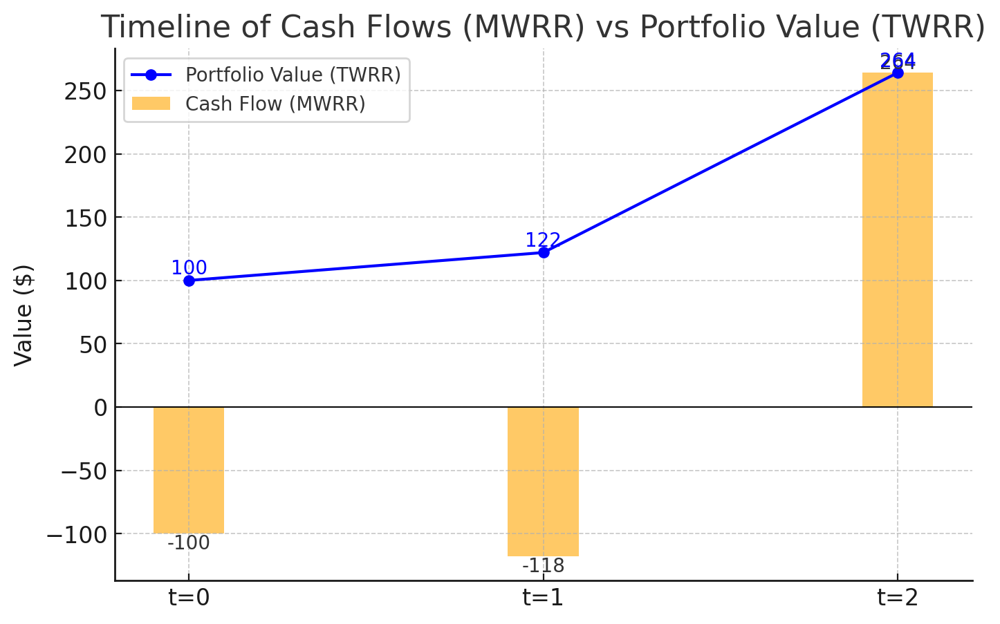

## QEC1.Rates&Returns

> Last Edit: 9/8/25
> 

## 1.1 Interest Rates & Return Measurement

### Interest Rates 利率

- Interest Rate measure the time value of money 衡量了货币的时间价值

### Equilibrium Interest Rates 必要的回报率

- 对于某项投资，Equilibrium Interest Rates 反映了投资人期望的市场回报率
- 也代表了投资人为了出借资金所要求的 Return

### Discount Rate 贴现率

- Discount Rate 可以被理解为**衡量未来资金的现在价值**的利率
- 因为有 Interest 的存在，未来的钱会增加，假设当前有 100 元，年利率为 5%，那么一年后 100 元会变成 105元
- 反过来说，如果希望一年后拿到 105 元，今天的价值则是 100 元，而这一比值就是 Discount Rate，把未来的钱转换成今天的价值的比率，有以下公式

$$
⁍
$$

- PV（Present Value）= 现值，即今天的钱
- FV（Future Value）= 未来值，即未来的钱
- r（Discount Rate）= 贴现率
- t = 未来的时间（通常按年计算）

> 和 Interest Rate 的关系就是一个是顺着时间推移，一个是逆时间的反过程
> 

### Opportunity Cost 机会成本

- 例如一个一年期利率为 5%，投资者选择了消费而非储蓄，则 5% 就是放弃储蓄的 Opportunity Cost

### Real Risk-Free Rate 无风险实际利率

- **定义**：是单期贷款的 Theoretical Interest Rate，不考虑 Inflation 通货膨胀 或 Default risk 违约风险
- **经济学意义**：衡量当前消费相对于未来消费的 Time Preference 时间偏好，也就是说同样的钱，不同时间下的价值就不同，Real Risk-Free Rate 就很好的衡量了不同时间下的价值

#### Time Preference 时间偏好

- 指的是人们对于“现在消费”和“未来消费”的偏好程度
- High Time Preference 更倾向现在消费放弃未来的收益

### Real Rete of Return 实际收益率

- **定义**：经过 Adjusting for inflation 通货膨胀调整后的投资者实际购买力收益

### Nominal Risk-Free Rate 名义无风险利率

- 指的是没有 Default Risk 违约风险的金融工具，但其回报仍受 Inflation 通货膨胀影响
- 例如，美国国库券（T-bills）的利率属于 Nominal Risk-Free Rate，但包含 Inflation Premium 通胀溢价
- 也就是说 Nominal Risk-Free Rate 和 Real Risk-Free Rate 和 Expected Inflation Rate 有关

$$
(1 + \text{Nominal Risk-Free Rate}) = (1 + \text{Real Risk-Free Rate}) \times (1 + \text{Expected Inflation Rate})
$$

- 这一关系有时候可以被近似为

$$
\text{Nominal Risk-Free Rate} \approx \text{Real Risk-Free Rate} + \text{Expected Inflation Rate}
$$

#### Inflation Premium 通胀溢价

- 是投资者要求的额外回报，用于补偿未来 Inflation 可能带来的货币购买力下降，这个额外的回报，就是 Inflation Premium，有

$$
\text{Inflation Premium} = \text{Nominal Risk-Free Rate} - \text{Real Risk-Free Rate}⁍
$$

#### ex. Inflation Premium at 3 inflation Rate

- 存 100 元到银行，银行给 5% 的 Nominal Risk-Free Rate，但如果 Inflation Rate 是 3%，那么真正的购买力只增加了 **2%**（实际收益），这里的 Inflation Premium 就是 3 %

### Risks 风险

- 对于一个投资，总结来说存在各种风险，其中的每一个风险都与一个 Risk Premium 所绑定，并会被夹到 Nominal Risk-Free Rates 上，于是 Nominal Risk-Free Rate 就变成了

$$
\text{nominal risk-free rate} \approx \text{real risk-free rate} + \text{expected inflation rate}
$$

#### Default Risk 违约风险

- 当 Borrower 无法按时 make the promised payments 的风险

#### Liquidity Risk 流动性风险

- 当 Investment 无法 Sold Quick for cash 套现时所面临的风险

#### Maturity Risk 到期风险

- 债券的到期日越远，其价格对利率变动的敏感性越高，也就具有更高的 Maturity Risk

### Holding Period Return HPR 持有期收益率

- HPR 计算出了投资在给定时间内价值的 Percentage Increase

$$
\text{holding period return} = \frac{\text{end-of-period value}}{\text{beginning-of-period value}} - 1
$$

- 单个持有期的HPR计算方法如下：

$$
\text{HPR} = \frac{P_t + \text{Div}}{P_0} - 1\frac{P_t - P_0 + \text{Div}}{P_0}
$$

- \\(P_t\\) 表示持有期末的股票价格
- \\(P_0\\) 表示持有期初的股票价格
- \\(\text{Div}\\) 表示在持有期间支付的股息

> Dividend 股息，指的公司盈利后把赚到的一部分分给 Shareholders 的形式
> 
- 举例来说，如果一支股票在期初价格为20欧元，在持有期间支付了 1 欧元股息，期末价格为22欧元，那么HPR计算如下：

$$
\text{HPR} = \frac{22 + 1}{20} - 1 = 0.15
$$

- 这表明投资者在这个持有期间内的总回报率是15%

> 22 欧元是股票结束时候的市场价值
> 
- 当考虑多个持有期的回报时，我们使用复合回报的概念，公式如下：

$$
\text{HPR} = (1 + \text{HPR}_{\text{Year 1}})(1 + \text{HPR}_{\text{Year 2}})(1 + \text{HPR}_{\text{Year 3}}) - 1
$$

- 这里，每个年度的HPR分别加1后相乘，然后再减1，这样可以计算出整个三年期间的总复合回报率
- 例如，如果第一年的回报率是5%，第二年是3%，第三年是7%，那么三年的总HPR计算如下：

$$
\text{HPR} = (1 + 0.05)(1 + 0.03)(1 + 0.07) - 1 \approx 0.1571 \text{ 或 } 15.71\%
$$

#### Annualized Return 年化回报率

- 最后，如果回报需要跨多年计算，通常会使用年化回报率而不是简单的HPR
- 年化回报率考虑了投资期间的具体长度，并将回报率调整为年度等效值，使得不同期间长度的投资回报率可以公平比较

### Average Returns

- 一般来说存在两种计算 Average Returns 的方式，Arithmetic 和 Geometric Mean，也就是算术和几何平均收益率

#### Arithmetic Mean Return 算数平均收益

- 最简单的计算 Average 的方式

$$
\text{arithmetic mean return} = \frac{R_1 + R_2 + R_3 + \dots + R_n}{n}
$$

- 直接计算所有值的总和，然后除以总个数。
- 适用于独立数据的均值，例如考试成绩、股市单日涨跌平均值等。

#### Geometric Mean Return

- 当每个 Period 的 Rate of return 不同的时候，Geometric Mean Return 可以用来计算 Compound Rate，当每个 Period 回报率波动比较大的时候，GM 通常小于 AM

$$
\text{geometric mean return} = \sqrt[n]{(1 + R_1) \times (1 + R_2) \times (1 + R_3) \times \dots \times (1 + R_n)} - 1
$$

- 先将所有值相乘，再开 n 次方（对数平均）
- 适用于复利增长或波动性较大的数据，例如投资回报、人口增长率等

| **类型** | **适用情况** | **示例** |
| --- | --- | --- |
| **算术平均数（AM）** | 适用于**加法关系**的数据，求一组数值的直接平均 | - 计算学生考试平均分- 计算不同年份的气温平均值 |
| **几何平均数（GM）** | 适用于**乘法关系**的数据，求一组数的复合增长率 | - 计算股票的年均回报率- 计算 GDP 增长率 |

#### ex. Calculate Geometirc Mean

Acme 公司普通股在过去三年的回报率分别是 -9.34%、23.45%、8.92%，求该股票的Compound annual rate of return

$$
R_G = \sqrt[3]{(1 - 0.0934) \times (1 + 0.2345) \times (1 + 0.0892)} - 1
$$

- 因此，该股票的几何平均回报率约为 6.825%

#### ex. Calculater GM in shorter period

- 给出四个 Semiannual periods 的回报率分别为 2.0%、0.5%、-10.0%、1.5%

$$
\text{Geometric mean} = \sqrt[4]{(1 + 0.02)(1 + 0.005)(1 - 0.10)(1 + 0.015)} - 1 = 0.7435\% 
$$

- 几何平均回报约为 0.7435%，这是6个月持有期的回报。
- 由于四个半年期等于两年，为了获得 Annual return ，我们需要取 2 作为开方的根数：

$$
\text{Annual return} = \sqrt[2]{(1 + 0.02)(1 + 0.005)(1 - 0.10)(1 + 0.015)} - 1  = 1.49\ \%
$$

- 最终，年化回报为 1.49%

### Harmonic Mean 调和平均数

- Harmonic Mean  常常用在速率，比率这类场景中，例如计算股票购买的平均成本，有

$$
X_H = \frac{N}{\sum \frac{1}{X_i}}
$$

- 其中 N 为数据个数，\\(X_i\\) 为各个数值

#### ex. Harmonic Mean

- 一位投资者每月投资 1,000 购买股份。在过去三个月内，每股支付的价格分别为 8、\\(9、\\)10，求 Harmonic Mean

$$
X_H = \frac{3}{\frac{1}{8} + \frac{1}{9} + \frac{1}{10}}  = 8.926
$$

- 平均成本价约为 $8.926 每股。
- 验证方法：计算总购买股份数

$$
\frac{1,000}{8} + \frac{1,000}{9} + \frac{1,000}{10} = 336.11 \text{ shares}
\frac{3,000}{336.11} = 8.926 \text{ per share}
$$

- 对于上面的三个 Mean Values，他们之间有一个数学关系，即

$$
\text{Arithmetic mean} \times \text{Harmonic mean} = (\text{Geometric mean})^2
$$

- 同时，HM<GM<AM

## 1.2 Time-Weighted And Money-Weighted Returns

- 比较 Money-Weighted Rate of return 资金加权收益率，和 Time Weighted Rate of Return 时间加权收益率，来评估投资组合的表现

### Money-weighted Rate of Return 资金加权收益率

- MWRR 和 IPR 实际上使用的是相同的计算公式，两者仅在语境上不同，IPR 多用在项目，公司投资商，MWRR 则是个人投资中用的多，但两者都计算了资金投入时间的加权效果
- IPR 即内部收益率，是一种衡量投资收益的方式
- 其核心思路是：**找出一个年收益率，使得“所有现金流”的现值加起来刚好等于 0**

> 投资的钱是流出，收到的钱是流入。把这些现金流按照某个收益率来“折现”之后，加起来为 0，那这个收益率就是 IRR
> 

#### ex.

- 举例来说，在 t = 0 时，投资者买入 1 股，花了 100 这是流出，\\(C(0)=-100\\)
- t = 1 时，再次买入 1 股，花了 120，同时在年末收到了 2 的 Dividend（股息），\\(C(1)=-120+2=-118\\)
- t = 2 时，卖出 2 股，收到 130，同时受到每股 2 的 Share Dividend（股息），\\(C(3)=130*2+2*2=264\\)

| 年份（t） | 现金流（Cash Flow） |
| --- | --- |
| 0 | -100 |
| 1 | -120 |
| 2 | +134 |
- 到了这一步后，就可以开始求 IPR 了，回顾 IPR 含义，一个能**使得“所有现金流”的现值（向前贴现）加起来刚好等于 0 的年收益率**
- 也就是说要求一个 **r**，让下面这个等式成立：

$$
-100 + \frac{-118}{(1 + r)} + \frac{264}{(1 + r)^2} = 0
$$

- 把所有的现金流都 Discount（折现）回 t = 0 时刻，使总和为 0
- 这个 **r**，就是 **money-weighted rate of return（货币加权收益率）**，也就是投资的 IRR
- 最后可以解出 \\(r\approx13.86%\\)
- 这个 r 的含义就是，整体的投资等同于把两笔钱在两个时间，2 年前和 1 年前的时候分别放入一个年收益率为 13.86 的账户中

### Time-weighted Rate of Return

- 衡量的是 **投资组合本身的复利增长率**，不受资金流入流出时机的影
- 在实际应用中，这个指标常用于评价 Fund Manager（资金经理）的投资能力，因为 Fund Manager 无法控制投资者何时申购或赎回
1. **分段计算**（每次有资金流入或流出时，把整个期间拆开）
2. **算每一段的持有期收益率（HPR, Holding Period Return 持有期收益率）**
    
    $$
    HPR = \frac{期末价值 + 分红}{期初价值} - 1
    $$
    
3. **几何平均**：

$$
(1+TWRR)^n = \prod (1+HPR_i)
$$

#### Ex.

- 用和 MWRR 一样的例子
- **第一年 (t=0 → t=1)**
    - 初始：100 美元
    - 年末：120 美元市值
    - 股息：2 美元
    - \\(HPR₁ = (120 + 2) / 100 - 1 = 22%\\)
- **第二年 (t=1 → t=2)**
    - 初始：240 美元（两股，每股120）
    - 年末：260 美元市值
    - 股息：4 美元
    - \\(HPR₂ = (260 + 4) / 240 - 1 = 10%\\)
- **总收益率（Geometric Mean）**
    
    $$
    (1+TWRR)^2 = (1.22)(1.10)
    $$
    
    $$
    TWRR = \sqrt{1.342} - 1 = 15.84\%
    $$
    

---

### MWRR V.S. TWRR

- **Money-weighted return (MWRR)** = 13.86%
- **Time-weighted return (TWRR)** = 15.84%
- 差异原因：
- **MWRR** 给了 **更多权重** 给 **第二年**，因为在第二年时资金更多（两股）
- 第二年收益率只有 **10%**，低于第一年的 **22%**，所以 **MWRR < TWRR**
- **TWRR** 完全去掉了资金流入流出的影响，只反映投资本身的复利效果
- **MWRR（13.86%）**：体现的是投资者个人的真实收益体验，取决于资金投入的时机
- **TWRR（15.84%）**：体现的是投资本身的表现，不受投入时机影响，更适合评价基金经理

## 1.3 Common Measures of Return

- Return 收益率存在多种度量方式

### Annualized Return（年化收益率）

- **定义**：把一个 HPR, Holding Period Return 持有期收益率换算成一年期的等效收益率
- **公式**：
    
    $$
    \text{annualized return} = (1+HPR)^{365/days} - 1
    $$
    
- **例子 1（不足一年）**：
    
    存 100 美元，90 天后变 100.75 美元
    
    - \\(HPR = (100.75 − 100)/100 = 0.75%\\)
    - \\(年化 = (1 + 0.0075)^{(365/90)} − 1 ≈ 3.08%\\)
- **例子 2（超过一年）**：
    
    买一张 500 天国债，970 → 1000。
    
    - \\(HPR = (1000 − 970)/970 = 3.09%\\)
    - \\(年化 = (1 + 0.0309)^{(365/500)} − 1 ≈ 2.25%\\)

👉 **作用**：不同持有期的收益率可以统一比较

### Compounding Frequency（复利频率）

- 名义年利率 r（quoted annual interest rate）不变，但复利次数 m 越多，有效利率越高
- 现值公式：
    
    $$
    PV = FV \cdot (1 + r/m)^{-mN}
    $$
    

> PV：Present Value，FV：Future Value
> 

**例子**：未来一年收到 1000 美元，贴现率 6%

- 年复利 (m=1): \\(PV = 943.40\\)
- 半年复利 (m=2): \\(PV = 942.60\\)
- 季度复利 (m=4): \\(PV = 942.18\\)
- 月复利 (m=12): \\(PV = 941.91\\)
- 日复利 (m=365): \\(PV = 941.77\\)

👉 复利次数越多，现值越低（贴现率并不变）

### Continuously Compounded Return（连续复利收益率）

- **定义**：当复利频率趋近于无穷时，得到连续复利收益率。
- **公式**：
    
    $$
    R_{cc} = \ln(1+HPR) = \ln\left(\frac{\text{ending value}}{\text{beginning value}}\right)
    $$
    
- **例子**：100 → 120
    - \\(HPR = 20%\\)
    - \\(连续复利收益率 = ln(1.2) = 18.232%\\)

👉 好处：连续复利收益率是 **可加的**，多个区间的连续收益率可以直接相加，便于计算

---

### Comparing

| 指标 | 特点 | 公式 | 适用场景 |
| --- | --- | --- | --- |
| HPR（持有期收益率） | 不考虑时间长短 | \\((期末价值 + 分红) / 期初价值 - 1\\) | 单一投资期间 |
| Annualized Return（年化收益率） | 统一成一年期 | \\((1+HPR)^{(365/days)} - 1\\) | 跨不同持有期比较 |
| 有限复利 | 考虑 m 次复利 | \\((1+r/m)^(mN)\\) | 银行利率、债券 |
| 连续复利 (Rcc) | 极限情况，可加性 | \\(ln(1+HPR)\\) | 数学推导、衍生品定价 |

> 以上三个 Returns 主要看时间维度的收益率变化，接下来要研究的是可能造成收益率变化的因素
> 

### Gross return vs Net return

- **Gross return（毛收益率）**
    
    投资组合的总回报，在扣除交易佣金和费用之前
    
- **Net return（净收益率）**
    
    扣除了佣金、管理费等必要费用后的回报
    
    👉 更能反映投资者最终拿到的收益。
    

### Pretax nominal return vs After-tax nominal return

- **Pretax nominal return（税前名义收益率）**
    
    投资在交税之前的收益，比如股息、利息、资本利得
    
- **After-tax nominal return（税后名义收益率）**
    
    扣除了税收之后的收益，才是真正到手的部分
    

### Real return（实际收益率）

- **定义**：名义收益率剔除通货膨胀（inflation）后的收益率，代表 **购买力的实际增长**

公式：

$$
1+ \text{real return} = \frac{1+\text{nominal return}}{1+\text{inflation rate}}
$$

例子：

- \\(名义收益率 = 7%\\)
- \\(通胀率 = 2%\\)
- \\(实际收益率 = (1.07 / 1.02) − 1 = 4.9%\\)

👉 投资赚了 7%，但通胀吞掉了 2%，所以实际购买力只提高了约 5%

### Leveraged return（杠杆收益率）

- **定义**：当投资者使用借贷（leverage）来放大投资时，得到的收益率

公式：

$$
\text{leveraged return} = \frac{r \times (V_0 + V_B) - r_B \times V_B}{V_0}
$$

其中：

- \\(V_0\\)：自有资金
- \\(V_B\\)：借入资金
- \\(r\\)：投资收益率
- \\(r_B\\)：借款利率

👉 杠杆放大了风险和收益：涨的时候收益率更高，跌的时候亏损更惨

### Comparing

| 指标 | 关注点 | 是否考虑通胀 | 是否考虑税收 | 是否考虑杠杆 |
| --- | --- | --- | --- | --- |
| Gross return | 毛收益率，不含费用 | 否 | 否 | 否 |
| Net return | 扣费后的收益率 | 否 | 否 | 否 |
| Pretax nominal return | 税前名义收益率 | 否 | 否 | 否 |
| After-tax nominal return | 税后名义收益率 | 否 | 是 | 否 |
| Real return | 实际收益率（剔除通胀） | 是 | 可加上 | 否 |
| Leveraged return | 杠杆收益率 | 可包含 | 可包含 | 是 |

✅ **一句话总结**：

- **毛/净收益率** → 是否扣费用
- **税前/税后收益率** → 是否扣税
- **名义/实际收益率** → 是否剔除通胀
- **杠杆收益率** → 是否使用杠杆

---