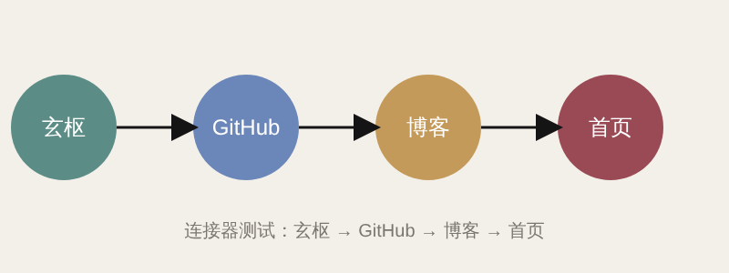

> Last Edit: 11/26/26

这篇笔记用来一次性测试玄枢和博客的所有显示效果：首页列表里的标题、日期、摘要、领域圆点、课程名和中英文标记，以及文章页里的公式、代码、表格、引用、提示框、列表、图片和各种链接。它最早是 Claude 通过玄枢的 MCP 连接器新建的，之后又在 Claude Code 里改写成了现在这个版本。测试完成以后，把开头的 publish 去掉，它就会从博客上消失，但玄枢里还会保留这篇笔记。为了让博客把它标成中文文章，这里需要写够两百个以上的汉字，所以这一段话特意写得长一些，顺便说明一下每个部分各自在测试什么东西。

## 公式

行内公式：$e^{i\pi} + 1 = 0$，带星号的共轭和卷积 $Z_L = Z_T^*$、$y(t) = h(t) * x(t)$。

独立公式：

$$
\mathcal{F}\{x(t)\} = X(\mathbf{j}\omega) = \int_{-\infty}^{\infty} x(t)\, e^{-\mathbf{j}\omega t}\, \text{d}t
$$

$$
\begin{bmatrix} 1 & 2 \\ 3 & 4 \end{bmatrix}^{-1} = \frac{1}{-2}\begin{bmatrix} 4 & -2 \\ -3 & 1 \end{bmatrix}
$$

## 代码

```python
def fib(n: int) -> int:
    """第 n 个斐波那契数"""
    a, b = 0, 1
    for _ in range(n):
        a, b = b, a + b
    return a
```

```cpp
#include <iostream>
int main() { std::cout << "玄枢" << std::endl; }
```

行内代码：`npm run build`。

## 表格

| 项目 | 状态 | 说明 |
|---|---|---|
| 首页列表 | ✓ | 标题、日期、摘要、领域、课程、CN |
| 文章页 | ✓ | 面包屑、Edited、标签、目录 |
| 链接 | ✓ | [SS5 笔记]() |

## 引用与提示框

> 这是一段引用：一个系统如果满足叠加原理，那么它就是线性的。

<aside>
💡

这是从 Notion 导出的提示框（callout），在玄枢里显示成灰底带图标的样式。

</aside>

## 列表

1. 有序列表第一项
2. 第二项
   - 嵌套的无序列表
   - 再一项
3. 第三项

- [x] 新建笔记（write_note）
- [x] 修改笔记（edit_note）
- [ ] 测试完撤下

## 图片



## 链接

- 指向已发布的笔记：[SS 5. Continuous-Time System]()
- 指向未发布的笔记（博客上会变成普通文字）：Futures Contract 期货合约
- 外部链接：[buezw.github.io](https://buezw.github.io)
