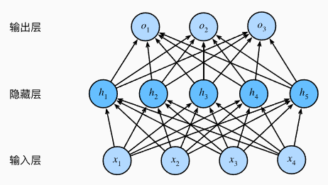
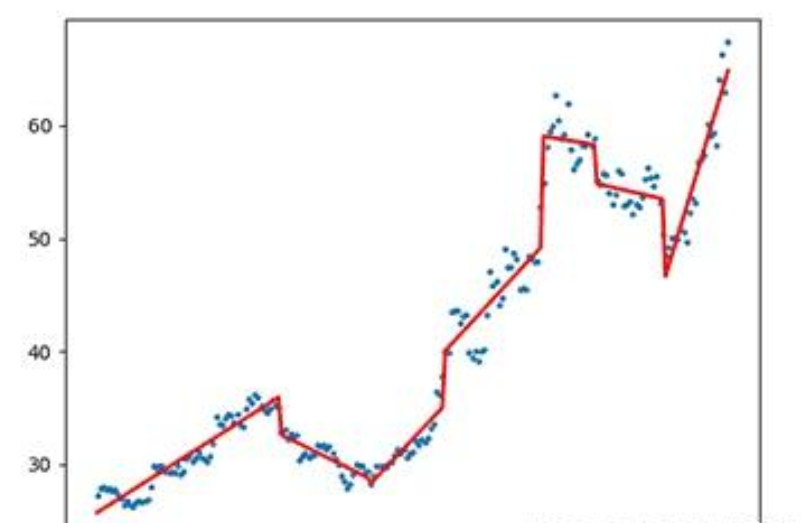

> Last Edit: 12/20/24

“如果微妙的边界条件很重要，我们很可能是在研究数学而非工程”
## Perceptron 感知机

- 一种单层神经网络模型，用于Binary Classification
$$o = \sigma\left(\langle w, x \rangle + b\right)~~~~
\sigma(x) = 
\begin{cases}
1 & \text{if } x > 0 \\
-1 & \text{otherwise}
\end{cases}$$
### Binary Classification 二分类问题

- 两个可能的值的问题，例如「正类」（1）和「负类」（0）

### Training 训练

```
initialize w = 0 and b = 0
repeat
    for each (xi, yi) in the training data:
        if yi * (⟨w, xi⟩ + b) ≤ 0 then
            w ← w + yi * xi
            b ← b + yi
        end if
    end for
until all points are classified correctly
```

- `initialize w = 0 and b = 0`：初始化weight和bias
- `if yi * (⟨w, xi⟩ + b) ≤ 0`：如果分类与预测不符
- 在Perceptron中并没有明确的Optimize Method，但可以隐式定义一个仅与分类错误的点有关的数据的损失，也就是上面小于零情况下的
$$L(w, b) = -\sum_{x_i \in M} y_i (w \cdot x_i + b)$$
- 由于\\(y_i (w \cdot x_i + b)\\)本身是负的，取负之后，这部分损失就变成了正
- 这意味着误分类样本对损失的贡献是增加的，因为我们希望最小化正的损失值
- 而对于weight和bias分别的Gradient为
$$\nabla_w L(w, b) = -\sum_{x_i \in M} y_i x_i$$
$$\nabla_b L(w, b) = -\sum_{x_i \in M} y_i$$
- 对应了伪代码中的`w ← w + yi * xi` 与 `b ← b + yi`
- 完整代码如下

``` python
import numpy as np

w = np.zeros(2) 
b = 0.0
n_epoch = 11

X = np.array([
    [0.5, 1.5],
    [1.0, 1.0],
    [1.5, 0.5],
    [2.0, 1.0],
    [2.5, 1.5],
    [3.0, 3.0],
    [3.5, 3.5],
    [4.0, 4.5],
    [4.5, 5.0],
    [5.0, 5.5]])

y = np.array([-1, -1, -1, -1, -1, 1, 1, 1, 1, 1])
for epoch in range(n_epochs):
    for i in range(len(X)):
        if y[i] * (np.dot(w, X[i]) + b) <= 0:
            w += y[i] * X[i]
            b += y[i]
        else:
            continue   

def predict(X, w, b):
    return np.sign(np.dot(X, w) + b)

predictions = predict(X, w, b)

print("Predictions:", predictions)
print("Actual labels:", y)

> Predictions: [-1. -1. -1. -1. -1.  1.  1.  1.  1.  1.]
> Actual labels: [-1 -1 -1 -1 -1  1  1  1  1  1]
```

## XOR Problem

XOR（异或）逻辑门是一个二输入逻辑门，其输出只在两个输入不同时为1（即当输入是(0,1)或(1,0)时）。其逻辑如下：

- 0 XOR 0 = 0
- 0 XOR 1 = 1
- 1 XOR 0 = 1
- 1 XOR 1 = 0

- 线性模型，如感知机，是基于线性方程的，它试图找到一个权重向量和偏差，以便通过一个超平面来分割数据点。
- 对于 XOR 问题，无论如何调整线性模型的参数，都无法得到一个能够将这四个点分开的单一直线
- 为了解决XOR问题，我们可以使用非线性模型。最常见的方法是使用神经网络，尤其是多层感知机（MLP）。通过添加一个或多个隐藏层，神经网络能够学习非线性函数

## 单调假设与线性模型的局限性

- **单调假设**：在一个线性模型中，特征与输出之间的关系是单调的
- **线性模型的局限**：虽然线性模型简单且易于理解，但很多现实世界的关系是非线性的

## Hidden Layer 隐藏层

- 我们可以通过在网络中加入一个或多个隐藏层来克服线性模型的限制



- 对于线性网络来说，每一层都是线性的Affine transformation 仿射变换
$$H = XW^{(1)} + b^{(1)},
O = HW^{(2)} + b^{(2)}$$
- 这样即使构造了多层的模型，其实际上还是只等于一个Affine Transformation
$$O = (XW^{(1)} + b^{(1)})W^{(2)} + b^{(2)} = XW^{(1)}W^{(2)} + b^{(1)}W^{(2)} + b^{(2)} = XW + b$$
- 而为了发挥多层框架的潜力，就需要在Affine Transformation后应用一个Non-Linear的Activation Function激活Output
- 一般来说在Activation之后便不能将其退化为Linear Model
$$H = \sigma(XW^{(1)} + b^{(1)}),
O = HW^{(2)} + b^{(2)}$$
- 为了构建更通用的多层感知机， 我们可以继续堆叠这样的隐藏层， 一层叠一层，从而产生更有表达能力的模型

## Activation Function 激活函数

- Activation function 通过计算加权和并加上偏置来确定神经元是否应该被激活， 它们将输入信号转换为输出的可微运算。 大多数激活函数都是非线性的
- 通过加入了更“DEEP”的层数，MLP理论可以拟合任意连续函数

### Weierstrass Approximation Theorem

- 在知道了Weierstrass Approximation Theorem后，也就是证明该
$$B_n(x) = \sum_{i=0}^n f\left(\frac{i}{n}\right) \binom{n}{i} x^i (1-x)^{n-i}$$
- Bernstein Polynomial，\\(B_n(f, x)\\)在区间\\([0, 1]\\)上以任意精度逼近\\(f(x)\\)
- 通过说明MLP如何通过从Activation Function构造Polynomial，最终证明MLP如何实现函数的理论任意精度逼近

### Activation Function that has Tyler Series

- **Weierstrass Approximation Theorem**指出，任意定义在闭区间 \\([a, b]\\)上的连续函数\\(f\\)都可以被多项式函数以任意精度逼近。即，对于任意\\(\varepsilon > 0\\)，存在一个多项式\\(P(x)\\)，使得
$$|f(x) - P(x)| < \varepsilon \quad \forall x \in [a, b]$$
- 为了证明单隐层神经网络能够逼近任意多项式，我们考虑如下多项式：
$$P(x) = \sum_{k=0}^n a_k x^k$$
- 其中\\(a_k\\)是多项式系数，n是多项式的次数。
- 目标是要构造一个单隐层神经网络\\(F(x) = \sum_{j=1}^m \alpha_j \sigma(w_j x + b_j)\\)，使得\\(F(x)\\)能够逼近\\(P(x)\\)以任意精度
- 选择合适的非线性激活函数是关键。假设\\(\sigma\\)在某个区间内具有泰勒展开：
$$\sigma(z) = \sum_{k=0}^\infty c_k z^k$$
- 其中\\(c_k\\)是泰勒级数的系数。典型的激活函数如 sigmoid、tanh 等都满足在某个区间内可展开为幂级数
$$\sigma(x) = \frac{1}{2} + \frac{x}{4} - \frac{x^3}{48} + \frac{x^5}{480} + \cdots$$
$$\tanh(x) = x - \frac{x^3}{3} + \frac{2x^5}{15} - \frac{17x^7}{315} + \cdots$$
- 由于\\(P(x)\\)是多项式，我们需要构造网络的输出\\(F(x)\\)来逼近\\(P(x)\\)具体步骤如下：
-  对于每个高阶项\\(x^k\\)，利用激活函数的非线性性质，通过组合多个隐藏单元来逼近。具体来说，可以通过调整\\(w_j\\)和\\(b_j\\)，使得多个\\(\sigma(w_j x + b_j)\\)的组合能够近似\\(x^k\\)
- 一个二次多项式的例子便是
<div>
$$F(x) = \underbrace{\sigma(b_1) \cdot \alpha_1}_{\text{常数项}} + \underbrace{\sigma(w_2x + b_2) \cdot \alpha_2}_{\text{线性项}} + \underbrace{\sigma(w_{3,1}x + b_{3,1}) \cdot \alpha_{3,1} + \sigma(w_{3,2}x + b_{3,2}) \cdot \alpha_{3,2}}_{\text{二次项}}$$
</div>

- 由于多项式是各阶项的线性组合，单隐层网络通过线性组合隐藏层的输出即可实现对多项式的逼近
$$F(x) = \sum_{j=1}^m \alpha_j \sigma(w_j x + b_j) \approx \sum_{k=0}^n a_k x^k = P(x)$$
- 上述证明假设激活函数\\(\sigma\\)能够通过适当组合逼近多项式项。某些激活函数（如ReLU）虽然非多项式，但由于其分段线性性质，也具备强大的逼近能力。

### Activation Function that doesn't have Tyler Series

- 首先要说明的就是上面所提到的那句话，"如果微妙的边界条件很重要，我们很可能是在研究数学而非工程."
- ReLU函数定义为：
$$\sigma(z) = \max(0, z)$$
$$\sigma(z) = \begin{cases} 0, & z \leq 0 \\ z, & z > 0 \end{cases}$$
- 分段线性函数能够在不同的区间内表现出不同的线性特征
- 这种特性允许神经网络通过组合多个ReLU单元，在输入空间中划分出多个线性区域，每个区域内的网络输出都是一个线性函数
- 通过增加隐藏单元数，可以在输入空间中创建更多的线性区间，从而逼近复杂的非线性函数
$$F(x) = \sum_{j=1}^m \alpha_j \sigma(w_j x + b_j) = \sum_{j=1}^m \alpha_j \max(0, w_j x + b_j)$$
- 每个隐藏单元\\(\sigma(w_j x + b_j)\\)在\\(w_j x + b_j = 0\\)处产生一个“折点”，即输入\\(x = -\frac{b_j}{w_j}\\)处
- 通过调整不同单元的权重\\(w_j\\)和偏置\\(b_j\\)，可以在输入空间中创建多个折点，将输入空间划分为多个线性区间。



> [5分钟理解激活函数让神经网络能拟合任何函数 - 知乎](https://zhuanlan.zhihu.com/p/374461411)


