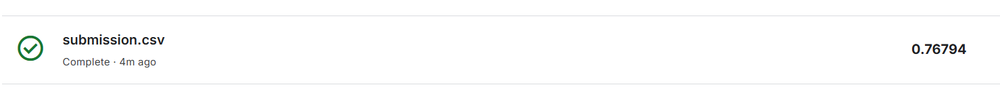

> Last Edit: 12/20/24

使用纯MLP参加https://www.kaggle.com/competitions/titanic的Competition

``` python
# This Python 3 environment comes with many helpful analytics libraries installed
# It is defined by the kaggle/python Docker image: https://github.com/kaggle/docker-python
# For example, here's several helpful packages to load

import numpy as np # linear algebra
import pandas as pd # data processing, CSV file I/O (e.g. pd.read_csv)

# Input data files are available in the read-only "../input/" directory
# For example, running this (by clicking run or pressing Shift+Enter) will list all files under the input directory

import os
for dirname, _, filenames in os.walk('/kaggle/input/d/heptapod/titanic/train_and_test2.csv'):
    for filename in filenames:
        print(os.path.join(dirname, filename))

# You can write up to 20GB to the current directory (/kaggle/working/) that gets preserved as output when you create a version using "Save & Run All" 
# You can also write temporary files to /kaggle/temp/, but they won't be saved outside of the current session
train_path = '/kaggle/input/titanic/train.csv'
test_path = '/kaggle/input/titanic/test.csv'
train_data = pd.read_csv(train_path)
test_data = pd.read_csv(test_path)
data = pd.concat([train_data, test_data], sort=False).reset_index(drop=True)
display(data)
# 填补Age的缺失值
data['Age'].fillna(data['Age'].median(), inplace=True)
# 填补Fare的缺失值
data['Fare'].fillna(data['Fare'].median(), inplace=True)
display(data['Fare'])
data = data[['Survived','Pclass','Sex','Age','SibSp','Parch','Fare']]
data['Sex'] = data['Sex'].map({'male': 0, 'female': 1})
print(data)
train_data = data.iloc[:891].copy()
test_data = data.iloc[891:].copy()
X_train = train_data.drop('Survived', axis=1)
y_train = train_data['Survived'].astype(int)
X_test = test_data.drop('Survived', axis=1).copy()
print(X_test)

from sklearn.neural_network import MLPClassifier
from sklearn.model_selection import train_test_split
from sklearn.metrics import accuracy_score, classification_report
# 将训练集分为训练子集和验证子集
X_tr, X_val, y_tr, y_val = train_test_split(X_train, y_train, test_size=0.2, random_state=42)
# 初始化MLPClassifier
mlp = MLPClassifier(hidden_layer_sizes=(100,),  # 一个隐藏层，100个神经元
                    activation='relu',        # 激活函数为ReLU
                    solver='adam',            # 优化器为Adam
                    max_iter=1000,            # 最大迭代次数
                    random_state=42)

# 训练模型
mlp.fit(X_tr, y_tr)
# 在验证集上进行预测
y_pred = mlp.predict(X_val)

# 计算准确率
accuracy = accuracy_score(y_val, y_pred)
print(f"\n验证集准确率：{accuracy:.4f}")

# 查看分类报告
print("\n分类报告：")
print(classification_report(y_val, y_pred))
y_test = mlp.predict(X_test)
result = mlp.predict(X_test)
X_test['Survived'] = result
passenger_ids = np.arange(891, 1309) 
X_test['Passengerid'] = passenger_ids
X_test = X_test['Survived']
print(X_test)
X_test.to_csv('submission.csv', index=False)
print("提交文件 'submission.csv' 已生成。")
```


