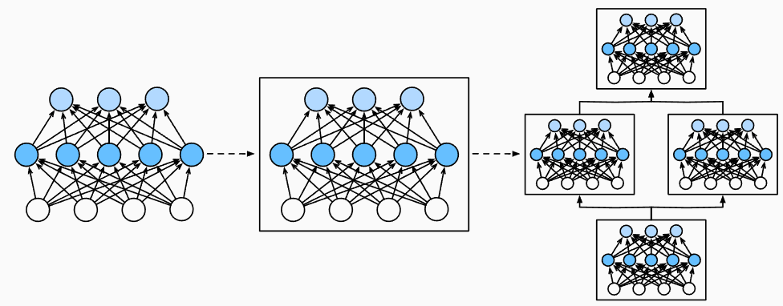

> Last Edit: 12/21/24

# Layer 层

- 对于一个Layer来说，其接受一组输入（通常是矢量化的），通过调整参数后生成相应的输出
- 对于一个Softmax回归，其模型本身就是一个Layer

# Block 块

- 在神经网络中，Block是一种通用的抽象概念，用来描述网络中的组件，可以是一个简单的单层，也可以是由多层组成的模块，甚至是整个模型本身
- 块的主要目的是对神经网络的结构进行分层抽象，方便构建和复用复杂的网络



# MLP

- 一个MLP就可以组建成一个简单的Block，通过如下方式

``` python
import torch
from torch import nn
from torch.nn import functional as F

net = nn.Sequential(nn.Linear(20, 256), nn.ReLU(), nn.Linear(256, 10))

X = torch.rand(2, 20)
net(X)
```

# 5.1.1 Custom block 自定义块

- 其具体的实现方式是通过一个Python中的Class定义的

``` python
class MLP(nn.Module):
    # 用模型参数声明层。这里，我们声明两个全连接的层
    def __init__(self):
        super().__init__()
        # 调用nn.Module的构造函数减少重新定义的代码
        self.hidden = nn.Linear(20, 256)  # 隐藏层
        self.out = nn.Linear(256, 10)  # 输出层

    # 定义前向传播流程
    def forward(self, X):
        #hidden -> relu -> out
        return self.out(F.relu(self.hidden(X)))
```

# 5.1.2 Sequence Block 顺序块

- 简单定义一个Sequential类，实现
- 1. 按顺序执行Block
- 2. 一个前向传播函数

```python
class MySequential(nn.Module):
    def __init__(self, *args):
        super().__init__() 
        for idx, module in enumerate(args):
            self._modules[str(idx)] = module

    def forward(self, X):
        for block in self._modules.values():
            X = block(X)
        return X
```

- `for idx, module in enumerate(args)` : 遍历所有传入的模块，并为每个模块分配一个从 `0` 开始的索引
- 比如传入了三个模块

```python
MySequential(
    nn.Linear(10, 20),
    nn.ReLU(),
    nn.Linear(20, 10))
```

- 那么 `enumerate(args)` 会依次返回 `(0, nn.Linear(10, 20))`, `(1, nn.ReLU())`, `(2, nn.Linear(20, 10))`

```python
self._modules[str(idx)] = module
```

- `self._modules` 是 PyTorch 提供的一个内置容器（`OrderedDict`），用来存储子模块。
- `self._modules[str(idx)] = module` 的作用是：
- `X` 先传入 `_modules["0"]`（即 `nn.Linear(10, 20)`）中进行计算。
- 输出传入 `_modules["1"]`（即 `nn.ReLU()`）中激活。
- 最后传入 `_modules["2"]`（即 `nn.Linear(20, 5)`），得到最终结果。
- `str(idx)`： Dict的Key要求使用可哈希值，所以需要转换为str

# 5.1.3 Control Flow in forward propagation

- 在网络中，可以加入一些不被更新的参数，即Constant Parameter，这一个参数不会在优化过程中被更新

```python
class FixedHiddenMLP(nn.Module):
    def __init__(self):
        super().__init__()
        self.rand_weight = torch.rand((20, 20), requires_grad=False)
        self.linear = nn.Linear(20, 20)

    def forward(self, X):
        X = self.linear(X)
        X = F.relu(torch.mm(X, self.rand_weight) + 1)
        X = self.linear(X)
        while X.abs().sum() > 1:
            X /= 2
        return X.sum()
```

```python
self.rand_weight = torch.rand((20, 20), requires_grad=False)
```

- `requires_grad=False` 指定该张量不会参与梯度计算，因此它是一个固定的权重，在训练过程中不会被优化。
- 它可以被视为一个网络中的“常量”

