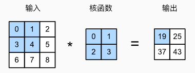

> Last Edit: 1/29/25

由于卷积神经网络的设计就是为了处理图像，所以这里直接以图像为例

# 6.2.1 Cross-Correlation Calculation

- 严格来说卷积层表达的运算实际上是 Cross-correlation 互相关运算，而不是卷积运算
- 暂时忽略图像的第三个维度信息，构造输入，卷积核和输出



- 在二维互相关运算中，卷积窗口从输入张量的左上角开始，从左到右、从上到下滑动
- 当输入中的卷积窗口移动到一个新位置的时候，窗口内的元素将和卷积核中按位置相乘并计算和得到一个标量值，如下
- $0 \times 0 + 1 \times 1 + 3 \times 2 + 4 \times 3 = 19$
- $1 \times 0 + 2 \times 1 + 4 \times 2 + 5 \times 3 = 25$
- $3 \times 0 + 4 \times 1 + 6 \times 2 + 7 \times 3 = 37$
- $4 \times 0 + 5 \times 1 + 7 \times 2 + 8 \times 3 = 43$
- 由于卷积核的长宽是大于一的，导致了输出的大小等于输入大小减去核大小加一
$$(n_h - k_h + 1) \times (n_w - k_w + 1)$$
> 想让输入输出大小一致，可以在四周填充0保证输入的大小

``` python
import torch
from torch import nn
from d2l import torch as d2l

def corr2d(X, K):  #@save
    """计算二维互相关运算"""
    h, w = K.shape
    Y = torch.zeros((X.shape[0] - h + 1, X.shape[1] - w + 1))
    for i in range(Y.shape[0]):
        for j in range(Y.shape[1]):
            Y[i, j] = (X[i:i + h, j:j + w] * K).sum()
    return Y
    
X = torch.tensor([[0.0, 1.0, 2.0], [3.0, 4.0, 5.0], [6.0, 7.0, 8.0]])
K = torch.tensor([[0.0, 1.0], [2.0, 3.0]])
corr2d(X, K)
```

- 现在有 Kernel $k=h\times w$，则每一个Input x上的点 $i,j$ 的输出都将是其 `i:i+h, j:j+w` 范围内的输入与k进行元素乘法后的和

``` python
X = torch.tensor([[0.0, 1.0, 2.0], [3.0, 4.0, 5.0], [6.0, 7.0, 8.0]])
K = torch.tensor([[0.0, 1.0], [2.0, 3.0]])
corr2d(X, K)
-> tensor([[19., 25.],
        [37., 43.]])
```

# 6.2.2 Convolution Layer 卷积层

``` python
class Conv2D(nn.Module):
    def __init__(self, kernel_size):
        super().__init__()
        self.weight = nn.Parameter(torch.rand(kernel_size))
        self.bias = nn.Parameter(torch.zeros(1))

    def forward(self, x):
        return corr2d(x, self.weight) + self.bias
```

- `nn.Parameter` 是 PyTorch 中的一个类，它被用来将一个张量转换为一个模块的参数
- 当使用 `nn.Parameter` 包装一个张量时，这意味着你希望这个张量能够在模型的训练过程中被优化器优化（即进行梯度更新）

# 6.2.3 Edge detection

- 卷积层，或者说互相关层的主要作用就是提取相邻像素的特殊信息，如颜色边缘
- 现在构造一个黑白色 6x8 图像

``` python
X = torch.ones((6, 8))
X[:, 2:6] = 0
X
-> tensor([[1., 1., 0., 0., 0., 0., 1., 1.],
        [1., 1., 0., 0., 0., 0., 1., 1.],
        [1., 1., 0., 0., 0., 0., 1., 1.],
        [1., 1., 0., 0., 0., 0., 1., 1.],
        [1., 1., 0., 0., 0., 0., 1., 1.],
        [1., 1., 0., 0., 0., 0., 1., 1.]])
```

- 现在用一个 Kernel 为 `K = torch.tensor([[1.0, -1.0]])`
- 可以发现这个核的作用是：如果水平相邻的两元素相同，则输出为零，否则输出为非零，具体来说，从1，也就是白色到0黑色的时候，有 $Y[i,j]=1+0*(-0.1)=1$，相反则是 -1，于是整体输出就为

```
tensor([[ 0.,  1.,  0.,  0.,  0., -1.,  0.],
        [ 0.,  1.,  0.,  0.,  0., -1.,  0.],
        [ 0.,  1.,  0.,  0.,  0., -1.,  0.],
        [ 0.,  1.,  0.,  0.,  0., -1.,  0.],
        [ 0.,  1.,  0.,  0.,  0., -1.,  0.],
        [ 0.,  1.,  0.,  0.,  0., -1.,  0.]])
```

- 现在如果将上面的图片做Transpose，可以发现检测到的垂直边缘消失了，也就是说其只能检测一个自由度上的特征

## 6.2.4. 学习卷积核

- 到了更加复杂的 Convolution Layer 的时候不可能手动设计滤波器，需要主动学习这一个Kernel Core，在忽略 Bias 的前提下有

``` python
# 构造一个二维卷积层，它具有1个输出通道和形状为（1，2）的卷积核
conv2d = nn.Conv2d(1,1, kernel_size=(1, 2), bias=False)

# 这个二维卷积层使用四维输入和输出格式（批量大小、通道、高度、宽度），
# 其中批量大小和通道数都为1
X = X.reshape((1, 1, 6, 8))
Y = Y.reshape((1, 1, 6, 7))
lr = 3e-2  # 学习率

for i in range(10):
    Y_hat = conv2d(X)
    l = (Y_hat - Y) ** 2
    conv2d.zero_grad()
    l.sum().backward()
    # 迭代卷积核
    conv2d.weight.data[:] -= lr * conv2d.weight.grad
    if (i + 1) % 2 == 0:
        print(f'epoch {i+1}, loss {l.sum():.3f}')
->  epoch 2, loss 6.422
	epoch 4, loss 1.225
	epoch 6, loss 0.266
	epoch 8, loss 0.070
	epoch 10, loss 0.022
```

- 此时输出得到的 Tensor 有 `tensor([[ 1.0010, -0.9739]])`

# 6.2.5. Cross-Correlation and Convolution

- 卷积和互相关运算在前面提到过，他们的差别就在 Kernel 是否翻转，但由于DL的历史遗留问题，我们统称 Convolution

## Feature Map and Receptive Field 特征层和感受野

- 对于一个 Convolution Layer 的output，其可以被称为 Feature Map，每过一层卷积层都会得到一个新的特征图，他们可以代表图像的特点信息如边缘，颜色，形状等
- 而 Receptive Field 感受野是指输入中影响单个输出的区域大小的区域，其在单层卷积层时就是 Kernel 大小，而到二零多层堆叠时，感受野就会累加


