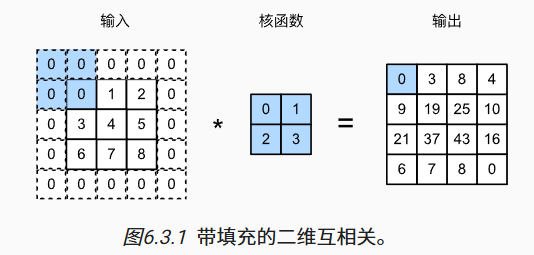
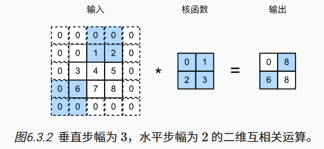

> Last Edit: 3/25/25

前面提到，输入图像大小为 3x3，kernel 为 2×2，输出的维数是 2×2，则可以判断出输出维度为

$$
(n_h - k_h + 1) × (n_w - k_w + 1)
$$

除了 Kernel 大小之外，还存在其他影响输出大小的因素，为 Padding 填充 & Stride 步幅

# 6.3.1 Padding 填充

- 已知当存在多个 Convolution Layers 的时候，随着深度越来越深，最终图像的尺寸会不断缩小，容易丢失边缘信息
- 而为了保留边缘，常用 Padding 的方法，通常就是在最外围填充一层 0



- 新的输出形状则为

$$
(n_h - k_h + p_h + 1) × (n_w - k_w + p_w + 1)
$$

- 通常情况下会把 Kernel 设计为 Odd 的 Dimension，这样做的好处就是可以在上下，左右添加相同数量的行和列

```python
import torch
from torch import nn

# 定义辅助函数，用于执行卷积并输出去掉批量和通道维度
def comp_conv2d(conv2d, X):
    # 这里的（1，1）表示批量大小和通道数都是1
    X = X.reshape((1, 1) + X.shape)
    Y = conv2d(X)
    # 省略前两个维度：批量大小和通道
    return Y.reshape(Y.shape[2:])

# 请注意，这里每边都填充了1行或1列，因此总共添加了2行或2列
conv2d = nn.Conv2d(1, 1, kernel_size=3, padding=1)
X = torch.rand(size=(8, 8))
comp_conv2d(conv2d, X).shape
```

# 6.3.2 Stride 步幅

- 在默认的互相关运算中，默认 Kernel 是一个个元素滑动的，但是有的时候是可以跳过的
- 将每一次滑动的元素的数量称为 Stride 步幅



- 上图为一个垂直步幅 3，水平步幅 2 的互相关运算
- 一个垂直步幅为 h，水平步幅为 w 的互相关运算的输出形状为

$$
\left\lfloor \frac{(n_h - k_h + p_h + s_h)}{s_h} \right\rfloor \times \left\lfloor \frac{(n_w - k_w + p_w + s_w)}{s_w} \right\rfloor
$$