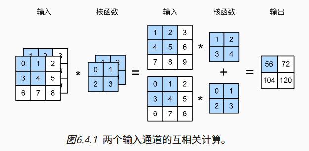
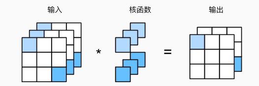

> Last Edit: 3/25/25
> 

一张常规的图像通常包含了 RGB 三种颜色，也是就是为互相关运算添加了一个维度

# 6.4.1 Multiple Input Channel

- 当输入包含多个通道时，需要构造一个与输入数据具有相同输入通道数的卷积核，这个很好理解，就是对每一个通道分别做不同的互相关运算
- 在每一个通道的互相关运算结果出来了之后，则采取相加的方式得到所有通道互相关运算的结果的和作为最终的输出



- 图中展示了 2 个通道的运算结果
- 其中拿出蓝色部分举例，两个通道运算分别为

$$
0*0+1*1+3*2+3*4=19
$$

$$
1*1+2*2+3*4+4*5=36
$$

- 然后将两个通道结果相加得到 56 作为输出

```python
def corr2d_multi_in(X, K):
    # 初始化输出为第一个通道的互相关结果
    res = d2l.corr2d(X[0], K[0])
    # 从第二个通道开始逐个累加
    for i in range(1, len(X)):
        res += d2l.corr2d(X[i], K[i])
    return res
```

# 6.4.2 Multiple Output Channel

- 到现在为止，无论计算涵盖多少个输入通道，他们最终都会被加到一块得到一个输出
- 然而在真实的网络中即使上存在多个 Output Channel，这可以帮助模型的提取出更多不同的 Feature 比如边缘、颜色变化、形状等等
- 这样做就会得到一个形状为 $co × ci × kh × kw$ 的 Kernel，举例来说
- 输入张量是：`2 个通道`（ci = 2）卷积核大小是：`3×3`（kh = kw = 3）我想要输出 `4 个通道`（co = 4）那么我们需要： 4 个输出通道 × 每个通道有 2 个核 × 每个核大小是 3×3→ 卷积核张量的总形状是：`[4, 2, 3, 3]`

# 6.4.3 1x1 Convolution Layer

- 一个 1x1 的 Convolution Layer 看上去啥也没干，这是因为这个 Layer 的功能不是提取特征，而是同于通道的变换和组合



- 一个 $3\times3\times3$ 的输入，$1\times2\times3$ 的 Kernel 也就做到了 Linear Algebra 中的 Projection
- 所有它本质上就是一个矩阵的乘法，Linear Transformation，还是 Not Full Full Rank 的

