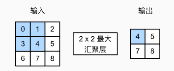

> Last Edit: 3/31/25
> 

在处理图像的时候，希望逐渐扩大 Layer 的 Receptive Field，这是因为学习任务通常会和全局的图像相关，如“图像是否包含某个物体？”，所以需要逐渐汇集信息到最后一层时包含整个图像

而在逐步汇聚的时候，Representation 特征图会变得更加粗略，但是这些图在粗略的同时已经保存饿了 Convolutional Layer 中的关键特征优势了，所以即使没有关注局部细节，但是有用的特征已经被保存下来了

# Pooling Layer

- 所以说这一层需要同时做到两个目的，让模型具有更加稳健的 Translation Invariance（平移不变性）的同时降低空间降采样的敏感性（压缩后保留重要信息）

# 6.5.1 Maximum & Average Pooling Layer

- Pooling Layer 和 Convolution Layer 一样，也有一个 Windows 在 Input Feature Map 上滑动，并且每次都覆盖一个小区域，然后给出对应输出
- 不同于 Convolution 中的 Cross-correlation 运算，Pooling Layer 本身并不包含参数
- 计算 Windows 中的最大值的运算的 Layer 叫做 Maximum Pooling Layer，同理计算平均数的就叫做 Average Pooling Layer

 



- Pooling Layer 的本质是在一个小范围（比如 2×2）的区域里，选出最大值（或平均值）来代表这块区域的整体特征。
- 所以只要那个特征还在这个小区域里没走出窗口，它就还能被选中，就还会出现在输出里
- 想要实现一个 Pooling Layer 也不难，只要拿出一个 Window 滑动就行了

```python
import torch
from torch import nn
from d2l import torch as d2l

# 定义二维汇聚函数
def pool2d(X, pool_size, mode='max'):
    # 拆解汇聚窗口的高和宽
    p_h, p_w = pool_size

    # 初始化输出张量 Y，大小为输入尺寸减去窗口尺寸加 1（假设步幅为 1）
    Y = torch.zeros((X.shape[0] - p_h + 1, X.shape[1] - p_w + 1))

    # 遍历输出张量的每个位置
    for i in range(Y.shape[0]):
        for j in range(Y.shape[1]):
            # 如果是最大汇聚模式
            if mode == 'max':
                # 取出当前汇聚窗口内的最大值
                Y[i, j] = X[i: i + p_h, j: j + p_w].max()
            # 如果是平均汇聚模式
            elif mode == 'avg':
                # 取出当前汇聚窗口内的平均值
                Y[i, j] = X[i: i + p_h, j: j + p_w].mean()

    # 返回汇聚后的输出结果
    return Y

```

# 6.5.2 Padding & Stride

- 与 Convolution 一样，Pooling 的 Windows Size 也可以变换以得到一个想要的输出形状
- 首先创建一个 Input Tensor `x = torch.arange(16, dtype=torch.float32).reshape((1, 1, 4, 4))` ，这会得到一个

```mathematica
[[[[ 0.,  1.,  2.,  3.],
    [ 4.,  5.,  6.,  7.],
    [ 8.,  9., 10., 11.],
    [12., 13., 14., 15.]]]]
```

- 一个没有设置的 Pooling Layer 将会有相同的 Window Size 和 Stide，也就是 $Stride = 3 = dim(win)$，这就导致了`pool2d = nn.MaxPool2d(3)` 只会截到

```mathematica
[[ 0,  1,  2],
 [ 4,  5,  6],
 [ 8,  9, 10]]
```

- 也就得到了 10 的输出
- 这就说明一个 Pooling Window 的参数都需要手动设置

```python
pool2d = nn.MaxPool2d((2, 3), stride=(2, 3), padding=(0, 1))
pool2d(X)
```

# 6.5.3 Multiple Channel

- 同样放到彩色的情况下，对每一个 Channel 的 Pooling 操作最后都是独立的，而不是像 Convolution 一样去求和，几个 Channel 的输入就对应了相等的输出 Channel