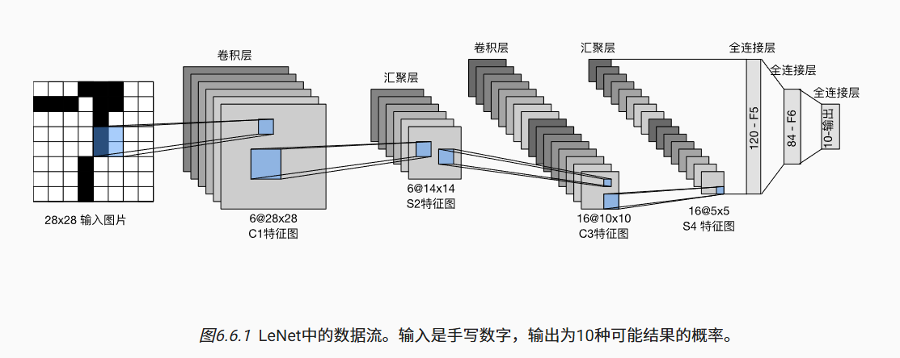

> Last Edit: 3/31/25
> 

我们在前面章节已经学习了构建完整 Convolutional Neural Network 卷积神经网络，简称 CNN）所需的基础模块，但是为了把这些模块真正用起来，需要介绍一个完整的、早期的 CNN 架构 LeNet（LeNet-5）

# 6.6.1 LeNet



| 层 | 输出形状 |
| --- | --- |
| 输入 | 1 × 28 × 28 |
| C1 卷积 | 6 × 28 × 28 |
| S2 池化 | 6 × 14 × 14 |
| C3 卷积 | 16 × 10 × 10 |
| S4 池化 | 16 × 5 × 5 |
| 展平后 | 400（向量） |
| FC1 | 120 |
| FC2 | 84 |
| 输出 | 10（分类概率） |

- 每一个 Convolution Layer 包含一个 5x5 Kernel，一个 Sigmoid Activation Function，同时也在增加 Output Channel，而每一个 Pooling Layer 都通过 2x2 的 window 和 2 的 Stride 将宽高减半
- 其中在 Convolution Layer 和 Full-Connect Layer 中需要进行数据的 Flatten 因为 Full-Connect Layer 只接受一维向量之后送进全连接
- 最后保留 10 维的输出，对应了 LeNet 的分类 0-9 任务
- 通过一个简单的 Sequential 块就可以实现 LeNet

```python
import torch
from torch import nn
from d2l import torch as d2l

# 使用 nn.Sequential 顺序堆叠每一层，构建 LeNet 网络
net = nn.Sequential(

    # 第一层：卷积层
    # 输入通道数 1（灰度图），输出通道数 6，卷积核大小 5×5，padding=2 保持输出大小不变
    nn.Conv2d(1, 6, kernel_size=5, padding=2),
    nn.Sigmoid(),  # 激活函数使用 sigmoid（原始 LeNet 使用的激活）

    # 第一层：平均池化层，窗口 2×2，步幅 2（尺寸减半）
    nn.AvgPool2d(kernel_size=2, stride=2),

    # 第二层：卷积层
    # 输入通道数 6，输出通道数 16，卷积核大小 5×5，不使用 padding（输出会缩小）
    nn.Conv2d(6, 16, kernel_size=5),
    nn.Sigmoid(),

    # 第二层：平均池化层
    nn.AvgPool2d(kernel_size=2, stride=2),

    # 将卷积输出展平为一维向量，便于输入到全连接层
    nn.Flatten(),

    # 第一层全连接：输入 16×5×5 = 400 个节点，输出 120 个神经元
    nn.Linear(16 * 5 * 5, 120),
    nn.Sigmoid(),

    # 第二层全连接：120 → 84
    nn.Linear(120, 84),
    nn.Sigmoid(),

    # 第三层全连接（输出层）：84 → 10（10 类分类结果）
    nn.Linear(84, 10)
)

```

- 简单概括就是图像尺寸越来越小，但是通道越来越多

# 6.6.2 Model Train

- 为了使用 GPU，需要作出一些小的改动

```python
def evaluate_accuracy_gpu(net, data_iter, device=None):#@save"""使用GPU计算模型在数据集上的精度"""if isinstance(net, nn.Module):
        net.eval()# 设置为评估模式ifnot device:
            device = next(iter(net.parameters())).device
# 正确预测的数量，总预测的数量metric = d2l.Accumulator(2)
with torch.no_grad():
for X, yin data_iter:
if isinstance(X, list):
# BERT微调所需的（之后将介绍）X = [x.to(device)for xin X]
else:
                X = X.to(device)
            y = y.to(device)
            metric.add(d2l.accuracy(net(X), y), y.numel())
return metric[0] / metric[1]
```

- 接下来就是主训练函数

## 定义函数

```python
def train_ch6(net, train_iter, test_iter, num_epochs, lr, device):
    """用 GPU 训练模型（在第六章定义）"""
```

## 1️⃣ 初始化网络参数（使用 Xavier 初始化）

```python
def init_weights(m):
    if type(m) == nn.Linear or type(m) == nn.Conv2d:
        nn.init.xavier_uniform_(m.weight)
net.apply(init_weights)
```

- 对所有 `Linear` 和 `Conv2d` 层使用 Xavier 均匀初始化，其他层是没有参数的，不用管

## 2️⃣ 设置设备（GPU / CPU）和优化器

```python
print('training on', device)
net.to(device)
optimizer = torch.optim.SGD(net.parameters(), lr=lr)
loss = nn.CrossEntropyLoss()
```

- 使用随机梯度下降（SGD）
- 使用 Cross Entropy Loss

## 3️⃣ 可视化工具（绘图）

```python
animator = d2l.Animator(...)
```

## 4️⃣ 开始训练循环

```python
for epoch in range(num_epochs):
```

### ① 初始化指标收集器（loss、acc、样本数）

```python
metric = d2l.Accumulator(3) # D2L 库的累加器
```

### ② 设置模型为训练模式

```python
net.train()
```

### ③ 遍历每个 batch

```python
for i, (X, y) in enumerate(train_iter):
```

- 将数据移到设备上（X 和 y）
- 前向传播 → 计算损失 → 反向传播 → 梯度更新

```python
timer.start() #开始计时
optimizer.zero_grad() #重置梯度
X, y = X.to(device), y.to(device)
y_hat = net(X) #前面的 nn.Sequence 的输出值
l = loss(y_hat, y) #Loss
l.backward() #Feed Backward
optimizer.step() #Optimizer
with torch.no_grad():
         #添加值到前面的定义的累加器中
     metric.add(l * X.shape[0], d2l.accuracy(y_hat, y), X.shape[0]) 
timer.stop() #结束计时
train_l = metric[0] / metric[2]
train_acc = metric[1] / metric[2]
```

### ④ 每训练完一部分，更新动态图（绘图）

```python
if (i + 1) % (num_batches // 5) == 0 or i == num_batches - 1:
    animator.add(...)

```

## 5️⃣ 每轮结束后在测试集上评估

```python
test_acc = evaluate_accuracy_gpu(net, test_iter)
animator.add(...)
```

## 6️⃣ 最终打印结果

```python
print(f'loss {train_l:.3f}, train acc {train_acc:.3f}, test acc {test_acc:.3f}')
print(f'{metric[2] * num_epochs / timer.sum():.1f} examples/sec on {str(device)}')
```