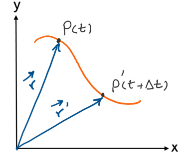
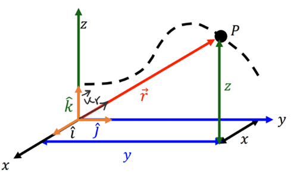
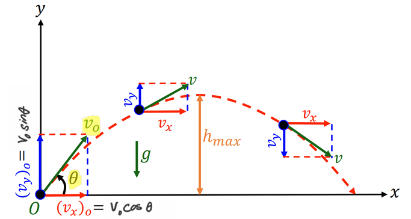
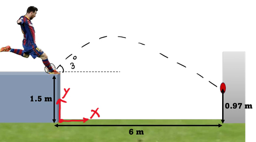
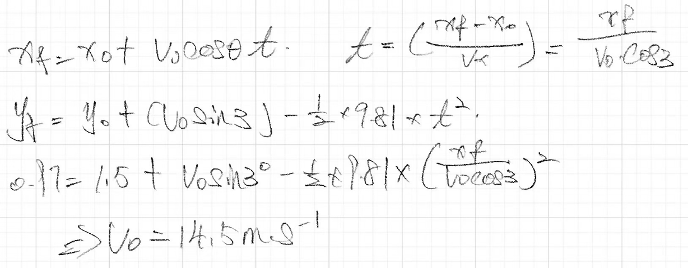
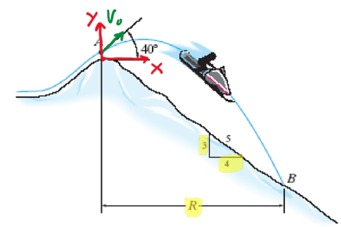
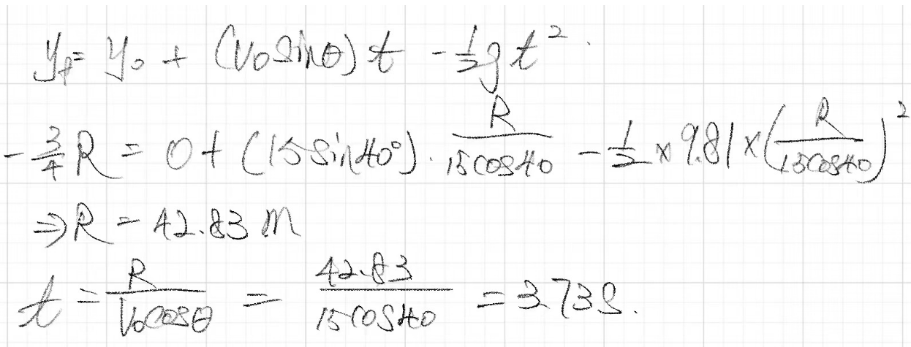

> Last Edit: 1/20/25

曲线运动，主要描述物体的位移速度和加速度

## Plane Curvilinear Motion 平面曲线运动

- 已知位置r，速度v和加速度a

- 物体的运动轨迹是一条二维曲线，表示物体在x-y平面中的运动。
- 位置矢量\\(\vec{r}(t)\\)是的是物体在时间t的时候从原点到物体当前所在位置的Vector
- 轨迹点P(t) 和\\(P'(t + \Delta t)\\)是物体在时刻t的位置
- 当时间t改变时，物体沿着曲线移动，位置矢量\\(\vec{r}\\)也会随时间变化
- 曲线运动中的速度和加速度是通过\\(\vec{r}(t)\\)的导数来确定的
$$\vec{r}(t) = x(t)\hat{i} + y(t)\hat{j}$$
$$\vec{v}(t) = \frac{d\vec{r}(t)}{dt} = \frac{dx(t)}{dt}\hat{i} + \frac{dy(t)}{dt}\hat{j}$$
$$\vec{a}(t) = \frac{d\vec{v}(t)}{dt} = \frac{d^2x(t)}{dt^2}\hat{i} + \frac{d^2y(t)}{dt^2}\hat{j}$$
- 如果Velocity的Magnitude没有发生改变，其加速度依然存在，具体来说速度不仅与速度的大小变化相关，还与速度的方向变化相关

### Instantaneous Direction 瞬时方向

- 对于曲线运动中的物体，当\\(\Delta t\rightarrow 0\\)的时候，其Displacement Vector和Velocity Vector总是与物体运动轨迹的Tangent方向一致

### ex. Collision Problem in Plane

The motions of two particles (A and B) are described by the position vectors. Find the point at which the particles collide and their speeds just before the collision.
$$\vec{r}_A = \left[ 3t \, \hat{i} + 9t(2 - t) \, \hat{j} \right] \, \text{m}
,\vec{r}_B = \left[ 3(t^2 - 2t + 2) \, \hat{i} + 3(t - 2) \, \hat{j} \right] \, \text{m}$$
- 想要做到碰撞，令i和j分别相等就行，之后就是求解了

## Rectangular Coordinate System

- 对于3D的情况，就是多了一个Freedom of motion其Position Vector以及Magnitude为
$$\vec{r} = x\hat{i} + y\hat{j} + z\hat{k},|\vec{r}| = \sqrt{x^2 + y^2 + z^2}
$$

### Velocity

- 同理只要对Position对时间t求导就是速度了
$$\vec{v} = \frac{d\vec{r}}{dt} = \frac{d}{dt} \left( x\hat{i} + y\hat{j} + z\hat{k} \right)$$
$$\vec{v} = \left( \frac{dx}{dt}\hat{i} + x\frac{d\hat{i}}{dt} \right) + \left( \frac{dy}{dt}\hat{j} + y\frac{d\hat{j}}{dt} \right) + \left( \frac{dz}{dt}\hat{k} + z\frac{d\hat{k}}{dt} \right)
$$
- 由于i，j，k是Unit Vector，其不受时间影响，所以可以去掉
$$vec{v} = \frac{dx}{dt}\hat{i}   + \frac{dy}{dt}\hat{j}    +  \frac{dz}{dt}\hat{k}   $$
### Acceleration

- 同理对速度求导就有
$$\vec{a} =  \frac{dv_x}{dt} \hat{i}+ \frac{dv_y}{dt} \hat{j} +  \frac{dv_z}{dt} \hat{k}$$
## Projectile Motion

- 斜抛运动其实就是在分析物体在两个自由度上的运动
- 现在为了简化问题，做出以下假设，忽略空气阻力，地球自转，并令重力为常数
- 于是有以下两个方向的初速度为

| Axis | Initial Velocity  | Acceleration                   |
| ---- | ----------------- | ------------------------------ |
| x    | \\(v_0 \cos \theta\\) | \\(0\\)                            |
| y    | \\(v_0 \sin \theta\\) | \\(\downarrow g, \, -g \uparrow\\) |

- 总结便可以得出以下表格

| Axis | Velocity (\\(v = v_0 + at\\))           | Position (\\(s = s_0 + v_0t + \frac{1}{2}at^2\\))                | No "t" (\\(v^2 = v_0^2 + 2a\Delta s\\))            |
|------|-------------------------------------|-------------------------------------------------------------|------------------------------------------------|
| x    | \\(v_x = v_0 \cos \theta\\)            | \\(x = x_0 + (v_0 \cos \theta)t\\)                              | \\(N/A\\)                                         |
| y    | \\(v_y = v_0 \sin \theta - gt\\)       | \\(y = y_0 + (v_0 \sin \theta)t - \frac{1}{2}gt^2\\)            | \\(v_y^2 = (v_0 \sin \theta)^2 - 2g\Delta y\\)    |
- 可以发现之所以x的第三列为\\(N/A\\)是因为x方向的加速度为零

### Maximum Height

- 物体在Projectile Motion中到达最高点后的Velocity会降到0
- 到达这一点的时间可以通过\\(0=v_y-gt\\)得到，有
$$t=\frac{v_y}{g}$$
- 其高度则是根据\\(v^2 = v_0^2 + 2a\Delta s\\) 解得
$$\Delta y = \frac{v_{y0}^2}{2g}$$
### ex. Messi kicks the ball

### ex. Snowmobile

Snowmobile is going 15 𝑚/𝑠 at point A. Find: The horizontal distance it travels (𝑅) and the time (𝑡) in the air

