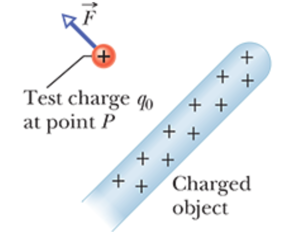
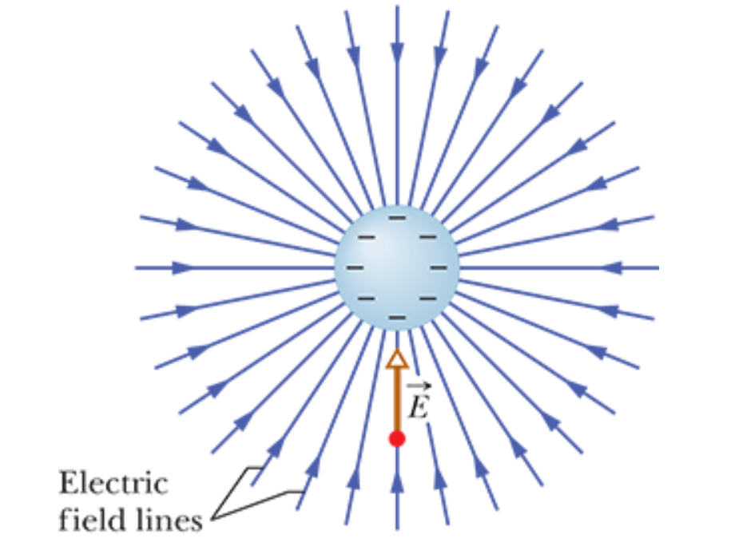
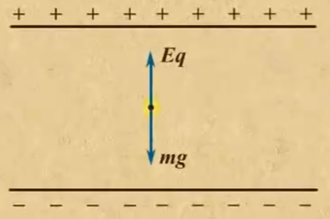

> Last Edit: 1/13/25

# Electric Field 电场

- 在科学中存在多个 Field的概念，其中包含了Teperature Field，Pressure Field等
- 而Electric Field则是一个Vecotr Field，矢量场，具体来说其包含了大小与方向
- 具体来说，定义Electric Field的方式是在Electric Field $\vec{E}$ 的某个点P处放置一个With Small Positive Charge的$q_0$，其为Test Charge，为测试Electric Field的一个Charge 电荷
> We want the charge to be small so that it does not disturb the object’s charge distribution

- 电场$\vec{E}$在点P由带电对象产生，对试验电荷$q_0$产生了静电力$\vec{F}$
- 由于$p_0$是一个正的Charge，所以电场的方向是电力的方向，而电场的大小由 
$$\vec{E} = \frac{\vec{F}}{q_0}$$
- Electric Field的国际单位系统(SI)单位是牛顿每库仑（N/C）。
- Electric Field是带电物体在周围空间（包括真空中）建立的，与是否有试验电荷到来测量无关

# Electric Field Lines 电场线

- 由于需要一种方式可视化电场，Eletric Field Lines出现了

- Electric Field Line的方向是由正电荷指向负电荷
- 根据Electric Field的性质，电场线的密集程度反映了电场的强度。电场线越密集，电场强度越大

# 2.2 The Electric Field Due to a charged Particle

- 为了找到带电粒子（通常称为点电荷）产生的电场，我们在粒子附近的任何点（距离 r）放置一个正测试电荷
- 前面知道Coulomb's Law有
$$F = \frac{1}{4 \pi \varepsilon_0} \frac{|q||q_0|}{r^2}$$
- 将$\vec F$代入到$\vec E$中便可以得到
$$\vec{E} = \frac{\vec{F}}{q_0} = \frac{1}{4\pi \epsilon_0} \frac{q}{r^2} \hat{r} \quad \text{(charged particle)}$$

##  P rinciple of superposition 电场的叠加原理

- 如果在某点有多个电荷产生的电场，可以通过叠加原理来计算该点的总电场。文中用到了叠加原理，表达式为 
$$\vec{E} = \vec{E}_1 + \vec{E}_2 + \cdots + \vec{E}_n$$
- 这说明总电场是各个单独电场向量的矢量和。

# 2.6 A Point Charge in an Electric Field

- 当一个Particle有着q的Charge被放置在Electric Field$\vec E$中的时候，Electric Field会对其产生$$\vec F=q\vec E$$
- 的Electrostatic Force

## Measuring the Elementary Charge - Millikan Oil-drop Experiment
 
- 罗伯特·A·密立根在1910年进行的著名实验油滴实验，用于测量电子的基本电荷e

