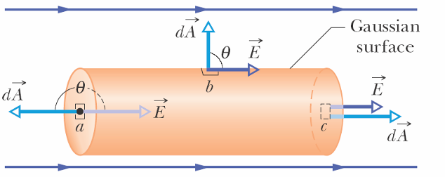
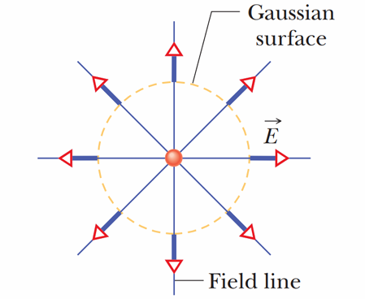
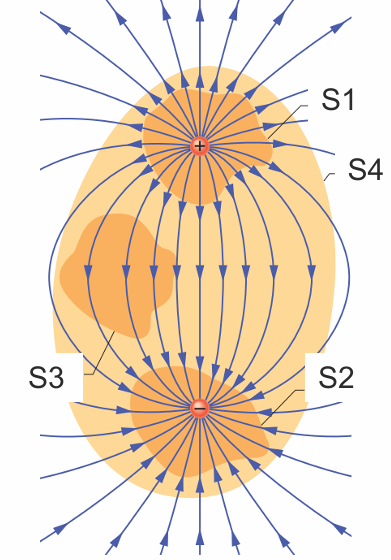
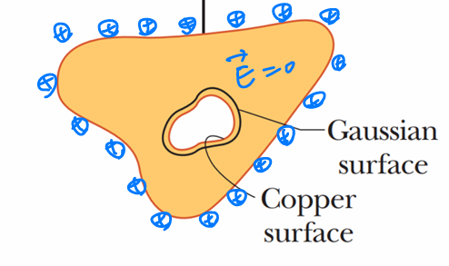
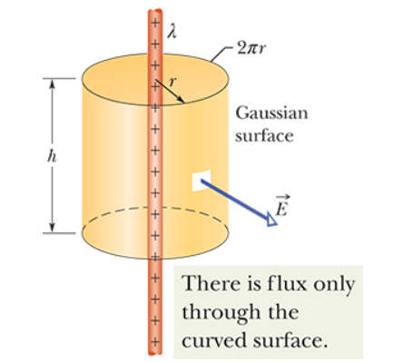
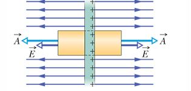
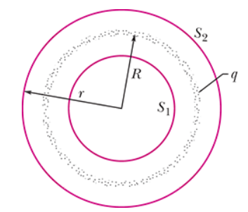
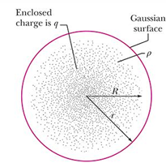

> Last Edit: 1/20/25

## 3.1 Electric Flux 电通量

- 从一个Flat的面积为A的平面开始，其处于一个Electric Field \\(\vec E\\) 中，其中会有\\(E\cos \theta\\)个电荷穿过这个平面，而这些个穿过该平面的电荷的数量就叫做Electric Flux，电通量

$$\Delta \Phi = (E \cos \theta) \Delta A$$
- 同时，上面的形式也可以替换为Dot Product的形式，\\(\Delta \Phi = \vec E \cdot \Delta A\\)，同样的，Total Flux就是
$$\Phi=\sum \vec E\cdot  \Delta \vec A，or~\Phi=\int\vec E\cdot d\vec A$$
### ex.

Consider a cylinder of radius R in a uniform electric field with axis parallel to the field direction, what are the flux through the end caps, cylindrical surface, and the net flux?

$$\begin{align*}
\text{right cap: } &\Phi_{\text{right}} = \int E \cos 0^\circ \cdot dA = E \int dA = E \pi R^2 \\
\text{left cap: } &\Phi_{\text{left}} = \int E \cos 180^\circ \cdot dA = -E \int dA = -E \pi R^2 \\
\text{cylindrical surface: } &\Phi = \int E \cos 90^\circ \cdot dA = 0 \\
\text{net flux: } &\Phi = -E \pi R^2 + E \pi R^2 + 0 = 0
\end{align*}
$$

## 3.2 Gauss's Law 高斯定律

- 一个闭合表面的电通量等于该表面所包围的净电荷量除以真空介电常数\\(\epsilon_0\\)
$$\Phi = \frac{Q_{\text{enc}}}{\epsilon_0}$$
- 其中\\(Q_{\text{enc}}\\)是闭合表面内部的总电荷
- 需要注意的点是，Gaussian Surface是一个Closed Surface
- 一个Gaussian Surface外的电荷不贡献Electric Flux

### ex. 

Consider a particle with charge +q is surrounded by an imaginary concentric sphere

$$\Phi = \oint \vec{E} \cdot d\vec{A} \\
= \oint E dA \\
= E \oint dA \\
= E \cdot 4\pi r^2 \\
= \frac{1}{4\pi \epsilon_0} \frac{q}{r^2} \cdot 4\pi r^2 \\
= \frac{q}{\epsilon_0}$$
- 利用现有的点电荷电场强度推导Gaussian's Law

### ex. Gauss's Law

Consider two charges with opposite signs and equal magnitude (+q and –q). Determine the electric flux of the four Gaussian surfaces are shown below:

- 对于S1来说，q是一个Positive Charge，所以其也是一个Postive Number
- 对于S2，q是一个Negative Charge，所以他也是Negative的
- 对于S3，其所围成的空间中并不包含Charge，所以Zero
- 对于S4，其Net charge为0，即Zero

### Gauss’ Law and Coulomb’s Law

- 将两个定律结合可以发现由于\\(\epsilon_0 \oint \vec{E} \cdot d\vec{A} = q_{\text{enc}}\\)，所以Electric Flux可以化简为
$$\Phi = E \cdot 4\pi r^2$$

## 3.3 A charged Isolated Conductor

- 在孤立导体上，所有额外的电荷都会移动到导体的表面，导体内部不会有多余电荷
- 这是因为导体内部的电荷会通过相互作用重新分布，直到内部电场为零，从而达到静电平衡

- 同理如果里面出现了一个Cavity，其也不会存在电荷
- 当Conductor不是一个光滑的Spherical的情况下，电荷并不会均匀的分布在表面上，而是受到曲率的影响，导致尖锐的部分会拥有更多的电荷密度

### The External Electric Field
$$ε₀EA = σA$$
- 导体外部电场强度与其表面上电荷密度成正比
- 对于具有**对称性**的Electric Field来说，Gauss' Law就可以计算其Field Strength

## 3.4 Applying Gauss's Law: Cylinderical Symmetry

- 有一个长度为无线的Plastic Rod，其Charge Density为\\(\lambda\\)
- 想求离Central Axis的半径为r的距离处的Electric Field Magnitude
- 由于Electric Field是从圆柱体中心穿过的，而有Gauss' Law \\(\Phi = \frac{Q_{\text{enc}}}{\epsilon_0}=  \oint \vec{E} \cdot d\vec{A}\\)
- 可以得出面积等于\\(A = 2\pi rl\\)
- 已知电荷密度为\\(\lambda\\)，即总电荷数为\\(Q_{enclosed}=\lambda \cdot L\\)，所以有\\(2\pi rl E=\frac{\lambda L}{E_0}\\)，也就是
$$E = \frac{\lambda}{2\pi\epsilon_0 r}$$

### ex. Lighting strikes the tree

- 当雷电击中一棵树的时候，其可以被看作是一个导线，而半径为r内的空气都将被Ionized，计算出这个半径r，令\\(E=3\times 10^6 N/C\\)
$$r = \frac{\lambda}{2\pi\epsilon_0 E}

= \frac{1 \times 10^{-3}\ \text{C/m}}{(2\pi)(8.85 \times 10^{-12}\ \text{C}^2/\text{N}\cdot\text{m}^2)(3 \times 10^6\ \text{N/C})}

= 6\ \text{m}$$

## 3.5 Applying Gauss's Law: Planar Symmetry

- 对于一个无限大的电荷密度为\\(\sigma\\)的Plane，有\\(\sigma=\frac{Q}{A}\\)
- 更具Guass' Law \\(\Phi = \frac{Q_{\text{enc}}}{\varepsilon_0}\\)，其中\\(Q=\sigma A\\)，于是有
$$\Phi=\frac{\sigma A_0}{\varepsilon_0}$$
- 令其中一个Cylinder为高斯面，对于Cylinder的侧面（Curved Surface）由于于电场平行没用Flux，而Flux从两个Cross-Sectional Area流过即
$$\Phi=EA=2EA_0=\frac{\sigma A_0}{\varepsilon_0}$$
$$\Rightarrow E=\frac{\sigma}{2\varepsilon_0}$$

## 3.6 Applying Gauss' Law: Spherical Symmetry

- 有一个球壳，上面的Charge均匀分布，电荷总量为q，半径为R

- 使用两个同心的球形高斯面\\(S_1\\)和\\(S_2\\)
- 对于内部高斯面\\(S_1\\)来说，Electric Field为0，Electric Flux也为0
- 对于外部高斯面\\(S_2\\)来说，Electric Field公式由\\(E=\frac{q}{4\pi\varepsilon_0r^2}\\)给出，由Shell Theorem 1证明，球壳外部的Charge可以被视为Point Charge
- 第二种情况则是一个带电的均匀实心球体（电荷在其中均匀分布）

- 令整个实心球半径为R，总电荷量为q，且在体积内均匀分布，则体积电荷密度
$$ρ  =  q43πR3. \rho \;=\; \frac{q}{\tfrac{4}{3}\pi R^3}$$
- 在球内取一半径为\\(r<R\\)的球面作高斯面，则该高斯面所包围的电荷量
$$Q_{\text{enclosed}} \;=\; \rho \times \bigl(\tfrac{4}{3}\pi r^3\bigr) = \frac{q}{\tfrac{4}{3}\pi R^3}\;\times\;\tfrac{4}{3}\pi r^3 = q\,\frac{r^3}{R^3}$$
- 由对称性，球面上电场大小恒为E，方向辐向向外，故
$$\oint \mathbf{E}\cdot \mathrm{d}\mathbf{A} = E\,\cdot 4\pi r^2$$
- 高斯定律给出
$$E \cdot 4\pi r^2 = \frac{Q_{\text{enclosed}}}{\varepsilon_0} = \frac{q\,\tfrac{r^3}{R^3}}{\varepsilon_0}$$
$$\Rightarrow E(r) = \frac{1}{4\pi \varepsilon_0} \,\frac{q\,\tfrac{r^3}{R^3}}{r^2} = \frac{1}{4\pi \varepsilon_0}\,\frac{q}{R^3}\,r$$
- 总的来说**空心球壳**：
- 壳外\\(r \ge R\\)：电场如点电荷，\\(E=\frac{1}{4\pi\varepsilon_0}\,\frac{q}{r^2}\\)
- 壳内\\(r \le R\\)：电场为 0
- **实心均匀带电球**：
- 球外\\(r \ge R\\)：同样表现为点电荷，\\(E=\frac{1}{4\pi\varepsilon_0}\,\frac{q}{r^2}\\)
- 球内\\(r \le R\\)：\\(E=\frac{1}{4\pi \varepsilon_0}\,\frac{q}{R^3}\,r\\)，即随r线性增大