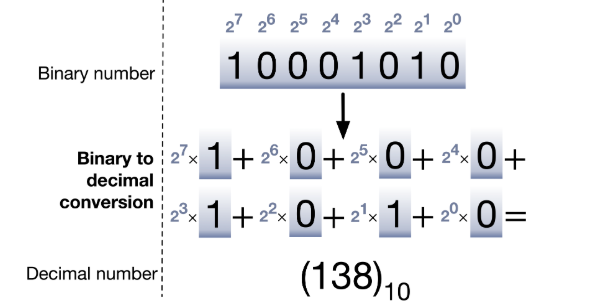
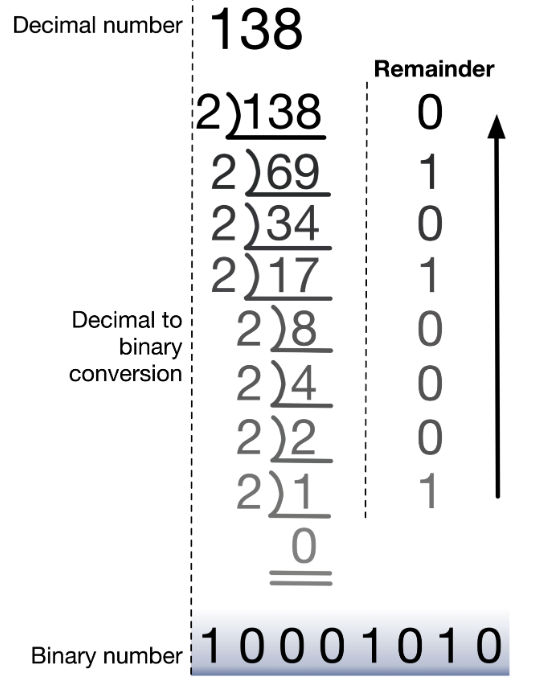
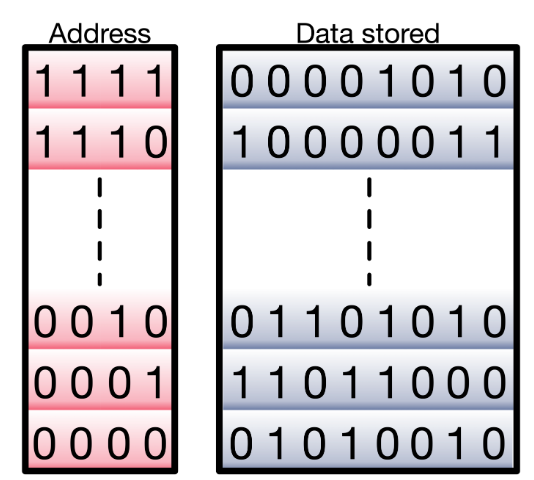

> Last Edit: 1/8/25

## 1.2 Binary representation in memory

### Binary to Decimal Number 二进制转十进制

- Binary到Decimal Number的转换通过位数和值相乘得到



### Decimal Number to Binary 十进制转二进制

- Decimal Number通过除法的余数得到二进制



### Number of Bits to represent x

- 需要n个二进制位数来表达一个\\(2^n\\)的Decimal Number
- 要表示 256 个数字，我们需要 8 位。要表示 512 个数字，我们需要 9 位。要表示 1024 个数字，我们需要 10 位

### Memory organized way 内存管理方式

- Memory通过Cells的方式管理，每一个Cell储存了一个byte 字节
- 而每一个Cell包换他的Address 地址，这使得Mmory Byte 内存字节是Byte-Addressable的



- 当采用32个Bits来表达Cell的Address的时候，我们可以储存\\(2^{32}\\)个Bytes 字节
- A byte is a group of 8 bits. A kilobyte (KB) is 1024 bytes. A megabyte (MB) is 1024 kilobytes. A gigabyte (GB) is 1024 megabytes. A terabyte (TB) is 1024 gigabytes.
- \\(2^{32}\\) Bytes也就是4个Gigabytes
- 现代计算机是64-bits的，也就是说它们的Memory Length可以达到\\(2^{64}\\)位

### Hexadecimal & Binary 十六进制和二进制

- 已知Hexadecimal和Binary的对应表为
- 0 = 0000, 1 = 0001, 2 = 0010, 3 = 0011, 4 = 0100, 
- 5 = 0101, 6 = 0110, 7 = 0111, 8 = 1000, 9 = 1001,
- A = 1010, B = 1011, C = 1100, D = 1101, E = 1110, F = 1111
- 一个Hexadecimal \\(c_1c_2\\)的本质为\\(16^1*c_1+16^0*c_2\\)
- 举例来说一个Hexadecimal \\(3A\\)的Decimal Number就是\\(3*16^1+A*16^0=3*16+10*1=58\\)
- 更简单的Hexadecimal直接转换到Binary Number的办法就是拼接
- 3 转换为 0011
- A 转换为 1010
- 将它们拼接：3A = 0011 + 1010 = 00111010

## 1.4 Write Simple C Programs 编写简单的 C 程序

``` c
// This program prints the message "Hello World!" on the screen.
##include <stdio.h>

int main(void){
   printf("Hello World!\n");
   return 0;
}
```

- `#include <stdio.h>`允许访问与输入（如键盘）和输出（如监视器）设备接口的功能。这些函数包括 和 。`printf``scanf`
 - `main` 是 C 程序的入口点。所有 C 程序都需要 main 函数
 - 在执行程序时调用。它返回一个整数值。该值表示程序执行成功。任何其他值都表示程序失败
- `printf` 是将字符串打印到屏幕的函数
- `\` is called an escape character 转义字符 ，`\n` is a special character that indicates a new line

### Input 输入

``` c
##include <stdio.h>

int main(void){
  int numPizzas, numSlices;
  printf("How many pizzas do you have?\n");
  scanf("%d", &numPizzas);
  numSlices = numPizzas * 8;
  printf("You have %d slices in %d pizza.\n", numSlices, numPizzas);
  return 0;
}
```

- `int numPizzas, numSlices;`声明两个类型的变量`int` is a data type that represents integers
- `scanf("%d", &numPizzas);`将获取用户输入并将其分配给 variable
- **`&` Address-of Operator（取地址符）** 是为了将变量的地址传递给 `scanf`

### pass-by-value 按值传递 

在 C 语言中，函数的参数传递**默认是按值传递**（pass-by-value）。这意味着：

- 当你调用一个函数时，传递的实际上是**变量值的副本**，而不是变量本身。
- 因此，如果不通过地址传递，函数无法直接修改原始变量的值。

### Escape Sequences 转义序列

- 转义字符是由反斜杠 `\` 开头的一组特殊字符，用于表示一些特殊含义。
- `\n` 表示换行。
- `\t` 表示制表符。
- `\\` 表示反斜杠本身。
- `\"` 表示双引号。


