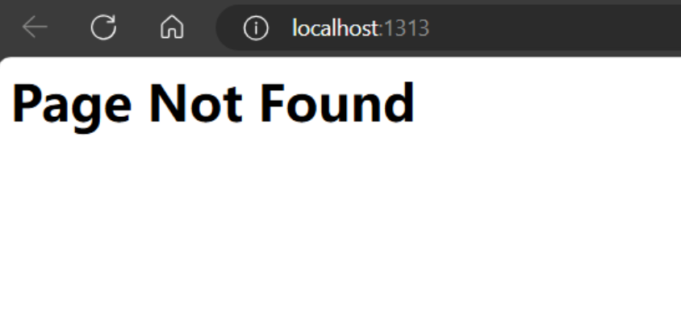
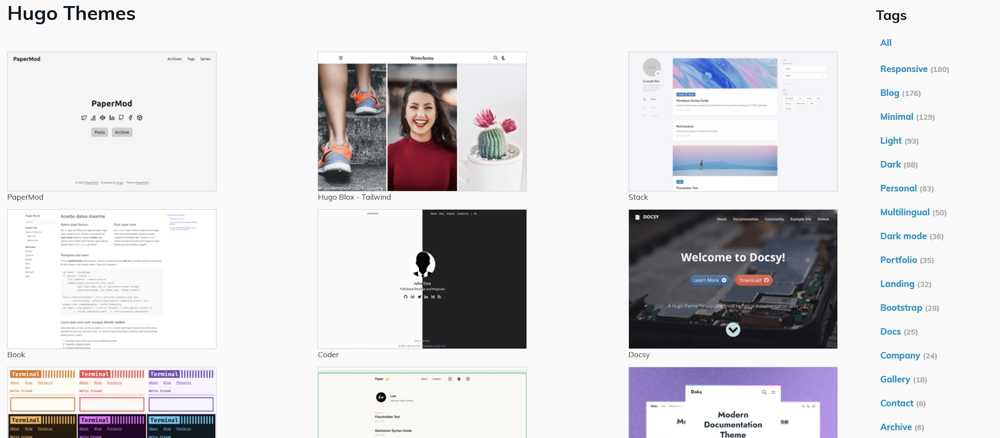
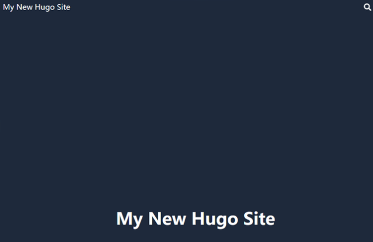
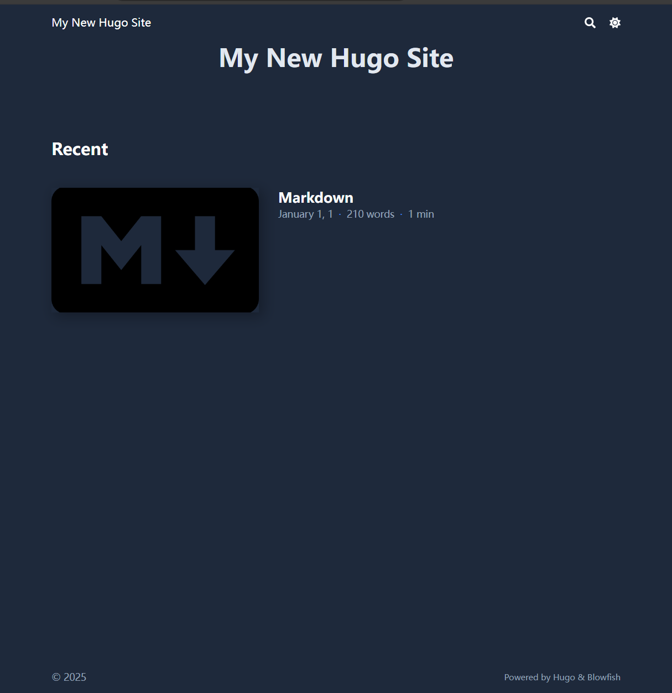

> Last Edit: 1/19/25
# 简介


- Hugo是一个基于Go语言的Github开源项目，其支持Markdown语法并可以托管到Github Pages上

# 环境准备

- Git
- https://git-scm.com/
- Go语言的安装
- [https://go.dev/doc/install](https://go.dev/doc/install)
- Scoop下载
- [https://scoop.sh](https://scoop.sh)

# 创建项目

- 在配置完了环境后，在终端通过Scoop安装Hugo文件

``` bash
scoop install hugo-extended
```

- 之后在准备好的项目路径下通过hugo指令直接创建项目文件

``` bash
hugo new site {{这里填你的文件名}}
```

- 之后提示Congratulation后，cd进入文件下下尝试启动hugo

``` bash
hugo server
```

- 如果输出为

``` 
- Web Server is available at http://localhost:1313/ (bind address 127.0.0.1)
- Press Ctrl+C to stop
```

- 则说明项目已被成功部署，打开链接可以看到以下界面



> 显示Page Not Found是正确的

- 之后建议Ctrl + C退出后台
  
# 安装主题

- Hugo项目可以通过安装他人准备好的Theme主题来达到轻松的美化效果
- Hugo主页上列出了很多个主题，可以任意选择一个喜欢的



- 这里将以Blowfish作为示范，以下是其Github仓库链接
- https://github.com/nunocoracao/blowfish/?tab=readme-ov-file

- 更具教程，使用git submodule安装主题
- 需要注意的是先要`git init`，之后在hugo文件夹下安装

``` bash
git submodule add -b main https://github.com/nunocoracao/blowfish.git themes/blowfish
```

- 等待主题安装完毕后，打开hugo文件夹下的hugo.toml文件，添加以下代码

```toml
- theme = 'blowfish'
```

- 保存后再次运行hugo便可以预览到该主题已经被成功安装



# 主题配置

- 建议在添加Markdown文档之前对主题做出如下更改
- 打开\themes\blowfish\config`，并将params.toml更改至如下

``` toml
[homepage]
  layout = "background" # valid options: page, profile, hero, card, background, custom
  #homepageImage = "IMAGE.jpg" # used in: hero, and card
  showRecent = true
```

- 这将打开主页上的最佳文档，可以直接在homepage上浏览到最近添加的文档

# 创建文章

- 打开Content文件夹，在里面新建文件夹
- 创建`_index.md`并写入以下代码

``` md
---
title: "Docs"
description: ""
cascade:
  showDate: true
  showAuthor: false
  invertPagination: true
---
```

- 关于具体代码的含义，请查看 [Documentation · Blowfish](https://blowfish.page/docs/)文档
- 之后保存文件并且在该文件夹下**再次新建文件夹**

> 建议采取一个文件夹一个文章方式，如该文件夹为其他页面的父页面，则命名为`_index.md`，如没有子文档，则文档存放markdown命名为`index.md`

- 之后添加`index.md`文件，并写入任意Markdown文章，具体语法可以查看 [Markdown Guide](https://www.markdownguide.org/)

# 预览

- 在想要预览的时候，于终端输入

``` bash
hugo server
```

- 打开http://localhost:1313/便可以看到创建出来的文档



# 上传至Github pages

- 打开github创建新仓库，创建一个名为{{id}}.github.io的仓库
- 来到hugo文件夹下

```bash
hugo
cd .\public\
```

- `hugo`是令hugo创建准备好的上传的页面，其会被存到public文件夹下，之后cd进入

```
git init -b main 
git remote add origin {{仓库链接}}
```

- 链接远程git仓库（git设置部分请自行准备）

```
git add .
git commit -m "init"
git push -u origin main
```

- 添加文件后push至github等其完成部署之后就能在{{id}}.github.io访问到了