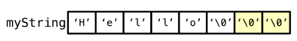

> Last Edit: 25/3/27


Throughout this book, we study different data types. None of the data types discussed before stores a word or sentence, because in C programming language there is no data type that stores a word/sentence. 

所以在这里将找到一个储存 String 的解决方案

# **10.1. What are strings?**

- String 被用来储存句子，例如 `printf("Hello world!\n");`

## 10.1.1 Store a String

- C 语言中储存 String 的办法就是通过 Array of Characters 字符数组
- 这个 Array 同时也是 Null Terminated 空字符结尾的，这意味着字符串存储在一个特殊的字符数组中，字符串的最后一个字符是 Null character 空字符
- 空字符（Null Character）：空字符表示为`\0`，它的ASCII码（ASCII Code）值是`0`
- 存储方式：`\0`在ASCII编码中对应于主存储器（main memory）中的`0`值
- 例如 String `“Hello”`  实际上在 Memory 中是 `H  e  l  l  o  \0`
- 这个设计是为了防止 C 语言的 String 处理函数知道 String 的边界以防越界

### 10.1.1.1 Declare and Initialize

- 在 C 语言中，我们可以声明一个 **1D array of characters**，并将其初始化为一个字符串，例如`char myString[] = "Hello";`
- 这一语句的作用是创建一个名为 `myString` 的字符数组，该数组包含 **6** 个元素：`'H'`, `'e'`, `'l'`, `'l'`, `'o'` 以及 `'\0'`
- 这时一般不需要给 Array 它的 Size，但是如果非要加，多出来的部分则会变成



- 同样的 Null Character
- 同时和 1D Array 一般，也可以通过 `myString[0] = 'h';` 的做法修改 Array 中 Index 对应的元素

### **10.1.1.2. Method 2: Declare now and Initialize later**

- 第二种做法就是声明字符数组，但不立即初始化，之后通过单独赋值的方式填充字符数组，并手动添加 `'\0'` 终止符

```c
char myString[4];
myString[0] = 'T';
myString[1] = 'h';
myString[2] = 'e';
myString[3] = '\0';
```

### **10.1.1.3. Method 3: Declare a Pointer Pointing to a Constant String**

- 第三种方法就是 Pointer，有 `char* pStr = "Wow";` ，这种方法中，String Wow 将被储存在 Const + Global Variables 的内存块中，而 pStr pointer 则在 Stack 中指向了第一个字符的地址


- 当尝试修改他的时候，如 `pStr[0] = 'R';` 会报错，因为 pStr 在尝试修改一个 Constant
- 但是是可以修改 pStr 的值，（修改一个 Pointer 的值也就是修改它指向的内存）的，如 `pStr = "Cat";`  就将指向另一个 String
- 现在举一个具体的 Pointer 换 String 的例子


- 在这里对于字符数组 `char str[] = "It";`  来说，它实际上创建了一个可修改的字符数组，即是一个非 Const 的 Declare 方式，所以它会被存在 Stack 上
- 而对于字符串常量 `"Wow"` 来说，定义了一个指针 `pStr`，指向一个字符串常量，这个常量实际存储在程序的 Const 区
- 将 pStr 更换位置后`pStr` 就被重定向到栈上的 `str`
- 下一个场景是给 Array of characters 赋值的操作，这同样也是不合法的，因为在C语言中，数组名被视为常量指针，它自动地指向数组的第一个元素的地址。因此，数组名是固定不变的，不能被重新赋值

```c
int main(void) {
    char str[] = "Hello";
    str = "APS105";  // 尝试更改数组标识符
    return 0;
}
```

## **10.1.2. What is the usage of the `'\0'` in a string?**

- 前面提到过在C语言中，`\0` 作为字符串的终止符，表示字符串的结束
- 当字符串作为参数传递给函数时，函数通过检测 `\0` 来判断何时停止处理字符串，这样可以避免超出字符串的实际内容范围，导致未定义的行为或访问违规

# 10.2 Input/Output Strings

## 10.2.1 Output Strings

### 10.2.1.1 Using pringf

- 对于 String 来说，其采用 `%s` 的 Format Specifier，`printf`  将从 `str[0]` 开始一直打印到（但不会打印）第一个非零 Character
- 同时作为 Pointer，如果传入 `str + 2` 来打印，则会输出从 `str[2]` 开始的剩余 String
- 如果想要打印特点个数的 String，可以用 `%.*s`  并将 * 替换为一个数字

```c
#include <stdio.h>
int main(void) {
  char s[] = "Hello";
  printf("%.2s\n", s);
  return 0;
}
```

### Printing character vs. a string

- Character 打印的是单个字符，而 String 则是一个 Array

### 10.2.1.2 Using puts

- `puts`  是另一种打印方式，但其不需要一个 Format String
- 它只接收一个参数即为 Pointer to the first character
- 在打印完后他会自动换行

```c
#include <stdio.h>
int main(void) {
  char s[] = "Hello";
  puts(s);
  return 0;
}
```

## 10.2.2 Input Strings

### 10.2.2.1 Using scanf

- 想要用 `scanf` 从用户那里获取一个 String 的输入，同样使用 `%s` 的 Format Specifier

```c
char st[10];
scanf("%s", st);
```

- 这里 `scanf("%s", st);` 之所以是 `st` 而不是 `&st` 是因为 `st` 本身就是一个 Pointer

### How does sanf work

- `scanf` 函数在处理输入的时候，会忽略输入前的所有空白，也叫做 Leading white space
- `scanf` 会读取字符知道遇到 White Space 或者 Endline
- 在读取完毕后，`scanf` 会自动给 String 加上 `\0` 结尾

```c
#include <stdio.h>
int main(void) {
  char st[10];
  printf("Enter a string: \n");
  scanf("%s", st);
  printf("s is saved as: %s\n", st);
  scanf("%s", st);
  printf("s is now saved as: %s\n", st);
  return 0;
}
```

- 上面的例子展示了当输入为 `ABCD  ff` 的时候，第一次 `scanf` 读取的将是 ABCD，第二次是 ff

### What if str is longer than array

```c
#include <stdio.h>
int main(void) {
  char st[7 + 1];
  printf("Enter a string: \n");
  scanf("%s", st);
  printf("s is saved as: %s\n", st);
  return 0;

```

- 当输入为 `ABCDEFGHIJ` 的时候

```
Enter a string:
ABCDEFJI
s is saved as: ABCDEFJI
```

### Buffer Overflow

- 当把数据写入比他小的数据结构的时候，会就出现的 Buffre Overflow 缓冲区溢出的 Crash
- 当输入为  `ABCDEFGHIJ` 实际上只应该被读出 ABCDEFGH，之所以读出了 I 是因为在 `char st[7 + 1];` 的时候，默认预留的位置中还加上了一个 `\0` 的空间，而 I 正是占用了这个空间所以才被打印了出来

### **10.2.2.2. Using `fgets` to avoid buffer overflow in `scanf`**

- 比起 `scanf` 来说还存在一种更加安全的函数叫做 `fgets` 来获取输入
- 和 `scanf` 不同的是，`fgets` 可以指定最多读取多少个字符
- `fgets(st, 3, stdin);` 就代表了将从输入中读取最多两个 Character（其中一个为 `\0` ）
- 后面的 `stdin` 则代表了 `stdio.h` 的标准输入库

```
Enter a string:
ABCDEFGHI
st is saved as: AB
```

- 当输入小于 `fgets` 的最大读取数量的时候，后续数组元素会被 Garbage Values 替代
- 比如最大读取数量为 3 的时候，只输入一个 A，后续要么是一个空格，要么是一个换行符，反正都是 Garbage Values

**10.2.2.3. Implement a `getStringSafely` function**

- 所有的 API 都被规定了，但是他们都大大小小存在一些问题，这时候就需要一个  Function 来规范化所有的输入了
- 这个 Function 的目标将是读取 String 并储存到 Array 中

### getchar() function

- 每一次调用 `getchar` 都只会接收输入的第一个 `char`

```c
#include <stdio.h>
char* getStringSafely(char* s, int n);
int main(void) {
  char st[10];
  printf("Enter string: \n");
  printf("User entered: %s\n", getStringSafely
(st, 7));
  scanf("%s", st);
  printf("This is what's left: %s\n", st);
  return 0;
}
char* getStringSafely(char* s, int n) {
  int charCount = 0;
  char c;
  while ((charCount < n - 1) && ((c = getchar()) 
!= '\n')) {
    s[charCount] = c;
    charCount++;
  }
  s[charCount] = '\0';
  return s;
}
```

# **10.3. String Functions**

- 前面的章节中，所有对 String 的处理都是通过 Characters 的 Array 做的，但是 C 语言实际上有一个 String Library `#include <string.h>`，里面有专门用来处理 String 的 Functions

## **10.3.1. Length of the string**

- 函数 `strlen` 可以被用来返回 String 长度，其 Prototype 为 `size_t strlen(char *str);`
- 其中`size_t` 是一个 Unsigned integer type 无符号整数类型，可以简单地把它当成 `int` 来理解

```c
#include <stdio.h>
#include <string.h>
int main(void) {
  char s[] = "Hello";
  int size = strlen(s);
  printf("String length is %d.\n", size);
  return 0;
}
```

- `strlen(s)` 返回的是字符串 `"Hello"` 的长度，也就是 `5`（不包含结尾的 `\0`）

### **10.3.1.1. Implementation of `strlen`**

- 直接从头构造一个 `strlen` 函数

```c
#include <stdio.h>
#include <string.h>
// 函数声明
int stringLength(char* s);
int main(void) {
    char s[] = "Hello";                   // 定义字符串
    int size = stringLength(s);           // 调用自定义的 stringLength 函数
    printf("String length is %d.\n", size); // 打印字符串长度
    return 0;
}
// 函数定义
int stringLength(char* s) {
    int count = 0;
    while (s[count] != '\0') {  // 遍历直到遇到 \0
        count++;
    }
    return count;
}
```

- 有的时候为了避免意外造成的修改，可以使用 `const` 来确保传入的 Str 是**只读**的

## **10.3.2. Copy a string into another string**

### **10.3.2.1. `strcpy`**

- `strcpy` 函数会将一个 String 中的内容复制到另一个 String 中，它的 Prototype 为 char* `strcpy(char *dest, char *src);`
- 将一直负值 `src` 直到碰到 `\0` ，下面是一个 `strcpy` 的示例

```c
#include <stdio.h>
#include <string.h>
int main(void) {
  char s[] = "Hello";
  char d[6];
  printf("d after copying has '%s\'.\n", strcpy(d, s));
  return 0;
}

-> d after copying has 'Hello'
```

- 之所以需要 `strcpy` 而不是直接赋值一个 str 给另一个，是因为在 C 中，一个 String 被创建的时候是以一个 Characters 的 Array 创建的，而给 Array 赋一个值是非法的

### **10.3.2.1.1. Implementation of `strcpy`**

- 想要实现一个 `strcpy` 本质就是一个个赋值直到 `\0` ，下面是具体实现

```c
  #include <stdio.h>
#include <string.h>
char* stringCopy(char* dest, const char* src);
int main(void) {
  char s[] = "Hello"; // 定义源字符串 s 
  char d[6];          // 定义目标字符串 d，有 6 个字符空间
  printf("d after copying has '%s'.\n", 
stringCopy(d, s));
  return 0;
}
char* stringCopy(char* dest, const char* src) {
  int ind = 0;
  
  while (src[ind] != '\0') {
    dest[ind] = src[ind];  // 逐个字符复制
    ind++;
  }
  dest[ind] = '\0';        // 添加结束符
  return dest;             // 返回目标字符串地址
}
```

- 同样因为 Array 就是 Pointer 的特性，也可以不用 Array 的 Index 实现

```c
char* stringCopy(char* pdest, const char* psrc) {
    char* pdestCopy = pdest;         // 保存目标字符串原始地址

    while (*psrc != '\0') {          // 当源字符串未结束
        *pdestCopy = *psrc;          // 拷贝字符
        pdestCopy++;                 // 移动目标指针
        psrc++;                      // 移动源指针
    }

    *pdestCopy = '\0';               // 添加字符串结束符
    return pdest;                    // 返回目标字符串起始地址
}
```

## **10.3.2.2. `strncpy`**

- 另一种更加安全的赋值 String 的办法，现在 `strcpy` 的问题是如果目标空间不够，会发生 Buffer Overflow 也就是内存越界的问题，而 `strncpy` 只比 `strcpy` 多了一个参数，也就是 `char* strncpy(char *dest, const char *src, size_t n);`
- 他会复制源字符串中的前 `n` 个字符，或遇到 `\0` 结束符为止，或者如果 `n` 比源字符串长，会在剩下的位置补上 `\0`


### If n is same as the size of src

- 但是他目前存在的问题是，如果 n 设置的和 String 一样长，那就会自动忽略 `\0` ，比如

```c
char d[] = "Hello world!";
strncpy(d, "Hello", 5);
```

- 在这个情况中，`Hello` 的长度和 5 一样，导致了 `\0` 没有空间，所以当 `printf` d 的时候，输出变成了 Copied exactly 5 characters: Hello world!，因为 d 没有找到 `\0` ，就一直打印了下去

### If n is larger than size of src

- 上面的情况是当 n 等于 src 时，现在的是 n 大于 src 时，比如

```c
char d[] = "Hello world!";
strncpy(d, "Hello", 7);
```

- 这时候会自动用 `\0` 补完剩下的，有

```c
源字符串 d 原内容： 'H' 'e' 'l' 'l' 'o' ' ' 'w' 'o' 'r' 'l' 'd' '!' '\0'
复制后变成    ： 'H' 'e' 'l' 'l' 'o' '\0' '\0' ...
字符位置：        1   2   3   4   5    6    7
```

## 10.3.3 Concatenating Strings

### 10.3.3.1 `strcat`

- `strcat` 是用来拼接 String 的，也就是把一个追加到另一个的末尾，他的 Prototype 为 `char* strcat(char *dest, const char *src);`
- 它会覆盖 `dest` 原有的 ****`\0`（结束符），从 `\0` 开始写入 `src` 的内容，最后 `strcat` 会在拼接后的新字符串结尾添加一个新的 `\0`


### **10.3.3.2. `strncat`**

- 同样的也需要一个规定 n 个 String 的用来放置 Buffer Overflow 的函数 `strncat`
- `strcat` 存在的问题是

```c
char s[4] = "Oh";   // s 有 4 个字符空间："O", "h", '\0', '\0'
char t[] = "No";    // t 是源字符串："N", "o", '\0'
strcat(s, t);
```

- 当两个追加了之后，由于 s 只有 4 个空间，所有位置都满了之后就没地方给 `\0` 了，也就非法了
- 所以就需要使用多一个参数的 `strncat` ，其 Prototype 为  `char* strncat(char *dest, const char *src, size_t n);`

## **10.3.4. Comparing Strings**

### 10.3.4.1 `strcmp`

- 比较两个 String 的办法，prototype 为 `int strcmp(const char *s1, const char *s2);` ，他的返回值是 大于小于或者等于
- 具体来说：
- **小于 0**：表示 `s1` 在字典中**排在 `s2` 前面**
- **等于 0**：表示 `s1` 和 `s2` **完全相同**
- **大于 0**：表示 `s1` 在字典中**排在 `s2` 后面**
- 这一个比较的过程是按照 Index 顺序依次过去的，比较的是 ASCII，根据他的 Return 值为 `int` 的特性，可以写出以下示例代码

```c
#include <stdio.h>
#include <string.h>

int main(void) {
    char s1[40];
    char s2[40];

    printf("Enter two strings separated by new line or white space: ");
    scanf("%s", s1);    // 输入第一个字符串
    scanf("%s", s2);    // 输入第二个字符串

    if (strcmp(s1, s2) < 0) {
        printf("'%s' is before '%s' in dictionary!\n", s1, s2);
    } else if (strcmp(s1, s2) > 0) {
        printf("'%s' is after '%s' in dictionary!\n", s1, s2);
    } else if (strcmp(s1, s2) == 0) {
        printf("'%s' is identical to '%s'!\n", s1, s2);
    }

    return 0;
}
```

| 场景 | 返回值 | 示例 |
| --- | --- | --- |
| `s1 < s2` | 小于 0 | `"apple"` VS `"banana"` |
| `s1 > s2` | 大于 0 | `"zebra"` VS `"apple"` |
| `s1 等于 s2` | 等于 0 | `"hello"` VS `"hello"` |

### 10.3.4.2 strncmp

- 它同时也存在一个 n 的版本，有 `int strncmp(const char *s1, const char *s2, size_t n);`
- `strncmp` 会从 `s1` 和 `s2` 的开头开始，一共最多比较 `n` 个字符
- 如果在前 `n` 个字符中字符相同但不足 `n` 个字符，遇到 `\0` 也会停止

## 10.3.5 Looking for in a string

### 10.3.5.1 `strchr`

- 在一个 String 中找一个 Character 的第一次出现的 Pointer，有 `char* strchr(const char *s, int c);` ，可以发现，这个 Character 是以一个 `int` 的数据类型传入的
- 其中如果没找到，返回 `Null` 并且要求字符串 `s` 必须是以 `\0` 结尾的有效 C 字符串
- 由于一般想要的都是 Index 而不是 Pointer，可以用减法得到

```c
#include <stdio.h>
#include <string.h>

int main(void) {
    char s[] = "Programming";  // 原始字符串
    char c = 'm';              // 要查找的字符
    int dist = strchr(s, c) - s;  // 找到字符后，计算其在字符串中的索引
    printf("The first %c is found at index %d in '%s'\n", c, dist, s);
    return 0;
}
```

### 10.3.5.2 `strstr`

- 这个是在一个 String 中找另一个 String，其 Prototype 为 `char* strstr(const char *s1, const char *s2);` 返回值是指向 `s2` 第一次出现在 `s1` 中的位置的指针

# 10.4 Array of Strings

- 前面提到了，一个 String 会以 `\0` 作为结尾，但是如果想要在一个 Array 中储存多个 String，有两种方式，1. 2D Array of Characters `char arr[12][10]`，2. Array of char `char* arr[]`

## 10.4.1 2D Array of Characters

- 一个例子是一年的十二个月

```c
char months[][10] = {
    "January", "February", "March", ...
};
```

- 其中每一个行都是一个完整的 String

```
months[0] 是 {'J', 'a', 'n', 'u', 'a', 'r', 'y', '\0', '\0', '\0'}
months[1] 是 {'F', 'e', 'b', 'r', 'u', 'a', 'r', 'y', '\0', '\0'}
...
```


## **10.4.2. 1D array of `char*`**

- 和前面一样，可以通过 Pointer 作为 Array 的内容而不是 character 来储存多个 String，也就是 `char* months[12]`

```c
char* months[12];
months[0] = "January";
months[1] = "February";
...
```

- 通过给每一个手动赋值，这里可以是因为每一个 `months[i]` 都是一个指针
- 他会创建 12 个  Pointer 放到 Stack 上，然后 Pointer 再指向 Static 中的 String

| 声明方式 | 指针变量位置 | 指向内容位置 |
| --- | --- | --- |
| `char* p = "abc";` | 栈 | 静态区（只读） |
| `static char* p = "abc";` | 静态区 | 静态区（只读） |
| `char s[] = "abc";` | 栈 | 栈（拷贝内容） |
| `char* p = malloc(...);` | 栈 | 堆 |

| 特性 | `char months[12][10]` | `char* months[12]` |
| --- | --- | --- |
| 是否可改内容 | ✅ 可以修改字符内容 | ❌ 通常不可以（字符串常量） |
| 是否可换整行字符串 | ❌ 不行，不能对数组赋值 | ✅ 可以 `months[0] = "new"` |
| 每行长度是否一致 | 是（固定长度） | 否（每个字符串长度可以不同） |
| 字符串存储在哪里 | 所有内容在栈（stack） | 指针在栈，字符串常量在静态区（只读区） |
| 是否可以初始化时一次性写完 | ✅ 可以 | ✅ 也可以 |