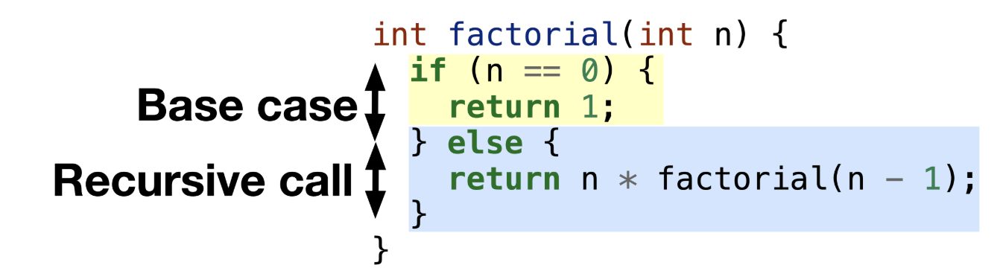
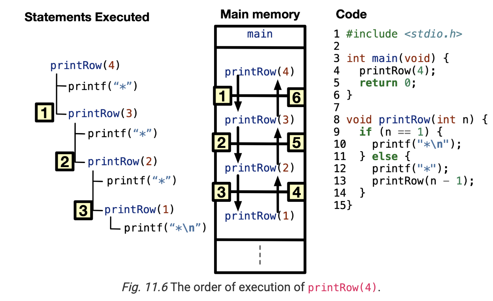

> Last Edit: 3/31/25

# 11.1 Recursive Functions by Definition

- Recursion 递归是一个先解决更小问题实例，后解决整体问题的方法
- Recursion 这一次特指函数调用自身
- Recursion 包含饿了 End Case 和 Loop Case，分别代表了循环条件和终止条件，二者缺一不可

## 11.1.1 Euclidean Algorithm for GCD

- Euclidean Algorithm 是一种用于求两个整数最大公约数的方法，这个方法是递归定义的
- 该算法的核心为，如果 a 和 b 是两个正整数且 $a > b$，则 a 和 b 的最大公约数等于 $a - b$ 和 b 的 GCD

$$
\text{GCD}(a, b) =\begin{cases}\text{GCD}(b, a - b) & \text{if } a > b \\\text{GCD}(b, a) & \text{if } a < b \\a & \text{if } a = b\end{cases}
$$

- 将流程写出代码就有

```c
#include <stdio.h>
int gcd(int a, int b);
int main(void) {
  int gcdAnswer = gcd(20, 8);
  printf("gcd(20, 8) = %d\n", gcdAnswer);
  return 0;
}
int gcd(int a, int b) {
  if (a == b) {
    return a;
  } else if (a > b) {
    return gcd(b, a - b);
  } else {
    return gcd(b, a);
  }
}
```

- 可以发现在 function gcd 中，gcd 函数再次调用了自身 `gcd(b, a - b)`，这种 function calling itself 的过程就叫做 Recursion

> 实际上 Recursion 严重降低了代码的可读性
> 

- 一个例子可以是

```mathematica
GCD(20, 8) → GCD(8, 12)   （20 - 8 = 12）
GCD(8, 12) → GCD(8, 4)    （12 - 8 = 4）
GCD(8, 4) → GCD(4, 4)     （8 - 4 = 4）
GCD(4, 4) = 4             （因为两个数相等）
```

## 11.1.2 Factorial of a Number

- 数学中定义 Factorial 为

```mathematica
n! = n × (n - 1) × (n - 2) × ... × 2 × 1
```

- 实现 Factorial 本质上只要一个 Loop，它可以是一个 `for loop`

```c
int factorial(int n) {
    int fact = 1;
    for (int i = 1; i <= n; i++) {
        fact = fact * i;
    }
    return fact;
}
```

- 将这一个用 Recursion 写出来就是

```c
int factorial(int n);

int main(void) {
    int fact = factorial(4);
    return 0;
}

int factorial(int n) {
    return n * factorial(n - 1);
}
```

- 这个代码并不是正确的，因为他少了一个 End Case，也就是没有一个终止条件，递归会不断重复调用自身，即 `n` 递减到 0、-1、-2...
- 所以加一个 `if (n == 0) {return 1;}` 就对了



# 11.2 Recursion in Patterns

- Recursion 是用来解决具有规律结构的问题的
- 重新拿回之前的打印 `*` 的代码，如果最终的目标是打印 n 个 `*` ，那将其拆分成子任务就变成了打印一个，之后在打印 n - 1 个，最终在 `n == 1` 的时候为 End Case



## 11.2.2 Print a Triangle of Stars

- 回到前面的 Loop 中的例子，打印一个

```mathematica
*****
****
***
**
*
```

```c
#include <stdio.h>
void printRow(int n);
void printTriangle(int n);
int main(void) {
  int rows;
  printf("Enter number of rows:");
  scanf("%d", &rows);
  printTriangle(rows);
  return 0;
}
void printTriangle(int n) {
  if (n > 0) {
    printRow(n);
    printTriangle(n - 1);
  }
}
void printRow(int n) {
  if (n == 1) {
    printf("*\n");
  } else {
    printf("*");
    printRow(n - 1);
  }
}
```

- 这里把行操作和列操作都用了 Recursion 写成了两个函数

## 11.2.3 Print an Inverted Triangle of stars

- 将图像转过来

```mathematica
*
**
***
****
*****
```

- 本质上就是给 `prinf` 和 Recursion 换个位置，先进入最深层的 Recursion 后再从 Base Case 往外 print

## 11.2.4 Print a Pattern Recursively

- 现在想要打印一个更加复杂的图形

```mathematica
*****
****
***
**
*
**
***
****
*****
```

- 这里的行操作是不需要变得，因为还是再第 n 行打赢 n 个 `*` 的逻辑
- 而列操作部分，只需要添加一个

```c
printRow(n);              // 打印当前行
printPattern(n - 1);      // 递归打印下一层（更短的行）
printRow(n); 
```

- 实现 Recursion 前后分别打印就行

# 11.3 Recursion in arrays

- 本章将解决一些和 Array 相关的 Recursions，包括 Strings （ Array of Characters)

## 11.3.2 Palindrome Problem

- Palindrome 回文，指的是从前往后，从后往前都一样的 String，比如 Nolan 导演的 TENET 就是一个 Palindrome
- 判断的思路就是每次从最外层进入，一层层判断，End Case 即为只剩下一个 Char 的情况，也就是头尾指向相同的 Char 的时候

```c
#include <stdbool.h>
#include <stdio.h>
#include <string.h>
bool isPalindromeHelper(char *s, int low, int high) {
  if (low >= high)
    return true;
  else if (s[low] != s[high])
    return false;
  else
    return isPalindromeHelper(s, low + 1, high - 1);
}
bool isPalindrome(char *s) { 
    return isPalindromeHelper(s, 0, strlen(s) - 1); 
}
int main(void) {
  printf("isPalindrome(\"racecar\") = %d\n", isPalindrome("racecar"));
  printf("isPalindrome(\"e\") = %d\n", isPalindrome("e"));
  printf("isPalindrome(\"\") = %d\n", isPalindrome(""));
  printf("isPalindrome(\"race\") = %d\n", isPalindrome("race"));
  return 0;
}
```

- 用 Double Node Recursively 进入