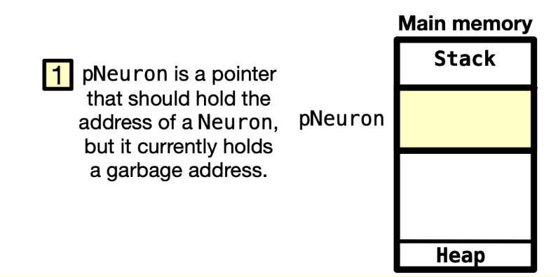

> Last Edit: 3/31/25
> 

Data Structure，即一种储存数据的方式，不同的结构会有不同的性能优势和劣势，即被运用到不同的工作上

# 12.1 What are Data Structures

## 12.1.1 Define a data Structure

### 12.1.1.1 Method 1: Define and Declare Separately

```c
struct Neuron {
  int neuronNum;
  double input1, input2;
  char areaName[20];
 };

 int main(void) {
   struct Neuron neuron;
   return 0;
}

```

- 上半部分 Define 了结构体 `Neuron` ，可以把结构体想象成一个“盒子”📦，里面可以装上：
- 一个整数（int）
- 两个小数（double）
- 一个名字（字符数组 char[]）
- 之后下半部分才 Declare 了一个 Variable `neuron` ，他的 Type 为 `struct Neuron` ，此时才是真正分配 Memory 的时候

### 11.1.1.2 Method 2: Define and Declare in same statement

```c
struct Neuron {
    int neuronNum;
    double input1, input2;
    char areaName[20];
} neuron;
```

- 在定一个 Struct `Neuron` 的同时 Declare 了一个 Variabel `neuron`
- `neuron` 在 Memory 中的结构如下

```mathematica
neuron
 ├── neuronNum       // int 类型，占据一段内存
 ├── input1          // double 类型
 ├── input2          // double 类型
 ├── areaName[0]     // char 类型，字符数组的第一个元素
 ├── areaName[1]
 ├── ...
 └── areaName[19]    // 最后一个字符
```

## 12.1.2 Access Members of a data Structure

- 想要访问 Structure 中的 Members，可以使用 Dot Operator `.`
- 比如访问 `struct Neuron` 类型变量 `neuron` 的 `neuronNum` 字段，就写成 `neuron.neuronNum`

## 12.1.3 Initialize a data Structure

```c
#include <stdio.h>
struct Neuron {
  int neuronNum;
  double input1, input2;
  char areaName[20];
} globalNeuron = {1, 9.1, 8.3, "Frontal Lobe"};
int main(void) {
  struct Neuron neuron = {3, 90, 23, "Frontal Cortex"};
  printf("globalNeuron.neuronNum = %d\n", globalNeuron.neuronNum);
  printf("globalNeuron.input1 = %.2lf\n", globalNeuron.input1);
  printf("globalNeuron.input2 = %.2lf\n", globalNeuron.input2);
  printf("globalNeuron.areaName = %s\n\n", globalNeuron.areaName);
  printf("neuron.neuronNum = %d\n", neuron.neuronNum);
  printf("neuron.input1 = %.2lf\n", neuron.input1);
  printf("neuron.input2 = %.2lf\n", neuron.input2);
  printf("neuron.areaName = %s\n\n", neuron.areaName);
  return 0;
}
```

- 在 Define 好了 `Neuron` 后，存在两个 Declare，分别为 `globalNeuron = {1, 9.1, 8.3, "Frontal Lobe"};` 和 `struct Neuron neuron = {3, 90, 23, "Frontal Cortex"};`
- 他们在 Declare 的同时完成了赋值，通过一个 `{}` 包装里面的值，其中需要注意的是
- 所有成员必须按照结构体中定义的顺序赋值
- 结构体可以在全局、也可以在函数内部初始化

## 12.1.4 Creating an alias for a data Structure

- 可以给一个 Data Structure 一个别的名字，通过语法 `typedef <已有类型> <新名字>;`

```c
#include <stdio.h>

typedef char byte;  // 定义 char 的别名为 byte

int main(void) {
    byte oneLetter = 'S';              // 相当于 char oneLetter = 'S';
    byte sentence[20] = "Snefru";      // 相当于 char sentence[20] = "Snefru";

    printf("oneLetter: %c\n", oneLetter);     // 打印单个字符
    printf("sentence: %s\n", sentence);       // 打印字符串
    return 0;
}
```

- 已知 `char` stands for Character，是 C 语言中的字符数据结构，而给他一个 Alias 就是 `byte` 就把所有 `char` 的操作同时也给了 `byte`
- 也就是说代码中的 `byte oneLetter = 'S';` 实际上就代表了 `char oneLetter = 'S';`

### Give Structure a alias

- 截止目前，所有对于 Structure 的操作都要写成 `struct Neuron neuron = {3, 90, 23, "Frontal Cortex"};`
- 这一个 struct 非常的麻烦，可以通过 typedef 的方式直接将 Structure 设置一个 Alias
- 通过 `typedef struct Neuron Neuron;`，将 `struct Neuron` 整体用 `Neuron` 替换，这样以后就只用写 `Neuron` 了
- 同样的操作还有在 Define 的同时 typedef

```c
typedef struct Neuron {
    int neuronNum;
    double input1, input2;
    char areaName[20];
} Neuron; 
```

- 在做了上面的操作了之后，相当于替换 `struct Neuron` 为 `Neuron` ，但是到现在为止只完成了 Declare 没有 Define 部分，于是可以有

```c
int main(void) {
    Neuron neuron;                      // 使用别名定义变量
    neuron.input1 = 7.9;                // 给结构体成员赋值
    printf("neuron.input1 = %.2lf\n", neuron.input1);  // 打印输出
    return 0;
}
```

- 通过 `Neuron neuron;` 就可以完成一个 Neuron Structure 的 Define

# 12.2 Pointers to Data Structures

## 12.2.1 Access members through pointes

- 现在初始化一个 DS 后给他赋值

```c
typedef struct Neuron {
    int neuronNum;
    double input;
} Neuron;

int main(void) {
    Neuron neuron = {901, 5.67};          // 定义并初始化一个结构体变量 neuron
    Neuron *pNeuron = &neuron;            // 定义结构体指针 pNeuron，指向 neuron
```

- 于是现在有了一个完整定义的 DS 和一个指向 DS 的 Pointer（比如 `pNeuron`）
- 现在有两种访问 DS 内部 Member 的办法

### Dereference and dot Operator

- `(*pNeuron).input = 7.94;`

### Arrow Operator

- `pNeuron->input = 7.94;` 等价于上面那句

## 12.2.2 Dynamic Memory Allocation of Data Structures

- 一切都和上面的一样，做到分配 Memory 的前一步

```c
typedef struct Neuron {
    int neuronNum;
    double input;
} Neuron;

int main(void){
    Neuron *pNeuron;
}
```



- 这时候一个 Pointer Variable `pNeuron` 被 Declare，但是还没有 Define，也就是指向了一个 Garbage Address，这时候 Pointer 本身是在 Stack 上的
- 之后动态分配 pNeuron 的 Memory，也就是一个 `Neuron` 的大小的 Memory `pNeuron = (Neuron *)malloc(sizeof(Neuron));`


- 这时候 `pNeuron` 就指向了 Heap 上的新 Memory，或者说 `pNeuron` 作为 Pointer Variable，它的值为在 Heap 上的一个 Neuron 的地址
- 之后再给 `pNeuron->input = 23.96` 赋值，这个操作对于 Dynamic 和 Static Memory 的作用是一样的，就有


- 最后 free 一下，就完成了一整个 Dynamic Memory Allocation 的过程