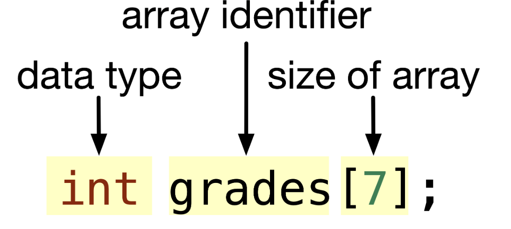
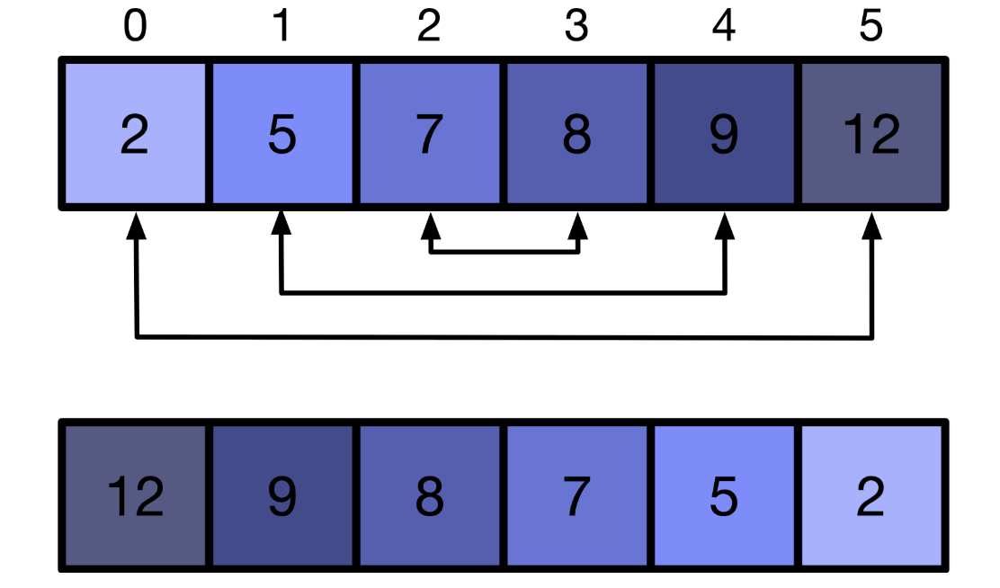
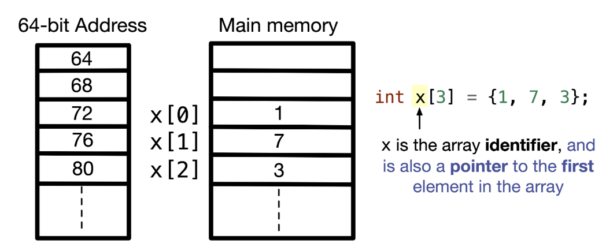

>Last Edit: 2/22/25

很多情况下，需要连续处理多个值，而分别给他们赋值则显得特别麻烦，于是就需要一种更加高效的数据结构

# 7.1 Why and how to use arrays ?

- 假设现在需要统计全班 400 个人的成绩，不可能创建 400 个 Varibale 将成绩和名称一一赋值，更高效的做法是创建一个 Array 
- 通过 `int grades[7]` 就可以 Declare 一个 Array




- 想要挨个指定 Array 内 Element 的值，则需要挨个指定

``` c
grades[0] = 100;
grades[1] = 95;
grades[2] = 67;
grades[3] = 99;
grades[4] = 72;
grades[5] = 101;
grades[6] = 200;
```

- 在 C 语言中，访问 Array 的第一个值，需要用 0 作为 Index
- 如果不想要一一赋值，可以直接 Initialize Array，直接 `int grades[7] = {100,95,67,99,72,101,200}  就可以完成定义并赋值
- 对于 Array 来说，他的 Size 在整个程序中都是固定的，定义他的大小的方式有很多种

``` c
#define SIZE 7

int main(void) {
  int arr[SIZE];  // 等价于 int arr[7];
  int x = SIZE;   // 等价于 int x = 7;
  return 0;
}
```

- 使用 Macro `#define` 作为宏定义，他的作用是给 7 取了个 Alias 别名 叫做 `SIZE`，这样在运行的时候，所有 `SIZE` 都会被替换成 7

``` c
int main(void) {
  const int Size = 7;
  int arr[Size];  // 在某些编译器中可能不合法
  int x = Size;
  return 0;
}
```

- 或者常规的使用 `const` 来定义

## ex. Find Avg of an array 

- 整体思路就是累加 Array 的每一个元素，后将和处以元素个数

```c
#include <stdio.h>
#define SIZE 7 
int main(void){
  int grades[SIZE] = {100, 95, 67, 99, 72, 101, 200};
  int sum = 0;
  double avg = 0;
  for (int index = 0; index < SIZE; index++){
    sum = sum + grades[index];
  }
  avg = (double) sum / SIZE;
  printf("Average is %.2lf", avg);
  return 0;
}
```

- 对于上面的常规遍历操作，会出现以下常见问题

### Array Index Range Error

- 想要遍历整个 Array，正确的 index 应该是 `0` 到 `SIZE - 1`，也就是说 Array 的最后一个元素是 `SIZE - 1`，若遍历为 `index <= SIZE` 则会出现越界错误
- 同样的，Array 的 start point 也是 `index = 0`，要从 0 开始不然无法访问到第一个元素
- 还有就是要将 `sum` 定义成 `double` 类型以确保除法不会出现精度问题

## 7.1.1 ex. Reverse the Elements in an Array



- 这里有很多种方法，书中采取了 Swap 的办法，即把 Low 和 High 配对然后 Swap

```c
#include <stdio.h>
#define SIZE 6
int main(void){
  int arr[SIZE] = {2, 5, 7, 8, 9, 12};
  for (int index = 0; index < SIZE; index++){
      printf("%d, ", arr[index]);
  } 
  printf("\n");
  for(int low = 0, high = SIZE - 1; low < high; low++, high--){
    int temp = arr[low];
    arr[low] = arr[high];
    arr[high] = temp; 
  }
  for (int index = 0; index < SIZE; index++){
    printf("%d, ", arr[index]);
  } 
  printf("\n");
  return 0;
}
```

## 7.1.2 Summary of Important Features of Arrays

- 以下总结了一些重要的 Array 的注意事项
- 第一个元素从 Index = 0 开始
- 当 Declaring Array 的时候，不是一定需要将 `SIZE` 给到 `[]` 中，因为 Compiler 编译器会自动计算 Array 中的元素个数
- 当 SIZE 大小大于实际元素的时候，如 `int array [5] = {1,2}` 的情况下，实际上它相当于 `int array [5] = {1,2,0,0,0}` 的效果，不会报错
- 同样的，当 SIZE 小于实际元素的时候，如 `int array [5] = {1,2,3,4,5,6}` 的情况下，程序会提示 `warning: excess elements in array initializer`
- 当访问的 index 超出 Array 有的 Elements 个数的时候，会得到 Segmentation Fault 

# 7.2 What are arrays, and how are they stored ?

- 当使用 Array 的时候，所有元素会被 Contiguously Stored in the main memory
- 假设有 `int x[3] = {1,7,3}`，首先这是一个 `int` Array，而一个 `int` 在 Memory 中会占用 4 Bytes，所以从 Array 的第一个 Element 开始，每一个 Element 都会间隔 4 个 Bytes



- 既然 Elements 之间是 Contiguously 的，那么可以发现，Array 自身的名字本质上就是一个指向 Array 中第一个元素的 Pointer，即 `x == &x[0]`
- 既然 Array 的本质就是 Pointer，那么就有 `x+1` 等价于 `&x[1]`，总结就是 

```c
x[i] == *(x + i) == *( &x[i] )
```

- Array 的第 i 个元素等价于 `x+i` 的解引用等价于 Array 的 index 为 i 的元素的 Address 的解引用

## 7.2.1 Pointer Arithmetic 

- 明白了 Array Identifier 是一个指向第一个 Element 的 Pointer 后，Pointer Arithmetic 在理解 Array 中的 Elements 是如何连 Contiguously Stored 在 Memory 中有很重要的作用

> 简单来说，Pointer 和正常的 Variable 不一样，它有着自己的加减乘除方法


- 假设有一个 `int x[] = {1,7,3}`，现在有如下代码

```c
#include <stdio.h>
int main(void) {
    const int size = 3;
    int x[size] = {1, 7, 3};  // 定义数组 x
    int *q = &x[2];           // 指针 q 指向 x[2]
    int dist = q - x;         // 计算指针之间的偏移量
    printf("Dist is %d\n", dist); // 输出偏移量
    return 0;
}
```

- 注意这里的 dist 是两个 Pointer 之间的差而不再是普通的值运算，他的值为
$$Dist =\frac{80-72}{4}$$
- 这是因为 Pointer 之间的加减运算以 Data Type 作为单位，而不是 Bytes，或者说 Pointer 之间计算的差值为 Number of Elements 而不是 Address 的 Bytes Difference
- 这里由于一个 `int` 为 4 Bytes，所以需要处以 4 作为单位长度

# 7.3 How do we pass an Array to a function ?

- 在 C 语言中，将 Array 传递给 Function 实际上是传递 Array 第一个 Element 的 Pointer 给到 Function 中，这意味着，Array 本身并不会被复制，因为 Function 接收到的是 Pointer 指向的 Address，Function 内部对 Array 的修改会影响到原 Array，因为他们用的是同一块 Memory

``` c
#include <stdio.h>
double f(int []); // 声明函数，接受一个整数数组

int main(void){
    int x[3] = {1, 7, 3};  // 定义一个数组
    double result = f(x);  // 传递数组 x 给函数 f
    return 0;
}
double f(int list[]){  // 这里 list[] 实际上是指针
    // statements;
}
```

## 7.3.1 Size of array in a function is unknown

- 前面提到了，Array 作为一个参数被传入的时候，本质上是传入了指向 First Element 的 Address 的 Pointer，这导致了 Function 并不知道 Array 的实际大小
- 这就使得想要让 Function 知道 Array 的 Size，必须将 Size 也作为参数传入

```c
#include <stdio.h>
int sumData(int[], const int); // 函数声明
int main(void){
    int x[3] = {1, 7, 3};  // 定义数组
    int result = sumData(x, 3);  // 传递数组和大小
    printf("Sum of elements in the array: %d.\n", result);
    return 0;
}
int sumData(int list[], const int size) {  
    int sum = 0;
    for (int index = 0; index < size; index++) {  
        sum = sum + list[index];  // 累加数组元素
    }
    return sum;
}
```

- 可以发现在 `int sumData(int[], const int);` 部分，指定了 Size 作为参数的传入

## 7.3.2 Can I use the pointer syntax too ?

- 因为 Array Identifiers 本质上是 Pointer，所以在 Function 内部，`*(list + index)` 也和 `list[index]` 等效

```c
#include <stdio.h>
int sumData(int*, int); // 使用指针表示数组参数
int main(void) {
    int x[3] = {1, 7, 3};  
    int result = sumData(x, 3);  // 传递数组 x
    printf("Sum of elements in the array: %d.\n", result);
    return 0;
}
int sumData(int* list, int size) {  
    int sum = 0;
    for (int index = 0; index < size; index++) {  
        sum = sum + *(list + index);  // 使用指针偏移代替数组索引
    }
    return sum;
}
```

- 可以看到 `sumData(int*, int);` 直接声明了接受 Pointer，而在 Function 内部则通过偏移量来遍历 Array
- 这也说明了 `int list[]` 和 `int* list` 的等效，无论用这两个的其中哪一个，他们都指向的是 `x[0]` 所对应的 Address

## 7.3.3 Are we passing the array by value or by pointers ?

- 下面的例子在其强调了对 Array 的操作都是基于 Address 的特殊性

```c
#include <stdio.h>
void swap(int[], int, int);  // 交换数组中两个元素
void printArray(int[], const int); // 打印数组元素

int main(void) {
    int x[5] = {3, 5, 8, 1, 7};  
    printf("Before swapping: ");
    printArray(x, 5);
    
    swap(x, 0, 4); // 交换 x[0] 和 x[4]

    printf("After swapping: ");
    printArray(x, 5);

    return 0;
}

// 交换 list[i] 和 list[j]
void swap(int list[], int i, int j) {
    int temp = list[i];
    list[i] = list[j];
    list[j] = temp;
}

// 遍历并打印数组
void printArray(int list[], const int size) {
    for (int index = 0; index < size; index++) {
        printf("%d ", list[index]);
    }
    printf("\n");
}
```

- 这就说明了代码中，无论是 `x` 还是 `list`，拿到的都是同一个 Array 的同一系列地址


