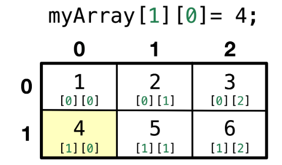
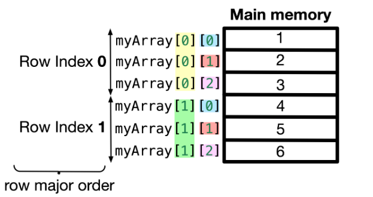
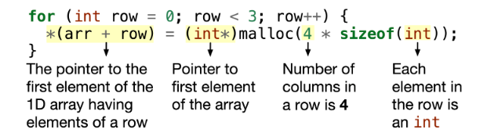

> Last Edit: 3/25/25
> 

在之前介绍了 Array 的使用，但那些都是对于 One-Dimensional Arrays 的，但是引入 Multi-Dimension 也非常重要

# 9.1 Why and How to use 2D Array

- 最常见的 2D Array 就是 Table，它可以用两个维度表示一个数据

## 9.1.1 How to Create

### 9.1.1.1 Declaration Only

- 回顾 1D Array，Declare 它的方法为 `int array[6];` ，其中 6 就是 Array 的 Size
- 对于 2D 也一样，只要一下给两个维度的 Size 就行了 `int array[2][3];`
- 在 Declare 后，需要一个个给 Array 赋值

```c
myArray[0][0] = 1;
myArray[0][1] = 2;
myArray[0][2] = 3;
myArray[1][0] = 4;
myArray[1][1] = 5;
myArray[1][2] = 6;
```

就能得到以下效果



- 一个更加常用的方法就是通过 Nested For Loop

```c
#include <stdio.h>
int main(void) {
  int myArray[3][4];
  
  for (int row = 0; row < 3; row++) {
    for (int col = 0; col < 4; col++) {
      myArray[row][col] = row * 4 + col;
      printf("myArray[%d][%d] = %d\n", row, col, myArray[row][col]);
    }
  }
  return 0;
}
```

- 通过遍历 Array 的 Row Size 和 Column Size 来遍历后依次赋值

### **9.1.1.2. Declaration and Initialization**

- 但是还是直接在 Declare 的时候 Initialize 会更加方便，对于 1D Array 他的操作为 `int myArray[] = {1, 2, 3, 4, 5, 6};`
- 2D 的情况下则多加一个 {}，有 `int array[][] = {{1,2,3},{4,5,6}};` , 也可以用一个括号 `int myArray[2][3] = {1, 2, 3, 4, 5, 6};` ，这种情况下，编译器会以 Row Major Order 也就是行优先的方式填充，也就是一行一行输入
- 在只指定了行和列中的一个参数的情况下，编译器会自动算出另外一个维度的数自行填充

## 9.1.2 2D Array’s Memory

- 一般来说 Array 在内存中都是按照顺序依次储存的，对于 C 语言中的 Array 来说则是 Row Major 的，也就是 `[0][0],[0][1],[0][2]` 的顺序



- 同 1D 的 Pointer 一样，`array[0][0]` 都会指向第一个 Element 的 Pointer，也就是 Base Address，之后通过 `&myArray[i][j] = &myArray[0][0] + (i * number_of_columns + j) * sizeof(int);` 也就可以算出第 i 个元素的 Memory Address 了
- 但是对于 2D Array 来说，它同时是指向第一个 Element 的 Pointer，也是指向第一行的，一般来说 `*myArray` 访问到 `[0][0]` 元素，相当属于是在访问 `*(myArray + 0)` ，而  `*(myArray + 1)` 则会直接访问到第二行
- 想要访问到第一行的第二个元素，则需要  `*((myArray + 0)+1)` 来访问，也就是说**`*(*(myArray + i) + j)`** 访问具体的元素，相当于 `myArray[i][j]`

# **9.2. How do we pass a 2D array to a function?**

- 与 1D 的传入参数一样，2D 下的 Array 也需要一个 Size，现在定义一个简单的 Function 为

```c
void func(int arr2D[][], int rows, int cols){
    arr2D[4][5] = 6; 
    // should go dereference the address:
    // arr2D + row (= 4) * number of columns + col (= 5)
    // the number of columns is unknown!!!
}
```

- 这是 Function 目前是有问题的，正确的语法需要通过 Specify Column 的数量在 arr2D 中
- 同时需要在 `arr2D[][]` 前定义 cols，有正确格式

```c
void func(int rows, int cols, int arr2D[][cols]){
    arr2D[4][5] = 6; 
    // should go dereference the address:
    // arr2D + row (= 4) * cols + col (= 5)
}
```

# 9.3 Dynamic Memory Allocation of 2D Arrays

- 当不知道 Array 中存在 Element 数量，或者是希望 Life Time 更加灵活的时候，需要通过 Dynamic Memory Allocation 来调度内存
- 对于二维数组来说，存在三种 Dynamic Memory Allocation 的办法

## **9.3.1. Method 1: Dynamic Allocation of an array of pointers**

- 第一种办法是分配一组 Array of pointers，其中每一个 Element Pointer 指向二维数组的一行

```c
int** arr = (int**) malloc(3 * sizeof(int*));
```

- 这里，`int** arr` 是一个指向指针的指针，即double pointer 双重指针
- 这个语句通过 `malloc` 函数分配了一个足够容纳三个 `int*` 指针的空间，每个指针将指向一个整数数组的首元素。这样，`arr` 就可以通过索引访问每一行的起始地址
- 第二步是给每一行分配一个对应的一位数组



- 接下来就是给每一个 Element 赋值，用 Pointer 或者 Array 的访问方式都是可以的

```c
for (int row = 0; row < 3; row++) {
    for (int col = 0; col < 4; col++) {
        *( *(arr + row) + col) = row * 4 + col + 1;
        // 或者
        arr[row][col] = row * 4 + col + 1;
    }
}
```

- 最后还需要 Free Memory，根据从里往外的顺序定义，先释放每一行所占内存

```c
for (int row = 0; row < 3; row++) {
  free(*(arr + row));
  // OR
  // free(arr[row]);
  arr[row] = NULL;
}
```

- 然后再释放最外层的 Array of pointers

```c
free(arr);
arr = NULL;
```

## **9.3.2. Method 3: Dynamic Allocation of a 1D array**

- 首先动态分配一个足够大的一维数组来存储所有元素，具体大小由所有 Element 的个数决定，这样就能存储整个二维数组的数据
- 由于数组是一维的，直接使用一维索引访问，计算方式为 `*(arr + row * cols + col)`。这里，`row * cols` 计算当前行之前的所有元素总数，`col` 是当前行中的列索引
- 最后只需要 `free(arr);` 就可以释放整个 Array 了

```c
#include <stdlib.h>
int main(void) {
    int rows = 3, cols = 4;
    int* arr = (int*)malloc(rows * cols * sizeof(int));  // 为整个二维数组分配一维数组空间

    // 使用一维索引填充数组
    for (int row = 0; row < rows; row++) {
        for (int col = 0; col < cols; col++) {
            *(arr + row * cols + col) = row * cols + col + 1;
        }
    }
    free(arr);  // 释放分配的内存
    return 0;
}
```