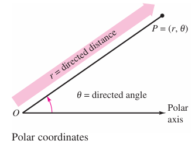
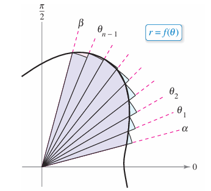

> Last Edit: 1/8/25

## 10.1 Parametric Equations

- If x and y are continuous functions of t on an interval I, then the equations are called parametric equations and t is called the parameter
$$x=x(t) andy=y(t)$$

### Eliminating the Parameter 化简

- 通过关系式直接得到x和y之间的函数

#### ex.
$$x(t) = t^2 - 3, \quad y(t) = 2t + 1, \quad -2 \leq t \leq 3.$$
- 从第二个Equation中提出\\(t = \frac{y - 1}{2}\\)后带入
$$x = \left(\frac{y - 1}{2}\right)^2 - 3 \\ = \frac{y^2 - 2y + 1}{4} - 3 \\ = \frac{y^2 - 2y - 11}{4}$$
### Use Trigonometrey to Eliminate Parameter

- 通过一些等式建立x和y之间的关系
- 例如\\(\cos^2x+\sin^2 x=1\\)

#### ex.

- 有\\(x = 3 \cos \theta \quad \text{and} \quad y = 4 \sin \theta, \quad 0 \leq \theta \leq 2\pi\\)
- 通过\\(cos \theta=\frac{x}{3},sin\theta=\frac{y}{4}\\)替换原式，便有\\((\frac{x}{3})^2+(\frac{y}{4})^2=1\\)

##  10.2 Calculus of Parametric Curves

### Derivatives of Parametric Equations

- If a smooth curve C is given by the equations
$$x = f(t) \quad \text{and} \quad y = g(t)$$
- then the slope of C at (x, y)  is
$$\frac{dy}{dx} = \frac{\frac{dy}{dt}}{\frac{dx}{dt}}, \quad \frac{dx}{dt} \neq 0
$$

### Arc Length of a Parametric Curve

- 普通的Arc Length公式为\\(\int^b_a\sqrt{1+[f'(x)]^2}dx\\)
- 将Parametric Curve的Derivative带入，得到
$$\int^b_a\sqrt{1+(\frac{dy/dt}{dx/dt})^2}dx=\int^b_a\sqrt{\frac{(dx/dt)^2+(dy/dt)^2}{(dx/dt)^2}}\frac{dx}{dt}dt$$
- 也就是
$$=\int^b_a\sqrt{(\frac{dx}{dt})^2+(\frac{dy}{dt})^2}dt=\int^b_a\sqrt{[f'(x)]^2+[g'(t)]^2}dt$$

 10.3 Polar Coordinates 极坐标

- Polar Coordinates，一个新的坐标系，通过Radius和于Polar Axis的Directed Angle来表示点在坐标系中的位置

### Converting Points between Coordinate Systems

- 想要把Cartesian Coordinates转换为Polar Coordinates，只需要找到\\(r=\sqrt{x^2+y^2}\\) 和 \\(\tan^{-1}\frac{y}{x}\\)便可
- 而Polar 到 Cartesian的转换则是通过公式\\(x=r\cos\theta , y=r\sin\theta\\)得到

##  10.4 Area and Arc Length in Polar Coordinates

### Slope of Polar Curve

- 对于Polar Coodinates来说，其Derivative可以通过一个简单的Chain Rule得到
$$\frac{dy}{dx} = \frac{\frac{dy}{d\theta}}{\frac{dx}{d\theta}} = \frac{f(\theta) \cos \theta + f'(\theta) \sin \theta}{-f(\theta) \sin \theta + f'(\theta) \cos \theta}$$
### Areas of Regions Bounded by Polar Curves

- 在之前都是采用多边形来近似面积，而在Polar Region中，采用了扇形的来近似

$$A = \lim_{n \to \infty} \frac{1}{2} \sum_{i=1}^{n} [f(\theta_i)]^2 \Delta \theta = \frac{1}{2} \int_{\alpha}^{\beta} [f(\theta)]^2 d\theta$$

