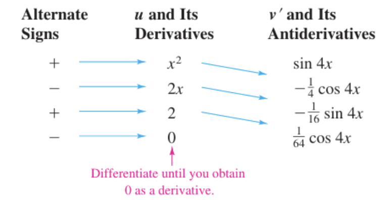

> Last Edit: 3/6/25

# Integration by part

- 当 Integral 内存在两个函数的乘积的时候，可以使用 Integration by parts
- 已知有 Derivative's Product Rule

$$
\left( u(x) v(x) \right)' = u'(x) v(x) + u(x) v'(x)
$$

- 将两边同时积分可以得到

$$
\int u(x) v'(x) \,dx = \int (u(x) v(x))' \,dx - \int v(x) u'(x) \,dx
$$

- 等式右边的第一项化简后可以得到

$$
\int u(x) v'(x) \,dx = u(x) v(x) - \int v(x) u'(x) \,dx
$$

- 于是就得到了 Integral By Parts 的公式

$$
\int u \,dv = uv - \int v \,du
$$

- 在得到了处理 Integral 内部有乘积时候的公式后，只需要选择乘积中的一个作为 u，另一个作为 v，并对一个求导，一个积分就可以得到 Integral By Parts 的结果了

## Guidelines for Integration by Parts

- u 和 v 的选择直接关系到了 Integral By Parts 的难度
- u求导后应该比u简单
- dv积分后应该比v简单

> 通常使用 **LIATE 法则**（Logarithmic, Inverse trig, Algebraic, Trigonometric, Exponential） 优先选择 LIATE 顺序靠前的函数作为 u，然后把剩下的部分作为 dv

## ex. Integral By Parts

考虑积分 $\int xe^{2x}dx$

- 在这里由于 e 的特殊性质，应该求 x 的 Derivative，求 dv 的 Integral，求出 $x'=1,\int e^{2x}dx=\frac{1}{2}e^{2x}$，可以得到

$$
\underbrace{x \frac{1}{2} e^{2x}}{uv} - \int \underbrace{\frac{1}{2} e^{2x}}{v} \underbrace{dx}_{du}
$$

- 再求得 $vdu$ 项的积分有

$$
\int xe^{2x}dx=\int \underbrace{x}{u} \underbrace{e^{2x} \,dx}{dv} = \underbrace{x \frac{1}{2} e^{2x}}{uv} - \int \underbrace{\frac{1}{2} e^{2x}}{v} \underbrace{dx}_{du} = \frac{1}{2} x e^{2x} - \frac{1}{4} e^{2x} + C
$$

## ex. Getting the original Integral

求 $\int x^2 sinx dx$

- 令 $x^2$ 为 u, sinx 为 dv

$$
\int x^2 \sin x \,dx = -x^2 \cos x + \int 2x \cos x \,dx= -x^2 \cos x + x^2 \cos x + \int x^2 \sin x \,dx
$$

- 化简后发现得到了

$$
\int x^2 \sin x \,dx=\int x^2 \sin x \,dx
$$

## Tabular Method

- 当一个 Integral 中两个函数相乘的时候，如果其中一个能在有限次数的求导内得到0，便可以使用 Tabular Method
    

    

- 左边必须是 Alternate Sign，从 + 开始，对 u 反复求导，对 dv 反复积分，最终将 u 乘以 dv，然后将所有项包含正负号加在一块就是答案

# Trigonometric Substitute

- 三角恒等式可以将 Integral 中的根号表达式通过如 $1 - \sin^2\theta = \cos^2\theta$ 的简单形式，从而让积分变得更容易计算，特别是对于以下三种形式

$$
\sqrt{a^2 - x^2} → 令~ x=asinθ \\
\sqrt{a^2 + x^2}→ 令 ~x=atanθ \\
\sqrt{x^2 - a^2} → 令~x=asecθ
$$

## \sqrt{a^2 - x^2} 的积分

- 对于积分 $\int \frac{dx}{\sqrt{a^2 - x^2}}$
- 因为 $x=asin⁡θ,dx=acos⁡θ$
- 有三角恒等式 $1 - \sin^2\theta = \cos^2\theta$ 可以得到 $\sqrt{a^2 - x^2} = a \cos\theta$

> 这里的 a 是为了化简根号中的被减数的

### ex.

有 Integral $\int \frac{dx}{\sqrt{4 - x^2}}$

- 观察发现 Constant Term 是被减数，可以使用的三角恒等式为  $1 - \sin^2\theta = \cos^2\theta$，令
$x=2sin⁡θ,dx=2cos⁡θ$
- 将 x 带入之后可以得到

$$
\sqrt{4-4\sin^2\theta}\Rightarrow \sqrt{4(1-\sin^2\theta)}=2\cos\theta
$$

- 带入后可以得到

$$
\int \frac{2\cos\theta \, d\theta}{2\cos\theta} = \int d\theta = \theta + C
$$

- 已知 $\theta = \arcsin\frac{x}{2}$

$$
\int \frac{dx}{\sqrt{4 - x^2}} = \arcsin\frac{x}{2} + C
$$

## \sqrt{a^2 + x^2}

- 对于形如 $\int \frac{dx}{\sqrt{a^2 + x^2}}$

$$
x=atan⁡θ,dx=asec⁡^2θ dθ
$$

- 观察发现可以使用三角恒等式 $1 + \tan^2\theta = \sec^2\theta$，和上面一样可以得到

$$
\sqrt{a^2 + x^2} = a \sec\theta
$$

### ex.

$$
\int \frac{dx}{\sqrt{9 + x^2}}
$$

- 观察发现 Constant Term 为 9，并且根号内为加法，可以使用 $1 + \tan^2\theta = \sec^2\theta$，替换 $x=3tan⁡θ,dx=3sec⁡2θ dθ$

$$
\sqrt{9 + x^2} = 3\sec\theta
\int \frac{3\sec^2\theta \, d\theta}{3\sec\theta} = \int \sec\theta \, d\theta= \ln | \sec\theta + \tan\theta | + C
$$

- 最后可以得到

$$
\int \frac{dx}{\sqrt{9 + x^2}} = \ln \left| \frac{\sqrt{9 + x^2}}{3} + \frac{x}{3} \right| + C
$$

### \sqrt{x^2 - a^2} 的积分

- 对于形如 $\int \frac{dx}{\sqrt{x^2 - a^2}}$，和前面的都一样，有

$$
x = a \sec\theta, \quad dx = a \sec\theta \tan\theta \, d\theta
$$

- 使用三角恒等式

$$
\sec^2\theta - 1 = \tan^2\theta \Rightarrow \sqrt{x^2 - a^2} = a \tan\theta
$$

## ex.

解 $\int \frac{dx}{\sqrt{x^2 - 16}}$

- 观察得到 Constant 是减数，而根式内是减号，观察可以使用 $\sec^2\theta - 1 = \tan^2\theta$，令 $x = 4\sec\theta, \quad dx = 4\sec\theta \tan\theta \, d\theta$

$$
\int \frac{4\sec\theta \tan\theta \, d\theta}{4\tan\theta} = \int \sec\theta \, d\theta\ln | \sec\theta + \tan\theta | + C
$$

## Summary

| 根式形式 | 代换方式 | 结果表达式 |
| --- | --- | --- |
| $\sqrt{a^2 - x^2}$ | $x = a\sin\theta$ | $\sqrt{a^2 - x^2} = a\cos\theta$ |
| $\sqrt{a^2 + x^2}$ | $x = a\tan\theta$ | $\sqrt{a^2 + x^2} = a\sec\theta$ |
| $\sqrt{x^2 - a^2}$ | $x = a\sec\theta$ | $\sqrt{x^2 - a^2} = a\tan\theta$ |

# Partial Fraction

- 对于一个分式

$$
\int\frac{1}{x^2-5x+6}dx
$$

- 无法对其直接做积分，于是可以通过 Partial Fraction 化简

## Partial Fraction

- 对于一个分式，如果分母可以因式分解成不同的一次因式，如下形式

$$
\frac{P(x)}{(x-a)(x-b)}
$$

- 那么它就可以化简为 Partial Fraction

$$
\frac{P(x)}{(x-a)(x-b)} = \frac{A}{x-a} + \frac{B}{x-b}
$$

- 接下来就需要更具步骤依次求解 A 和 B
- 首先将等式两边分别通分，可以得到

$$
P(x)=A(x-b)+B(x-a)
$$

- 现在的阶段，a 和 b 是 Constant，设 x = b 就可以解出 B，令 x = a 就可以解出 A

### ex.

因式分解 $\frac{3x + 5}{(x-1)(x+2)}$

$$
\frac{3x + 5}{(x-1)(x+2)} = \frac{A}{x-1} + \frac{B}{x+2}
$$

- 通分得到

$$
3x+5=A(x+2)+B(x-1)
$$

- 令 $x=-2$，有 $-1=-3B \Rightarrow B = \frac{1}{3}$ ，同理解出 $A=\frac{8}{3}$

### ex. Quadratic Factors

现在有 $\frac{2x^3 - 4x - 8}{(x^2 - x)(x^2 + 4)} \, dx$

- 化简分母 $(x^2 - x)(x^2 + 4) = x(x - 1)(x^2 + 4)$
- 当分母中出现二次不可约因子（即不能因式分解为两个一次因子），对应的分子必须是一次多项式，即 Cx + D
- 通过 Partial Fraction 可以得到

$$
\frac{2x^3 - 4x - 8}{x(x - 1)(x^2 + 4)} = \frac{A}{x} + \frac{B}{x - 1} + \frac{Cx + D}{x^2 + 4}
$$

- 通分后可以得到

$$
2x^3 - 4x - 8 = A(x - 1)(x^2 + 4) + Bx(x^2 + 4) + (Cx + D)(x)(x - 1)
$$

- 用普通方式计算 A 和 B $x=0\Rightarrow A=2, x=1 \Rightarrow B =-2$
- 现在将 A，B 和两个任意的 $x\neq 0,1$ 带入原式后就可以得到一个二元一次方程组，之后就可以解出 C 和 D 了

# Improper Integrals

- 在 Integral 被定义的时候，限制了他的 a 和 b 需要是一个有限的值，而有的时候上下界不可避免的会出现 Infinite 的情况，这就需要 Improper Integral
- 简单来说 Improper Integral 就是给 Integral 前面添加一个 Limit，在这之外就没有其他的变化

$$
\int_{a}^{\infty} f(x) \, dx = \lim_{b \to \infty} \int_{a}^{b} f(x) \, dx
$$

## ex.

计算积分 $\int_{1}^{\infty} \frac{dx}{x}dx$

- 通过 $\lim_{b\rightarrow \infty}$ 替换上界，有

$$
\int_{1}^{\infty} \frac{dx}{x} = \lim_{b \to \infty} \int_{1}^{b} \frac{dx}{x}= \lim_{b \to \infty} \left[ \ln x \right]{1}^{b}
= \lim{b \to \infty} (\ln b - 0)
= \infty
$$