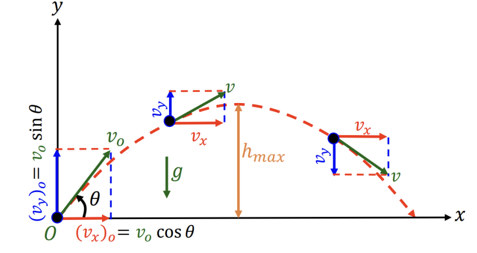
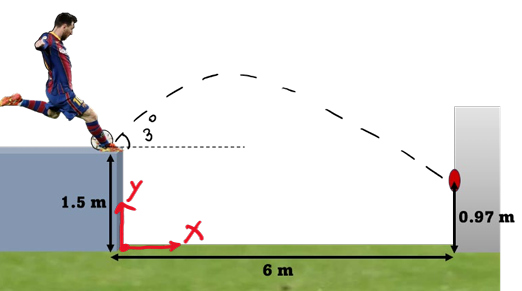
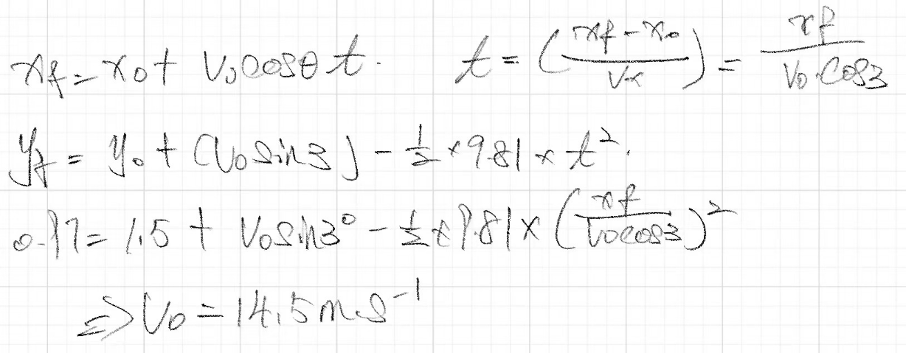
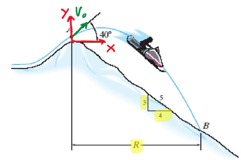
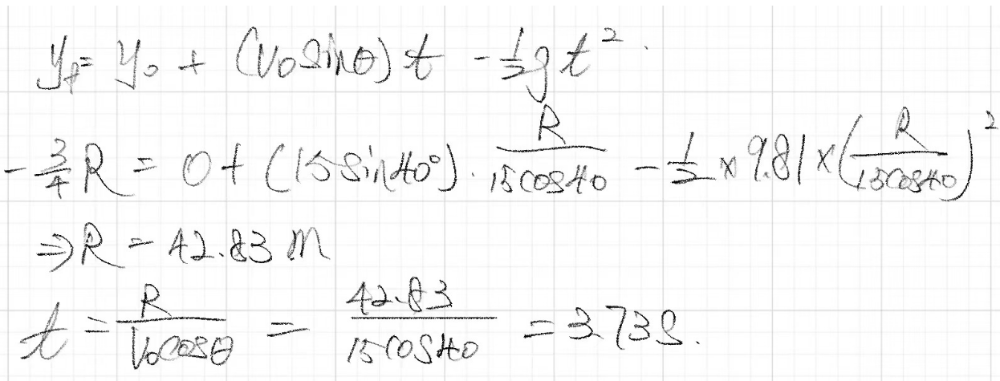

> Last Edit: 3/24/25

## Assumptions

- 斜抛运动其实就是在分析物体在两个自由度上的运动
- 现在为了简化问题，做出以下假设，忽略空气阻力，地球自转，并令重力为常数

## Velocity

- 于是有以下两个方向的初速度为

| Axis | Initial Velocity | Acceleration |
| --- | --- | --- |
| x | \\(v_0 \cos \theta\\) | 0 |
| y | \\(v_0 \sin \theta\\) | \\(\downarrow g, \, -g \uparrow\\) |

- 总结便可以得出以下表格

| Axis | Velocity (\\(v = v_0 + at\\)) | Position (\\(s = s_0 + v_0t + \frac{1}{2}at^2\\)) | No "t" (\\(v^2 = v_0^2 + 2a\Delta s)\\) |
| --- | --- | --- | --- |
| x | \\(v_x = v_0 \cos \theta\\) | \\(x = x_0 + (v_0 \cos \theta)t\\) | N/A |
| y | \\(v_y = v_0 \sin \theta - gt\\) | \\(y = y_0 + (v_0 \sin \theta)t - \frac{1}{2}gt^2\\) | \\(v_y^2 = (v_0 \sin \theta)^2 - 2g\Delta y\\) |
- 可以发现之所以x的第三列为 N/A 是因为 x 方向的加速度为零

### Maximum Height

- 通过分析这里的公式就可以得出一些二级结论
- 物体在 Projectile Motion 中到达最高点后的Velocity会降到0
- 到达这一点的时间可以通过 \\(0=v_y-gt\\)  得到，有

$$
t=\frac{v_y}{g}
$$

- 其高度则是根据 \\(v^2 = v_0^2 + 2a\Delta s\\) 解得

$$
\Delta y = \frac{v_{y0}^2}{2g}
$$

### ex. Messi kicks the ball

### ex. Snowmobile

Snowmobile is going 15 𝑚/𝑠 at point A. Find: The horizontal distance it travels (𝑅) and the time (𝑡) in the air

