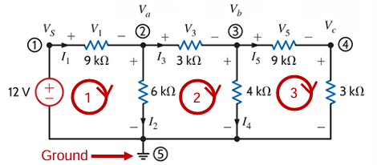

> Last Edit: 3/7/25

## Node Analysis

- 在 Kirchhoff's Voltage Law, KVL 中，规定了在一个完整的 Closed loop 中，所有 Voltage rises 和Voltage drops 的代数和必须等于零
- 这是因为电压是势能差，一个完整的回路回到起点后，总能量变化应该为零，这是电荷守恒和能量守恒的直接体现
- 然而，对于 **Partial path** 或 **Non-closed segment** 非闭合段，其电压之和不一定为零，而是等于这些局部路径两端 Node 的电压差

- 以上图为例，在 Node 1 到 2 之间，Potential Difference 为 \\(V_s=V_1+V_a\\)
- 而需要注意的是，在 Node Analysis 中，由 Battery 提供的初始 Voltage 被视为负值，有 \\(-V_s+V_1+V_a=0\\)
- 这是因为，当电路闭合的时候，Battery 推动 Electron 从负极向正极移动，并且在到达正极的时候获取了最高的 Electric Potential，之后在通过 Resistor 和其他负载的时候，Electron 会消耗这些 Potential Energy 以克服阻力，这视为 Potential 的下降
- 但是规定的符号与能量变换相反，即 Battery 提供 Electric Potential 的过程视为负号，用电器小号 Potential 的过程视为正号
- 总结上图中的 \\(V_1,V_3,V_5\\)，可以得出

$$
I_1 = \frac{V_1}{9k} = \frac{V_s - V_a}{9k},I_3 = \frac{V_3}{3k} = \frac{V_a - V_b}{3k},I_5 = \frac{V_5}{9k} = \frac{V_b - V_c}{9k}
$$

- 对于 \\(6k\Omega\\) 和 \\(4k\Omega\\) 来说，由于 Ground 是电路中所有 Node Potential 的参考零点，所以其本身为 0 V，也就是说 \\(0=V_a-V_{6k\Omega}\\)，而它所对应的 Current 也就是

$$
I_2=\frac{V_{6k\Omega}}{6k}=\frac{V_a-0}{6k}
$$

### PD & Current Direction

- 现在有以下 Circuit

- Voltage 即 Potential Difference 是一个参考量，即根据参考点的不同具有不同的数据，图中的 4 V 和 -2 V 即为相较于 Ground 也就是 0 V 参考的
- 而 Current 的 Direction 又和 Fragment 两端的 Node 的 Potential Difference 有关，呈现出的规律为 Current Will flow from higher to lower potential
- 在这张图中即为，R1 从上往下，R2 从左往右，R3 从下往上

### Circuits containing only Independent Current Sources

- 在没有 Voltage Source 而是 Current Source 的时候，Circuit 的行为主要由 Current Source 驱动，而不是 Voltage Source

- 上图中即存在两个 Current Source，\\(i_A\\)  和 \\(i_B\\)
- 而对于 Node 来说，Node 1 根据 KCL 有 \\(i_A=i_1+i_2\\)，Node 2 有 \\(i_2=i_B+i_3\\)
- 现在进一步假设 \\(I_A = 1\,mA, R_1 = 12\,k\Omega, R_2 = 6\,k\Omega,  I_B = 4\,mA, R_3 = 6\,k\Omega\\)
- 已知 \\({i}_1 = \frac{v_1}{R_1},{i}_2 = \frac{v_1 - v_2}{R_2},{i}_3 = \frac{v_2}{R_3}\\)，将他们带入原来的 Equation 中，有

$$
i_A = \frac{v_1}{R_1} + \frac{v_1 - v_2}{R_2},i_B = \frac{v_1 - v_2}{R_2} + \frac{v_2}{R_3}
$$

- 带入数据得到

$$
1\times 10^3=\frac{v_1}{12k}+\frac{v_1-v_2}{6k},-4\times10^3=\frac{v_1-v_2}{6k}=\frac{v_2}{6k}
$$

- 解方程组后可以得到 \\(V_1=-6V,V_2=-15V\\)，也就可以对应解出 \\(I_1,I_2\\) 了

> 同时也可以发现，如果一个 Circuit 中有 N 个 Node，则对应存在 N-1 个 Equation 需要解
>