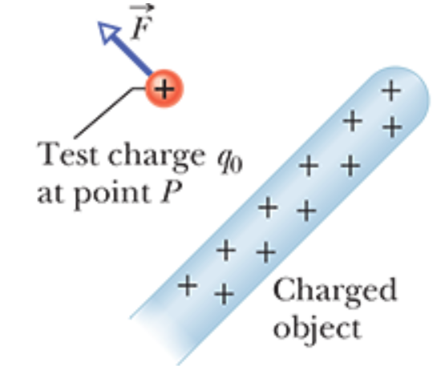
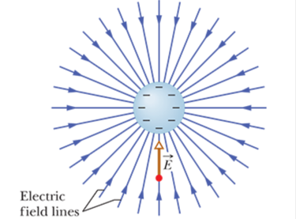
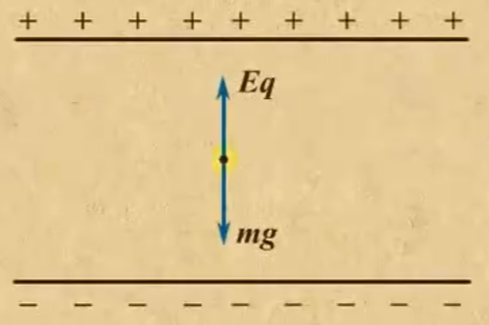

> Last Edit: 3/21/25

## Electric Field 电场

- 在科学中存在多个 Field的概念，其中包含了 Teperature Field，Pressure Field 等
- 而 Electric Field 则是一个 Vector Field，矢量场，其包含了大小与方向
- 具体来说，定义 Electric Field的方式是在 Electric Field \\(\vec{E}\\) 的某个点 P 处放置一个 Small Positive Charge 的 \\(q_0\\)，其为 Test Charge

> We want the charge to be small so that it does not disturb the object’s charge distribution

## Electric Field Strength 电场强度

- 一个表示电场强弱的物理量
- 电场 \\(\vec{E}\\) 在点 P 由带电对象产生，对试验电荷 \\(q_0\\) 产生了静电力 \\(\vec{F}\\)
- 由于 \\(p_0\\) 是一个正的Charge，所以电场的方向是电力的方向，而电场的大小有

$$
\vec{E} = \frac{\vec{F}}{q_0}
$$

- Electric Field 的国际单位系统 (SI) 单位是牛顿每库仑（N/C）

## Electric Field Lines 电场线

- 由于需要一种方式可视化电场，Eletric Field Lines出现了

- Electric Field Line 的方向是由正电荷指向负电荷
- 根据 Electric Field 的性质，电场线的密集程度反映了电场的强度。电场线越密集，电场强度越大

### ex. Graph Interpretation of Electric Field

In the figure the electric field lines on the left have twice the separation as those on the right. (a) If the magnitude of the field at A is 39 N/C, what is the magnitude of the force on a proton at A? (b) What is the magnitude of the field at B?

## The Electric Field Due to a charged Particle

- 为了找到 Charged Particle（通常称为点电荷）产生的 Electric Field，我们在粒子距离 r 的位置放置一个正测试电荷
- 前面知道 Coulomb's Law 有

$$
F = \frac{1}{4 \pi \varepsilon_0} \frac{|q||q_0|}{r^2}
$$

- 将 \\(\vec F\\) 代入到 \\(\vec E\\) 中便可以得到

$$
\vec{E} = \frac{\vec{F}}{q_0} = \frac{1}{4\pi \epsilon_0} \frac{q}{r^2}\quad \text{(charged particle)}
$$

### Principle of superposition 电场的叠加原理

- 如果在某点有多个电荷产生的电场，可以通过叠加原理来计算该点的总电场。文中用到了叠加原理，表达式为

$$
\vec{E} = \vec{E}_1 + \vec{E}_2 + \cdots + \vec{E}_n
$$

- 这说明总电场是各个单独电场向量的矢量和

### ex. Electric Field Superposition

In the figure the four particles are fixed in place and have charges \\(q_1 = q_2 = 4e\\), \\(q_3 = 2e\\), and \\(q_4 = -8e\\). Distance d=4.75d = 4.75 µm. What is the magnitude of the net electric field at point P due to the particles?

## A Point Charge in an Electric Field

- 当一个 Particle 有着 q 的 Charge 被放置在 Electric Field \\(\vec E\\) 中的时候，Electric Field 会对其产生\\(\vec F=q\vec E\\) 的Electrostatic Force

### Millikan Oil-drop Experiment

- 罗伯特·A·密立根在1910年进行的著名实验油滴实验，用于测量电子的基本电荷e

