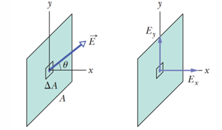
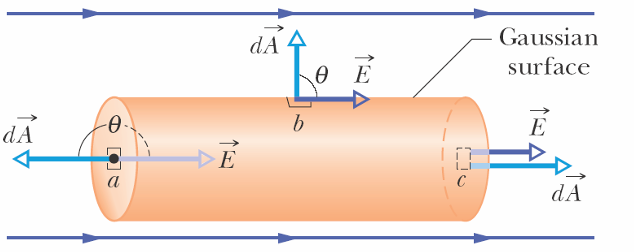
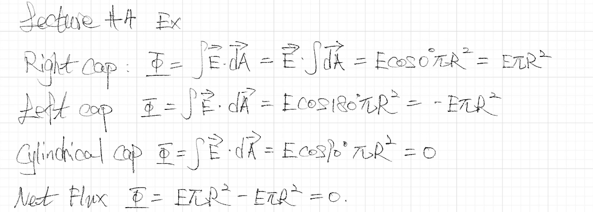
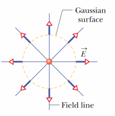
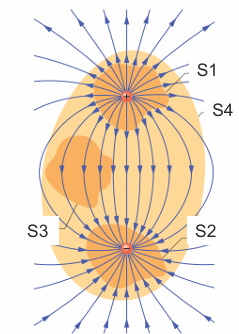
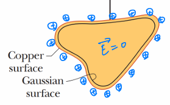
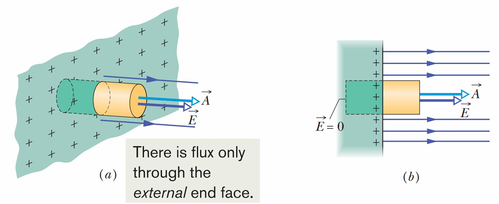
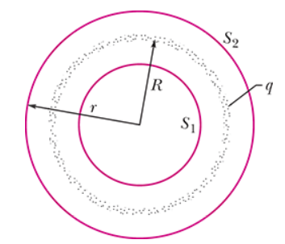
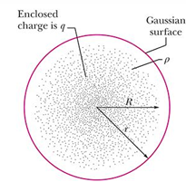

> Last Edit: 3/28/25
> 

# Electric Flux

- 穿一个大小为 A 的平面的 Electric Field 个数

$$
\Delta \Phi = (E \cos \theta) \Delta A
$$

- 也可以替换为 Dot Product，$\Delta \Phi = \vec E \cdot \Delta A$，同样的，Total Flux就是

$$
\Phi=\sum \vec E\cdot  \Delta \vec A，or~\Phi=\int\vec E\cdot d\vec A
$$

## ex.

Consider a cylinder of radius R in a uniform electric field with axis parallel to the field direction, what are the flux through the end caps, cylindrical surface, and the net flux?

# Gauss's Law

- Consider a particle with charge +q is surrounded by an imaginary concentric sphere

> 这是一个 Gauss‘ Law 的 Special Case
> 

$$
\Phi = \oint \vec{E} \cdot d\vec{A} = \oint E \, dA = E \oint dA= E \cdot 4\pi r^2 = \left( \frac{1}{4 \pi \varepsilon_0} \cdot \frac{q}{r^2} \right) \cdot 4 \pi r^2 = \frac{q}{\varepsilon_0}
$$

- 其中 $\oint dA$ 指的是一个封闭曲面的总面积
- 通过上面等式，Gauss’ Law 说明了一个闭合表面即 Gaussian Surface 的 Electric Flux 和其包围的 Net Charge 的关系，即

$$
{\varepsilon_0}\Phi = Q_{\text{enc}}
$$

## ex. Gauss's Law

Consider two charges with opposite signs and equal magnitude (+q and –q). Determine the electric flux of the four Gaussian surfaces are shown below:

- S1：q 是一个 Positive Charge，是一个 Positive Number
- S2：q 是一个 Negative Charge，是 Negative
- S3：其所围成的空间中并不包含 Charge，所以 Zero
- S4：Net charge 为 0，即 Zero

# A charged Isolated Conductor

- 孤立导体上，所有额外的电荷都会移动到导体的表面，导体内部不会有多余电荷
- 这是因为导体内部的电荷会通过相互作用重新分布，直到内部电场为零，从而达到静电平衡

- 同理如果里面出现了一个 Cavity，其也不会存在电荷
- 当 Conductor 不是一个光滑的 Spherical 的情况下，电荷并不会均匀的分布在表面上，而是受到曲率的影响，导致尖锐的部分会拥有更多的电荷密度

## The External Electric Field

- 对于一个贴着 Conductor 的 Gaussian Surface，由于 Conductor 内部 Electric Field 为 0，所以只考虑外部的通量

$$
ε₀EA = σA
$$

- 导体表面外侧的电场强度等于表面电荷密度除以 $\varepsilon_0$，但这个关系只在表面成立

# Applying Gauss's Law: Cylindrical Symmetry

- 有一个长度为无线的 Plastic Rod，其 Charge Density 为 \lambda
- 想求离Central Axis的半径为r的距离处的Electric Field Magnitude
- 由于Electric Field是从圆柱体中心穿过的，而有Gauss' Law

$$
\Phi = \frac{Q_{\text{enc}}}{\epsilon_0}= \oint \vec{E} \cdot d\vec{A}
$$

- 可以得出面积等于 $A = 2\pi rl$
- 已知电荷密度为 $\lambda$，即总电荷数为 $Q_{enclosed}=\lambda \cdot L$，所以有 $2\pi rl E=\frac{\lambda L}{E_0}$，也就是

$$
E = \frac{\lambda}{2\pi\epsilon_0 r}
$$

## ex. Lighting strikes the tree

当雷电击中一棵树的时候，其可以被看作是一个导线，而半径为r内的空气都将被 Ionized，计算出这个半径r，令 E=3\times 10^6 N/C

$$
r = \frac{\lambda}{2\pi\epsilon_0 E}= \frac{1 \times 10^{-3}\ \text{C/m}}{(2\pi)(8.85 \times 10^{-12}\ \text{C}^2/\text{N}\cdot\text{m}^2)(3 \times 10^6\ \text{N/C})}= 6\ \text{m}
$$

# Applying Gauss's Law: Planar Symmetry

- 对于一个无限大的电荷密度为 $\sigma$ 的Plane，有 $\sigma=\frac{Q}{A}$
- 根据 Gauss' Law $\Phi = \frac{Q_{\text{enc}}}{\varepsilon_0}$，其中 $Q=\sigma A$，于是有

$$
\Phi=\frac{\sigma A_0}{\varepsilon_0}
$$

- 令其中一个 Cylinder 为高斯面，Flux 从两个Cross-Sectional Area 流过

$$
\Phi=EA=2EA_0=\frac{\sigma A_0}{\varepsilon_0}
\Rightarrow E=\frac{\sigma}{2\varepsilon_0}
$$

# Applying Gauss’s Law Shell Theorem #1

- 回顾 Shell Theorem #1，它讲的是一个带有均匀电荷的壳层对壳外的粒子的吸引或排斥作用，就像所有电荷集中在球壳的中心一样

$$
\Phi = \oint \vec{E} \cdot d\vec{A}      = E \oint dA    = E \cdot 4\pi r^2 \\\varepsilon_0 \Phi = q_{\text{enc}} \quad \text{(where } \varepsilon_0 \text{ is the permittivity of free space)} \\\varepsilon_0 E \cdot 4\pi r^2 = q_{\text{enc}}\Rightarrow E = \frac{1}{4\pi \varepsilon_0} \cdot \frac{q_{\text{enc}}}{r^2}
$$

# Applying Gauss’s Law Shell Theorem #2

- 第二个 Shell Theorem 说的是如果一个带电粒子处于一个带有均匀电荷分布的壳层内部，那么壳层对该粒子不会产生任何 Electrostatic force
- 这是因为所有的电荷都在 Shell 的 surface 上，内部 Gauss Surface 所包围的 Charge 为 0，所以内部粒子不会受到任何 Electrostatic Force

> However, there can still be an electric field within the shell, created by other objects
> 
> 
> 需要注意的是，Shell 内部仍可能存在其他物体所产生的电场
> 

# Applying Gauss' Law: Spherical Symmetry

- 有一个球壳，上面的Charge均匀分布，电荷总量为q，半径为R

- 使用两个同心的球形高斯面 $S_1$ 和 $S_2$
- 对于内部高斯面 $S_1$ 来说，Electric Field 为 0，Electric Flux 也为 0
- 对于外部高斯面 $S_2$ 来说，Electric Field公式由 $E=\frac{q}{4\pi\varepsilon_0r^2}$ 给出，由 Shell Theorem 1 证明，球壳外部的 Charge 可以被视为 Point Charge
- 第二种情况则是一个带电的均匀实心球体（电荷在其中均匀分布）

- 令整个实心球半径为R，总电荷量为q，且在体积内均匀分布，则体积电荷密度

$$
\rho \;=\; \frac{q}{\tfrac{4}{3}\pi R^3}
$$

- 在球内取一半径为 $r<R$ 的球面作高斯面，则该高斯面所包围的电荷量

$$
Q_{\text{enclosed}} \;=\; \rho \times \bigl(\tfrac{4}{3}\pi r^3\bigr) = \frac{q}{\tfrac{4}{3}\pi R^3}\;\times\;\tfrac{4}{3}\pi r^3 = q\,\frac{r^3}{R^3}
$$

- 由对称性，球面上电场大小恒为E，方向辐向向外，故

$$
\oint \mathbf{E}\cdot \mathrm{d}\mathbf{A} = E\,\cdot 4\pi r^2
$$

- 高斯定律给出

$$
E \cdot 4\pi r^2 = \frac{Q_{\text{enclosed}}}{\varepsilon_0} = \frac{q\,\tfrac{r^3}{R^3}}{\varepsilon_0}
\Rightarrow E(r) = \frac{1}{4\pi \varepsilon_0} \,\frac{q\,\tfrac{r^3}{R^3}}{r^2} = \frac{1}{4\pi \varepsilon_0}\,\frac{q}{R^3}\,r
$$

- 总的来说**空心球壳**：
- 壳外 $r \ge R$：电场如点电荷，$E=\frac{1}{4\pi\varepsilon_0}\,\frac{q}{r^2}$
- 壳内 $r \le R$：电场为 0
- **实心均匀带电球**：
- 球外 $r \ge R$：同样表现为点电荷，$E=\frac{1}{4\pi\varepsilon_0}\,\frac{q}{r^2}$
- 球内 $r \le R$：$E=\frac{1}{4\pi \varepsilon_0}\,\frac{q}{R^3}\,r$，即随r线性增大