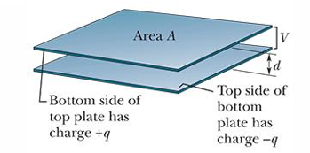
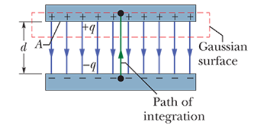
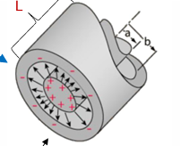
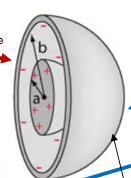
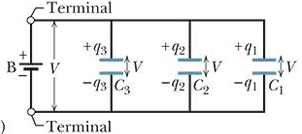
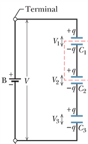
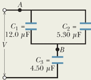

> Last Edit: 2/6/25
 
Capacitor 电容器是一种储存 Electrical Energy 的装置，由两个相互隔离的导体（即极板）组成，分别带有 +q 和 -q 的电荷

## 5.1 Capacitance 电容

- Capacitance 电容代表了导体储存 Charge 的能力，表示一个电容器在一定的电压下能储存多少电荷，其基本定义是
$$q=CV$$
- 其中 \\(V\\) 是两个 Plate 极板之间的 Potential Difference

### Charging a Capacitor

- 要使 Capacitor 充电，需要利用到电池两侧初始存在的 Potential Difference
- 由于电池两侧存在 Potential Difference，于是就形成了一个 Electirc Field，电场会对电荷产生一个 Force \\(F=qE\\) ，这使得电荷在电场中受力，正电荷从负极电极到了正极（正电荷是不会移动的，只有负电荷会，这里的“移动”是假设”，负电核到了正极
- 举一个例子就是假设一开始电池具有 10 V 的电压，充电完成后正极板上有 +10V，负极则有 0V，此时由于两个电极板之间是绝缘的，电荷会积累到电极板表面并形成 Electric Field，从正极指向负极，此时电路中的电极板电压等于电池电压，电荷不在移动，电极板完成整个充电的过程
> 类比一个水流抽水的过程，电池就是水泵推动水在管道中移动

### Property of Capacitance

- 与电阻一样，电容是一个电容器的特性，其即使公式为 \\(q=CV\\) ，但实际上其并不依赖于储存的电荷量 q
- 真正影响电容的因素为形状，尺寸，相对位置以及介质
> 也就是说 q = CV 这个公式真正定义的是 q 和 V 之间的系数关系

## 5.2 Calculating The Capacitance

不同类型的电容器，其电容值的计算方式不同，具体取决于几何结构和极板之间的介质

### Parallel-Plate Capacitor 平行板电容器

- 当有两个面积为 A 的平行导体板相距为 d 的时候，其电容有
$$C=\frac{\varepsilon_0 A}{d}$$

- 可以看出面积增大、电极板距离减小时，电容增大

### Cylindrical Capacitor 圆柱形电容器（

- 两个同轴圆柱导体，内外圆柱的半径分别为 **a** 和 **b**，长度为 L
$$C = 2 \pi \varepsilon_0 \frac{L}{\ln(b/a)}$$

- 电容与圆柱长度 **L** 成正比，内外圆柱半径比值决定了电容大小。

### Spherical Capacitor 球形电容器

- 两个同心球形导体，内外球半径分别为 **a** 和 b
$$C = 4 \pi \varepsilon_0 \frac{ab}{b - a}$$

### Isolated Spherical Capacitor 孤立球形电容器

- 仅有一个孤立的球体，半径为 R
$$C = 4 \pi \varepsilon_0 R$$
- 孤立球体的电容只与球体半径有关

### ex. Change in Capacitance when change in radius

A drop of mercury is an isolated sphere with radius R= 3.83. What is the capacitance of a drop that results from three drops of mercury combined, each with the same radius R

- 三个球的总体积为：
$$V_{\text{total}} = 3 \times \frac{4}{3} \pi R^3 = 4 \pi R^3$$
- 此时可以求出新半径 \\(R' = \sqrt[3]{3} R = 1.442 \, R\\)
- 将 R=3.83R = 3.83 代入：
$$R' = 1.442 \times 3.83 \approx 5.524$$
- 已知孤立球体的电容公式为：
$$C = 4 \pi \varepsilon_0 R$$
- 带入半径之后得到
$$C≈6.14×10−10 FC \approx 6.14 \times 10^{-10} \, \text{F}$$

## 5.3 Capacitors in parallel and in series

- 电路中的电容器也将遵循并联和串联的特性

### 5.3.1 Capacitors in Parallel

- 对于一个电路，其中三个 Capacitors 并联放置，有
$$\ q_1 = C_1 V, \ q_2 = C_2 V, \mbox{ and } \ q_3 = C_3 V$$

- 根据串联分压，并联分流的特性，说明并联的时候每个电容器 V 相等，有
$$q = q_1 + q_2 + q_3 = (C_1 + C_2 + C_3) V$$
$$C_{eq} = \frac{q}{V} = C_1 + C_2 + C_3$$
- 也就是说电容器并联时，总电容 \\(C_{\text{eq}}\\)​ 增大

### 5.3.2 Capacitors in Series

- 到了串联的时候，每个电容器电流相同，也就是 q 一致，有
$$V_1 = \frac{q}{C_1}, \quad V_2 = \frac{q}{C_2}, \text{ and } \quad V_3 = \frac{q}{C_3}$$

$$V = V_1 + V_2 + V_3 = q \left( \frac{1}{C_1} + \frac{1}{C_2} + \frac{1}{C_3} \right)$$
$$C_{eq} = \frac{q}{V} = \frac{1}{\frac{1}{C_1} + \frac{1}{C_2} + \frac{1}{C_3}}$$
$$\frac{1}{C_{eq}} = \frac{1}{C_1} + \frac{1}{C_2} + \frac{1}{C_3}$$
### ex. Capacitors in both Parallel and Series

Find charge on C1

- 首先计算 C1 和 C2 两个 Parallel Capacitor 的总电容，有并联电路
$$C=C_1+C_2=17.3$$
- 之后这个 17.3 再和 4.5 串联，有
$$\frac1C=\frac{1}{17.3}+\frac{1}{4.5}\Rightarrow C=3.57$$
## 5.4 Energy Stored in an Electric Field

当外部装置（如电池）对电容器充电时，做的功以势能 U 的形式储存，有
$$U=\frac{q^2}{2C}$$
- 当带入 \\(q =cv\\) 的时候，得到另一种形式
$$U=\frac 12CV^2$$
- 做的功主要是由 Electric Field Strength \\(F=qE\\) 提供，具体来说是将负电荷从一个极板移动到另外一个极板所做的功，完整推导如下
- 当少量电荷 dq 从一个极板到达另一个的时候，两个极板之间形成一个初始电场 E，导致极板之间产生 Potential Difference \\(V=\frac qC\\) 
- 想要在移动电荷，则需要 Electric Field Strength，F 做功，有 \\(W=Fd\\)，其中 F就是电场力，那么就有 \\(dW= Fdl\\)，用了 l 替换 d，同时因为 \\(F=qE\\)，有 \\(dW=qE\cdot dl\\)
- 现在知道电势差 V 与电场的关系为
$$V=-\int^b_a\vec E\cdot dl$$
> 积分在均匀电场和点电荷电场等对称电场中简化，有 \\(V_{AB} = - \int_A^B \vec{E} \cdot d\vec{l} = - E \int_A^B \cos \theta \, dl\\)，\\(V_{AB} = - \int_A^B \frac{kq}{r^2} \, dr = kq \left( \frac{1}{r_A} - \frac{1}{r_B} \right)\\) 等

- 从上面的 V 中可以推导出 \\(dV=-E \cdot dl\\)，带回做功的公式中有 \\(dW=q\cdot dv\\)，观察此时的公式，它描述的是一个电荷在经过路径上不同的 V 的时候产生的功，也就是一个电荷在不同电势的路径下的功
- 而我们像描述的是一个充电，也就是电荷累加到极板上的一个过程，此时的瞬时电势 V 将会是一个 Constant，但是电容器极板上的 Charge 则会随时间增加，即每增加一个微小的电荷 dq，电场力都要做一个微小功为 \\(dW=V\cdot dq\\)
- 两边积分得到
$$W=U=\int^Q_0 V\cdot dq=\int^Q_0\frac{q}{C}\cdot dq=\frac{q^2}{2C}$$
> 为什么 W = U 我也不知道

### Distance between plates and Capacitance

- 已知\\(U = \frac{q^2}{2C}\\) ，将 \\(C = \frac{\varepsilon_0 A}{d}\\) 带入，有 \\(U = \frac{q^2}{2 \frac{\varepsilon_0 A}{d}}\\)，整理得到
$$U = \frac{dq^2}{2 \varepsilon_0 A}$$
### Energy Density

- 能量密度由总能量除以体积得到，有
$$u = \frac{U}{Ad} = \frac{CV^2}{2Ad}$$
- 带入 \\(C = \frac{\varepsilon_0 A}{d}\\) 得到
$$u = \frac{1}{2} \varepsilon_0 \left( \frac{V}{d} \right)^2= \frac{1}{2} \varepsilon_0 E^2$$
### Dielectric

- 介电材料是绝缘的材料，其填充在电容器板之间提高电容
- Michael Faraday 于1837年发现了此规律，并且定义加入介电材料后的电容值将会增加一个比例因子 \\(\kappa\\) ，其中真空中的介电常数默认为 1

### Breakdown Potential

- 在电容器中加入了介电材料后，这个材料会存在一个 Maximum Potential （Breakdown Potentioal），当电压超过这个值，Dielectirc 会被 Break Down 击穿并变为导体

| Material             | Dielectric Constant \( \kappa \) | Dielectric Strength (kV/mm) |
|----------------------|-----------------------------------|-----------------------------|
| Air (1 atm)          | 1.00054                          | 3                           |
| Polystyrene          | 2.6                               | 24                          |
| Paper                | 3.5                               | 16                          |
| Transformer oil      | 4.5                               |                             |
| Pyrex                | 4.7                               | 14                          |
| Ruby mica            | 5.4                               |                             |
| Porcelain            | 6.5                               |                             |
| Silicon              | 12                                |                             |
| Germanium            | 16                                |                             |
| Ethanol              | 25                                |                             |
| Water (20°C)         | 80.4                              |                             |
| Water (25°C)         | 78.5                              |                             |
| Titania ceramic      | 130                               |                             |
| Strontium titanate   | 310                               | 8                           |
> For a vacuum, \( \\(\kappa = 1\\) \).*

### Capacitor with a Dielectric

- 当加入了 Dielectric 后，电容公式改变为
$$C = \kappa \frac{\varepsilon_0 A}{d}$$
- 同时可以定义一个 \\(l=\frac{A}{d}\\)，公式就变为 \\(C = \kappa \varepsilon_0 \ell\\)
- 电压 V 保持恒定（并联电容器）**：
$$q = CV = \kappa \varepsilon_0 \ell V$$
- 电荷 q 保持恒定（串联电容器）
$$V = \frac{q}{C} = \frac{q}{\kappa \varepsilon_0 \ell}$$
### Super Capacitor

对比了超级电容器（Supercapacitor）与锂离子电池（Lithium-ion battery）的性能和特性：

| **功能**          | **超级电容器**         | **锂离子电池（通用）**       |
| --------------- | ----------------- | ------------------- |
| **充电时间**        | 1 – 10 秒          | 10 – 60 分钟          |
| **循环寿命**        | 100 万次或 30,000 小时 | 500 次及以上            |
| **单元电压**        | 2.3 至 2.75 伏      | 3.6 至 3.7 伏         |
| **比能量 (Wh/kg)** | 5（典型值）            | 100 – 200           |
| **比功率 (W/kg)**  | 高达 10,000         | 1000 – 3000         |
| **每 Wh 成本**     | 约 20 美元           | 0.50 – 1.00 美元（大系统） |

- 超级电容器充电快、循环寿命长、比功率高，但能量密度低，成本较高
- 锂离子电池有较高的能量密度和较低的成本，但充电时间长，循环寿命较短

### ex. Energy change when insert an Dielectirc 

- 平行板电容器的电容为 \\(C = 13.5 \, \text{pF}\\)，通过电池充电到电压 \\(V = 12.5 \, \text{V}\\)
- 断开电池后，插入介电常数 \\(\kappa = 6.50\\) 的瓷板。
- 问题：  
a) 插入前的电容器电势能是多少？  
b) 插入后的电容器电势能是多少？
- 插入前的电势能 \\(U_i\\) 为
\\(U_i = \frac{1}{2} C V^2\\)
$$U_i = \frac{1}{2} \times 13.5 \times 10^{-12} \, \text{F} \times (12.5 \, \text{V})^2 = 1.055 \times 10^{-9} \, \text{J} \approx 1100 \, \text{pJ}$$
- 插入后的电势能 \\(U_f\\)
$$U_f = \frac{q^2}{2 \kappa C} = \frac{U_i}{\kappa}$$
插入介电材料后，能量减少，损失的能量为：
$$W = U_i - U_f = 1055 \, \text{pJ} - 162 \, \text{pJ} = 893 \, \text{pJ}$$
- 插入介电材料后，电势能因介电常数 \\(\kappa\\) 的影响减少。
- 损失的能量可被视为在插入过程中施加的机械功。