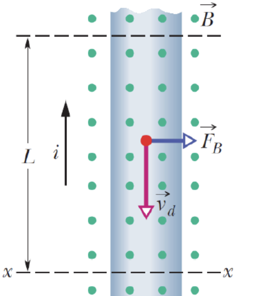
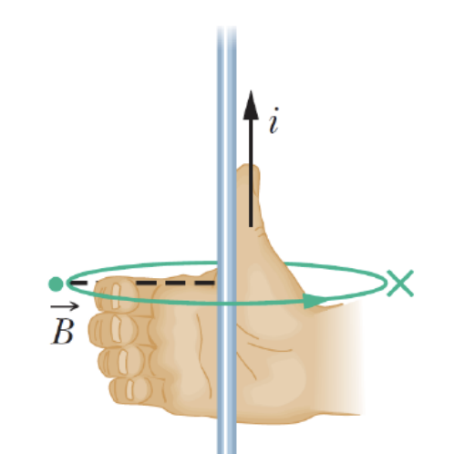
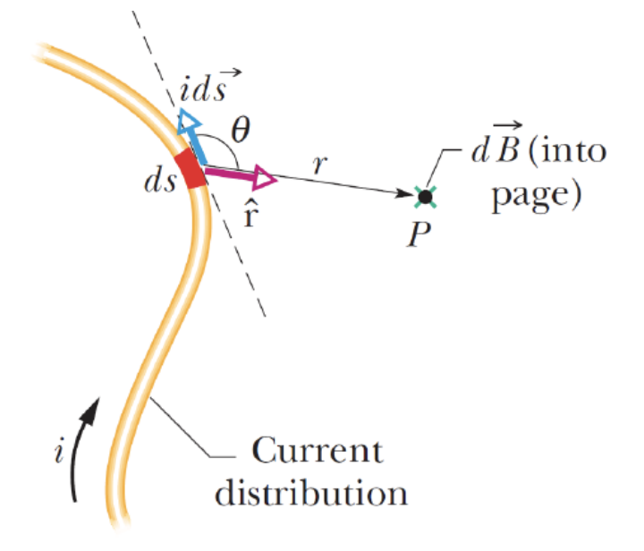
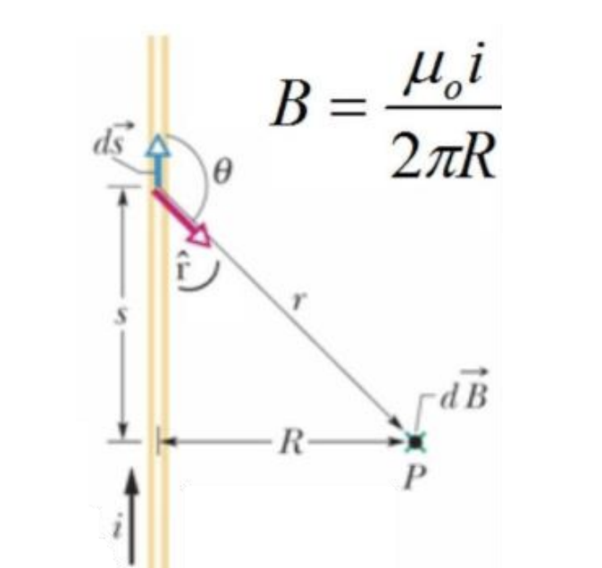
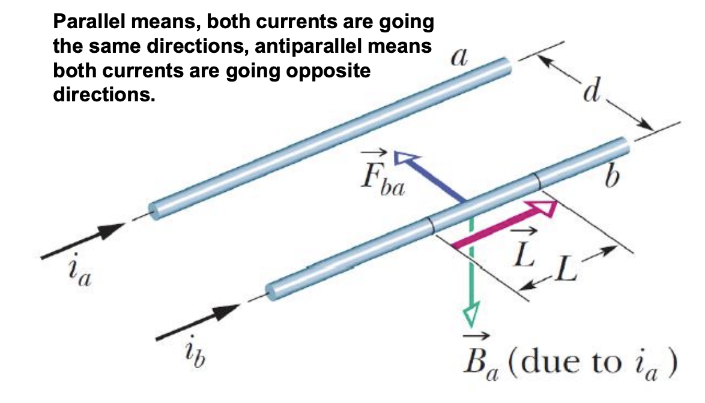
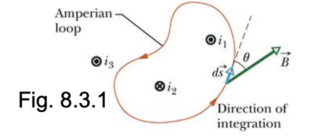
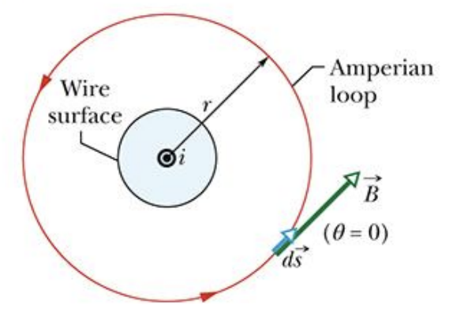

> Last Edit: 2/8/25

## Magnetic Field

- 与 Electric Field 一般，Magnetic Field 也是由 Magnetic Charge 产生的
- 虽然理论上存在 Individual Magnetic Charges (AKA Magnetic Monopoles) 但是尚未被证实

### Creation of Magnetic Fields

- 通常来说磁场通过两种方式形成，一个是 Electrically Charged Particles 比如导线中的电流形成的 Magnetic Field
- 另一种则是通过 Elementary Particles 基本粒子，如 Electron 等形成的 Intrinsic Magnetic Field 固有磁场

### Magnetic Field Strength

- 当 Charged Particle 在 Magnetic Field 中移动的时候，它受到的力为
$$\vec F_B=q(\vec v\times\vec B)$$
- 其中 \\(\vec v\\) 为 Velocity Vector
- Magnetic Field Strength 的力的方向则是 Cross Product 方向，即通过 Right Hard Rule 给出
- 具体来说 Magnitude 为
$$F_B=|q|v_B\sin\phi$$
- 其中 \\(\phi\\) 为 Velocity 和 Magnetic Field 之间的夹角
- Magnetic Field Strength 的单位为 Tesla，有
$$1 \, \text{tesla} = 1 \, \text{T} = \frac{1 \, \text{newton}}{(\text{coulomb})(\text{meter/second})}$$

### Direction of Magnetic Field

- 磁场线从磁体的 North Pole 指向 South Pole，和 Charged Particle 一般，同性相斥异性相吸

### ex. Magnetic Force on a moving charged particle

A uniform magnetic field \\(\vec{B}\\), with a magnitude of \\(1.2 \, \text{mT}\\), is directed vertically upward throughout the volume of a laboratory chamber. A proton with kinetic energy \\(5.3 \, \text{MeV}\\) enters the chamber, moving horizontally from south to north. What magnetic deflecting force acts on the proton as it enters the chamber? The proton mass is \\(1.67 \times 10^{-27} \, \text{kg}\\). (Neglect Earth's magnetic field.)

- 先通过 Energy 求得 Proton 的 Velocity 有
$$v = \sqrt{\frac{2K}{m}} = \sqrt{\frac{(2)(5.3 \, \text{MeV})(1.60 \times 10^{-13} \, \text{J/MeV})}{1.67 \times 10^{-27} \, \text{kg}}} = 3.2 \times 10^7 \, \text{m/s}$$
- 再将速度带入 Magnetic Field Strength，有
$$F_B = |q| v B \sin \phi  
= (1.60 \times 10^{-19} \, \text{C})(3.2 \times 10^7 \, \text{m/s})  
\times (1.2 \times 10^{-3} \, \text{T})(\sin 90^\circ)  
= 6.1 \times 10^{-15} \, \text{N}. \, (\text{Answer})$$

## Magnetic Force due to straight current wire

- 对于一条有 Current 的 Wire，当它位于一个 Uniform 的 Magnetic Field 中时，其会收到一个 Magnetic Field Strength \\(\vec F_b\\)

- 具体来说，Magnetic Field Force 的方向将由 Current 和 Magnetic Field 的方向决定

## Magnetic Field Create by Straight Wire

- 当一个 Current 从一根直的 Wire 中通过的时候，其周围会形成环形磁场 \\(\vec B\\)

- Magnetic Field 的方向可以通过 Right Hand Rule 判断

## Biot - Savart Law

- 非直线导线中一个长度元素 \\(ds\\) 在距离 r 处的点 P 产生的磁场微分为
$$dB = \frac{\mu_0}{4 \pi} \cdot \frac{i \, ds \, \sin \theta}{r^2}
$$
- 其中的 \\(\mu_0\\) 为真空磁导率，有 \\(μ0​=4π×10^{−7}T⋅m/A=1.26\times 10^{-6}T\cdot m/A\\)

- 可以得到完整的 Law of Biot and Savart 有
$$dB = \frac{\mu_0}{4 \pi} \cdot \frac{i \, d\vec s \ \times \hat r}{r^2}
$$
### Law of Biot and Savart in Straight current-carrying Wire

- 由 Biot and Savart 公式可以得出一个 Long Straight Wire R 远的距离的 Magnetic Field为
$$B=\frac{\mu_oi}{2\pi R}$$

### Law of Biot and Savart in circular wire

- 一个圆弧的导线的圆心处的 Magnetic Field Strength 有
$$B = \frac{\mu_0 i \Phi}{4 \pi R}$$

## Force Between Two Parallel Currents

- 已知一根带有 Current i 的 Straight Wire 的 Magnetic Field 有
$$\vec F_b=i\vec L\times \vec B$$
- 两根平行导线之间的力是由于其中一根导线产生的磁场作用在另一根导线上的结果
- 导线 a 产生的磁场 \\(B_a\\) 在 b 位置为 \\(B_a = \frac{\mu_0 i_a}{2 \pi d}\\)，即 b 收到的 Magnetic Field Strength 为
$$F_{ba} = i_b L B_a \sin 90^\circ = i_b L \cdot \frac{\mu_0 i_a}{2 \pi d}
\Rightarrow F_{ba} = \frac{\mu_0 L i_a i_b}{2 \pi d}$$

## Ampere's Law

- Ampere's Law，通过一个假想的称为安培环（Ampereian Loop）的假想闭合路径来分析电流周围的磁场

### Ampereian Loop 安培环

- Ampereian Loop 是一个假想的闭合路径，用于计算路径所包围的 Current 对该路径上每一点处磁场的贡献

- 对于 Ampereian Loop 内部的 Current，有
$$\oint \vec{B} \cdot d\vec{s} = \mu_0 i_{enc} \quad (\text{Ampere's law})$$
### Direction of Magnetic Field

- 通过右手来判断，四指弯曲指向 Integration 方向，大拇指方向则为 Current 方向

### Inside & Outside of the Wire

- 在 Long Straight 内外部的 Magnetic Field 是不同的
- 在外部时，可以通过 Biot - Savart Law 得到 Magnetic Field 为
$$B=\frac{\mu_oi}{2\pi R}$$

