## EF9.ResistiveCircuits

Last Edit: 3/3/25

## Ohm’s Law

- Ohm’s Law是以德国物理学家 Georg Simon Ohm 的名字命名的，他确立了 Voltage 和 Current 之间的关系，其发现了 Resistor 两端的 Voltage 和通过的 Current 成正比

### Symbol for a Resistor

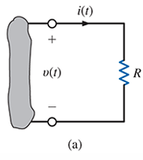

### Mathematical Relationship

- Ohm's Law 指出

$$
v(t) = Ri(t), \text{ where } R \geq 0
$$

- 其中 Ohms 的符号为 \\(\Omega,1\Omega=1V/A\\)

### Graphical representation of V vs. I

- 不同用电器有着不同的 Voltage-Current Relationship

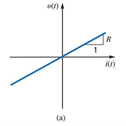

- 一个线性电阻器

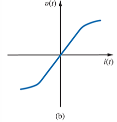

- 一个 Light Bulb 的则是非线性的关系

## Conductance 电导

- Conductance 由符号 G 表示，其是 Resistor 的倒数
- 它的单位是 Siemens，有 \\(1S=1A/V\\)

## Power Relationships

- Power 的最基础的定义为 W = VI，也就是

$$
p(t) = v(t) i(t)
$$

- 当把 \\(V=Ri\\) 带入，有

$$
p(t) = Ri^2(t) = \frac{v^2(t)}{R}
$$

- 带入 Conductance \\(i(t) = Gv(t)\\) 可以得到

$$
p(t) = \frac{i^2(t)}{G} = Gv^2(t)
$$

## Conductor's Influence in Circuit

- 对于一个位于 Circuit 中的 Resistor 来说，其可以通过变换对 Circuit 整体造成不同的影响

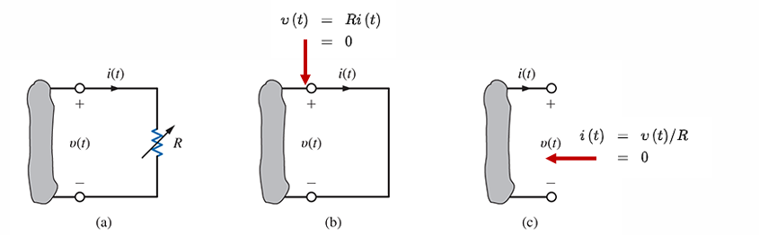

- 如上图所示，当 Resistor 减小到零的时候，电源两端直接连线，形成 Short Circuit
- 而到了 C 中，Resistor 增大到无限大时，形成 Open Circuit

## Kirchhoff's Laws

- Kirchhoff's Laws 具体表现为 Kirchhoff's Current Law 和 Kirchhoff's Voltage Law

### KCL Current Law

- 对于一个 Circuit 中的 Node 来说，其 Algebraic Sum of the Current leaving or entering a node is zero，说明从节点流出或流入的电流 之代数和为零

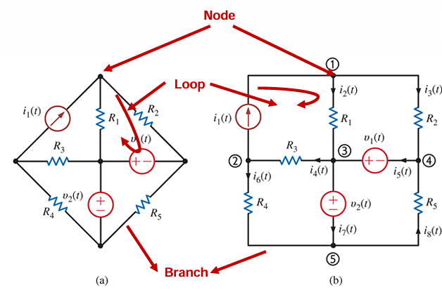

- 想要解决 Circuit 中每一个 Node 的 Current 的办法就是通过解线性方程组，而并不是每一个节点的 Equation 都在 System 中是 Linearly Independent 的，这说明仅需要选择线性独立的方程来进行分析

### Kirchhoff’s Voltage Law

- KVL 指出，在任何闭合回路中，电压的代数和必须为零

### Voltage Division

- 在 Series, Parallel Circuit 中，需要进一步通过 Current 和 Voltage 在不同情况下的性质在写出 Linear Equation 后进一步求解

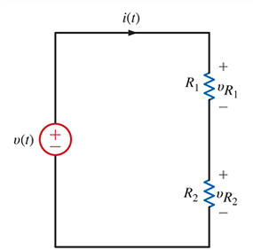

- 当 Circuit 中存在一个 Series 的时候，可以得到d

$$
-v(t) + v_{R1} + v_{R2} = 0\Rightarrow v(t) = v_{R1} + v_{R2}
$$

- 根据 Ohm's Law 可以知道，\\(v_{R1} = R_1i(t),v_{R2} = R_2i(t)\\)，有 \\(v(t)=R_1i(t)+R_2i(t)\\)，可以解出 \\(i(t) = \frac{v(t)}{R_1 + R_2}\\)
- 带回 \\(v_{R_1}=R_1 i(t)\\) 后可以得到

$$
= R_1 \left[ \frac{v(t)}{R_1 + R_2} \right]
= \frac{R_1}{R_1 + R_2} v(t)
$$

## Multiple-Source/Resistor Networks

- 有的时候的 Circuit 会非常复杂，比如存在多个 Voltage Sources 的情况，这时候就需要通过 Simplified Equivalent Circuit 来分析 Circuit

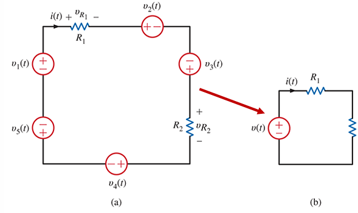

- 上图中，a 存在了多个 Voltage Sources 和 Resistors，沿着 Closed Loop 列出所有 KVL 方程 \\(+vR1+v2(t)−v3(t)+vR2+v4(t)+v5(t)−v1(t)=0\\)，将所有非 Resistor 的 Voltage 移动到等式右边，有 \\(vR1+vR2=v1(t)−v2(t)+v3(t)−v4(t)−v5(t)\\)
- 根据 KVL ，就可以创建一个 \\(R_S=R_1+R_2+R_3+R_4+R_5\\) 的等效电路
- 于是就把整个 Circuit 化简为了 b 中的等效电路

#### ex. Find Voltage in a fragment

有以下图 a，求 bd 段的等效电路

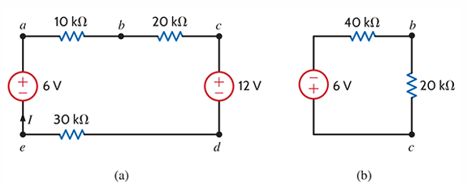

- 在同时存在 Resistor 和 Battery 的情况下，要先求得他们的 Current （串联分压不分流）
- 根据 KVL，有

$$
10kI + 20kI + 12 + 30kI - 6 = 0\Rightarrow60kI = -6 \Rightarrow I = -0.1 \, \text{mA}
$$

- bd 段的 Voltage 自然可以通过 \\(10kI + V_{bd} + 30kI - 6 = 0\\) 得到，代入 \\(I = -0.1 \, \text{mA}\\) 后得到 \\(V_{bd}=10V\\)

#### ex2.

求出 \\(V_S\\) 段的 Voltage

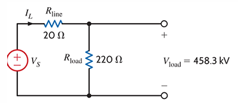

- 已知 Parallel Circuit 分流不分压，有 \\(I_L=458.3/220=2.083~kA\\)
- 后面又进入了一个 Series Circuit，有 \\(V_{line}=20\cdot 2. 083=41.66 ~kV\\)
- 根据 KVL，可以得到 \\(V_S=V_{line}+V_{load}=500 ~kV\\)

## Single-Node-Pair Circuits

- 串联分压，并联分流的原理也可以通过 KVL 进一步验证

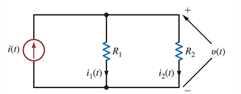

- 对于上面的电路，有

$$
i(t) = \frac{v(t)}{R_1} + \frac{v(t)}{R_2} 
= \left( \frac{1}{R_1} + \frac{1}{R_2} \right) v(t) 
= \frac{v(t)}{R_p}
$$

- 能总结出公式为

$$
i_1(t) = \frac{v(t)}{R_1}\Rightarrow i_1(t) = \frac{R_2}{R_1 + R_2} i(t)
$$

- 可以用于计算 Parallel Circuit 中的 Current

## Multiple-Source/Resistor Networks

- 对于具有 n 个 Parallel Resistor 的 Circuit，根据 KVL 可以得出

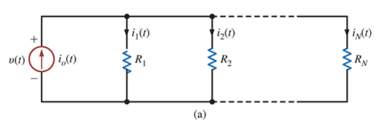

$$
i_0(t) = i_1(t) + i_2(t) + \ldots + i_N(t) = \left( \frac{1}{R_1} + \frac{1}{R_2} + \ldots + \frac{1}{R_N} \right) v(t)
$$

- 其中每一个 Parallel Circuit 上的 Resistor 可以通过

$$
i_j(t) = \frac{v(t)}{R_j} \quad \quad i_j(t) = \frac{R_p}{R_j} i_o(t)
$$

- 得出答案