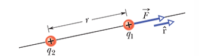
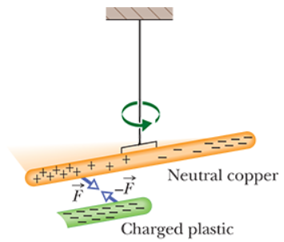

> Last Edit: 3/21/25

# Coulomb's Law 库仑定律

- 电荷之间相互作用力遵循的公式
- Coulomb's Law 描述了两个 Charged Partials 之间的 Electrostatic Force（或Electric Force）

> Electrostatic Force专指静止或相对静止的电荷之间的作用力
Electric Force则为更广义的术语，指电场对电荷施加的作用力
> 

$$
F = \frac{1}{4 \pi \varepsilon_0} \frac{|q_1||q_2|}{r^2} \quad (\text{Coulomb's law})
$$

- \\(\varepsilon_0 = 8.85 \times 10^{-12} \, \text{C}^2/\text{N} \cdot \text{m}^2\\) Vacancies Permittivity Constant 真空介电常数

> Permittivity Constant 体现了材料对电场的响应能力。真空介电常数是固定值，而不同材料的介电常数决定了其在电场中的行为特性
> 

- \\(\frac{1}{4πε0}=k = 8.99 \times 10^9 \, \text{N} \cdot \text{m}^2/\text{C}^2\\) 通常被 Electrostatic constant 静电常数 \\(k\\) 替代
- 由于两个Charged Particle之间的作用力是一条直线，所以其Electrostatic Force Vector 要么直接指向第二个Particle（相反的电荷符号），要么直接远离第二个粒子（相同的电荷符号）
- 如果多个 Electrostatic Force 作用在一个粒子上，则 Net Force 是各个力的 Vector Sum

## ex. Electrostatic Force’s Net Force

In the figure four particles form a square with edge length \\(a = 3.64 × 10⁻²\\) m. The charges are \\(q₁ = q₄ = 1.77 × 10⁻¹⁵\\) C and \\(q₂ = q₃ = q\\)

(a) What is q if the net electrostatic force on particle 1 is zero?

# Shell Theorem 壳定理

## Shell Theorem #1

- 对于一个带电粒子，如果它位于一个带电球壳的外部，且球壳的电荷均匀分布在表面上，该粒子受到的力等效于球壳的电荷全部集中在球壳的中心（即外部粒子感受到的电场与球壳的半径无关，只与球壳的总电荷有关）

## Shell Theorem #2

- 对于一个带电粒子，如果它位于一个带电球壳的内部，且球壳的电荷均匀分布在表面上，那么该粒子不会受到来自球壳的净电场作用力。 （即在球壳内部，电场为零）

# Charge on Conducting Spherical Shell 导体球壳

- 一个中空的球形壳体，由导电材料制成
- 在一个导体球壳上，Charges会均匀地分布在其**外表面**，而不是内表面，这是因为导体内电荷会相互排斥，最终达到平衡分布

# Conductor & Insulator 导体和绝缘体

- 我们通常可以根据Charge穿过它们的能力对材料进行分类

## Conducting Path 传导路径

- 用羊毛摩擦铜棒时，电荷会从羊毛转移到铜棒，使铜棒带电。
- 如果此时握着铜棒，并接触一个与金属管道相连的水龙头，那么铜棒cannot be charged，这是因为人、铜棒、水龙头与地球表面通过管道形成了一条导电路径。多余的电荷会通过这条路径流向地球（地球是一个巨大的导体）。因此，铜棒上的电荷会扩散到地球表面，最终使铜棒变得**电中性**。

### Grounding 接地

- 通过设置一条导体路径连接物体和地球，可以消除物体上的多余电荷，这个过程称为Grounding

### Discharge 放电

- 这一个Grounding的将Exceed的Charge Neutralize的过程被称为Discharge

## Charged Particles 带电粒子

- 原子由带正电的质子、带负电的电子和电中性中子组成
- 质子和中子紧密地堆积在一个原子核中
- 单个电子的电荷和单个质子的电荷具有相同的大小，但符号相反

### Conduction electrons 价电子

- 在导体中**Conduction electrons**（价电子）因其与原子核的吸引力较弱而变得**自由移动**。
- 当导体原子形成固体结构时，这些导电电子在导体中形成“电子海”，可以在整个导体内自由流动
- 而在在绝缘体中，原子的电子与原子核结合得非常紧密，几乎没有自由电子

## Induced Charge 感应电荷

- Induced Charge指的是由于**邻近电荷的影响**，导体内的电荷重新分布，形成正负电荷分离的现象

- 如图将一个Charged Plastic Rod放置到Neutral的Copper Rod旁边，Positive Charge将会被吸引到Copper Rod的左侧，Negative Charge则会被排斥到右侧，此时虽然Copper Rod是Neutral的，但其有一个 Induced Charge 感应电荷
- 需要注意的是，在Induced Charge形成的过程中，并不是Positive Charge移动了，而是因为原来均匀分布在整个Copper Rod上的Positive & Negative Charge中的Negative Charge移动了，所以才会有Positive Charge的出现
- 换句话说，Positive Charge不是“增加”来的，而是因为失去了Negative Charge，所以显得“正”

# Charge is Quantized 量化电荷

- 在Benjamin Franklin的时代，电荷被认为是一种连续的流体——这个想法有很多用途。然而，我们现在知道流体本身，例如空气和水，不是连续的，而是由原子和分子组成的;物质是离散的
- 实验表明，Electrical fluid也不是连续的，而是由某种基本电荷的倍数组成。任何可以检测到的正电荷或负电荷 q 都可以写成

$$
q = n e, \quad n = \pm 1, \pm 2, \pm 3, \ldots
$$

## Charge of three Particles

| Particle | Symbol | Charge | Antiparticle | Symbol | Charge |
| --- | --- | --- | --- | --- | --- |
| Electron | e or e⁻ | -e | Positron | e⁺ | +e |
| Proton | p | +e | Antiproton | **p̅** | -e |
| Neutron | n | 0 | Antineutron | **n̅** | 0 |

> Electron的Symbol为e是因为其通常表示电子作为一种**粒子**的名称，而不特别强调它的电荷性质

## Charge on two quarks

| Quark | Symbol | Charge | Antiparticle | Symbol | Charge |
| --- | --- | --- | --- | --- | --- |
| Up | u | \\(+\frac{2}{3}e\\) | Antiup | \\(\bar{u}\\) | \\(-\frac{2}{3}e\\) |
| Down | d | \\(-\frac{1}{3}e\\) | Antidown | \\(\bar{d}\\) | \\(+\frac{1}{3}e\\) |
- 由于Quark不能单独存在（被限制在强相互作用中），我们通常不将它们的电荷视为基本电荷

# Charge is Conserved 电荷守恒

- 摩擦不会产生电荷，而只会将其从一个物体转移到另一个物体，从而在此过程中破坏每个物体的电中性
- 任何孤立系统的净电荷总是守恒的，无论系统内部发生什么变化（如粒子的生成、湮灭或分裂），系统的总电荷量不会改变，下面给出一些常见的例子说明这一现象

### Electron Capture 电子捕获

- 母核中的质子“捕获”原子的一个内部电子以形成中子（保留在子核中）并释放中微子

$$
p + e^- \rightarrow n + \nu
$$