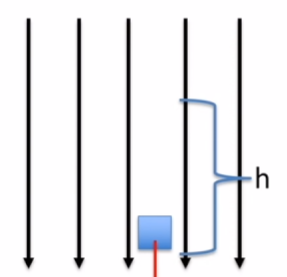
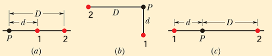

> Last Edit: 1/23/25

## 4.1 Electric Potential

- 对于一个重力场，其Field Strength为g，而Gravity所做的功则为\\(W=mgh\\)

- 可以发现这一个Work Done只和高度差有关，与路径无关（也就是说即使在途中左右摇摆，重力做的功依然不变）
- 同理可以类比到Electric Field中，电场力做功为\\(W=Eqh\\)，并且同样的与路径无关

### Electrical Potential Energy 电势能

- Electrical Potential Energy 是带电粒子由于其位置处于电场中而具有的能量
- 如果Charge在Electric Field中做了Negative的Work，其就是在Electric Field中积累了Electric Potential Energy，于是就有公式
$$U=-W$$
- 其中U就是Electric Potential Energy 电势能
- 具体来说定义Electric Potential Energy的办法就是通过Test Charge的两个参考点，一个是无穷远处电荷之间相互作用力忽略不记的地方，到另一个参考点，Test Charge在这两个点之间做的功便为电势能

### Electrical Potential 电势

- **Electrical Potential** 指的是电场中某一点单位电荷所具有的电势能
$$V=\frac{U}{q}$$
- 当Paritical从Electrical Field中的初始点移动到终点时，电势发生变化，用公式表示为
$$\Delta V = V_f - V_i$$
- 电势能的变化可以用公式计算，由于Paritcal的Charge并不发生改变，有
$$\Delta U = -W=q \Delta V = q(V_f - V_i)$$
- 在这一过程中，总能量是守恒的，这意味着动能和势能之和保持不变
- 从初始点 i 移动到终点 f 时，机械能守恒关系表示为： 
$$U_i + K_i = U_f + K_f 或\Delta K = -\Delta U$$

## 4.2 Equipotential Surfaces 等势面

- Equipotential Surfaces 指的是一个Electrical Potential 相等的区域，Partical沿着这一个Surface移动的时候不需要做功

### Calculating the Potential from the Field

- 根据Electric Field Magnitude可以计算出Partical移动后的Potential Difference
- 由于Partical在Electric Field中需要克服电场力做功，则有
$$dW=\vec E \cdot d\vec s\Rightarrow \int dW= V_f - V_i =  -\int_i^f \vec{E} \cdot d\vec{s}$$
## 4.3 Electrical Potential Due to a Charged Particle

- Charged Particle在空间中会形成一个Electrical Field，\\(\vec{E} = \frac{1}{4\pi \epsilon_0} \frac{q}{r^2} \hat{r}\\)，将其代入积分 $$V = -\int_\infty^r \frac{1}{4\pi \epsilon_0} \frac{q}{r^2} dr= \frac{1}{4\pi \epsilon_0} \frac{q}{r}$$
> A positively charged particle produces a positive electric potential. A negatively charged particle produces a negative electric potential.

### ex. Rank the Electral Potential 

Assume all dots are Protons

- 根据\\(V= \frac{1}{4\pi \epsilon_0} \frac{q}{r}\\)，r越小V越大，有
- a) Proton 1 has more Electric Potential (v) than Proton 2, since D > d
- b) Proton 1 has more Electric Potential (v) than Proton 2, since D > d
- c) Proton 1 has more Electric Potential (v) than Proton 2, since D > d

## 4.7 Electrical Potential Energy of a system of charged Particles

- 对于空间中的两个Particle，他们之间的距离为 r ，则由他们之间的Electrical Field相互作用而具有的Energy被称为他们的Potential Energy，前面已经提到了一个Partical在空间中会形成一个Electrial Potential \\(V = \frac{1}{4\pi \epsilon_0} \frac{q}{r}\\) ，而U是Partical在电场中所具有的能量，就有
$$U = \frac{1}{4\pi \epsilon_0} \frac{q_1 q_2}{r}$$
- U：两电荷之间的Electrical Potential Energy 
- \\(q_1、q_2\\)：两个电荷的电荷量（C）
- \\(r\\)：两电荷之间的距离
- \\(\varepsilon_0\\)：真空介电常数（\\(8.85 \times 10^{-12} \, \text{F/m}\\)）

### Sign Convention

- 已知2个Partical可能出现三种不同的系统
- 如果两电荷都是正电荷，它们会排斥，电势能 U>0
- 如果两电荷都是负电荷，它们同样会排斥，但电势能公式保持不变，因为两个负电荷相乘仍为正数，因此 U>0
- 如果两个电荷符号不同（例如，一个是正电荷，另一个是负电荷），它们会吸引，表示系统释放能量

### ex. Potential Energy of a system of three charged particles

有一个等边三角形的电荷系统，包含三个带电粒子：q1=+q，q2=−4q，q3=+2q，分别间隔12cm，求这个系统的Total Potential Energy

- 已知两个电荷之间的电势能为： \\(U_{ij} = \frac{1}{4\pi \epsilon_0} \frac{q_i q_j}{d}\\)，总电势能是所有电荷对之间电势能的总和： \\(U = U_{12} + U_{13} + U_{23}\\)
$$U = U_{12} + U_{13} + U_{23}$$
$$U = -\frac{4q^2}{4\pi \epsilon_0 d} + \frac{2q^2}{4\pi \epsilon_0 d} - \frac{8q^2}{4\pi \epsilon_0 d} $$
$$U = -\frac{10q^2}{4\pi \epsilon_0 d}$$
- 代入数据后可以得到
$$U = -\frac{10 (150 \times 10^{-9})^2}{4\pi \epsilon_0 \times 0.12}\Rightarrow U = -1.7 \, \text{J} = -1.7 \, \text{mJ}$$
> 负电势能意味着这个带电系统更稳定，或者说如果你想把这些电荷分开到无限远，就需要额外做功才能克服它们之间的相互作用。负值越大，系统的束缚越强。

