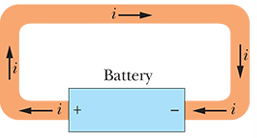

> Last Edit: 2/7/25

## Electric Current

- 对于一个铜环，内部每一处都处于同一个 Potential 下，即 In Electrostatic Equilibrium 处于静电平衡，并且内部 Electric Field 均为零

- 通过添加一个 Battery，可以形成一个 Potential Difference，产生一个 Electric Field，之后推动 Charge 移动，导致了 Current 电流的产生

### Direction of electric Current

- 电流的方向被定义为是 Positive 指向 Negative 的，但实际上在电路中移动的是 Electron，由于 Electron 在电路中的移动才产生了 Position Charge 的“移动”，但根据定义，电流方向仍然按照正电荷运动方向定义

> 约定建立之初，人们尚未了解到电子的存在，导致错误的定义沿用至今

## Current

- 对于一个在 Conductor 中的电流，有
$$i=\frac{dq}{dt}$$
- 代表了单位时间内穿过导体截面的电荷量

## Kirchhoff's Current Law KCL

- 基尔霍夫电流定律指出，在电路的任意 Junction 处，流入该节点的 Totoal Current 等于流出的 Total Current

## Current Density

- 电流密度是描述电荷流动分布的重要量，带有方向信息
$$i=\int\vec J\cdot d\vec A$$
- 其中 dA 是**垂直于**导体表面元素的面积矢量
- 若电流 i 在截面上均匀分布且平行于 \\(\vec A\\)，积分就可以化简为
$$i=JA\Rightarrow J=\frac{i}{A}$$

## Drift Speed

- 在不同 Electirc Force 下，Charge Carriers (Assumed Positive) 会获得一个 Drift Speed \\(\vec v_d\\)，其方向于 Electric Field 方向一致
- 并且 Current Density 与 Drift Speed 有
$$\vec J=(ne)\vec V_d$$
- 其中 n 是单位面积（通常为 \\(1m^3\\) 中 Charge Carrier 的数量）
- e 则是单个 Charge Carrier 的电荷量

## Resistance and Resistivity

- 一个 Conductor 的 Resistance R 被定义为
$$R=\frac{V}{i}$$
- V 是 Conductor 两端的 Potential Difference
- Resitance 的SI Unit 为 欧姆 \\(\Omega\\)
- Resistance 在电路中起到了 Reduce Current Flow，Adjust Signal Levels，Divide Votages 等作用

### Resistor Color Code

- 电阻的颜色编码标识了他的电阻值和公差，具体来
- 前两位代表了电阻值的有效数字，第三位代表了倍率，第四位为公差
- 例如，红-红-橙-金：
- 红色（2）、红色（2）、橙色（\\(\times 1000\\)）、金色（公差 \\(\pm 5\%\\)）
- 电阻值为 \\(22 \times 1000 = 22k\Omega\\)，误差为 \\(\pm 5\%\\)

## Resitivity 电阻率

- 与 Capacitance 一样，Resitivity 也是材料的固有属性，用于描述**材料**对于电流的阻碍能力
$$\rho=\frac{1}{\sigma}=\frac{E}{J}$$
- E 为电场强度，J 为电流密度，Resitivity 的单位是 \\(\Omega\cdot m\\)
- 同样也有 \\(\vec E=\rho \vec J\\)，说明了材料的电阻率越高，相同电流密度下的电场强度就越高

### Resistance 电阻

- Resitivity 描述的是 Material 对 Current 流动的阻碍属性，与其形状和大小无关，而 Resistance 描述的特点物体对电流流动的阻碍，单位是 \\(\Omega\\)，计算一个 Conductor Resisitance 的方式是
$$R=\rho\frac LA$$
- A 为 Cross-Sectional Area

### Temperature & Resisitance

- 大多数材料的 Resistance 会根据温度而变化，由公式
$$\rho - \rho_0 = \rho_0 \alpha (T - T_0)$$
## Ohm's Law

- Ohm's Law 表明，通过一个器件的 Current 总是与施加在器件上的 Potential Difference 成正比
- 当一个 Conductor 的 Resistance 不依赖于施加的 Potential Difference 的大小和极性时，则其遵守 Ohm's Law
- 当一个 Material 的 Resitivity 不依赖于施加的 Electric Field 的大小和方向时，其遵守欧姆定律 Ohm's Law

> 也就是说当它们的 Resistance 和 Resitivity 是固有属性的时候，他们就遵守 Ohm's Law

## Power 

- Power 是能量转换的速率，其最基本的计算公式为 \\(P=iV\\)，单位为瓦特
- 利用 Ohm's Law，可以改写成
$$P=i^2R=\frac{V^2}{R}$$

