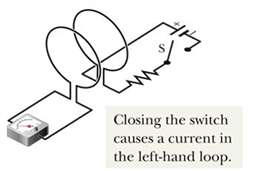
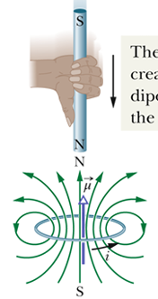
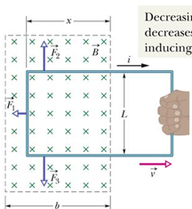
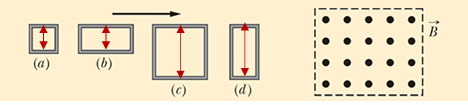

> Last Edit: 2/20/25

### Faraday’s Law of Induction

- 任何封闭电路中 Induced Current 大小，等于穿过这一电路 Magnetic Flux 的变化率
- 已知 Magnetic Flux 的定义即为 \\(\Phi_B=\int B\cdot dA\\)

#### Experiment on change of Magnetic Flux

- 如图所示，现在有两个独立闭合电路

- 当开关 S 闭合后，右侧电路会生成一个 Magnetic Field，此时左侧度数瞬间有读数后消失，这表明了 Change in Magnetic Flux caused the Induced Charge in the left loop

#### EMF Electromotive Force

- EMF 实际上被叫做 Electromotive Force，即电动势，虽然名字中有 Force，但其实际上是 Potenial Difference，单位是 Volt
- 在 Faraday's Law 中，emf 由 Induced Charge 引起

> EMF 来自来源于早期的电学研究，当时科学家认为电池、电机等装置“推动”电荷，所以称之为“电动势”，尽管它的单位和电压一样（伏特, V），但两者有一些区别

- Faraday's Law 给出 EMF 的数学表达为
$$\mathcal{E} = -\frac{d\Phi_B}{dt}$$
- \\(\mathcal{E}\\) 是 EMF
- \\(\Phi_B\\) 是 Magnetic Flux
- t 是时间
- 负号（来自Lenz's Law）表示感应电流方向总是抵抗磁通量的变化
- 也就是说当磁通量**随时间变化**时，就会在回路中产生 EMF，推动电荷流动，从而形成Induced Charge

#### Coil

- 当存在多匝线圈的时候，Total EMF 为
$$\mathcal{E} =−N\frac{dΦB}{dt}​​$$
#### Ways of changing Magnetic Flux

- 已知 \\(ΦB​=BAcosθ\\)，可以知道想要改变 Magentic Flux，可以改变 Magnitude of Magnetic Flux，Area of Coil & Angle Between A & B

### Lenz's Law

- After Faraday propsed his law of induction, Heinrich Friedrich Lenz devised a rule for determinging the direction of an induced current in a loop
- 楞次定律描述了感应电流的方向，它的核心思想是 Induced Current 会产生一个 Magnetic Field 来抵抗 Magnetic Flux 的变化
- 换句话说，线圈中的 Induced Current 会尽可能 Resisit Magnetic Flux 的增加或减少

> *如果磁通量增加，感应电流会产生一个**相反方向的磁场**来**抵抗增加**
>如果磁通量减少，感应电流会产生一个**相同方向的磁场**来**补偿减少**

- 当 Magnet 靠近 Coil 时，Magnetic Flux 增加，Coil 会产生一个向北的 Magentic Field 以抵抗 Change in Magnetic Flux，通过 Right Hand Rule 就可以确定这一 Magnetic Field 是由 CCW 方向的 Induced Current 形成的

### Induction and Energy Transfers

- 现在有以下场景，一个闭合的导体电路在一个 Uniform Magnetic Field 中被拉出

- 这一运动的结果是，Magnetic Flux 减少
- 根据 Faraday's Law，回路中产生 Induced Current 
- 根据 Lenz's Law，Induced Current 方向会抵抗磁通量的减少，形成 CW 
- 前面没有提到的是，这一个过程必然会产生一个 Force，即拉动线圈的过程中，EMF 会产生一个和拉动方向相反的 Force，而这一个 Force 于 Velocity 平行，有 \\(P=Fv\\)，这一做功将最终转换成 Induced Current 中的 Electric Energy，即能量守恒

#### Induced EMF

- 已知 \\(\mathcal{E} = -\frac{d\Phi_B}{dt}\\)，由于上面的回路在 Magnetic Field 中被拉出，Magnetic Flux 的变化为
$$\mathcal{E}=BLv$$
#### Induced Current

- 根据 Ohm's Law，
$$i=\frac{\mathcal{E}}{R}=\frac{BLv}{R}$$

#### Opposing Force

- 根据洛伦兹力作用，有
$$F=iLB=\frac{B^2L^2v}{R}$$
#### Rate of Work

- 与上方同理，外力做功为
$$P=Fv=\frac{B^2L^2v^2}{R}$$
#### Thermal Energy Dissipation

- Current 在 Resistor 中流动的时候，一部分 Energy 会损耗为 Thermal Energy，有
$$P=i^2R=(\frac{BLv}{R})^2R=\frac{B^2L^2v^2}{R}$$
#### ex.  Comparison of EMF

- 现在有四个 Wire Loop，依次要穿过 Magnetic Field，要求比较 EMF 大小，已知 Faraday's Law \\(\mathcal{E} =BLv​​\\)，只有垂直于运动方向的边长才决定 Induced EMF 大小，有
- (a)\\(\mathcal{E} = B L v\\)
- (b)\\(\mathcal{E} = B L v\\)
- (c)\\(\mathcal{E} = B (2L) v\\)
- (d)\\(\mathcal{E} = B (2L) v\\)

### Eddy Currents

- Eddy 涡流是闭合导体在变化的磁场中产生的环形感应电流，类似于水中的漩涡
- 假设我们用 Conductor Board 代替之前的闭合导体回路
- 由于磁通量变化，根据 Faraday's Law，导体中会产生 Induced Current
- 但由于导体是连续的金属板，电流不会沿着单一路径流动，而是形成 Eddy Current
- 这些感应电流与磁场相互作用，产生反作用力，阻碍导体的运动

### Inductors and Inductance

- Capacitor 用于产生所需的 Electric Field，而 Inductor 用于产生所需的 Magnetic Field
- Solenoid 是最基本的电感器，当电流 i 通过其线圈时，产生磁通量 ΦB​
- Inductor L 通过磁通量 \\(\Phi_B\\) 定义为：
$$L = \frac{N \Phi_B}{i}$$
- N 是线圈的匝数
- \\(\Phi_B\\) 是磁通量
- i 是电流
- Inductor 的单位是亨利（Henry, H）
- 1 亨利的定义： \\(1 H = 1 T \cdot m^2 / A\\)
- 如果1 安培电流变化 1 秒，导致1 伏特感应电动势（EMF），则电感值为 1 亨利
- 对于 Solenoid，其单位长度的电感为：
$$\frac{L}{l} = \mu_0 n^2 A$$
- \\(\mu_0\\) 是真空磁导率（\\(4\pi \times 10^{-7} H/m\\)）
- n 是每单位长度的匝数（匝数密度）
- A 是螺线管的横截面积

#### Property of Inductance

- 电感 L 仅取决于电感器的几何结构（类似于电容器的电容取决于板间距离和面积）
- 线圈匝数的平方关系
- 若匝数增加 n 倍，则：   
- 磁通量 \\(\Phi_B\\) 增加 n 倍（因为磁场 B 增加）
- 电感 L 增加 \\(n^2\\) 倍，因为磁通量和线圈匝数同时增加

### Self-Induction

- 就像是一个具有 Mass 的物体存在惯性，抵抗瞬间产生的加速度一样，当 Current 在快速变化的时候，Inductor 会通过 Induced EMF 进行反抗
- 也就是说当 Current 变化的时候，Inductor 根据公式 \\(\mathcal{E} =−L\frac{di}{dt}​​\\) 产生一个 Induced Current Opposing the change 来 “缓冲” 这一变化

### Energy Stored in a Magnetic Field

- Inductor 在 Current 流过时会储存能量，该能量由磁场存储，并由以下公式计算
$$U_B​=\frac{1}{2}Li^2$$
- \\(U_B\\)​ 是存储的 Magnetic Energy（单位： J）
- L 是 Inductor（单位： H）
- i 是线圈中的 Current（单位： A）

> 电容器存储电场能量（\\(\frac{1}{2} C V^2\\)），电感器存储磁场能量（\\(\frac{1}{2} L i^2\\)）

