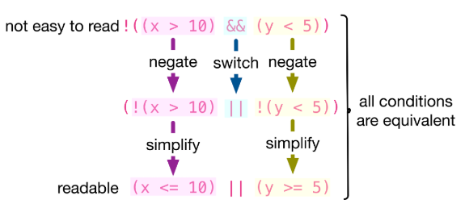

> Last Edit: 1/13/25

 In this chapter, we will discuss how to make decisions in C. We will discuss the `if`, `else` and `else if` statements

# 3.1 If-Statement

- 开发一个提示用户输入年龄的程序。如果未满工作的法定年龄，程序会打印“您还没有资格工作”，否则会显示“您有资格工作”
- `if`和`else`的语法在C中如下

``` c
if (condition) {
  // code to execute if condition is true
} else {
  // code to execute if condition is false
}
```

## 3.1.1 What can this condition be

- Condition是一个Bool variable，其可以用`True`表示，也可以用Numerical Value。在C中，任意非零的值都（通常用1）代表了`True`，而`False`则是0

### Relational Expression

- 关系运算符通常使用以下的符号
- `==`：Equal to
- `!=`：Not Equal to
- `<`：Less than
- `>`：Greater than
- `<=`：Leq
- `>=`：Geq
- 有了这些就可以完整编写一个判断年龄的程序了

``` c
#include <stdio.h>
int main(void) {
  int age = 0;
  printf("Enter your age: ");
  scanf("%d", &age);
  
  if (age < 14) {  // Condition 
checking if age is less than 14
    printf("You are not yet 
eligible to work in Ontario.");
  } else {
    printf("You are eligible to 
work in Ontario.");
  }
  return 0;
}
```

## 3.1.2. What can we do with relational operators?

- 通过Relational Operators，可以实现
1. 比较值的大小：`(7.2>5.1)`
2. 比较`char`的大小：`'a'>'b'`，这里比较的是他们的ASCII
3. 比较`char`和`int`：比如`(0 == '0')`，char的0有ASCII = 48，所以0 != '0'

```c
int x = 0;
if (x = 1) {
	printf("True");
}
```

- 这是一个判断，他最终会输出True，这是因为即使第一行赋值`int x = 0;`，第二行重新令`x = 1`，使得判断变成了`if (1)`，而1就是True

# 3.2 Multiple Conditions

- 想要同时判断两个Condition的成立，可以通过`&&`的判断符，这些完整的叫做Logical Operators

## 3.2.1 Logical/Boolean Operators

| A     | B     | A && B | A \|\| B |
|-------|-------|--------|----------|
| false | false | false  | false    |
| false | true  | false  | true     |
| true  | false | false  | true     |
| true  | true  | true   | true     |
- 完整的Logical Opeators的判断结果如上，但是记住过程比背下表格更加简单
- `&&`，and，当A和B同为true则为True，其他均为False
- `||`，or，当A和B其中一个为True则整体为True
- 还有第三个Logial Operators为`!`，其的作用就是Reverse Bool Value

``` c
#include <stdio.h>
int main(void) {
  char letter = ' ';
  printf("Enter a letter: ");
  scanf("%c", &letter);
  
  if (letter == 'A' || letter == 'a') {
    printf("You entered an upper case or lower 
case A.");
  } else {
    printf("You did not enter an upper case or 
lower case A.");
  }
  return 0;
}
```

- 上面的程序，当输入为A或者a的时候，都会进入if，因为用的是`||`，or判断符

### 3.2.1.1 Lazy Evaluation

- 假设执行了`x % y < 10`的判断，一个问题可能出现在当y=0的时候，所以这就需要在整除之前做一步`y!=0`的判断
- 一种做法就是nested-if，嵌套if，这是一个非常lj的做法，虽然可读性高，但占用的时间和空间都是庞大的

``` c
if (条件1) {
    // 条件1满足时执行的代码
    if (条件2) {
        // 条件1和条件2同时满足时执行的代码
    }
}
```

- 另外一种做法就是通过Lazy Evaluation，其实就是使用`&&`

``` c
if (y != 0 && x % y < 10) {
  // do something
}
```

- Lazy evaluation将多个判断结合为一个的办法，详细来说他会从左到右的顺序判断
- `||`
- 这个运算符先评估左侧的表达式（LHS，Left-Hand Side）。
- 如果LHS为`true`，那么整个条件表达式结果为`true`，程序将不再继续评估右侧的表达式（RHS，Right-Hand Side）。
- 如果LHS为`false`，程序需要继续评估RHS来决定整个表达式的结果。
- `&&`
- 这个运算符也先评估LHS。
- 如果LHS为`false`，那么整个条件表达式结果为`false`，程序将不再继续评估RHS。
- 如果LHS为`true`，程序需要继续评估RHS来决定整个表达式的结果。
- 这种评估方式是一种效率优化手段，可以减少不必要的计算

### 3.2.1.2 De Morgan's Law

- 当一个**Lazy Evaluation**（注意仅是两个及以上的判断同时发生的情况下）判断的最外侧为一个Not，也就是`!`的时候，整体的判断将会看上去十分复杂，这可以通过De Morgan's Law化简
- 具体来说`!(A && B)` is equivalent to `!A || !B`，`!(A || B)` is equivalent to `!A && !B`
- 同时Relational Expression也可以变换，> 变成了<=，>= 变成 <，== 变成 != 




# 3.3 Nested-if Statement

- 当想要做特别多的判断的时候，可以采取Nested-if Statement，也就是嵌套If

## 3.3.2  Dangling Else Problem

- 在C语言中，`if`语句可以不带大括号`{}`来执行单条语句

``` c
if (condition)
    statement;
else
    statement;
```

- 这种写法没有问题，因为每个`if`和`else`清晰地对应一条语句。但是，如果没有使用大括号对嵌套的`if`语句进行清晰的界定，就会产生 Dangling Else 问题

``` c
if (condition1)
    if (condition2)
        statement;
else
    statement;
```

- 在这种情况下，不明确的是这个`else`应该属于哪个`if`。按照C语言的规则，`else`总是匹配最近的未匹配的`if`，所以在没有大括号明确界定的情况下，上面的`else`属于`if (condition2)`
- 所以没事就加个`{}`


