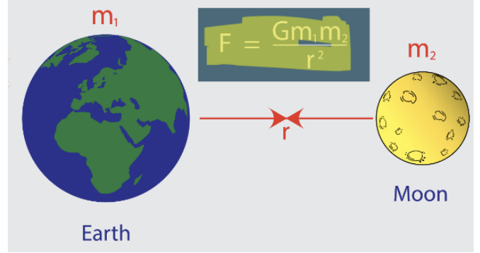

> Last Edit: 3/24/25

直线运动指的是物体沿着一条直线路径移动。这种运动的特点是，物体的速度和加速度（如果有的话）的方向只在一条直线上

## Velocity & Speed

- Velocity，瞬时速度，\\(\vec v=\frac{d\vec s}{dt}\\)
- Average Velocity，一个区间内的平均速度 \\(\vec{v}_{avg}=\frac{\Delta \vec x}{\Delta t}\\)
- Speed，Scalar，\\(|\vec v|\\)

## Acceleration 加速度

- 加速度是 Velocity 的 Second Derivative

$$
a=\frac{d\vec v}{dt}=\frac{d^2\vec x}{dt^2}
$$

### Acceleration as a function of time a(t)

- 当 Acceleration 是时间t的函数的时候（也就是说加速度在随着事件 t 变化而变化时），这种情况下，例如一个汽车加速或减速，有s和v等于

$$
a(t) = \frac{dv}{dt} \implies \int_{t_0}^{t} a(t) \, dt = \int_{v_0}^{v} dv = v - v_0
\implies v = v_0 + \int_{t_0}^{t} a(t) \, dt
$$

$$
v(t) = \frac{ds}{dt} \implies \int_{t_0}^{t} v \, dt = \int_{s_0}^{s} ds = s - s_0
\implies s = s_0 + \int_{t_0}^{t} \left[ v_0 + \int_{t_0}^{t} a(t) \, dt \right] dt
$$

- 对于上面的公式，当加速度a是一个Constant的时候

$$
v=v_0+\int_{t_0}^{t} a \, dt=v_0+a\int_{t_0}^{t} \, dt=v_0+a(t-t_0)
$$

- 同理s也就有

$$
s=s_0+\int_{t_0}^{t} \left[ v_0+a(t-t_0) \right] dt=s_0+\frac{1}{2}at^2-at_0t+v_0t
$$

### Acceleration is a function of position a(s)

- 在这种情况下，加速度取决于位置，这常见于诸如重力势能场中物体的运动
- 同理Acceleration是速度对于时间的导数，有

$$
a(s)=\frac{dv}{dt}\Rightarrow dt=\frac{dv}{a(s)}
$$

- 又因为 Velocity 是 Speed 对于时间的导数，有

$$
v=\frac{ds}{dt}\Rightarrow dt=\frac{ds}{v}
$$

- 建立等式便可得到

$$
\frac{dv}{a(s)}=\frac{ds}{v}\Rightarrow \int a(s)ds=\int vdv=\frac{1}{2}(v^2-{v_0}^2)
$$

- 同理当a是Constant的时候有

$$
\frac{1}{2}(v^2-{v_0}^2)=a\int^s_{s_0}ds=a\Delta S\Rightarrow v^2={v_0}^2+2a\Delta S
$$

> 在加速度是位置的函数的时候没有对于s的公式

#### ex. Speed of asteroid falling

Find the impact speed of an asteroid falling to earth from a height of 109m (from the center of earth), when 𝑣𝑜 =-50 m/s. Consider m(earth)=6e24 kg, and G=6.67e-11Nm²/kg², and r(earth)=6.4e6 m

- 已知u，S0，Sf，求Vf，已知加速度是Position s的函数 \\(a=\frac{Gm_e}{r^2}\\)

$$
v^2={v_0}^2-2\int\frac{Gm_e}{s^2}ds={v_0}^2+2Gm_e(\frac{1}{s}-\frac{1}{s_0})
$$

### Acceleration as a function of velocity a(v)

- 加速度为速度 v 的函数

$$
a(v)=\frac{dv}{dt}\Rightarrow dt=\frac{dv}{a(v)}\Rightarrow \int^t_{t_0}dt=\int^v_{v_0}\frac{dv}{a(v)}=t-t_0
$$

#### ex. Projectile Motion

A projectile travels through fluid with an initial velocity of 60 m/s. The acceleration is 𝑎 = −0.4 v3𝑚/𝑠². Find v after 4 s

- 可以发现a是v的函数，有 \\(a(v)=-0.4v^3\\)

$$
a(v)=\frac{dv}{dt}\Rightarrow \int^t_{t_0} dt=\int\frac{dv}{-0.4v^3}=\frac{-1}{0.4}\int v^{-3}dv
$$

- 分别求出积分后得到

$$
t-t_0=\frac{-1}{0.4}\frac{-1}{2}=(\frac{1}{v^2}-\frac{1}{{v_0}^2})\Rightarrow v=0.559m/s
$$

## Summary

- 加速度 a(t) 是时间的函数

$$
∫dv=∫a(t) dt\int dv = \int a(t) \, dt
$$

- 加速度 a(s) 是位移的函数

$$
∫v dv=∫a ds\int v \, dv = \int a \, ds
$$

- 加速度 a(v) 是速度的函数

$$
∫dva(v)=∫dt\int \frac{dv}{a(v)} = \int dt
$$

- 当a是常数的时候

$$
V = V_0 + at
$$

$$
S = S_0 + V_0 t + \frac{1}{2} a t^2
$$

$$
V^2 = V_0^2 + 2a \Delta s
$$