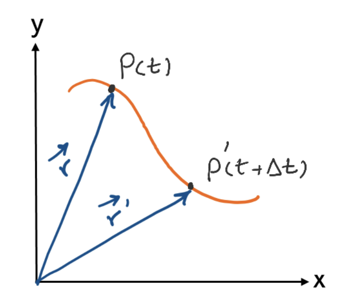

> Last Edit: 3/24/25

## Plane Curvilinear Motion

- Plane Curvilinear Motion 是指物体在二维平面内沿曲线路径的运动。这种运动比直线运动复杂，因为物体的速度向量不仅大小可能变化，方向也在不断变

- 物体的运动轨迹是一条二维曲线，表示物体在x-y平面中的运动。
- 位置矢量 \\(\vec{r}(t)\\) 的是物体在时间t的时候从原点到物体当前所在位置的 Vector
- 轨迹点 P(t) 和 \\(P'(t + \Delta t)\\) 是物体在时刻t的位置
- 当时间t改变时，物体沿着曲线移动，位置矢量 \\(\vec{r}\\) 也会随时间变化
- 曲线运动中的速度和加速度是通过 \\(\vec{r}(t)\\) 的导数来确定的

$$
\vec{r}(t) = x(t)\hat{i} + y(t)\hat{j}
$$

$$
\vec{v}(t) = \frac{d\vec{r}(t)}{dt} = \frac{dx(t)}{dt}\hat{i} + \frac{dy(t)}{dt}\hat{j}
$$

$$
\vec{a}(t) = \frac{d\vec{v}(t)}{dt} = \frac{d^2x(t)}{dt^2}\hat{i} + \frac{d^2y(t)}{dt^2}\hat{j}
$$

- 如果Velocity的Magnitude没有发生改变，其加速度依然存在，具体来说速度不仅与速度的大小变化相关，还与速度的方向变化相关

### Instantaneous Direction 瞬时方向

- 对于曲线运动中的物体，当 \\(\Delta t\rightarrow 0\\) 的时候，其Displacement Vector和Velocity Vector总是与物体运动轨迹的 Tangent 方向一致

#### ex. Collision Problem in Plane

The motions of two particles (A and B) are described by the position vectors. Find the point at which the particles collide and their speeds just before the collision

$$
\vec{r}_A = \left[ 3t \, \hat{i} + 9t(2 - t) \, \hat{j} \right] \, \text{m}
,\vec{r}_B = \left[ 3(t^2 - 2t + 2) \, \hat{i} + 3(t - 2) \, \hat{j} \right] \, \text{m}
$$

- 想要做到碰撞，令i和j分别相等就行，之后就是求解了

## Rectangular Coordinate System

- 对于3D的情况，就是多了一个Freedom of motion其Position Vector以及Magnitude为

$$
\vec{r} = x\hat{i} + y\hat{j} + z\hat{k},|\vec{r}| = \sqrt{x^2 + y^2 + z^2}
$$

### Velocity

- 同理只要对Position对时间t求导就是速度了

$$
\vec{v} = \frac{d\vec{r}}{dt} = \frac{d}{dt} \left( x\hat{i} + y\hat{j} + z\hat{k} \right)
$$

$$
\vec{v} = \left( \frac{dx}{dt}\hat{i} + x\frac{d\hat{i}}{dt} \right) + \left( \frac{dy}{dt}\hat{j} + y\frac{d\hat{j}}{dt} \right) + \left( \frac{dz}{dt}\hat{k} + z\frac{d\hat{k}}{dt} \right)
$$

- 由于i，j，k是Unit Vector，其不受时间影响，所以可以去掉

$$
vec{v} = \frac{dx}{dt}\hat{i} + \frac{dy}{dt}\hat{j} + \frac{dz}{dt}\hat{k} 
$$

### Acceleration

- 同理对速度求导就有

$$
\vec{a} = \frac{dv_x}{dt} \hat{i}+ \frac{dv_y}{dt} \hat{j} + \frac{dv_z}{dt} \hat{k}
$$