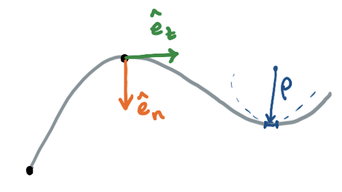

> Last Edit: 3/24/25

## Why N-T

- 当已知了物体运动的轨迹的时候，可以更加简便的通过 Normal 法线，和 Tangential 切线坐标来描述粒子的运动

- t -axis：切线方向，与粒子所在位置的曲线切线方向一致，并且方向为粒子运动的正方向
- n -axis：法线方向，垂直于 t 轴，正方向指向曲线的曲率中心
- eₙ 和 eₜ：分别是法线和切线方向的单位向量

## Radius of curvature 曲率半径

- Radius of Curvature 曲率半径是描述曲线在某点处弯曲程度的量度，具体来说，它是通过该点的曲线能够最佳拟合的圆的半径来定义的

$$
\rho = \frac{(1 + y'^2)^{3/2}}{|y''|}
$$

## Distance in n-t System

- 在一个 Circular Motion 中，物体移动的距离由 Radius of curvature 和滑过角度的积分得出，因为 Radius of Curvature 描述的就是在一点的曲线的完整圆的半径，半径乘以距离就得到了 Arc Length，具体来说有

$$
ds=\rho d \beta
$$

## Velocity in n-t System

- 在 n-t 系统中，Velocity 的方向永远指向 Path of motion 的 tangent 方向，也就是说 V 就是 Tangent 方向上 V 的 Magnitude

$$
\vec{v} = v \vec{e}_t
$$

- 同理在上面描述了 n-t System 中的 Distance，Velocity 也可以通过对其求导得到，有

$$
v = \dot{s} = \frac{ds}{dt} = \frac{\rho d\beta}{dt} = \rho \dot{\beta} \Rightarrow \vec{v} = v \vec{e}_t = \rho \dot{\beta} \vec{e}_t
$$

- 这一个公式同时又可以推导出 Angle 关于 time 的导数，有

$$
\frac{d\theta}{dt} = \dot{\theta} = \frac{v}{\rho}
$$

## Acceleration in n-t System

- 再次对 Velocity 求导就可以得到

$$
\vec{a} = \frac{d\vec{v}}{dt} = \frac{d \left( v \hat{e}_t \right)}{dt} = \dot{v} \hat{e}_t + v \frac{d\hat{e}_t}{dt}
$$

- 其中，因为 Velocity 方向的导数由 Angle 的变化量决定，因为其本身 Magnitude 并不会发生改变，一直都是一，并且方向是圆心方向，所以有 \\(d\hat{e}_t = d\theta \hat{e}_n\\)，带入得到

$$
\vec{a} = \dot{v} \hat{e}_t + v \frac{d\theta}{dt} \hat{e}_n = \dot{v} \hat{e}_t + \frac{v^2}{\rho} \hat{e}_n
$$

- 而 a 的 Magnitude 就可以通过勾股定律得到

### Tangential Acceleration

- 总结上面的所有公式，可以得到

$$
a_t = \frac{dV}{dt}
$$

### Normal Acceleration

- 同理对于 Normal 方向上的，有

$$
a_n = V \dot{\theta}=\rho \dot{\theta}^2 = \frac{V^2}{\rho}
$$