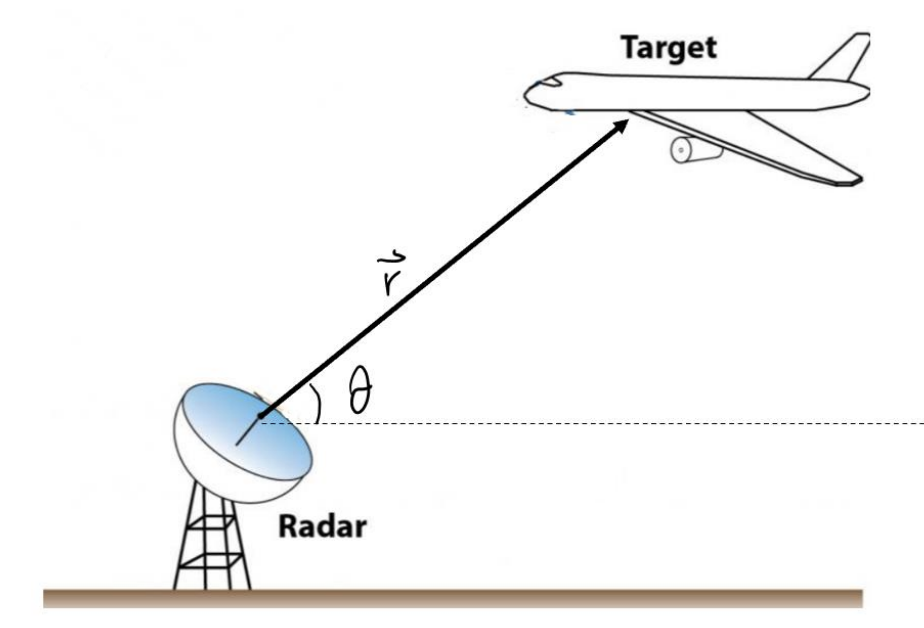
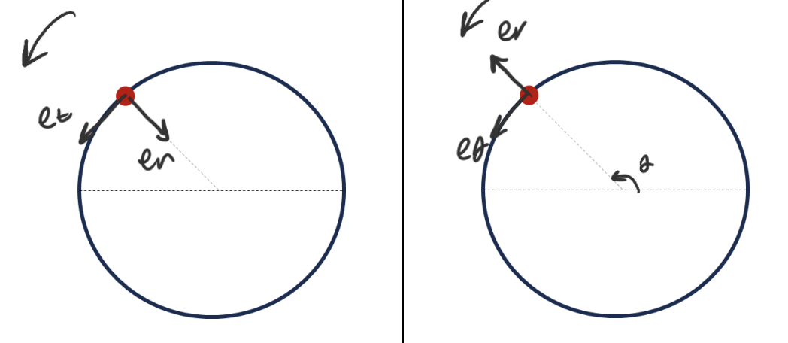

> Last Edit: 3/25/25
> 

当在通过一个固定点观察物体运动的时候，使用 $R-\theta$ 坐标系描述运动吗会高效很多

# Position in R-Theta System

- 想要描述一个物体在 Coordinate 中的位置，可以通过

$$
\vec r=r\hat e_r
$$

# Velocity in R-Theta System

- 将 Position 求导就可以得到 Velocity，有

$$
\vec{v} = \frac{d\vec{r}}{dt} = \frac{d(r \hat{e}_r)}{dt} = \dot{r} \hat{e}_r + r \dot{\hat{e}}_r=\dot{r} \hat{e}_r + r \dot{\hat{e}}_r=
\dot{r} \hat{e}_r + r \dot{\theta} \hat{e}_\theta
$$

- 于是就得到了两个方向上的 Velocity

## ex. Finding the velocity

A carousel is turning at the speed of 8 rpm. A child initially at 4m from the center walks toward the center at 2m/s. Find $\vec v$

$$
\vec{V} = \dot{r} \hat{e}r + r \dot{\theta} \hat{e}\theta
= -2 \hat{e}r + (14)(0.84) \hat{e}\theta \quad \text{m/s}
$$

# Acceleration in R-Theta System

- 再次对于 velocity 求导得到

$$
\vec{a} = \frac{d\vec{v}}{dt} = \frac{d}{dt} (\dot{r} \hat{e}r + r \dot{\theta} \hat{e}\theta)
= \ddot{r} \hat{e}r + \dot{r} \dot{\hat{e}}r + \dot{r} \dot{\theta} \hat{e}\theta + r \ddot{\theta} \hat{e}\theta + r \dot{\theta} \dot{\hat{e}}_\theta
= \hat{e}r (\ddot{r} - r \dot{\theta}^2) + \hat{e}\theta (\ddot{\theta} + 2 \dot{r} \dot{\theta})
$$

$$
\Rightarrow a = \hat{e}r (\ddot{r} - r \dot{\theta}^2) + \hat{e}\theta (r\ddot{\theta} + 2 \dot{r} \dot{\theta})
$$

### ex. Finding the Acceleration

**Extracted Problem Statement:**

A shuttle is launched vertically and tracked by a radar station. At the instant when $\theta = 60^\circ$, $r = 9 km, $\ddot{r} = 21 \text{ m/s}^2$, and $\dot{\theta} = 0.02 \text{ s}^{-1}$, determine the acceleration vector $\vec{a}$

计算航天器的加速度 $\mathbf{a}$，给定数据如下：

![[DYN4.NormalandTangentialCoordinates-2.png]]

# Special Case: Circular Motion

- 对于 Polar Coordinate 中的 Circular Motion，由于 $\dot r=\ddot r=0$ 很多公式都会被化简

## N-T Coordinate

- 在 Circular Motion 中有

$$
v= ve_t
$$

- 其本身就由 Tangential Direction 上的 Velocity 决定，不受影响

## R-Theta Coordinate

- 对于一个 Polar Coordinate 中的 Circular Motion，有

$$
v=\dot{r} \hat{e}r + r \dot{\theta} \hat{e}\theta
$$

- 带入 $\dot r=\ddot r=0$，得到

$$
v=r \dot{\theta} \hat{e}_\theta
$$

## Clockwise & Counter Clockwise

- 对于不同的运动方向，可以建立两个坐标系的关系
- 对于两个坐标系，其中一个特点就是 N-T Coordinate 中，Normal Force 是指向圆心的，而对于 R-Theta 来说，Radius 是从圆心指向物体 Postion 的，这直接导致了两个 Coordinate 下，有 $\vec a_n=-\vec a_r$
- 再者就是对于 R-Theta 中的 Angle 来说，Angle 的变化的永远以 Counter Clockwise 为正，但是 N-T 中不同转向的 Tangential Force 的正负不同，所以当 CW 时，有 $\vec a_t=-\vec a_\theta$，在 CCW 中则是 $\vec a_t=\vec a_\theta$

