# AEM1.ComplexNumbers

> Last Edit：9/15/25
> 

## Complex Numbers

- 最早对 Complex Numbers 的接触出现在 Quadratic Equation 中
- 当有 \\(ax^2+bx+c=d\\) 的时候，如果 Discriminant 判别式 \\(b^2-4ac < 0\\)  的时候，方程没有 Real Solution，这时候就引入了 Imaginary Unit \\(i^2=-1\\)
- 但是同时一个 Complex Number 并不止含有 Imaginary Unit，它同时包含 Real Part，于是就可以定义一个完整的 Complex Number 为任意形式的

$$
\mathbb C=\{z|z=a+bi,a,b\in\mathbb R \}
$$

- 其也有 Polar Form，也称为三角形式，为

$$
z=r(\cos \theta+i\sin\theta)
$$

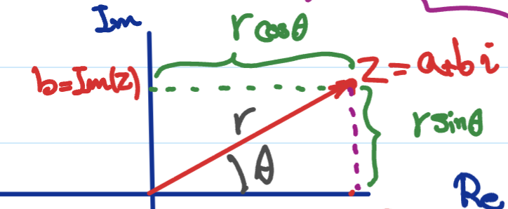

### Arithmetic Operations

- Complex Number 的加减乘除如下
- 设 \\(z_1 = x_1 + iy_1, z_2 = x_2 + iy_2\\)：

#### **Addition**

$$
z_1 + z_2 = (x_1 + x_2) + i(y_1 + y_2)
$$

#### **Subtraction**

$$
z_1 - z_2 = (x_1 - x_2) + i(y_1 - y_2)
$$

#### **Multiplication**

$$
z_1 z_2 = (x_1x_2 - y_1y_2) + i(x_1y_2 + x_2y_1)
$$

#### **Division**

- 在计算 Complex Number 的 Division 之前需要先定义 \\(z^{-1}\\)
- 这个数他需要满足的条件为 \\(z\times z^{-1} =1\\)
- 现在已知 \\(z=a+bi\\)，可以计算出 \\(z^{-1}\\) 的 Rectangular Form 为#

$$
\frac1z= \frac{1}{a+bi}=\frac{1}{a+bi}\times\frac{a-bi}{a-bi}=\frac{a-bi}{a^2+b^2}=\frac{a}{a^2+b^2}-i\cdot\frac{b}{a^2+b^2}
$$

### Conjugate

- Complex Number 的 Conjugate 的定义就是

$$
\overline Z = Re(z)-iIm(z)
$$

- 定义好了 Conjugate 的特性，就会出现很多二级结论

$$
\frac{1}{z} = \frac{1}{z} \times \frac{\overline{z}}{\overline{z}}= \frac{\overline{z}}{z \overline{z}}= \frac{\overline{z}}{|z|^2}
$$

$$
\overline{z} |= \sqrt{(\operatorname{Re}(z))^2 + (-\operatorname{Im}(z))^2}= |z|
$$

$$
\left| \frac{1}{z} \right|= \left| \frac{\overline{z}}{|z|^2} \right|= \frac{1}{|z|^2} |\overline{z}|= \frac{1}{|z|^2} |z|= \frac{1}{|z|}
$$

$$
z\overline{z}
= (\operatorname{Re}(z) + \operatorname{Im}(z) i)(\operatorname{Re}(z) - \operatorname{Im}(z) i)
= (\operatorname{Re}(z))^2 + (\operatorname{Im}(z))^2
= |z|^2
$$

$$
\frac{z + \overline{z}}{2} = \operatorname{Re}(z)
$$

$$
\overline{z_1 + z_2} = \overline{z_1} + \overline{z_2}
$$

$$
\overline{z_1 z_2} = \overline{z_1} \, \overline{z_2}
$$

$$
\overline{\left(\frac{z_1}{z_2}\right)} = \frac{\overline{z_1}}{\overline{z_2}}
$$

### Polar Form

- 现在研究几个 Polar Form 下的结论
- 假设现在有 \\(z=r(\cos\theta+i\sin\theta)\\)
- Find Polar Form of \\(\overline z\\)

$$
\overline{Z} = r(\cos\theta - i \sin\theta) = r(\cos(-\theta) + i\sin(-\theta))
$$

- Find Polar Form of \\(\frac1z\\)

$$
\frac{1}{Z} = \frac{1}{|Z|^2} \, \overline{Z} = \frac{1}{r^2} \, r(\cos(-\theta) + i \sin(-\theta)) = \frac{1}{r} \left( \cos(-\theta) + i \sin(-\theta) \right)
$$

### Geometric Interpretation

- 假设有一个 \\(z = a + bi\\)，What is the geometric interpretation of  \\(\overline z\\)  and \\(\frac1z\\)

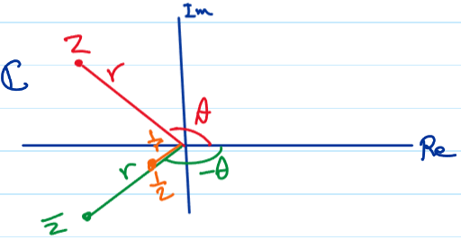

- 根据上面 Polar Form 中得到的结论可以看出，Conjugate 和 Reciprocal 的 Mod 和 Argument

#### Multiplication by i

- 当一个 Complex Number 乘上一个 Imaginary Number i 的时候，本质上就是将其 Polar Form 的图案 CCW 移动了 90 Degree

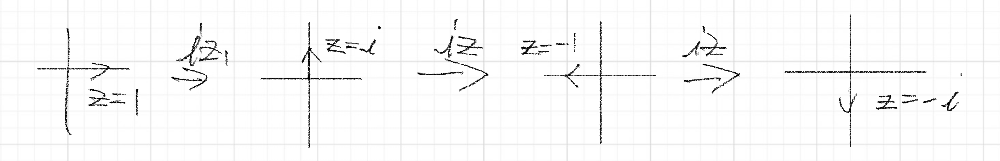

- 同时，当两个 Complex Number 互乘的时候，他们的结果如下

$$
Z_1 Z_2 = r_1 \bigl( \cos\theta_1 + i \sin\theta_1 \bigr) \times r_2 \bigl( \cos\theta_2 + i \sin\theta_2 \bigr) \\[6pt]= r_1 r_2 \left(    \bigl( \cos\theta_1 \cos\theta_2 - \sin\theta_1 \sin\theta_2 \bigr)    + i \bigl( \cos\theta_1 \sin\theta_2 + \sin\theta_1 \cos\theta_2 \bigr)  \right) \\[6pt]= r_1 r_2 \left( \cos(\theta_1 + \theta_2) + i \sin(\theta_1 + \theta_2) \right)
$$

- 观察公式可以看出，Multiplication 的结果就是，mod 相乘，Argument 相加

### Argument 辐角

- Complex Number 中，**Argument** 是指复数在复平面上与 正实轴 的夹角
- 假设现在有 \\(z = (-2.5)\left(\sin\frac{\pi}{7} - i\cos\frac{\pi}{7}\right)\\)，要求 Z 的极坐标形式，有

$$
z = 2.5\left(-\sin\frac{\pi}{7} + i\cos\frac{\pi}{7}\right)
$$

- 注意到 \\(\sin\\) 和 \\(\cos\\) 的位置不对，通过三角公式可以变换求得 \\(\theta\\)

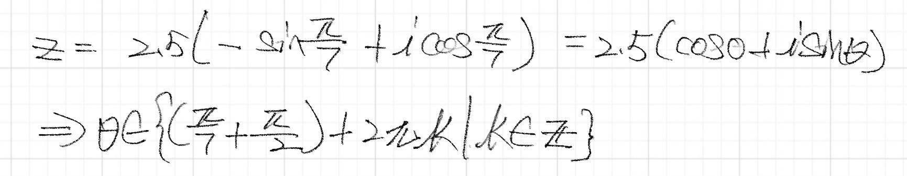

#### Principle Argument

- Principle Argument 就是最简单的那个 Argument，取值范围是

$$
-\pi < \arg(z) \leq \pi
$$

#### Ex.

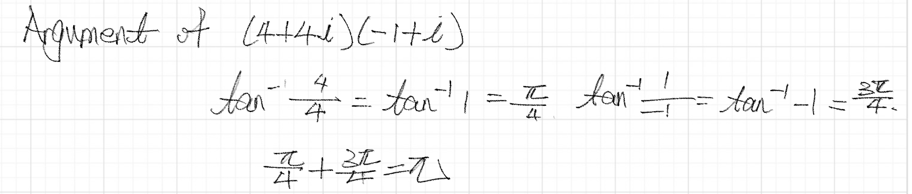

## Complex Exponential

- We define \\(e^z\\) for any \\(z \in \mathbb{C}\\) with the same series:

$$
e^z = \sum_{n=0}^{\infty} \frac{z^n}{n!}
$$

- 上面的公式就是 Definition of exponential function in complex domain（复数域中的指数函数定义）

### **Properties**

- 复数域中指数函数的几个重要性质：

#### **Property #1**

$$
e^{z_1 + z_2} = e^{z_1} \cdot e^{z_2}, \quad \forall z_1, z_2 \in \mathbb{C}
$$

- 指数加法法则，在复数域中依然成立

#### **Property #2**

$$
e^0 = 1
$$

- 零次幂等于 1

#### **Property #3**

$$
e^{-z} = \frac{1}{e^z}, \quad \forall z \in \mathbb{C}
$$

- 负指数等于倒数

#### **Property #4**

$$
(e^z)^k = e^{kz}, \quad \forall z \in \mathbb{C}, \; k \in \mathbb{Z}
$$

- 整数次幂的性质

## Euler’s Formula

- 令 \\(z = i\theta\\)，代入指数函数的定义：

$$
e^{i\theta} = \sum_{n=0}^{\infty} \frac{(i\theta)^n}{n!}
$$

- 把各项展开，可以分为：
- 实部（Real part）：\\(1 - \frac{\theta^2}{2!} + \frac{\theta^4}{4!} - \dots = \cos \theta\\)
- 虚部（Imaginary part）： \\(i(\theta - \frac{\theta^3}{3!} + \frac{\theta^5}{5!} - \dots) = i\sin \theta\\)
- 于是就有

$$
e^{i\theta} = \cos\theta + i\sin\theta
$$

### **Geometric meaning**

- 前面提到了 Euler's Formula 指出了 \\(e^{i\theta} = \cos\theta + i\sin\theta\\)，这就说明了 \\(e^{i\theta}\\) 是在 unit circle 上的一个复数，Arugument 为 \\(\theta\\)

### Properties

- \\(|e^{i\theta}| = 1\\)，因为 \\(\cos^2\theta + \sin^2\theta = 1\\)
- 回忆 mod 的定义 对于 Complex Number \\(z = x+iy\\) 来说，它的 mod \\(|z| = \sqrt{x^2 + y^2}\\)
- 套用到 \\(e^{i\theta}\\) 中可以得到 \\(|e^{i\theta}| = \sqrt{(\cos\theta)^2 + (\sin\theta)^2}=1\\)
- \\(\arg(e^{i\theta}) = \theta + 2k\pi, \, k \in \mathbb{Z}\\)

### **Polar Representation**

- 复数的极坐标表示：

$$
Z = r(\cos\theta + i\sin\theta)
$$

- 这里 r 是模（modulus）
- \\(\theta\\) 是辐角（argument）

### **Exponential Representation**

- 利用欧拉公式，可以写成：

$$
Z = re^{i\theta}= re^{i(\theta + 2k\pi)}, \quad \forall k \in \mathbb{Z}
$$

## Euler’s Identity

- 上面的 Euler’s Formula 写道

$$
e^{i\theta} = \cos\theta + i\sin\theta
$$

- 当 \\(\theta = \pi\\)  时：

$$
e^{i\pi} = \cos\pi + i\sin\pi
$$

- 将值代入，有 \\(\cos\pi = -1, \quad \sin\pi = 0\\)，可以得到

$$
e^{i\pi} = -1 + i\cdot 0 = -1
$$

- 于是就得到了 Euler’s Identity

$$
e^{i\pi} + 1 = 0
$$

## Euler’s Formula + Rectangular Representation

- 回顾指数的性质 Recall property #1

$$
e^{z_1 + z_2} = e^{z_1} \cdot e^{z_2}
$$

- 把复数写成 Rectangular form，令

$$
Z = x + iy, \quad x,y \in \mathbb{R}
$$

- 于是就有

$$
e^Z = e^{x+iy}= e^x \cdot e^{iy}
$$

- 根据 Euler’s Formula 可以知道

$$
e^{iy} = \cos y + i\sin y
$$

- 再乘上 \\(e^x\\)  可以得到

$$
e^{x+iy} = e^x (\cos y + i\sin y)
$$

- 这就是复数指数函数的 R**ectangular representation** **直角坐标表示**

### Upshot

- 由上式可以得到几个重要结果：

#### Modulus

$$
|e^Z| = e^x
$$

#### Argument

$$
\arg(e^Z) = y + 2k\pi, \quad k \in \mathbb{Z}
$$

- 如果有两个复数 \\(Z_1, Z_2\\)：

$$
\arg(Z_1 Z_2) = \arg(Z_1) + \arg(Z_2)
$$

## Integer Powers of Complex Numbers

- 很多我们用三角函数证明过的复数性质，其实也可以用指数函数来证明

### Multiplication of complex numbers 复数相乘的性质

- 之前提到

$$
Z_1 Z_2 = r_1 r_2 \big(\cos(\theta_1 + \theta_2) + i \sin(\theta_1 + \theta_2)\big)
$$

- 换成指数形式：

$$
Z_1 = r_1 e^{i\theta_1}, \quad Z_2 = r_2 e^{i\theta_2}
$$

- 那么：

$$
Z_1 Z_2 = r_1 e^{i\theta_1} \cdot r_2 e^{i\theta_2} = r_1 r_2 e^{i(\theta_1 + \theta_2)}
$$

- 再用 Euler’s Formula 可以得到：

$$
= r_1 r_2 (\cos(\theta_1 + \theta_2) + i \sin(\theta_1 + \theta_2))
$$

- 这和三角函数的方法一致，但更简洁

### De Moivre’s Formula（棣莫弗公式）

- 由指数函数的性质：

$$
(e^{i\theta})^n = e^{in\theta}, \quad n \in \mathbb{Z}
$$

- 于是：

$$
(\cos\theta + i\sin\theta)^n = (e^{i\theta})^n=(e^{i n\theta })=\cos(n\theta) + i\sin(n\theta)
$$

- 这就是著名的 **De Moivre’s Formula**

### Integer powers of complex numbers 复数的整数次幂

- 设复数：\\(Z = |Z| e^{i\theta}\\)
- 给定整数 kk：

$$
Z^k = (|Z| e^{i\theta})^k = (|Z|)^k e^{ik\theta} = |Z|^k (\cos(k\theta) + i\sin(k\theta))
$$

- Modulus：被提升到 k 次方，变为 \\(|Z|^k\\)
- Argument：被放大 k 倍，变为 \\(k\theta\\)
- 也就是说：**复数的幂就是“拉伸模长 + 放大角度”**

### Ex.

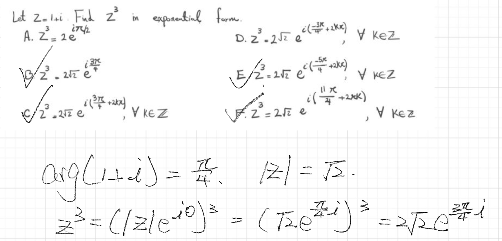

- B 和 C 正确没什么特别的，对于 E 来说 \\(\frac{3\pi}{4}=-\frac{5\pi}{4}\\) 也没问题
- 对于 F 来说就是多了一个 \\(2\pi\\)，也没问题

## Roots of Complex Numbers

- 如果 w 是 Z 的 n 次方根，记作

$$
Z^{1/n} = w, \quad \text{if } w^n = Z
$$

- 将他们两个写成 Exponential 的形式，有

$$
Z = r_0 e^{i\theta_0}, \quad w = r e^{i\theta}
$$

- 要求 \\(w^n = Z\\)，即

$$
(r e^{i\theta})^n = r^n e^{i n\theta} = r_0 e^{i\theta_0}
$$

- 根据 Complex Exponential 的性质，可以得到
- 模长：

$$
r^n = r_0 \;\;\Rightarrow\;\; r = (r_0)^{1/n}
$$

- 角度：

$$
n\theta = \theta_0 + 2k\pi, \quad k \in \mathbb{Z}\Rightarrow \theta = \frac{\theta_0 + 2k\pi}{n}
$$

- 通得到 General Solution

$$
w = r_0^{1/n} e^{i\frac{\theta_0+2k\pi}{n}}, \quad k \in \mathbb{Z}
$$

- 注意：一共有恰好 n 个不同的 Complex Roots

### Geometric Interpretation

#### **Roots on a circle**

- 所有根都在一个圆上，其半径为

$$
|Z|^{1/n} = r_0^{1/n}
$$

#### **Even spacing**

- 这些根沿着圆 **平均间隔** \\(2\pi/n\\)，起点在 \\(\theta_0/n\\)

$$
w_k = Z^{1/n} = r_0^{1/n} e^{i\frac{\theta_0+2k\pi}{n}}, \quad k=0,1,2,\dots,(n-1)
$$

#### Ex. 求 \\(\sqrt{i}\\)

- 先写出 i 作为一个 Complex Number 的 Exponential Form，有 \\(i = e^{i\pi/2}\\)
- 平方根：

$$
w = e^{i(\pi/2 + 2k\pi)/2}, \quad k=0,1\Rightarrow w_1 = e^{i\pi/4}, \quad w_2 = e^{i(5\pi/4)}
$$

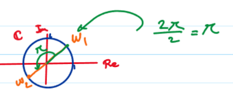

- 在图上，两个根分布在圆上，相隔 \\(\pi\\)（180°）

## Complex Logarithm

- 令 \\(w = \ln Z \Rightarrow Z = e^w\\)
- 这是 Complex Logarithm 的定义方式，即如果我们要定义 \\(w = \ln Z\\)，那就要让 \\(Z = e^w\\) 成立
- 为了找出 w，我们令复数 \\(Z = x + iy = re^{i\theta}\\)

> 两个分别是 Rectangular Form 和 Polar Form
> 
- 假设 \\(w(x,y) = U(x,y) + iV(x,y)\\)，这里表示将 w 写成 Real + Imaginary 的形式，也就有

$$
e^{w(x,y)} = e^{U(x,y) + iV(x,y)} = e^{U(x,y)} \cdot e^{iV(x,y)}
$$

- 这个东西是等于 \\(Z = re^{i\theta}\\) 的，这就可以将他们一一对应，得到

$$
e^{U(x,y)} = r \Rightarrow U(x,y) = \log_e r = \log_e |Z|
$$

- 于是就可以得到 General Solution 形式

$$
\ln(Z) = \log_e |Z| + i(\theta + 2\pi k),\quad k \in \mathbb{Z}
$$

<aside>
💡

这表示复对数是一个multi-valued function（多值函数），因为任意加上 \\(2\pi k\\) 都是合法的解

</aside>

> 上面的意思就是，给定一个 \\(Z\in \mathbb C\\)，\\(\ln(Z)\\) 存在无数个 Periodic Solutions
> 

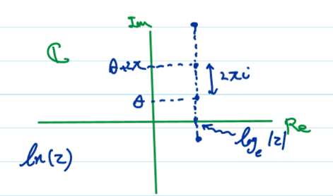

- 其中每一个 Solution 之间间隔 \\(2\pi\\)

### ln is a Multi-Valued Function

- 由于一个 Complex Number 存在无限个周期性的 Argument，这就是导致 Complex Logarithm 存在无限解的原因，同时 \\(\ln Z\\) 就可以写成

$$
\ln(Z)=\log_e|Z|+i\arg(Z)
$$

- 同时就也会存在一个 Principle Argument Arg(z)，写做

$$
Ln(Z)=\log_e|Z|+iArg(Z)
$$

## Properties of \\(e^z\\) and \\(ln(z)\\)

- 设现在有 Complex Number \\(z = x + iy\\)，可以得到以下性质
1. \\(|e^z| = e^x\\)，模长等于实部的指数
2. \\(\arg(e^z) = y + 2\pi k，k \in \mathbb{Z}\\)，幅角来自虚部

---

- 同时，由于 Complex Logarithm 的 Solution 是一个 Set

$$
\ln(z) = \{ w \mid e^w = z \}
$$

- 所以有：
1. \\(e^{\ln(z)} = z\\)，只要 \\(z \neq 0\\)
2. 如果 \\(w_1 \in \ln(z_1), w_2 \in \ln(z_2)\\)，那么 \\(w_1 + w_2 \in \ln(z_1 z_2)\\)

<aside>
💡

对数相加等于乘积的集合

</aside>

> 只在复数对数的多值定义下成立，不适用于 Principal value
> 
- 其实就是

$$
\ln(z_1) + \ln(z_2) = \ln(z_1 z_2)
$$

- 于是可以 Derive 出

$$
\ln\left(\frac{1}{z}\right) = -\ln(z), \quad\ln\left(\frac{z_1}{z_2}\right) = \ln(z_1) - \ln(z_2)
$$

### Ex. 1 ln(3)

- 先说结论，\\(ln(3)\\) 就是 \\(log_e(3)\\)
- 具体带入公式可以得到 3 的 Mod 为 3，Arg 为 0，于是有

$$
\ln(3) = \log_e |3| + i\arg(3) = \log_e 3
$$

### Ex. 2 ln⁡(−3)

- \\(\ln(-3)\\) 就和上面的不一样了，在 Real Analysis 中，Logarithm 中是不允许出现负数的，但是在 Complex Analysis 中，有

$$
\ln(-3) = \log_e |-3| + i\arg(-3) = \log_e 3 + i\pi
$$

- 详细来说，-3 的 mod 为 3，Arg 为 \\(\pi\\)

### 求解 e^z = 1 + i

- 两边取对数就可以知道这题在问的是 \\(Z = \ln(1 + i)\\) 的解，有

$$
Z = \ln(1 + i) = \log_e \sqrt{2} + i\left( \frac{\pi}{4} + 2\pi k \right), \quad k \in \mathbb{Z}
$$

- 用图表示这个解就是

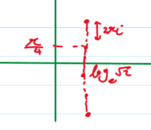

- 用图画出所有解在复平面上的位置就有，将 Real Part 固定：\\(\log_e \sqrt{2}\\)，将 Imagery Part 周期性上移：\\(\frac{\pi}{4} + 2\pi k\\)
- 最终得到一条沿虚轴等间距排列的点列

## General Complex Power

- 想要定义 \\(Z^α\\)，\\(\text{其中 } Z, \alpha \in \mathbb{C}\\)
- 类似于实数域中 \\(x^a\\)，我们在复数域中定义：

$$
Z^\alpha = e^{\alpha \cdot \ln(Z)}
$$

<aside>
💡

这仍是一个多值函数，因为 \\(\ln(Z)\\) 是多值的

</aside>

### Ex. 1: \\(2^\pi\\)

$$
2^\pi = e^{\pi \cdot \ln(2)}
$$

- 右边使用公式 \\(e^{\alpha \ln Z}\\)
- 现在分析 Complex logarithm \\(\ln 2\\)，有

$$
\ln(2) = \log_e 2 + i \cdot 2\pi k
$$

> 2 的 Arg (Principle Argument) 是 0，但是 arg 不是
> 
- 乘以 \\(\pi\\) 得到：

$$
\pi \log_e 2 + i \cdot 2\pi^2 k
$$

- 指数展开为：

$$
e^{\pi \log_e 2} \cdot e^{i \cdot 2\pi^2 k} = 2^\pi \cdot e^{i \cdot 2\pi^2 k}
$$

- 最后写成：

$$
2^\pi = 2^\pi \angle 2\pi^2 k
$$

- 意思是模长为 \\(2^\pi\\)，虚部会旋转 \\(2\pi^2 k\\)

### Ex. 2: \\(i^i\\)

- 已知 \\(i^i = e^{\ln(i) \cdot i}\\)

$$
\ln(i) = \log_e 1 + i \cdot \arg(i) = 0 + i\left( \frac{\pi}{2} + 2\pi k \right)
$$

- 所以：

$$
i^i = e^{i \cdot i \cdot \left( \frac{\pi}{2} + 2\pi k \right)} = e^{- \left( \frac{\pi}{2} + 2\pi k \right)}
$$

- 它的 Principle Branch 就是

$$
i^i = e^{-\pi/2} \quad \text{(当选择主值 \(k = 0\) 时)}
$$

## Jacques Hadamard

> **“The shortest path between two truths in the real domain passes through the complex domain**.“ —— 在实数域中，两条真理之间最短的路径，是通过复数域。
> 

- 现在需要证明

$$
\cos A \cos B = \frac{1}{2} \left[ \cos(A+B) + \cos(A-B) \right]
$$

- 首先用 Euler‘s 表示 cos 和 sin

$$
\cos x = \frac{e^{ix} + e^{-ix}}{2}, \quad \sin x = \frac{e^{ix} - e^{-ix}}{2i}
$$

- 把 \\(\cos A \cos B\\) 用复指数展开：

$$
\begin{align*}\cos A \cdot \cos B &= \left( \frac{e^{iA} + e^{-iA}}{2} \right)   \cdot \left( \frac{e^{iB} + e^{-iB}}{2} \right) \\&= \tfrac{1}{4} \left( e^{i(A+B)} + e^{i(A-B)} + e^{-i(A-B)} + e^{-i(A+B)} \right)\end{align*}
$$

- 利用对称性重新组合：

$$
e^{i(A+B)} + e^{-i(A+B)} = 2\cos(A+B)
$$

$$
e^{i(A-B)} + e^{-i(A-B)} = 2\cos(A-B)
$$

- 最终得到

$$
\cos A \cdot \cos B = \frac{1}{2} \left[ \cos(A+B) + \cos(A-B) \right]
$$

## Defining Complex Trigonometric Functions

- 回顾 Euler's Formula，有

$$
e^{i\theta} = \cos\theta + i\sin\theta
$$

- 可以得出：
    
    $$
    \sin\theta = \frac{e^{i\theta} - e^{-i\theta}}{2i}, \quad \cos\theta = \frac{e^{i\theta} + e^{-i\theta}}{2}
    $$
    
- 现在想要定义 \\(\sin(z),\cos(z)\\) 在复数 \\(z \in \mathbb{C}\\) 中怎么定义
- Definition 就是直接先把 Complex Number z 替换进去，可以得到

$$
\sin(z) = \frac{e^{iz} - e^{-iz}}{2i},\quad \cos(z) = \frac{e^{iz} + e^{-iz}}{2}
$$

- 然后对 tan 和 cot 同理

$$
\tan(z) = \frac{\sin(z)}{\cos(z)}, \quad \forall z \in \mathbb{C}, \cos(z) \ne 0
$$

$$
\cot(z) = \frac{\cos(z)}{\sin(z)}, \quad \forall z \in \mathbb{C}, \sin(z) \ne 0
$$

### Hyperbolic Sine

- 双曲正弦函数 \\(\sinh x\\) 是和单位双曲线 \\(x^2-y^2=1\\) 有关的正弦函数，定义为

$$
\sinh(x) = \frac{e^x - e^{-x}}{2}, \quad\cosh(x) = \frac{e^x + e^{-x}}{2}
$$

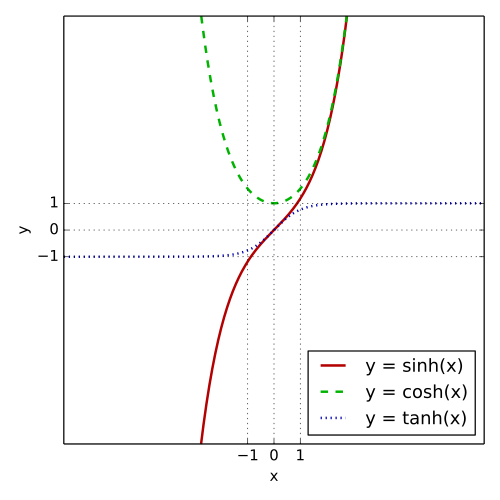

- 同理，Complex Number 下的 \\(\sinh z\\) 就是把 z 先带入

$$
\sinh(z) = \frac{e^z - e^{-z}}{2}, \quad \forall z \in \mathbb{C}
$$

$$
\cosh(z) = \frac{e^z + e^{-z}}{2}, \quad \forall z \in \mathbb{C}
$$

### Summarize

| 函数名 | 定义公式 |
| --- | --- |
| \\(\sin(z)\\) | \\(\frac{e^{iz} - e^{-iz}}{2i}\\) |
| \\(cos⁡(z)\cos(z)\\) | \\(\frac{e^{iz} + e^{-iz}}{2}\\) |
| \\(\tan(z)\\) | \\(\frac{\sin(z)}{\cos(z)}, 条件：\cos(z) \ne 0\\) |
| \\(\cot(z)\\) | \\(c\frac{\cos(z)}{\sin(z)}, 条件：s\sin(z) \ne 0\\) |
| \\(\sinh(z)\\) | \\(\frac{e^z - e^{-z}}{2}\\) |
| \\(\cosh(z)\\) | \\(\frac{e^z + e^{-z}}{2}\\) |

## Properties of Complex Trig Functions

- 下面要介绍几个在 Complex Domain 下的 Trig 的 Properties

### Sin(z) & Cos(z) in Rectangular Form

- 先定义一个 Complex Number \\(z = x + i y\\)，其中 \\(x, y \in \mathbb R\\)
- 已知 Complex sine function 为
    
    $$
    \sin(z) = \frac{e^{iz} - e^{-iz}}{2i}
    $$
    
- 将完整的 z 带入，得到

$$
\sin(z) = \frac{e^{i(x+iy)} - e^{-i(x+iy)}}{2i}
$$

- 已知 Euler’s Formula

$$
e^{ix} = \cos x + i \sin x, \quad e^{-ix} = \cos x - i \sin x.
$$

- 代入得到

$$
\sin(x+iy) = \frac{e^{-y}(\cos x + i \sin x) - e^{y}(\cos x - i \sin x)}{2i}.
$$

- 展开公式得到

$$
= \frac{(e^{-y}\cos x + i e^{-y}\sin x) - (e^{y}\cos x - i e^{y}\sin x)}{2i}
$$

$$
= \frac{(e^{-y}\cos x - e^{y}\cos x) + i(e^{-y}\sin x + e^{y}\sin x)}{2i}
$$

- 将两个分子分离，

$$
\frac{e^{-y}\cos x - e^{y}\cos x}{2i} = \frac{- (e^{y}-e^{-y})\cos x}{2i}
$$

$$
\frac{1}{i} = -i, \quad \frac{e^{y} - e^{-y}}{2} = \sinh(y)
$$

- 所以得到：

$$
= i \cos(x) \sinh(y)
$$

- 另外一半有

$$
\frac{i(e^{-y}\sin x + e^{y}\sin x)}{2i} = \frac{e^{y}+e^{-y}}{2} \sin x.
$$

$$
\frac{e^{y}+e^{-y}}{2} = \cosh(y)
$$

- 所以得到

$$
= \sin(x) \cosh(y)
$$

- 最后把两个加一块得到

$$
\sin(x+iy) = \sin(x)\cosh(y) + i \cos(x)\sinh(y)
$$

- cos 有类似的结论

$$
\cos(z) = \cos(x)\cosh(y) - i \sin(x)\sinh(y)
$$

### sin(z) & sinh(z)

- 已知 sin z 和 sinh z 的 Formula

$$
\sin(z) = \frac{e^{iz} - e^{-iz}}{2i}, \quad \sinh(z) = \frac{e^z - e^{-z}}{2}
$$

- 代入 \\(z \to i z\\)：
    
    $$
    \sinh(i z) = \frac{e^{iz} - e^{-iz}}{2} = i \sin(z)
    $$
    
- 所以得到关系：
    - \\(\sinh(z) = i \sin(i z)\\)
    - \\(\sin(z) = -i \sinh(i z)\\)
- 对于 Cos 也有类似结论，
    - \\(\cos(i z) = \cosh(z)\\)
    - \\(\cosh(i z) = \cos(z)\\)

## Modulus of sin z and cos z

- 根据上面的结论

$$
\sin(z) = \sin(x)\cosh(y) + i \cos(x)\sinh(y)
$$

- 所以模平方为

$$
|\sin(z)|^2 = (\sin(x)\cosh(y))^2 + (\cos(x)\sinh(y))^2
$$

- 展开得到

$$
|\sin(z)|^2 = \sin^2(x)\cosh^2(y) + \cos^2(x)\sinh^2(y)
$$

- 已知

$$
\cosh^2(y) = 1 + \sinh^2(y)
$$

- 代入得到

$$
|\sin(z)|^2 = \sin^2(x) + \sinh^2(y)
$$

- cos 也有相同结论

$$
|\cos(z)|^2 = \cos^2(x) + \sinh^2(y)
$$

<aside>
💡

\\(|\sin(z)|^2\\) 和 \\(|\cos(z)|^2\\) 不一定小于等于 1，因为 \\(\sinh(y)\\) 可能非常大

</aside>

## Zeros of sin(z) and cos(z)

- 当一个 Complex Trig Function 想要成为 Zero 的时候，Complex number 也有固定值

$$
\sin(z) = 0 \iff \sin^2(x) + \sinh^2(y) = 0
$$

- 因为平方和为零，必须同时成立：

$$
\sin(x) = 0, \quad \sinh(y) = 0
$$

- \\(\sin(x) = 0 \implies x = k\pi, \; k \in \mathbb{Z}\\)
- \\(\sinh(y) = 0 \implies y = 0\\)
- 所以：

$$
\sin(z) = 0 \iff z = k\pi, \quad k \in \mathbb{Z}
$$

- 对于 Cos 有着类似结论

$$
\cos(z) = 0 \iff \cos^2(x) + \sinh^2(y) = 0
$$

- 同样必须同时成立：

$$
\cos(x) = 0, \quad \sinh(y) = 0
$$

- \\(\cos(x) = 0 \implies x = \frac{(k+1)\pi}{2}, \; k \in \mathbb{Z}\\)
- \\(\sinh(y) = 0 \implies y = 0\\)

$$
\cos(z) = 0 \iff z = \frac{(k+1)\pi}{2}, \quad k \in \mathbb{Z}
$$

## Periodicity of sin(z), cos(z), sinh(z) and cosh(z)

### Sin(z) & Cos(z)

- 先说结论，sin(z) 和 cos(z) 的 Period 就是 \\(2\pi\\)，而 sinh(z) 和 cosh(z) 的 Period 为 \\(2\pi i\\)

$$
\sin(z) = \frac{e^{iz} - e^{-iz}}{2i}, \quad \cos(z) = \frac{e^{iz} + e^{-iz}}{2}.
$$

- 把 \\(z \to z + 2\pi\\)：

$$
\sin(z+2\pi) = \frac{e^{i(z+2\pi)} - e^{-i(z+2\pi)}}{2i}
$$

- 因为

$$
e^{i(z+2\pi)} = e^{iz} e^{i2\pi} = e^{iz} \cdot 1 = e^{iz}
$$

$$
e^{-i(z+2\pi)} = e^{-iz} e^{-i2\pi} = e^{-iz} \cdot 1 = e^{-iz}
$$

- 所以：

$$
\sin(z+2\pi) = \frac{e^{iz} - e^{-iz}}{2i} = \sin(z)
$$

- 有相同结论

$$
\cos(z+2\pi) = \cos(z)
$$

- 所以 \\(\sin(z)\\) 和 \\(\cos(z)\\) 的周期是 **\\(2\pi\\)**

### sinh(z) and cosh(z)

$$
\sinh(z) = \frac{e^z - e^{-z}}{2}, \quad \cosh(z) = \frac{e^z + e^{-z}}{2}.
$$

- 把 \\(z \to z + 2\pi i\\)

$$
\sinh(z+2\pi i) = \frac{e^{z+2\pi i} - e^{-(z+2\pi i)}}{2}.
$$

$$
= \frac{e^z e^{2\pi i} - e^{-z} e^{-2\pi i}}{2}.
$$

- 因为 \\(e^{2\pi i} = 1, \; e^{-2\pi i} = 1\\)，所以：

$$
\sinh(z+2\pi i) = \frac{e^z - e^{-z}}{2} = \sinh(z)
$$

同理：

$$
\cosh(z+2\pi i) = \cosh(z)
$$

- 所以最终得出 \\(\sinh(z)\\) 和 \\(\cosh(z)\\)  的周期是 **\\(2\pi i\\)**

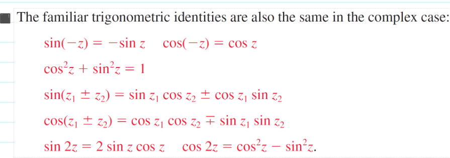

- 还有很多和 Real Number 中相同的结论

### Ex. Find Z s.t. Cos(z) = Sin(z)

$$
\frac{e^{iz} + e^{-iz}}{2} = \frac{e^{iz} - e^{-iz}}{2i}
$$

$$
i(e^{iz} + e^{-iz}) = e^{iz} - e^{-iz}\Rightarrow(i-1)e^{iz} = -(i+1)e^{-iz}\Rightarrow e^{2iz} = \frac{-(i+1)}{i-1}
$$

- 化简得到  \\(e^{2iz} = i\\)，取对数：\\(2iz = \ln(i)\\)
- 得到 \\(\ln(i) = i\left(\frac{\pi}{2} + 2k\pi\right), \quad k \in \mathbb{Z}\\)
- 解出 z 为 \\(z = \frac{\pi}{4} + k\pi, \quad k \in \mathbb{Z}\\)