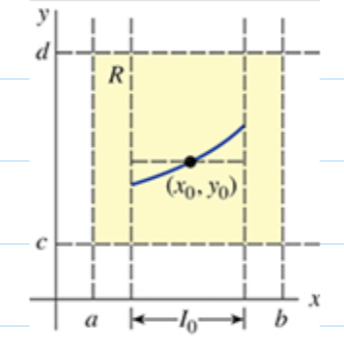
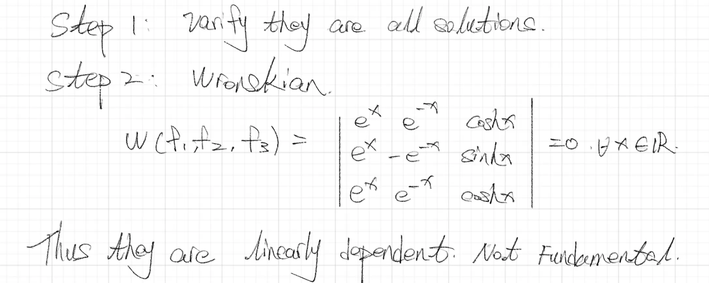

> Last Edit: 10/6/25

## Ordinary Differential Equations 常微分方程

- 在 ODE 中，未知函数只依赖于一个 independent variable

$$
\frac{d^2 y}{dx^2} = -k^2 y
$$

- 使用的是 **Leibniz notation（莱布尼茨记号）**
- 其中：
    - y：**dependent variable（因变量）或函数**
    - x：**independent variable（自变量）**
- 与上式等价的拉格朗日记号写法为 Lagrange Notation
    
    $$
    y'' = -k^2 y
    $$
    
- 通用记法：
    
    $$
    \frac{d^n y}{d x^n} \equiv y^{(n)}
    $$
    

## Classifying DE’s

### Order of a DE

- DE 的 order 是方程中出现的最高阶导数的阶数
- 示例：
    
    $$
    y^{(4)} + 2x^2 + y'' = \sin x
    $$
    
- 是一个四阶常微分方程（**4th order ODE**）

### General form of DE

$$
F(x, y, y', y'', ..., y^{(n)}) = 0
$$

### **Linear and Non-linear ODEs**

- 一个阶数为 n 的微分方程是 linear 的，当它可以写成：

$$
a_n(x)y^{(n)} + a_{n-1}(x)y^{(n-1)} + \cdots + a_0(x)y = f(x)
$$

- 系数 \\(a_i(x)\\) 只依赖于 \\(x\\)，不能含有 \\(y\\)
- 示例：
    - **First-order linear DE**
        
        $$
        y' + p(x)y = f(x)
        $$
        
    - **Second-order linear DE**
        
        $$
        y'' + p(x)y' + q(x)y = f(x)
        $$
        

### **Homogeneous and Non-homogeneous Linear ODE**

- 若 \\(f(x) = 0\\)，则为 **Homogeneous**
- 若 \\(f(x) \ne 0\\)，则为 **Non-homogeneous**

### **Constant vs Variable Coefficient**

- 若 \\(a_0(x), ..., a_n(x)\\) 是 constant，则为 **constant coefficient DE**
- 否则为 **Variable coefficient DE**

### **Autonomous ODE**

- 自治微分方程（Autonomous ODE），又叫 **Time-Invariant**
- 指的是 Independent variable 不会显式出现在方程中

#### Ex. Autonomous ODE

- Population growth equation

$$
\frac{dP}{dt} = (\beta - \alpha)P
$$

- t 没有显式出现
- \\(\beta\\)：出生率
- \\(\alpha\\)：死亡率

#### General Form

$$
y^{(n)} = F(y^{(n-1)}, y^{(n-2)}, ..., y', y)
$$

### Ex. Identify the ODEs

$$
y'' + 3(y')^2 + \cos x = 0
$$

- **non-linear**（因为有 \\((y')^2\\)）
- **non-homogeneous**（有常数项 \\(\cos x\\)）
- **variable coefficient**（\\(3(y')^2\\) 中的系数依赖 \\(y'\\)，不是常数）

> 这里是 \\(y'\\) 的平方
> 

---

$$
5\sin\left(\frac{dy}{dt}\right) + \tan^2 y = 1
$$

- **non-linear**
- **non-homogeneous**

---

$$
\frac{d^2 y}{dx^2} + x^2 \frac{dy}{dx} + (\sin x) y = e^x
$$

- **linear**（\\(y, y', y''\\) 都是一次）
- **non-homogeneous**（右边不是 0）
- **variable coefficient**（系数 \\(x^2, \sin x\\) 都依赖于 \\(x\\)）

---

$$
x y'' + 4x^2 y' - \frac{2}{1 + x^2} y = 0
$$

- **linear**
- **homogeneous**（右边是 0）
- **variable coefficient**（所有系数依赖 x）

---

$$
y'' + \sin(y') + x y = x^2
$$

- **non-linear**（因为 \\(\sin(y')\\) 是非线性项）
- **non-homogeneous**（右边为 \\(x^2\\)）
- **variable coefficient**（项 \\(x y\\) 中系数为 \\(x\\)）

---

## Solution of ODE

- Given an ODE of form

$$
y^{(n)} = F(y^{(n-1)}, ..., y', y, x)
$$

- 如果一个函数 \\(y = \varphi(x)\\) 被代入后，使得方程变为 **identity** 恒等式，那么它就是这个微分方程的一个 **solution**
- 代入后要满足：

$$
\varphi^{(n)} \equiv F\left(\varphi^{(n-1)}, ..., \varphi', \varphi, x\right)
$$

#### Ex. Verifying Solution

For DE \\(y' = 6x(y - 1)^{2/3}\\)，verify by substitution that  is a solution on interval \\((-\infty, +\infty)\\)，where C is an arbitrary constant

$$
y' = 2x \cdot 3(x^2 + C)^2 = 6x(x^2 + C)^2
$$

$$
y - 1 = (x^2 + C)^3 \Rightarrow (y - 1)^{2/3} = [(x^2 + C)^3]^{2/3} = (x^2 + C)^2
$$

$$
6x(y - 1)^{2/3} = 6x(x^2 + C)^2
$$

## Existence of Solutions, General, Particular and Singular

- General Solution 包含一个 C，代表了一个 Solution Set
- Particular Solution 解出了 C 的具体值
- Singular Solution 是不属于 General Solution Set 中的一个解

## **How to solve first-order ODE**

### **Separable First-order ODE**

- 对于形如 \\(y' = g(x)h(y)\\) 的 ODE
- 解法是将变量 x 和 y 分离，积分两边：

$$
\int \frac{1}{h(y)} dy = \int g(x) dx
$$

- 这是标准的 **Separation of Variables**

### **Integrating Factor Method**

- 适用于 linear first-order ODE
- 标准形式为：
    
    $$
    y' + P(x)y = f(x)
    $$
    
- 有 Integrating Factor

$$
\mu(x) = e^{\int P(x)\,dx}
$$

- 将方程两边都乘以 \\(\mu(x)\\)

$$
\mu(x) \cdot y' + \mu(x) \cdot P(x) \cdot y = \mu(x) \cdot f(x)
$$

- 左边可以写成一个积的导数：

$$
\frac{d}{dx}[\mu(x) \cdot y] = \mu(x) \cdot f(x)
$$

- 两边同时积分

$$
\int \frac{d}{dx}[\mu(x) \cdot y]\, dx = \int \mu(x) \cdot f(x) \, dx
$$

- 得到：

$$
\mu(x) \cdot y = \int \mu(x) \cdot f(x)\, dx + C
$$

- 解出 y(x)

$$
y(x) = \frac{1}{\mu(x)} \left[ \int \mu(x) \cdot f(x) \, dx + C \right]
$$

### Ex.

$$
xy' - y = 2x^2 \quad \text{with} \quad y(x_0) = y_0
$$

- 将 DE 转换成标准形式，有 \\(y' - \frac{1}{x} y = 2x\\)
- 所以 \\(P(x) = -\frac{1}{x}，f(x) = 2x\\)
1. 计算积分因子（Integrating Factor）：
    
    $$
    \mu(x) = e^{\int -\frac{1}{x} dx} = e^{-\ln x} = \frac{1}{x}
    $$
    
2. 两边乘以积分因子：
    
    $$
    \frac{d}{dx} \left( \frac{1}{x} y \right) = 2
    $$
    
3. 积分并解出 y：
    
    $$
    \frac{1}{x} y = \int 2 dx + C = 2x + C \quad \Rightarrow \quad y = x(2x + C) = 2x^2 + Cx
    $$
    
4. 若 IC 为 \\(y(1) = 1\\)：
    - 解代入得：
    
    $$
    1 = 2(1)^2 + C(1) \Rightarrow C = -1
    $$
    
5. 若 IC 为 y(1) = 0
    - 解代入得：
    
    $$
    0 = 2 + C \Rightarrow C = -2
    $$
    
6. 若 IC 为 \\(y'(1) = 2, y(1) = 2\\)

$$
y = 2x^2 + Cx \Rightarrow y' = 4x + C
$$

- \\(y'(1) = 4 + C = 2 \Rightarrow C = -2\\)
- 代入 y(1) 得：

$$
y(1) = 2 + (-2) = 0 \ne 2
$$

- ❌ 无解（No solution）

## Existence and Uniqueness of Solutions for Linear 1st Order IVPs

### Existence of a Unique Solution for First-Order IVPs

- **Initial-value problem (IVP, 初值问题)**：
    
    $$
    y' = f(x,y), \quad y(x_0) = y_0
    $$
    

> 给到一个 1st Order Differential Equation，并给了某个点 \\((x_0, y_0)\\) 的初始条件
去研究解到底存不存在？如果存在，是不是唯一的？
> 
- 如果 \\(f(x,y)\\) 和 \\(\frac{\partial f}{\partial y}\\)（对 y 的偏导）在矩形区域 R (矩形区域) 内连续
- 也就是说如果一个微分方程 \\(y' = f(x,y)\\) 里面的函数 \\(f(x,y)\\) 和它对 y 的偏导数 \\(\frac{\partial f}{\partial y}\\) 都是“平滑的”（数学上 = 连续）

- 那么在区间 \\(I_0 (a < x_0 < b)\\) 内，**Solution Exist 并且是 Unique 的**，存在唯一解 \\(y(x)\\)，并且这个区间 \\(I_0\\) 包含在更大的区间 \\(I (a \leq x \leq b)\\) 中

> 这种情况下，只保证在 \\(x_0\\) 附近一个**小区间** \\(I_0\\) 内，存在唯一解
> 

### **Existence of a Unique Solution for First-Order Linear IVPs**

- **Linear IVP (线性初值问题)**：
    
    $$
    y' + P(x)y = f(x), \quad y(x_0) = y_0
    $$
    

> 多了一个 Linear 的条件
> 
- 如果函数 P(x) 和 f(x) 在包含 \\(x_0\\) 的开区间 I (开区间) 上连续，
- 那么这个初值问题在整个区间 **I** 上都有唯一解

> 解不仅唯一，而且在整个区间 **I** 上都成立
> 

### Why Linear Follow From Non-Linear

- 两个 Theorem，第一个 Non-Linear 下要满足的条件是
- f(x,y) 连续；\\(\dfrac{\partial f}{\partial y}\\) 在该区域也连续
- 而在 Linear 的特殊情况下

$$
y' + P(x)y = f(x)
$$

- 可以改写成为

$$
y' = f(x) - P(x)y = \hat{f}(x,y)
$$

- 也就来到了 Non-Linear 的第一个条件，想要让 \\(\hat{f}(x,y)\\) Cont. 在 Linear Function 中只需要 \\(f(x)、P(x)\\)  在区间 II 上连续就行
- 同时 \\(f(x)、P(x)\\)  连续的情况下，也满足了 Partial Derivative 连续的条件，这是因为
    
    $$
    \frac{\partial \hat{f}(x,y)}{\partial y} = -P(x)
    $$
    
- 所以只要 P(x) 连续，所以这个偏导也连续

#### Ex. Applying Non-Linear Case

“What is the interval R in this example?”

$$
y' = 3y^{2/3}, \quad y(2)=0
$$

- Non-Linear Case，检查 \\(f(x,y) = 3y^{2/3}\\) 是连续的
- 计算偏导：

$$
\frac{\partial f}{\partial y} = 2y^{-1/3} = \frac{2}{y^{1/3}}
$$

- 观察可以发现，当 y=0 的时候，\\(\dfrac{2}{y^{1/3}}\\)  会发散

> So, are we guaranteed to have a unique solution?
> 
> 
> **Theorem 1.2.1 does not guarantee that. But we don’t know if the solution is unique or not.**
> 
> 定理 1.2.1 **不能保证**。但是我们也不能直接下结论说解一定不唯一，只是“没有保证”。
> 

## Solution Curves without Solutions: Direction Field

- 对于一个微分方程：

$$
y' = f(x,y),
$$

- 它告诉你：在平面上每一个点 \\((x,y)\\)，解曲线的斜率是多少
- **方向场** 就是：在很多点 \\((x,y)\\) 上画一条小的斜线，表示解曲线在这里的切线方向
- 这样即使你没解出方程，也能大致看到解的走势

## Autonomous DE and its Critical Points

- **Autonomous DE（自治微分方程）** 指的是方程里面 Independent Variable **x** 不显式出现，形式为：
    
    $$
    \frac{dy}{dx} = f(y)
    $$
    
- 或者更一般写成 \\(F(y,y')=0\\)

👉 换句话说：方程的变化只依赖于 y，不依赖于 x

### Critical Point

- 给定：\\(y' = f(y)\\)，如果存在某个 \\(y=c\\)，使得：\\(f(c)=0\\)
- 那么 y=c 就是 **临界点 (critical point)**

> 也就是导数 \\(y'=0\\) 的点
> 

#### Ex. Critical Point of a Function

$$
x' = x(4-x)
$$

- Critical Point 出现在 x = 0 和 4 的位置

## Stability of Critical Points

### Stable Point

### Unstable Point

### Semi-Stable Point

---

## General Linear ODE’s and Linear Differential Operator

- 回顾前面的 Linear ODE，其 Form 为

$$
a_n(x)y^{(n)} + a_{n-1}(x)y^{(n-1)} + \cdots + a_1(x)y' + a_0(x)y = g(x)
$$

- 这是 n-th order linear ordinary differential equation, ODE 的一般
- 其中 \\(a_k(x)\\) 是系数函数，可能随 \\(x\\) 变化
- 右边的 \\(g(x)\\) 是非齐次项
- \\(y^{(n)}\\) 表示对函数 y 的 n 阶导数
- 其是 **Linear** 的，当它的所有 Coefficient 都是一次方的
- 其是 **Homogeneous** 的，当 g(x) = 0 时
- 其是 **Constant coefficient differential equation 常系数微分方程**，当 \\(a_k(x)\\) 都是 Constant 时

### Linear Differential Operator L

- 线性微分的算子 L 可以简化我们写高阶 linear ODE 的方式
- 上面提到了，传统的写法是

$$
a_n(x)y^{(n)} + a_{n-1}(x)y^{(n-1)} + \cdots + a_1(x)y' + a_0(x)y = g(x)
$$

- 这整个东西可以简写为：

$$
Ly = g(x)
$$

- 其中 L 是一个“作用在 y”上的线性微分算子
- 可以发现 Equation 的左边只有 y，这就说明了 L 不仅包含 Coefficient，还包含对 y 的 Derivative

$$
L = a_n(x) \frac{d^n}{dx^n} + a_{n-1}(x) \frac{d^{n-1}}{dx^{n-1}} + \cdots + a_1(x) \frac{d}{dx} + a_0(x)
$$

#### Ex1. Find Linear Differential Operator L

$$
3\ddot{y} - 4 \dot{y} + 2xy = e^{x} \Rightarrow L = 3 \frac{d^2}{dx^2} - 4 \frac{d}{dx} + 2x
$$

#### Ex2. Find Linear Differential Operator L

$$
y'' + x \sin(y') - xy = x^2
$$

- 这并不是一个 Linear 的 DE，所以没有整个 Linear Differential Operator L

## Existence and Uniqueness of nth order Linear ODE

- 之前提到过 1st Linear ODE 的存在与唯一性定理
- 那么对于 **n 阶线性 ODE + 初始条件（initial value problem, IVP）**，是否也存在类似定理？
- 要求 nth ODE 形如

$$
a_n(x)y^{(n)} + a_{n-1}(x)y^{(n-1)} + \cdots + a_1(x)y' + a_0(x)y = g(x)
$$

- initial conditions 为

$$
y(x_0) = y_0,\quad y'(x_0) = y_1,\quad \cdots,\quad y^{(n-1)}(x_0) = y_{n-1}
$$

### **Theorem: Existence of a Unique Solution**

- 若函数 \\(a_1(x), a_2(x), ..., a_n(x), g(x)\\) 在区间 I 上连续（continuous），且 \\(a_n(x) \ne 0\\)，那么对任意 \\(x_0 \in I\\)，初值问题：

$$
a_n(x)y^{(n)} + \cdots + a_0(x)y = g(x), \quad y(x_0) = y_0, \quad y'(x_0) = y_1, \quad \cdots, \quad y^{(n-1)}(x_0) = y_{n-1}
$$

- 在区间 I 上有唯一解

> 这里的 \\(a_n(x)\\) 指的是最高项的那个 Coefficient
> 

#### Ex1. Existence of a Unique Solution

$$
y^{(3)} + 3y'' + 4y' + 12y = 0
$$

- 初始条件为：

$$
y(1) = y'(1) = y''(1) = 0
$$

- 系数全是常数，连续
- \\(a_3 = 1 \ne 0\\)，最高阶导数项系数非零
- 所以 Exist Unique Solution

#### Ex2. Existence of a Unique Solution

$$
(1 - t^2)y'' - 2ty' + 2y = 0
$$

- 初始条件是：

$$
y(0) = 1,\quad y'(0) = 2
$$

- 问：在哪个区间上存在唯一解？

---

- 总的来说，除了最高次项系数不是常数，其他都是 Constant，连续，
- \\(1 - t^2 = 0\\) 当且仅当 \\(t = \pm 1\\)，这些点会使 \\(a_2(t) = 0\\)，不满足定理条件，所以不能包含 \\(t = \pm 1\\)

## Homogenous Linear DE’s: General Solutions

### Theorem： General Solutions for Homogeneous Linear DEs

- 对于一个 nth Order 的 Homogenous Linear DEs

$$
L(y) = 0
$$

- 一定有 n 个 linearly independent 的解，这组解被称为：**fundamental set of solutions（基本解组）**
- 当知道了完整的 Solution Set：

$$
y_1(x), y_2(x), ..., y_n(x)
$$

- 那么 **Particular Solution** 就是它们的 **linear combination**
- 如果 IVP 给了超过 n 个初值条件，会 over-determined，可能无解
- 这是因为 L 是线性算子（linear operator）

$$
L(\alpha y_1 + \beta y_2) = \alpha L(y_1) + \beta L(y_2)
$$

- 也就是说假设 \\(y_1, y_2, ..., y_n\\) 是解，那么任意线性组合：

$$
c_1 y_1 + c_2 y_2 + \cdots + c_n y_n
$$

- 也一定是解，这就是为什么我们把所有解写成“线性组合”

### Definition: Linearly Independence of Functions

- 回忆线性代数里的定义：向量 \\(v_1, ..., v_n\\) 是线性无关的意思是：

$$
c_1 v_1 + c_2 v_2 + \cdots + c_n v_n = 0
$$

- 仅当所有 \\(c_k = 0\\) 时才成
- 在函数空间中也一样：如果只有 \\(c_1 = c_2 = \cdots = c_n = 0\\) 才能让 \\(c_1 f_1(x) + c_2 f_2(x) + \cdots + c_n f_n(x) = 0\\) 成立，则函数 \\(f_1, ..., f_n\\) 是 linearly independent

#### Ex1. Finding the Linear Independency of function

Are functions \\(\{1 - 3x + 2x², 1 - x + x², 1 + x\}\\) linearly independent?

---

#### Ex2. Finding the Linear Independency of function

Are functions \\(\{e^x, xe^x, x²e^x\}\\) linearly independent?\

---

## How to check if n functions are independent?

- 如果我们有 n 个多项式函数，这种情况是容易判断的
- 找到它们的线性组合形式：

$$
\sum_{k=1}^{n} c_k y_k
$$

- 也就是形式如 \\(c_1 y_1 + c_2 y_2 + \cdots + c_n y_n\\)
- 观察每一项（例如 \\(x^k\\)）的系数，如果所有系数都为零，说明这些函数线性无关
- 这就是上面的两个例子

### Case in non Polynomial

- 当函数不是 Polynomial，可以通过 Wronskian 行列式

### The Wronskian

- 对于一组函数 \\(f_1(x), f_2(x), \dots, f_n(x)\\)，如果它们在区间 \\([a, b]\\) 上有 \\(n-1\\) 阶导数，则可以构造一个如下的行列式：
    
    $$
    W(f_1, f_2, \dots, f_n) = \begin{vmatrix}
    f_1 & f_2 & \cdots & f_n \\
    f_1' & f_2' & \cdots & f_n' \\
    \vdots & \vdots & \ddots & \vdots \\
    f_1^{(n-1)} & f_2^{(n-1)} & \cdots & f_n^{(n-1)}
    \end{vmatrix}
    $$
    
- 假设这组函数在区间 \\(I = [a, b]\\) 上都有 \\(n-1\\) 阶导数
- 如果它们的 Wronskian 行列式 在整个区间 I 上不**恒等为零（not identically zero）**，那么这些函数是 **Linearly independent** 的

### The beauty of Math (or how seemingly unrelated mathematical topics connect to each other)

- 考虑一个 Function Set

$$
\left\{ e^{m_1 x}, e^{m_2 x} \right\}, \quad m_1, m_2 \in \mathbb{C}
$$

- 想要找这些函数是否 **linearly independent**
- 如果通过之前的通过 Polynomial 构造的方式，可以列出 Linear Combination

$$
C_1 e^{m_1 x} + C_2 e^{m_2 x} = 0, \quad \forall x \in \mathbb{R} \tag{I}
$$

- 目前这是一个方程、两个未知数，方程不够
- 于是可以尝试用 Wronskain，先对 Functions 求导，得到

$$
C_1 m_1 e^{m_1 x} + C_2 m_2 e^{m_2 x} = 0, \quad \forall x \in \mathbb{R}
$$

- 将他们写入 Wronskain 可以得到

$$
\begin{bmatrix}
e^{m_1 x} & e^{m_2 x} \\
m_1 e^{m_1 x} & m_2 e^{m_2 x}
\end{bmatrix}
\begin{bmatrix}
C_1 \\
C_2
\end{bmatrix}
=
\begin{bmatrix}
0 \\
0
\end{bmatrix} \tag{II}
$$

- 令左边的 Matrix 为 \\(A(x)\\)
- 向量为 \\(\vec{C} = [C_1, C_2]^T\\)

<aside>
💡

想要证明 Wronskian 行列式 在整个区间 I 上不**恒等为零（not identically zero），**就假设它有零解，然后证伪

</aside>

- 也就是寻找一个向量 \\(\vec{C}\\) 使得：

$$
A(x)\vec{C} = \vec{0}, \quad \forall x \in \mathbb{R}
$$

- 如果唯一满足这个条件的是 **\\(\vec{C} = \vec{0}\\)**，那说明函数是线性无关的
- 而要保证这一结论，可以通过证明如果某个点 \\(x \in \mathbb{R}\\) 使得 \\(A(x)\\) Invertible，那么系统只有唯一解 \\(\vec{C} = \vec{0}\\)
- 而想要证明 \\(A(x_0)\\) 可逆，就可以通过 Determinant，即

$$
\vec{C} = A(x_0)^{-1} \vec{0} = \vec{0}
$$

- 而这个 \\(\det A(x)\\) 就是 **Wronskian**，有

$$
W(f_1, f_2) = 
\begin{vmatrix}
e^{m_1 x} & e^{m_2 x} \\
m_1 e^{m_1 x} & m_2 e^{m_2 x}
\end{vmatrix}
= e^{(m_1 + m_2)x}(m_2 - m_1)
$$

- 如果 \\(m_1 \ne m_2\\)，那么 \\(W(f_1, f_2) \ne 0\\)，Wronskian 不为零
- 因此函数集合 \\(\{e^{m_1 x}, e^{m_2 x}\}\\) Linearly Independent

### Case when W = 0 for all x in I

- 已知一组函数 \\(\{f_1(x), f_2(x), \dots, f_n(x)\}\\)
- 计算得 \\(W(f_1, f_2, \dots, f_n) = 0\\) 对所有 \\(x \in I\\) 成立
- **不能**否断定这些函数是 **linearly dependent，**这不是定理所说的内容

$$
W \not\equiv 0 \quad \Longrightarrow \quad \text{线性无关}
$$

- 但是它的逆命题 **不成立**：

$$
W \equiv 0 \quad NOT\Rightarrow \quad \text{线性相关}
$$

#### Ex. Case when W = 0 for all x in I

$$
f_1(x) = 
\begin{cases}
x^2, & x \geq 0 \\
0, & x < 0
\end{cases},
\quad
f_2(x) =
\begin{cases}
0, & x \geq 0 \\
x^2, & x < 0
\end{cases}
$$

- 这两个函数在各自区域里互补，显然是线性无关的
- 但它们的 Wronskian 在整个区间恒为零，所以 Wronskian=0 并不能保证线性相关

### Special Case of Wronskian

- 如果一组函数 \\(\{y_1(x), \dots, y_n(x)\}\\) 是某个n阶 homogeneous linear ODE 的解

$$
a_n(x)y^{(n)} + a_{n-1}(x)y^{(n-1)} + \cdots + a_1(x)y' + a_0(x)y = 0
$$

- 会有一个更强的结论，也就是
- 这些函数在区间 II 上**线性无关 当且仅当 iff**：

$$
W(y_1, y_2, \dots, y_n)(x) \neq 0, \quad \forall x \in I
$$

- 也就是说
- \\(W \equiv 0\\) ⇒ 必定线性相关
- \\(W \neq 0\\) ⇒ 必定线性无关

#### Ex. Determine Fundamental Set of Solution

Is the set \\(\{e^x,e^{-x},\cosh x\}\\) the Fundamental Set Solution of \\(y-y'''=0\\) ?

---

### Find the Second Solution for a 2nd Degree Linear Homo ODE

Assume that we already know that \\(y_1(x)\\) is a solution for this ODE, and consider the ODE

$$
y''+P(x)y'+Q(x)y=0
$$

- Let the second solution as

$$
y_2(x)=U(x)y_1(x)
$$

- Where \\(U(x)\\) is an undetermined function
- Take the derivative on both side to get

$$
y_2' = U' y_1 + U y_1' 
$$

$$
y_2'' = U'' y_1 + 2U' y_1' + U y_1''
$$

- Recall the original function \\(y'' + P(x) y' + Q(x) y = 0\\)
- Sub in \\(y_2\\)  to get

$$
(U y_1)'' + P(U y_1)' + Q(U y_1) = 0
$$

> Substitution is \\(y_2= Uy_1\\), since \\(y_2\\) is also a solution, so it can be sub in the function
> 
- Expand to get

$$
(Uy_1)'' = U''y_1 + 2U'y_1' + Uy_1''
$$

$$
(Uy_1)' = U'y_1 + Uy_1'
$$

- Sub in to get

$$
(U''y_1 + 2U'y_1' + Uy_1'') + P(U'y_1 + Uy_1') + Q(Uy_1) = 0
$$

- Arrange them into order of U

$$
y_1U''+(2y_1' + P y_1)U'+(y_1'' + P y_1' + Q y_1)U  = 0\tag{1}
$$

- We have the original ODE \\(y_1'' + P y_1' + Q y_1=0\\)
- Thus (1) now become

$$
U y_1'' + (2 y_1' + P y_1) U' + y_1 U'' = 0
$$

- Now let \\(w=U'\\), then

$$
y_1 w' + (2 y_1' + P y_1) w = 0
$$

- Arrange to get

$$
w' + \left( 2\frac{y_1'}{y_1} + P \right) w = 0
$$

- Further Arrange to get

$$
\frac{w'}{w} + 2\frac{y_1'}{y_1} + P = 0\Rightarrow \frac{w'}{w} + 2\frac{y_1'}{y_1} = -P
$$

- Can see that LHS is a result of Derivative of Products
- Thus have

$$
\frac{d}{dx}(\ln(w y_1^2)) = -P
$$

- Integrate both side to get

$$
\ln(w y_1^2) = -\int P(x),dx
$$

$$
w y_1^2 = e^{-\int P(x),dx}\Rightarrow w = \frac{1}{y_1^2} e^{-\int P(x),dx}
$$

- Recall that we let \\(w=U'\\) before, now sub back to get

$$
U' = \frac{1}{y_1^2} e^{-\int P(x),dx}
$$

- Integrate both side to get

$$
U = \int \frac{1}{y_1^2} e^{-\int P(x),dx},dx
$$

- Recall we let \\(y_2=y1U(x)\\), so the **Final Result** is

$$
y_2(x) = y_1(x) \int \frac{e^{-\int P(x),dx}}{y_1(x)^2},dx
$$

#### Ex. Find the second Solution for 2nd Linear Homo ODE

The function is \\(y''+4y'+4y=0\\),  \\(y_1(x) = e^{-2x}\\)

---

## Find the fundamental set of solutions for Higher Order Homo Linear DE

Consider the function

$$
a y''' + b y'' + c y' + d y = 0\quad a,b,c,d \in \mathbb{R}
$$

- This is a third-order homogeneous linear ODE with constant coefficients
- Consider \\(y(x) = e^{mx}\\) as a solution
- Now sub in \\(y(x)\\) into function

$$
y' = m e^{mx}, \quad y'' = m^2 e^{mx}, \quad y''' = m^3 e^{mx}
$$

$$
a m^3 e^{mx} + b m^2 e^{mx} + c m e^{mx} + d e^{mx} = 0
$$

- Since \\(e^{mx} \neq 0\\), then get rid of it to get

$$
a m^3 + b m^2 + c m + d = 0
$$

- This is the Characteristic Equation（特征方程）
- For that Equation above, clearly it has three solutions \\(m_1, m_2, m_3\\), so the funciton can become

$$
a (m - m_1)(m - m_2)(m - m_3) = 0
$$

- Thus the three solutions are \\(e^{m_1 x},\ e^{m_2 x},\ e^{m_3 x}\\)
- And clearly if \\(m_1\neq m_2\neq m_3\\), then they are linearly independent
- Then will get the fundamental solution set of the DE as

$$
\{e^{m_1 x}, e^{m_2 x}, e^{m_3 x}\}
$$

### Types of roots (solution for DE)

In above part, we conclude the fundamental solution set of DE, but there may exist multiple situations for those roots (i.e. May have complex roots)

- Now consider a more general case, for a nth order homo DE

$$
a_n y^{(n)} + a_{n-1} y^{(n-1)} + \dots + a_1 y' + a_0 y = 0
$$

- Its Characteristic Equation is

$$
a_n m^n + a_{n-1} m^{n-1} + \dots + a_1 m + a_0 = 0
$$

- The possible roots can be
    - Real
    - Complex
    - Repeated
- Now we are going to analysis them one by one

#### **Type 1：Distinct Real Roots**

The most simple case, when all three are **Distinct Real Roots**

$$
y = c_1 e^{m_1 x} + c_2 e^{m_2 x} + \dots + c_n e^{m_n x}
$$

- Then the solution is simple

#### **Type 2：Conjugate Complex Roots**

As Complex Roots need to appear with its **Conjugate,** thus have

$$
m_{1,2} = \alpha \pm i\beta
$$

- Their roots are \\(y = e^{(\alpha + i\beta)x}\\), expand and get

$$
e^{\alpha x} \cos(\beta x), \quad e^{\alpha x} \sin(\beta x)
$$

- Those two complex solution can be represent as

$$
y = e^{\alpha x}(c_1 \cos\beta x + c_2 \sin\beta x)
$$

> Prove that a Complex Number Solution’s Conjugate is also a Solution
We have the first Complex Number as
\\(A_n m_1^n + A_{n-1} m_1^{n-1} + \cdots + A_1 m_1 + A_0 = 0\\), take Conjugate on both side to get
\\(\overline{A_n} \, \overline{m_1}^n + \overline{A_{n-1}} \, \overline{m_1}^{\,n-1} + \cdots + \overline{A_1} \, \overline{m_1} + \overline{A_0} = 0\\), thus also a solution
> 

#### **Type 3：Repeated Real Roots**

If one Real Root has repeated r times \\(m_1 = m_2 = \dots = m_r = m\\), then the solution is 

$$
e^{mx},x e^{mx}, x^2 e^{mx}, \dots, x^{r-1} e^{mx}
$$

#### Ex. Specify the general class of solution of function

Having the function

$$
y^{(6)} - 8y^{(5)} + 23y^{(4)} - 26y^{(3)} - 2y'' + 32y' - 24y = 0
$$

---

- First get the Characteristic Function \\(m^6 - 8m^5 + 23m^4 - 26m^3 - 2m^2 + 32m - 24 = 0\\)
- This function has the following roots

$$
(m + 1)(m - 3)(m - 2)^2 (m - (1 + i))(m - (1 - i)) = 0
$$

- The roots we have above are

| Root | Type | Solution |
| --- | --- | --- |
| ( m = -1 ) | Real | ( \\(e^{-x}\\) ) |
| ( m = 3 ) | Real | ( \\(e^{3x}\\) ) |
| ( m = 2 )（重根） | Repeated Real | ( \\(e^{2x},\ x e^{2x}\\) ) |
| ( m = 1 \pm i ) | Conjugate Complex | ( \\(e^{x}\cos x,\ e^{x}\sin x\\)  |
- So the General Solution si

$$
\{ e^{-x},\ e^{3x},\ e^{2x},\ x e^{2x},\ e^{x}\cos x,\ e^{x}\sin x \}
$$

$$
y_c(x) = C_1 e^{-x} + C_2 e^{3x} + C_3 e^{2x} + C_4 x e^{2x} + C_5 e^{x}\cos x + C_6 e^{x}\sin x
$$

#### Ex. Can the auxiliary equation have repeated complex roots?

If we have the Characteristic Function as

$$
(m - (1+i))^2 (m - (1-i))^2 = 0
$$

- Then its a Conjugate Pair of \\((1+i)\\) and \\((1-i)\\), their solution is then

$$
e^{x}\cos x,\ e^{x}\sin x,\ x e^{x}\cos x,\ x e^{x}\sin x
$$

## General Solution of Non-homo Linear DE

Now we are copping with the Non-Homo Case, where there’s non zero on the RHS, so with the function 

$$
a_n(x)y^{(n)} + a_{n-1}(x)y^{(n-1)} + \dots + a_0(x)y = g(x)
$$

- So we are trying to find a Particular solution that

$$
L(y_p) = g(x)
$$

- And a Homo Solution where

$$
L(y_c) = 0
$$

### Proving the General Solution is Comp + Part

So we are trying to prove that \\(y = y_c + y_p\\)

- So sub it back to get

$$
L(y) = L(y_c + y_p)
$$

- Because L is Linear, then

$$
L(y) = L(y_c) + L(y_p)
$$

- We know that \\(L(y_c) = 0\\)  and \\(L(y_p) = g(x)\\), thus

$$
L(y) = 0 + g(x) = g(x)
$$

- This will also work in the converse way that

$$
y - y_p
$$

- has to have the identity that

$$
L(y - y_p) = L(y) - L(y_p) = g(x) - g(x) = 0
$$

#### Ex. Finding the General Solution

Having the function \\(y'' - 3y' + 2y = e^{x}\\)

---

### Variation of Parameters

Finding the Particular Solution of the DE is hard, and this method can help

- Suppose we have the DE

$$
y'' + P(x)y' + Q(x)y = f(x)
$$

- First the Complementary Solution is

$$
y_c = C_1 y_1 + C_2 y_2
$$

- Then Start the Variation of Parameters
- Let all Constant become function

$$
y_p = U_1(x) y_1 + U_2(x) y_2
$$

- Before we taking the derivatives, we found that

$$
y_p' = U_1'y_1 + U_1y_1' + U_2'y_2 + U_2y_2'
$$

- Is hard to due, so we can smartly setting a restriction that let

$$
U_1' y_1 + U_2' y_2 = 0 \quad \text{(Eq.1)}\Rightarrow y_p' =U_1y'_1+U_2y'_2
$$

> This helps when calculating \\(y''\\)
> 
- Now, calculate the \\(y''\\)

$$
y_p'' = U_1'y_1' + U_1y_1'' + U_2'y_2' + U_2y_2''
$$

- Then sub back the \\(y_p\\) into \\(y'' + P y' + Q y = f(x)\\),

$$
(U_1'y_1' + U_1y_1'' + U_2'y_2' + U_2y_2'')+P(U_1y_1' + U_2y_2')+Q(U_1y_1 + U_2y_2)= f(x)
$$

- Rearrange \\(U_1,U_2\\) to get

$$
(U_1'y_1' + U_2'y_2') + U_1(y_1'' + Py_1' + Qy_1) + U_2(y_2'' + Py_2' + Qy_2) = f(x)
$$

- Cause \\(y_1, y_2\\) are solution of the Homo Function, thus

$$
y_1'' + Py_1' + Qy_1 = 0, \quad y_2'' + Py_2' + Qy_2 = 0
$$

- Then the part left is

$$
U_1'y_1' + U_2'y_2' = f(x)
$$

- So now, we got a function set

$$
\begin{cases}
U_1'y_1 + U_2'y_2 = 0 & (\text{Eq.1}) \\
U_1'y_1' + U_2'y_2' = f(x) & (\text{Eq.2})
\end{cases}
$$

- Write them in Matrix Form is

$$

\begin{bmatrix}
y_1 & y_2 \\
y_1' & y_2'
\end{bmatrix}
\begin{bmatrix}
U_1' \\
U_2'
\end{bmatrix}

\begin{bmatrix}
0 \\
f(x)
\end{bmatrix}

$$

- We can find out that this matrix is just Wronskian, thus use Cramer’s Rule

$$
W(y_1, y_2) =
\begin{vmatrix}
y_1 & y_2 \\
y_1' & y_2'
\end{vmatrix}
$$

- Thus we got

$$
U_1' = -\frac{y_2 f}{W(y_1, y_2)}, \quad U_2' = \frac{y_1 f}{W(y_1, y_2)}
$$

- Take integral

$$
U_1 = \int -\frac{y_2 f}{W(y_1, y_2)},dx, \quad U_2 = \int \frac{y_1 f}{W(y_1, y_2)},dx
$$

- Then we will get the **Particular Solution**

#### Ex. Finding the Particular Solution

We have the function \\(y'' - 2y' + y = \frac{e^t}{1+t^2}\\)

---

---

5.1