# DS1.IntroductiontoLogicCircuits

> Last Edit: 10/2/25
> 

计算机中的信息由 Electronic Signals 表示 ，其存在两个 Discrete Values，它们通过 Voltage Levels 电压电平实现，但是称为 Logic Values，0 和 1

## 2.1 Variables and Functions

- Binary Circuits 在数字系统中占主导地位，因为他们简单，只允许两个可能值 0 和 1 的存在

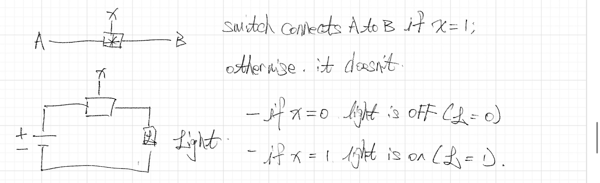

- 这是最基本的形式，即一个 Switch，在其为 0 的时候灯为关闭的，在其为 1 的时候则是开启的
- 当把 Switch 添加到两个的时候，就会出现两种连接这两个 Switch 的方式，Series 和 Parallel，他们也将会产生不同的结果

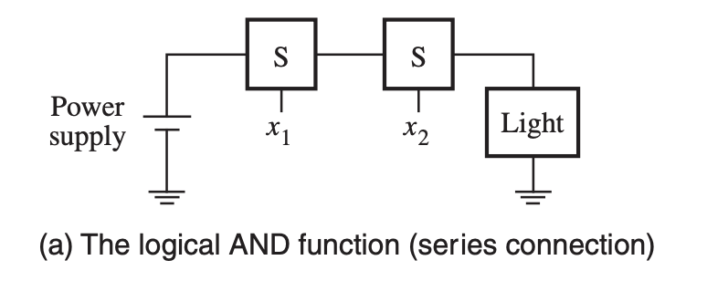

- 在 Series 的时候，仅当 \\(x_1 =x_2 =1\\)  的时候 Light 是开的，同时也仅当 \\(x_1=x_2=0\\)  的时候 Light 是关的
- 在 Parallel 的情况下则不同

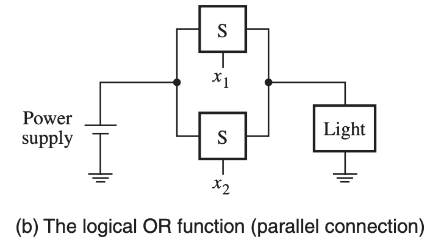

- 当 \\(x_1 =1 | x_2=1\\)  的情况下，Light 都是开的，同时 \\(x_1 =x_2 =1\\)  的时候 Light 也是开的
- 上面介绍了 Series 和 Parallel 的两种情况，同时也存在一种情况即两个同时出现，叫做 Series - Parallel Connection

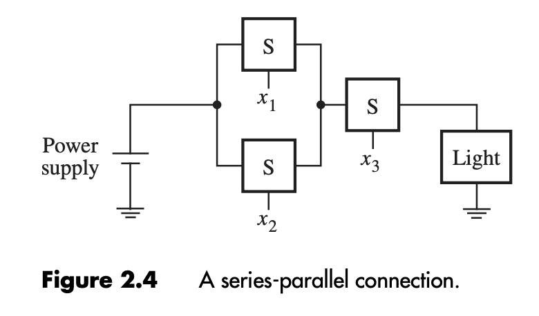

- 如上图，Light 亮的情况下，需要 \\(x_3= 1\\) 的前提下，\\(x_2\\) 和 \\(x_1\\)  中起码有一个为 1

### Logic Function 逻辑方程

- 总结上面的规律，可以总结一个表达式
- 用 + 表示 OR，用 $$ \\(\cdot\\) 表示 AND
- 在上面的 Series-Parallel Connection 中，则可以表达为

 

$$
L(x_1,x_2,x_3)=(x_1+x_2)+\cdot x_3
$$

- 需要注意不能把 +，\\(\cdot\\) 等逻辑运算符和加减乘除搞混

## 2.2 Inversion

- 到目前为止，我们假设 switch closed 代表正向动作，比如灯亮
- 但同样有意义的是考虑另一种情况：当 switch opened 时触发动作
- 也就是和之前相反的情况，当 \\(x=0\\)  的时候 \\(L=1\\)
- 这个运算也叫做 NOT Operation 非运算

## 2.3 Truth Tables

- 到目前已经介绍了三种最基本的逻辑运算，AND，OR 和 Complement，这些运算也可以通过 Table 的方式定义，具体方式是列出所有的可能性
- 这个 Table 则被称为 Truth Table

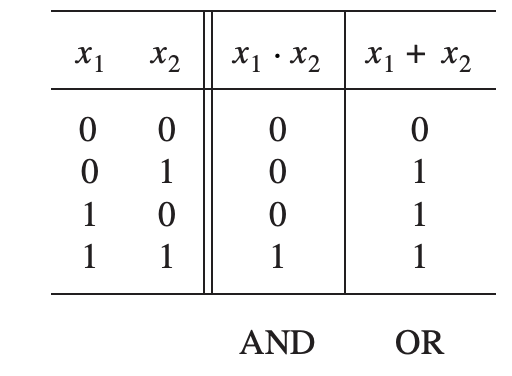

- 在少数变量的时候可以被很方便的列出来，但是一旦 Variable 数量增加后，表格的规模会 Exponentially Ascend

## 2.4 Logic Gates and Networks

- 前面介绍的三种基本逻辑运算（AND、OR、NOT）都可以用来实现更复杂的 Logic functions 逻辑函数
- 每个逻辑运算都可以用 Transistors 晶体管 来实现，这样得到的电路元件叫做 **logic gate逻辑门**
- 一个逻辑门有一个或多个输入和一个输出，输出是输入的函数

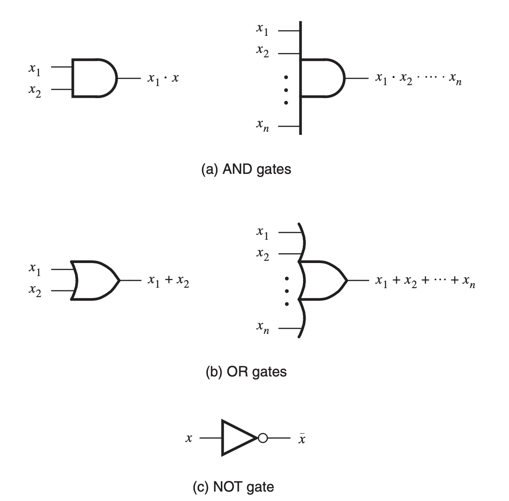

- 上面的三个就是 Logic Gate 的 Schematic Diagram 原理图
- 注意到其中的符号 \\(\cdot\\), + 等，正如上面所提到的，一个 Logic Gate 存在多个 Input 和一个 Output
- 重新拿到之前的 Series-Parallel Connection

- 这个 Circuit Diagram 被画成 Schematic Diagram 后就是先是一个 OR Gate 后接一个 AND Gate

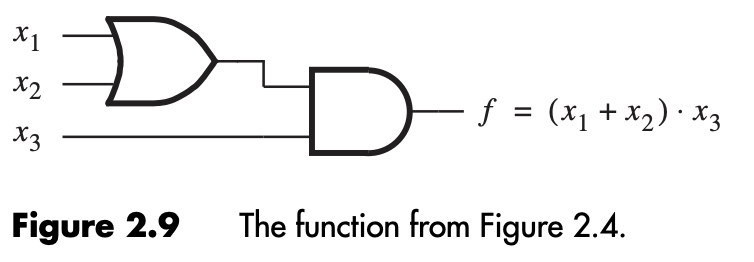

### 2.4.1 Analysis of A logic Network

- 对于 Logic Network 来说，基本上存在两种问题
- 一个是 Analysis 分析，通过一个已知的网络，去确定他最终实现的逻辑功能
- 第二个则是 Synthesis 综合，设计一个新的 Logic Network 来实现某个功能

### 2.4.2 Exclusive OR (XOR) Function

- 一个很常见的 Logic Circuit 是 XOR
- 信号 x 和 y 是电路的输入，电路控制一个灯 ****L
- 要求是：灯只有在两个开关中有一个（但不是两个同时）处于顶端时才点亮

> 这就是家中常见的控制灯的方式，当两个一样的时候灭灯，两个不一样的时候则是亮
> 
- 具体来说：
- 当 **x = 0, y = 1** 时，L = 1（灯亮）
- 当 **x = 1, y = 0** 时，L = 1（灯亮）
- 其他情况下 L = 0
- 想要分析一个新的 Logic Circuit，第一步就是列出 Truth Table

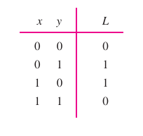

- 在这种情况下分析灯亮的两种情况，即 \\(\overline XY+X\overline Y\\)

> 注意这里的 + 是 OR 的意思
> 
- 于是就得到了最简单的 Function 形式

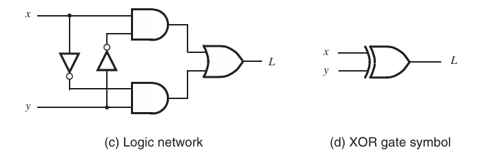

- 画成 Schematic Diagram 就是图 C 的样子
- 由于这是一个很常见的 XOR，所以单独为他设计了一个 Gate Symbol，即图 D

### Design Example

- 现在来一个更加复杂的情况
- 有一个生产线，其存在 3 个传感器，分别检测大小，光滑度和重量，当不达标的时候传感器为 0
- 当 3 个传感器中存在**两个以上**的 0 的时候，R = 1，即不通过
- 正如前面提到的，分析 Function 的第一步就是 Truth Table

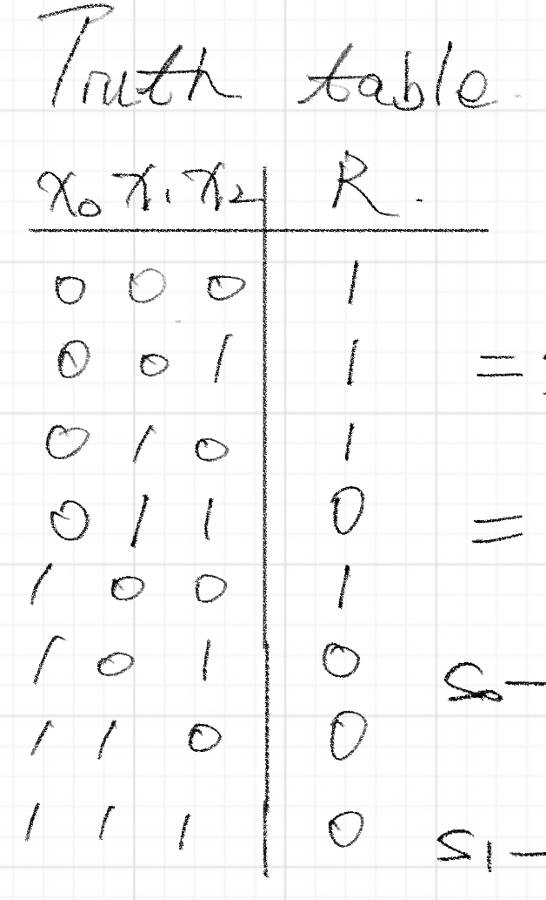

- 本例子中的 Truth Table 应该长这样，分析其中 R = 1 时候的情况，可以得到

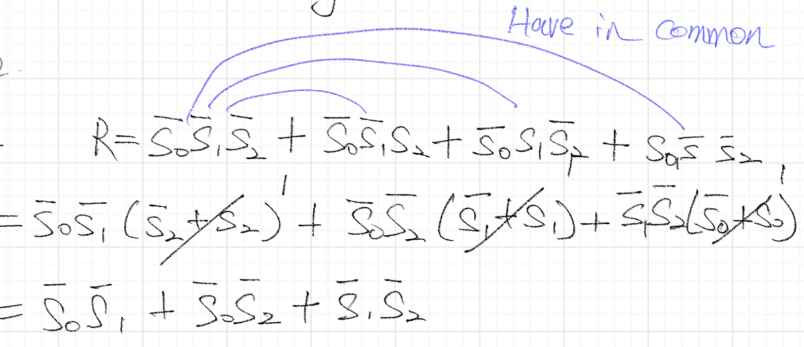

- 这里的关键就在于，+ 并不是再 Add，而是表示 OR
- 但是两个 OR 是可以相互组合的，比如 \\(\overline s_0\overline s_1 \overline s_2\\) 在这里就非常重要，因为它能和剩下的三个依次组合，完成化简
- 又因为 \\(\overline s_n+s_n\\) 无论如何都是 1 的特性，最终可以被化简到非常简单的形式

### Timing Diagram

- Timing Diagram 表示的是和 Truth Table 一样的信息，即在不同的信号下 Digit 的变化

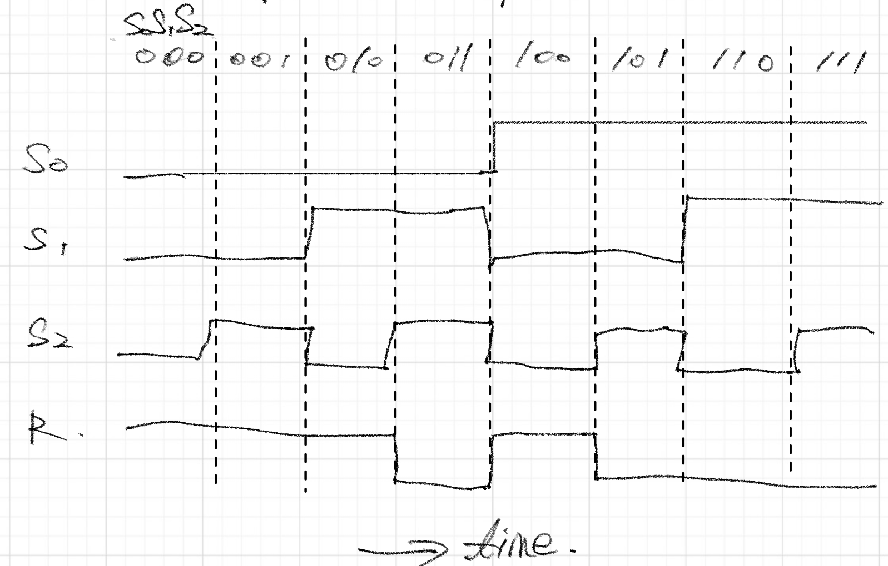

- 上图就是 Exclusive OR（XOR）的 Timing Diagram

## 2.5 Boolean Algebra

- Algebra 从 Axioms（公理）出发，他们是一套系统最初的假设，不需要证明就接受的命题

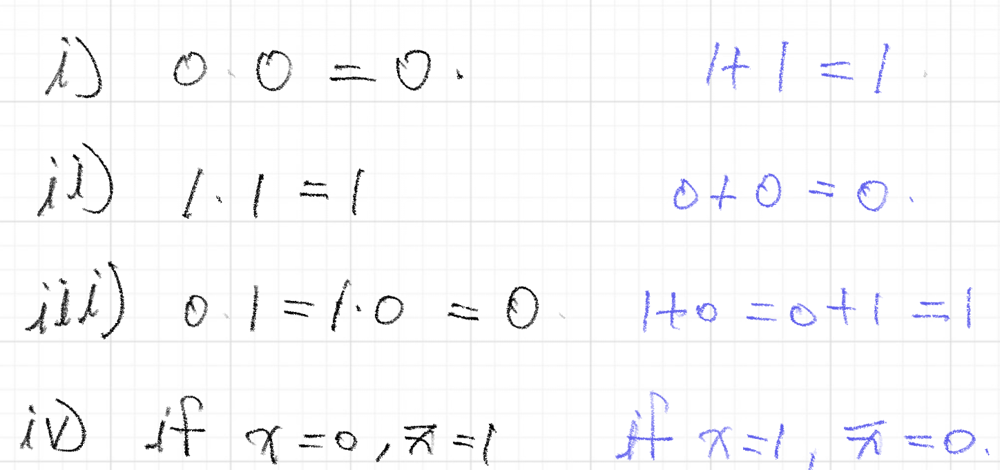

- \\(\cdot\\)  代表了 AND，0 和 0 做 AND，结果是 0，等
- 这几个就是最基本的 Boolean Algebra

### Duality

- Boolean Algebra 的一个特性，由于状态只有 0 和 1，所以当 Swap 一个 Axiom 的 0 和 1，同时更换 AND 和 OR 的时候，新的表达式仍将成立
- 于是上图中的蓝色就是通过 Axioms 的 Duality 总结出的

### Single Variable Theorems

- 在 Axioms 之上，可以总结出存在关于 Single Boolean Variable  的推论

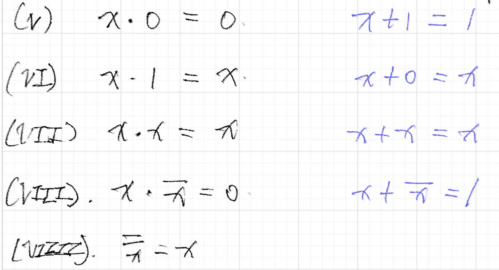

- 他们同样有自己的 Axioms

### Two and Three Variable Properties

- 当处理两个或三个变量时也存在 Identities，常见的就是 Commutative, Associative 等

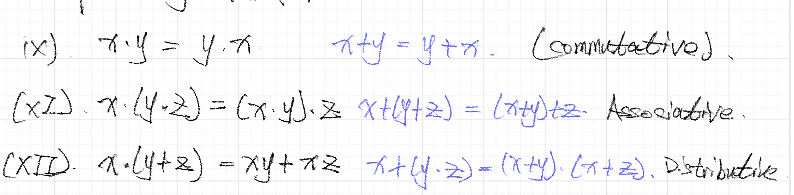

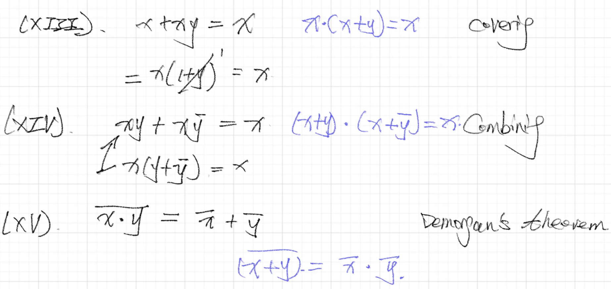

### 2.5.1 Venn Diagram

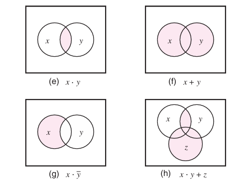

- 通过 Shaded Area 表示 Set

#### Ex. Prove x + (yz) =  (x + y)(x + z)

- 第一种证法就是通过 Truth Table，这里主要讲的是 Venn Diagram

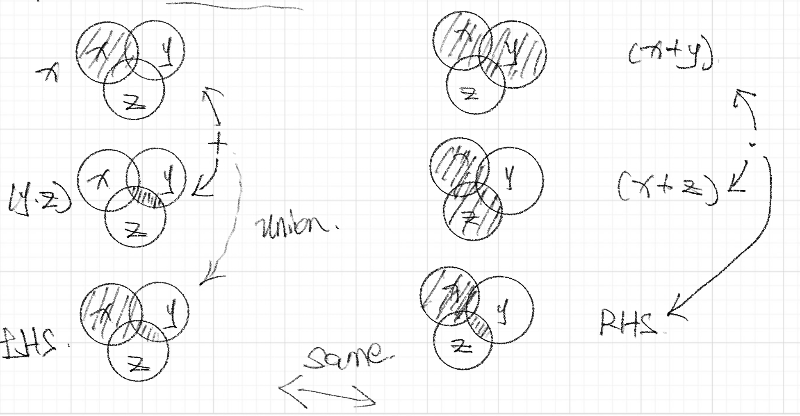

### 2.5.2 Notation and Terminology

- 在 Boolean Algebra 中，分别使用 AND 和 OR 进行运算，而他们可以被用符号 \\(\cdot\\) 和 + 表示
- 因为 Boolean Algebra 和正常的 Algebra 中用的相同的符号，所以 AND 也被叫做 Logic Product，OR 则叫做 Logic Sum
- 于是就有了 Product of Sum 和 Sum of Product
- PoS 就是几个 OR 运算外面接了 AND，SoP 则相反

### 2.5.3 Precedence of Operations

- 优先级在 Boolean Algebra 中并没有被明确规定
- 但是 Parentheses（括号）还是存在，用来指明运算顺序
- 但如果要避免过多的使用括号，也存在一个规定，先做 NOT，再是 AND，最后是 OR

> AND 的乘号一般会被省略
> 

## 2.6 Synthesis Using AND, OR, and NOT Gates

### 2.6.1 Sum-of-Products and Product-of-Sums Forms

#### Minterm

- 定义是：A Product term that correspond to a row of a truth table
- 它是输出为 1 的时候的条件表达，这句话很关键
- 由于 Minterm 是 Product Term (AND Term)，所以需要所有 Term 都为 1，即在 0 的 Term 上 Complement（取反）
- 当一个 Function 被写作是 \\(\sum m(0,1,2)\\) 就代表了第 0，1，2 行的 Truth Table 值为 1
- 而三个变量又确定了这是一个有着 \\(2^3 = 8\\)  行的 Truth Table，所以就是 000, 001, 010 三个 Term 为 1，而要让他们为 1，中间还是 Product (AND) 则 Conical SoP 为
    
    $$
    \overline{x_1}\,\overline{x_2}\overline{x_3},\overline{x_1}\,\overline{x_2}\,x_3,\overline{x_1}\,x_2\,\overline{x_3}
    $$
    

#### Maxterm

- 同理：A Sum term that correspond to a row of a truth table
- 他是输出为 0 时的条件表达，所以当存在任何一个 1 的时候，都要对他取 Complement

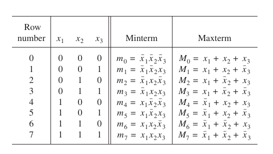

#### Cononical SoP

- 一个 SoP Expression，其中每一个 Product 都是一个 Minterm

#### Cononical PoS

- 同理：一个 PoS Expression，其中每一个 Sum 都是一个 Maxter

### Duality

- 由于 Boolean Algebra 的 Duality 特性，Min 和 Max term 也有着他们的 Duality
- 假设一个 Function \\(f(x,y,z)\\) 有 \\(\sum m (0,1,6,7)\\) 作为 Minterm，那根据 Duality 他就有 \\(\prod M(2,3,4,5)\\) 作为 Maxterm

#### Ex. Proof of Duality

- 就拿上面的 \\(\sum m(0,1,6,7)\\) 举例，有

$$
f=(x+\overline y+z)\cdot(x+\overline y + \overline z)\cdot (\overline x+y+z)\cdot (\overline x+y+\overline z)
$$

- 它的 Complement \\(\overline f\\) 就是 SoP，有

$$
\overline f= \overline xy\overline z+\overline xyz +x  \overline y \overline z+x \overline yz
$$

- 要通过 \\(\overline f\\) 计算 \\(f\\)，就通过再次 Complement 就可以得到， 有

$$
\overline{\overline f} = f=\overline{\overline xy\overline z+\overline xyz +x  \overline y \overline z+x \overline yz}
$$

- 回顾 Demorgan’s Theorem，\\(\overline {x_1x_2}=\overline{x_1}+\overline{x_2}\\)，\\(\overline{x_1+x_2}=\overline{x_1}\cdot \overline{x_2}\\)
- 在上面的 \\(\overline{\overline f}\\) 中，先使用第二个得到

$$
f=\overline{\overline xy\overline z}\cdot \overline{\overline xyz}\cdot \overline{x\overline y z}\cdot \overline{x \overline y z}
$$

- 再用第一个得到

$$
f=(x+\overline y +z)\cdot ( x+\overline y + \overline z)\cdot (\overline x+y+\overline z)\cdot(\overline x+y+\overline z)
$$

- 注意到这和上面的 PoS 是一个东西了