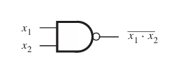
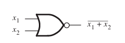
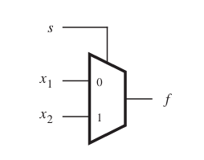
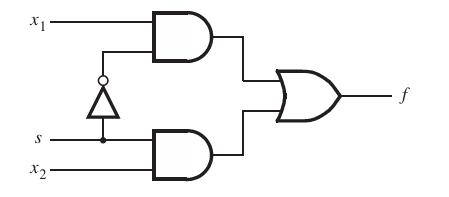
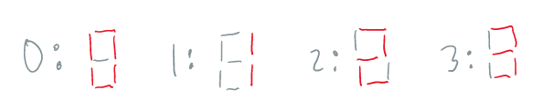
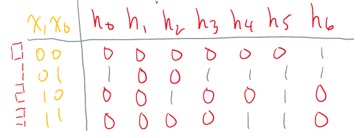
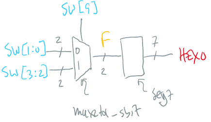

> Last Edit: 10/5/25

## NAND and NOR Logic Networks

- 这两个都是在最后的结果上加 NOT 的 Logic Network

### NAND

- 先 AND 再 NOT，写作 \\(\overline {A\cdot B}\\)



### NOR

- 先 OR 再 NOT，写作 \\(\overline{A+B}\\)



> 在实际制造中：NAND 和 NOR 门的晶体管布线最简单，这两个也是现实唯二的 Logic Gate
> 

### Multiplexer



- Multiplexer, is used as a **selector** that S’s status can determine the output
- In case when \\(s=0\\), then output is whatever \\(x_1\\)’s value
- When \\(s=1\\), output is whatever \\(x_2\\)’s value



- Thus it has the logic of \\(f=\overline sx+sy\\)

## Verilog Code

A sample Verilog Structure can be the following

```cpp
module Name (ports);
    specify input/output ports
    specify signal name for internal use
    assign values to outputs & signals
endmodule
```

### Multiplexer in Verilog

A Multiplexer can be implement as

```cpp
module mux2to1 (x, y, s, f);
    input x, y, s;
    output f;
    assign f = (~s & x) | (s & y);
endmodule
```

- `input x, y, s;`: Specify the inputs
- `output f;`: Specify the outputs

> Although `x,y,s,f` are variable names, in FGPA they don’t actually exist, so those are just random variable so far
> 
- `assign f = (~s & x) | (s & y);`
    - `~` : NOT
    - `&` : AND
    - `|` : OR

## FGPA

FGPA, Fidd-Prog Gate Array

### Multiplexer (Two to one bit)

To implement FGPA on the FGPA, can use a Verilog Code as

```cpp
module mux2to1 (SW, LEDR);
		//Specift in/outputs
    input  [9:0] SW;       
    output [9:0] LEDR;     
		//The intermediate Variables
    wire s, x, y, f;       
		//Assign
    assign s = SW[9];     
    assign x = SW[0];     
    assign y = SW[1];    
    assign f = (~s & x) | (s & y);  
    assign LEDR[0] = f;    
endmodule
```

### Multiplexer (Two to two bits)

A two to two bits multiplexer basically retrieve two digit input for x and y, then provide two bits output for F

```cpp
module mux2to1_2bit (X, Y, S, F);
    input S;
    input [1:0] X, Y;
    output [1:0] F;

    assign F[0] = (~S & X[0]) | (S & Y[0]);
    assign F[1] = (~S & X[1]) | (S & Y[1]);
endmodule
```

- As seen, F has both 0 and 1 two digits

### Hierarchical Verilog Code

Verilog Code can be assigned as modules that look like functions, one module can call others for simplification

Now define a subcircuit call a **7-Segment Decoder,** what is does is to get input `x,x_0` and represent them as a 2 bit number

- For a 7 Segment Display, it looks like this

```less
    h0
   ----
h5|    |h1
  | h6 |
   ----
h4|    |h2
   ----
    h3
```



- With 7 h, each controls one bar, and by setting them in correct, it can show number 0 - 9
- As said, before analyzing the Logic Function, always use Truth Table first



- This circuit is a 2 digit input (Four decimal numbers) input and 7 digit output function
- Its truth table can be above
- So got the logic expression for each h

```less
h0 = ~x1 & x0
h1 = 0
h2 = x1 & ~x0
h3 = ~x1 & x0
h4 = x0
h5 = x0 | x1
h6 = ~x1
```

### Data Structure

In Verilog, sometimes we are cooping with decimal, sometimes binary, sometimes hex, the way to declare which one is using is by three digits

- In the case above, `h1 = 0` , the way we assign 0 to h1 need the Data Structure
- For example, 0 is `1’b0`
- `1` : Number of bits
- `b` : Base (Binary)
- `0` : Its value

## Top Level Module

Top Level Module is like a `main` file that connect everything

In this case, we created two two digit inputs, and use a multiplexer to choose one to display on HEX by 7 Segment Decoder, so its a circuit look like 



- We have done with the multiplexer, the 7 Segment Decoder, now need to connect them

```less
module hier (SW, HEX0);
    input  [9:0] SW;
    output [6:0] HEX0;

    wire [1:0] F;

    mux2to1_2bit U1 (SW[1:0], SW[3:2], SW[9], F);
    seg7         U2 (F, HEX0);
endmodule
```

- `mux2to1_2bit` and `seg7` are the module instantiation, thus a call in main function

## Half Adder

Half Adder is a circuit that can add two 1 bit input

- When there’s two one bit adding, the highest result we get are 1 + 1 = 2
- 2 is 11 in Binary, thus this circuit is a two bit input, two bit output circuit
- Its Truth Table is

| a | b | Output S₁S₀ |
| --- | --- | --- |
| 0 | 0 | 00 |
| 0 | 1 | 01 |
| 1 | 0 | 01 |
| 1 | 1 | 10 |
- From the truth table, we can get that
- `s_1 = a & b` : If both a and b are 1, then there’s a carry out（进位）
- `s_0 = a^b` : XOR, is one if a and b are not the same

## Three input XOR

Take three inputs and calculate their XOR

$$
f=a⊕b⊕c
$$

- Basically do `a^b` first, then use the result to do XOR with c, it has the truth table of

| c | a | b | (a⊕b) | f = a⊕b⊕c |
| --- | --- | --- | --- | --- |
| 0 | 0 | 0 | 0 | 0 |
| 0 | 0 | 1 | 1 | 1 |
| 0 | 1 | 0 | 1 | 1 |
| 0 | 1 | 1 | 0 | 0 |
| 1 | 0 | 0 | 0 | 1 |
| 1 | 0 | 1 | 1 | 0 |
| 1 | 1 | 0 | 1 | 0 |
| 1 | 1 | 1 | 0 | 1 |
- From observation, we can see that only when odd inputs are 1, the result will be 1 then
- So this is also called **odd function**
- In Verilog, this can be approached by `assign f = a ^ b ^ c;`
- For the carry out, it’s one if one of ab, ac, bc are one, so it has logic function `cout = (a & b) | (a & cin) | (b & cin);` , so we can conclude one Full Adder’s Verilog code be

```verilog
module FA (a, b, cin, s, cout);
    input a, b, cin;
    output s, cout;

    assign s = a ^ b ^ cin;               // sum
    assign cout = (a & b) | (a & cin) | (b & cin);  // carry out
endmodule
```

- This FA module can due with any two 1 bit adding, it has input of `a, b, cin` and output `s, cout`
- In order to implement a three 1 bit Ripple-Carry Adder, we need to call `FA` three times

```verilog
module adder3 (A, B, Cin, S, Cout);
    input  [2:0] A, B;
    input  Cin;
    output [2:0] S;
    output Cout;

    wire C1, C2;

    FA U1 (A[0], B[0], Cin, S[0], C1);
    FA U2 (A[1], B[1], C1, S[1], C2);
    FA U3 (A[2], B[2], C2, S[2], Cout);
endmodule
```

- Where `c1, c2` are the middle carry out, we have the flow of

```verilog
   Cin → [FA0] → C1 → [FA1] → C2 → [FA2] → Cout
             ↓          ↓          ↓
            S0         S1         S2
```