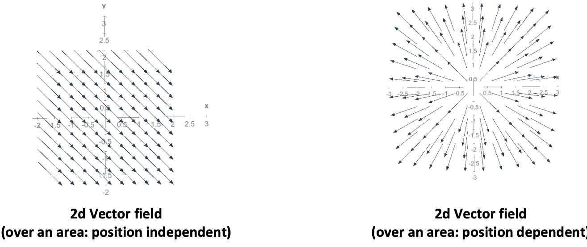

# IMP1.ReviewofVector
> Last Edit: 9/7/25
> 

## Scalar & Pseudoscalars

### Scalar 标量

- Scalar 只有 magnitude 没有 direction数学上定义：

> 一个 Scalar 是在任意坐标变换（包括旋转、反射、平移）下保持不变的数量
> 
- 不论你怎么看它（换坐标系、换角度、翻转世界），它的数值都不变
- 所以它是“绝对的数值”

#### 常见例子：

| 标量（Scalar） | 单位 | 意义说明 |
| --- | --- | --- |
| 质量（mass） | kg | 不管从哪个方向看，质量就是那么多 |
| 温度（temperature） | °C, K | 没有方向性，就是个数值 |
| 时间（time） | s | 没有方向，只是过去多少秒 |
| 电压（voltage） | V | 某点电势差（可以是正负，但不是方向） |
| 能量（energy） | J | 总能量多少，不依赖空间方向 |

### Scalar field 标量场

- Scalar field 是一个 function，它接收一组 Scalar inputs，例如空间中的位置，并输出一个scalar output
- 比如说房间里的温度分布就是一个标量场
- 如果我们在二维空间输入位置 \\((x,y)\\)，比如 \\((1,1)\\)，函数 \\(T(x,y)\\) 会返回该点的温度

### Pseudoscalars 伪标量

- Pseudoscalars 是看起来像标量（只有大小、没有方向）
- 但在parity inversion （空间反射）下会变号的量

## Position Vectors & Vector Fields

### Pseudovector 伪向量

- Pseudovector 由两个普通 Vector Cross Product 产生
- 它的特性是当 Parity Inversion 时，方向不发生变化，即还是之间的两个 Vector 的 Cross Product 的位置

### Vector field 向量场

- 向量场是一个函数，它在空间中的每一个位置上返回一个向量
- 三维空间中的 electric field 典型的向量场
- 由于一个 point charge Q 在空间产生的电场 \\(\mathbf{E}\\)，就是一个向量场
- 标量场 → 每个点只给一个数值
- 向量场 → 每个点给一个向量，既有大小又有方向

## **Orthonormal Basis Vectors & Dot Product**

### Orthonormal Basis Vectors 正交归一向量

- 在一个空间中，Orthonormal Basis Vectors 具有的特性就是 Orthogonal：互相垂直，Normalised：长度为 1

### Dot Product 点积

- 计算一个 Vector 在另一个 Vector 方向上的 Projection

## Cross Product 叉积

- 正如前面所提到的，两个 Vectors Cross Product 的结果将会是一个 Pseudovector 伪向量

## Planes & Lines

### Line in Space

- 在 \\(\mathbb R^3\\) 中，Two Distinct Point，或者一个 Point 加一个 Direction Vector 都可以可以确定一个 Unique Line
- 想要描述这一条 Unique Line 也可以通过 Parametric 和 Vector Equations

### Plane Equation

- Plane 的 Equation 为 \\(ax + by + cz = d\\)

### **Curved Surface**

- 曲面上的法向量不是固定的，而是与位置 \\((x,y)\\) 有关
- \\(\vec{n} = \langle x, y, 1 \rangle \quad \text{或} \quad \langle -x, -y, -1 \rangle\\)

### Equation of a Plane Given Three Points

- 已知三个点后，就可以得到一个同时穿过这三个点的 Plane Equation

#### e.x.

- 假设 \\(\mathbb R^3\\) 中有三个点 O = (2, -1, 3)，Q = (1, 4, 0)，R = (0, -1, 5)
- 要求平面方程 \\(ax + by + cz = d\\)
- 需要知道**法向量** \\(\vec{n} = \langle a,b,c\rangle\\)，有了这个 Normal Vector 就可以得到 Plane 的 Equation
- 首先在 Plane 上找到两个 Vector \\(\vec{OQ} = Q - O = \langle -1,5,-3\rangle\\) 和 \\(\vec{OR} = R - O = \langle -2,0,2\rangle\\)
- 通过将这两个 Vector 做 Cross Product 就可以得到

$$
\vec{n} = \vec{OQ} \times \vec{OR}= 
\begin{vmatrix}
\hat{x} & \hat{y} & \hat{z} \\
-1 & 5 & -3 \\
-2 & 0 & 2
\end{vmatrix}
= \langle 10,8,10\rangle
$$

- 就可以得到 \\(10x+8y+10z = d\\)，带入任意一点就可以求出 d

### Equation of a Plane Given That 2 Lines Intersect

- 两条相交的 Line 也可以在 \\(\mathbb R^3\\) 中围出一个唯一的 Plane
- 假设有两条 Line

$$
Line ~1: x = t,\ y = 2t + 1,\ z = 3t + 4
$$

$$
Line~2:x = 2s - 2,\ y = 2s - 1,\ z = 3s + 1
$$

- 他们的 Intersection 即出现在 \\(2s-t=2\\)，\\(-s+t=-1\\)的位置
- 接出方程组就可以知道 \\(O = (0, 1, 4)\\)
- 从交点处在两个直线上衍生出两个 Vector，求他们的的 Cross Product 即为 Plane 的 Normal Vector

### Equation of a Line Formed by the Intersection of Two Planes

- 两个 \\(\mathbb R^3\\) 中的 Plane 的 Intersection 会是一个 Line，想要求的这个 Line 的 Equation
- 先通过两个 Plane 的 Normal Vector Cross 出 Intersection 的方向，再求出 Intersection 上任意一点
- 最后就可以得到 Line 的 Equation

## Introduction to Multivariable Functions

- Multivariable Functions 指的就是存在不止一个变量的 Function
- 其 Explicit function 显式函数为 \\(z = f(x, y) = x² + y²\\)
- 写成 Implicit function 隐式函数后则有 \\(x² + y² − z = F(x, y, z) = 0\\)

> 含义：把等式写成 F = 0 的形式，其中 F（函数）同时包含 x、y、z，未把 z 单独解出
> 
- 但并不是所有的 Implicit Function 的 Explicit 都是很容易解出的，比如 Function

$$
sin(xyz) − zx + yx = F(x, y, z) = 0
$$

- 这个等式无法通过代数运算把 z 写成 z = f(x, y) 的形式

### Domain and Range of Function

- Consider 2 independent variables x and y and the function z = f(x, y)
- Domain（定义域）：permissible values that you can input into the function
- Range（值域）：all values that are outputs
- 对于 Domain 和 Range 来说，正确的书写表达很重要，拿函数 \\(z = f(x,y) = \sqrt{4 - x^{2} - y^{2}}\\) 举例，它的 Domain 和 Range 即为

| domain | range |
| --- | --- |
| \\(\{(x,y);\; x^{2}+y^{2}\le 4,\ (x,y)\in\mathbb{R}^{2}\}\\) | \\(0 \le z \le 2,\ z \in \mathbb{R}\\) |

## Graphing 2-Variable Scalar Functions (Traces)

- 首先，Traces 指的是 Cross sectional slice of a 3D shape

- 比如上图中的红色曲线就是这个 Ellipsoid 椭球 和 xy-Plane 的 Intersection，整个完整的曲线也就被称为 Trace
- 一般来说，Trace 并不单独出现，为了构建一个三位图形的骨架，需要构建多个二维对象
- 追常见的做法就是在 xy, xz, yz 三个 Plane 上切片，最终绘出完整的 3D 图像

## Graphing 2-Variable Scalar Functions (Cylinders)

- Definition: Cylinder（定义：柱面）
- 在三维空间中，一个二元函数的图形：Function 在  Missing Variable 的所有取值下都成立
- 换句话说，trace 在被忽略的变量方向上保持相同
- 举例来说，有 Function \\(x^2+4y^2=16\\)，这个 Function 中完全不包含 z Axis 上的信息
- 分析它的 Domain 和 Range 来说，有

$$
\{ (x,y) \;|\; x^2 + 4y^2 = 16, \; -4 \leq x \leq 4, \; -2 \leq y \leq 2, \; x,y \in \mathbb{R} \}
$$

$$
z \in \mathbb{R}
$$

- 这意味着图形在 z 方向无限延伸 → 形成一个 cylinder（柱面）

## Graphing 2-Variable Scalar Functions (Level Curves)

- Level Curves 由多条线构成，在同一曲线上，所有点的高度相同
- 如果等高线很密集，表示高度变化快
- 如果等高线稀疏，表示高度变化慢
- 其完整的定义为：Level curves（等值曲线）：把三维函数 \\(z = f(x, y)\\)  投影到 xy 平面，取不同的 z 常数值得到的曲线

## Graphing Scalar 3-Variable Functions (Level Surfaces)

- Level surfaces（等值面）：是函数在不同常数值下的投影
- 给定函数 \\(w = f(x,y,z)\\)，如果取 \\(w = \text{constant}\\)，就能得到一个等值面

$$
w = f(x,y,z), \quad w = \text{constant} = f(x,y,z)
$$

- 如图，不同的 w 值（常数）对应不同的曲面：
    - w = 0（最内层）
    - w = 1
    - w = 2
    - w = 3（最外层）
- 每一个 w = 常数，都代表一个具体的 surface（曲面）
- 当 w 增大时，等值面逐渐扩展，像一个逐层展开的锥形体