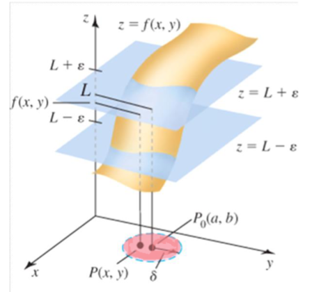
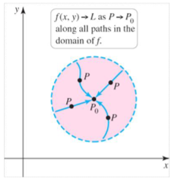
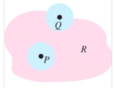
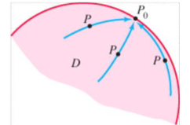
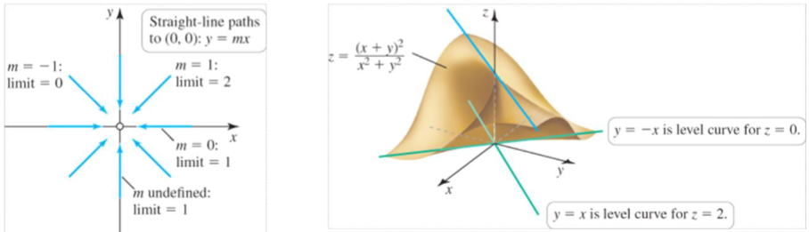
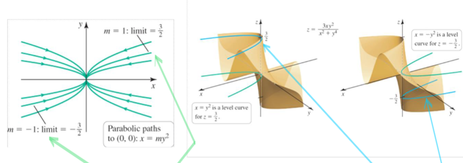
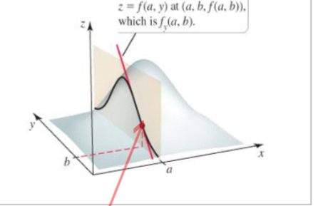
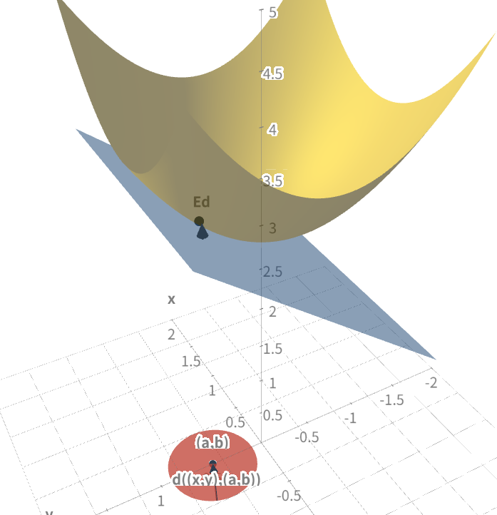

## IMP2.Limits
> Last Edit: 9/22/25
> 

### **Multivariable Limit Definition（多元极限定义）**

- 函数 \\(f\\) 的极限是 \\(L\\)，当点 \\(P(x,y)\\) 逼近 \\(P_0(a,b)\\) 时，写作

$$
\lim_{(x,y)\to(a,b)} f(x,y) = \lim_{P \to P_0} f(x,y) = L
$$

- 对任意的 \\(\varepsilon > 0\\)，存在一个 \\(\delta > 0\\)，使得

$$
| f(x,y) - L | < \varepsilon
$$

当且仅当 \\((x,y)\\) 在 \\(f(x,y)\\) 的定义域内，并且

$$
0 < |P - P_0| = \sqrt{(x-a)^2 + (y-b)^2} < \delta
$$

**Note（注释）：**

- \\(\varepsilon\\) 和 \\(\delta\\) 是很小的数
- L 是一个常数，等于极限值

- 上图中，坐标系：横轴是 \\(x, y\\)，竖轴是 \\(z = f(x,y)\\)
- \\(P_0(a,b)\\)：点 \\((a,b)\\) 在平面上的位置
- \\(P(x,y)\\)：变化点，趋向于 \\(P_0\\)
- \\(\delta\\)：红色圆盘区域，表示 \\(P(x,y)\\)  离  的距离限制
- \\(z = f(x,y)\\)：函数的曲面
- 两个蓝色平面：\\(z = L + \varepsilon\\) 和 \\(z = L - \varepsilon\\)
- 中间的水平面 \\(z = L\\)：极限值所在的平面
- 说明当 \\(P(x,y)\\) 落在 \\(\delta\\) 邻域内时（但不等于 \\(P_0\\)），\\(f(x,y)\\) 的函数值就会被夹在 \\(L - \varepsilon\\) 和  \\(L + \varepsilon\\) 之间

### Definition of Boundary Points and Interior Points

- 想要描述 Limit 的存在的核心条件，需要构建一个圆盘区域，中心是 \\(P_0\\)，几条曲线上的点 P 向 \\(P_0\\) 靠近

- 当点 P 沿着定义域里的所有路径趋近于 \\(P_0\\) 时，\\(f(x,y)\\) 趋于 L
- **Limit exists if the limit is the same for all possible paths（极限存在当且仅当所有可能路径得到的极限相同）**

#### Interior & Boundary Point

- 区域：粉色区域是集合 R

- 点 Q：在边界上
- **Q is a boundary point（边界点）**：Every disk centered at Q contains points in R and points not in R（以 Q 为圆心的任何小圆盘，都会同时包含在 R 内的点和不在 R 内的点）
- 点 P：在内部
- **P is an interior point（内部点）**：There is a disk centered at P that lies entirely in R（以 P 为圆心的某个小圆盘可以完全包含在 R 内部）

#### Location of P_0

- Function 总是存在它的 Domain，有的时候 \\(P_0\\) 可能会出现在 Boundary Point 上，这就需要判断 Set 为 Closed 还是 Open 了
- **Solid red contour（实红线）= closed set（闭集）**
- **Dashed red contour（虚红线）= open set（开集）**

- 点 P 必须沿着定义域 D 内所有路径趋近于 \\(P_0\\)
- **Limit exists if the limit is the same for all possible paths that reside within the region/domain（极限存在当且仅当所有在区域/定义域内的路径极限相同）**
- 极限在边界点 \\(P_0\\) 时，**只考虑从集合 D 内部靠近的路径**
- 如果区域是 Open Set，\\(P_0\\) 不在集合里，但仍然可以研究极限（即函数在  \\(P_0\\) 处未必定义，但极限可能存在）
- 如果区域是 Closed Set，\\(P_0\\) 在集合里，那不仅要考虑极限，还可能要求函数值在该点与极限一致（Continuity）

### Definition of Open and Closed Regions/Sets

- **Open（开集）**：一个区域是开集，如果它只包含 **内部点 (interior points)**，不包含任何边界点
- **Closed（闭集）**：一个区域是闭集，如果它包含 **内部点** 和 **边界点 (boundary points)**

### Methods For Determining Existence or Nonexistence of Limits

- \\(\delta-\varepsilon\\) 定义来严格证明极限存在是标准方法，但很难
- 在课程里会用一些更简单的方法来处理

#### Methods to Apply

1. **Basic limit laws（基本极限定律）** → 用直接法 (direct method)
2. **Factoring numerator（分子因式分解）** → 直接法
3. **Multiply by an algebraic conjugate（乘以代数共轭）** → 直接法
4. **Squeeze theorem（夹逼定理）** → 本课程不涉及
5. **Change of variables（变量代换）** → 可以用直接法，或者 **2-path test（两路径检验）**，或者 **contrapositive method（逆否命题法）**
- 总结来说存在两种方式
- **Direct method（直接法）**
    - 要证明：如果“所有可能路径下的极限相同”，那么极限存在
    - 用途：证明极限存在
- **Contrapositive method（逆否命题法）**
    - 要证明：如果找到至少两条路径得到的极限不同，就能说明极限不存在
    - 用途：证明极限不存在

### Basic Limit Laws

#### Theorem 15.1: Limits of Constant and Linear Functions

- 设 \\(a, b, c\\) 为实数：
1. **Constant function（常数函数）**
    - \\(f(x,y) = c\\)
    - \\(\lim_{(x,y)\to(a,b)} c = c\\)
2. **Linear function（线性函数）**
    - \\(f(x,y) = x\\)
    - \\(\lim_{(x,y)\to(a,b)} x = a\\)
3. **Linear function**
    - \\(f(x,y) = y\\)
    - \\(\lim_{(x,y)\to(a,b)} y = b\\)

#### Theorem 15.2: Limit Laws of Two Variables

- 设 \\(\lim_{(x,y)\to(a,b)} f(x,y) = L，\lim_{(x,y)\to(a,b)} g(x,y) = M\\)
1. **Sum（和）**
    
    $$
    \lim_{(x,y)\to(a,b)} [f(x,y) + g(x,y)] = L + M
    $$
    
2. **Difference（差）**
    
    $$
    \lim_{(x,y)\to(a,b)} [f(x,y) - g(x,y)] = L - M
    $$
    
3. **Constant multiple（常数倍）**
    
    $$
    \lim_{(x,y)\to(a,b)} c f(x,y) = cL
    $$
    
4. **Product（乘积）**
    
    $$
    \lim_{(x,y)\to(a,b)} f(x,y) g(x,y) = LM
    $$
    
5. **Quotient（商）**
    
    $$
    \lim_{(x,y)\to(a,b)} \frac{f(x,y)}{g(x,y)} = \frac{L}{M}，条件：M \neq 0
    $$
    
6. **Power（幂次）**
    
    $$
    \lim_{(x,y)\to(a,b)} [f(x,y)]^n = L^n
    $$
    
7. **Root（开方）**
    
    $$
    \lim_{(x,y)\to(a,b)} [f(x,y)]^{1/n} = L^{1/n}，条件：若 n 为偶数，则要求 L > 0
    $$
    

##### Ex. Factoring Numerator Direct Example

$$
z = \lim_{(x, y) \to (4,4)} \frac{x^2 - y^2}{x - y}
$$

- 分析 Domain 为 \\(\{ (x, y), x \neq y, x, y \in \mathbb{R}^2 \}\\)
- Range 为 \\(z \in \mathbb{R}\\)，有

$$
z=\frac{(x + y)(x - y)}{x - y}=\frac{(x + y)(x - y)}{x - y} = x + y
$$

$$
z = \lim_{(x, y) \to (4,4)} x + y= \lim_{(x,y)\to(4,4)} x + \lim_{(x,y)\to(4,4)} y = 4 + 4 = 8
$$

##### Ex. Change of Variables

\\(\text{Determine if } \lim_{(x,y)\to(0,0)} \frac{x^2 y}{x^2 + y^2} \text{ exists and if so compute its value.}\\)

- \\((x, y) = (0,0)\\) 是边界点（boundary point），因为分母在 \\((0,0)\\) 处为 0

> 这里提供一种思路， 当出现 \\(x^2 + y^2\\) 时，使用 P**olar coordinates**，有
> 

$$
x = g(u,v) = v \cos u, \quad y = h(u,v) = v \sin u
$$

> \\(u,v \mapsto x,y\\) 必须是一一对应（one-to-one）并且满射（onto）
> 
- 代入 v 和 u 得到

$$
\frac{x^2 y}{x^2 + y^2} \to \frac{(v\cos u)^2 (v\sin u)}{v^2} = v \cos^2 u \sin u
$$

- 观察到，想让 \\(x,y=(0,0)\\) 并不需要 u，只当 \\(v=0\\) 的时候就满足，于是就有
- \\((x,y) = (0,0)\\) 等价于 \\((v,u) = (0,u)\\)，有

$$
z = \lim_{v \to 0} v \cos^2 u \sin u = 0 \quad \text{（对于所有 u）}
$$

#### Process for Assuming Limit DNE

- 当假设 Limit 不存在的时候，可以通过 Two Path Test 来验证想法

#### Two Path Test

- 核心思想：在 boundary point 沿至少两条不同路径逼近，如果得到的极限值不同，则极限不存
- 这里的边界点通常在定义域的开集边界（open set）
- 实际操作：选择不同的路径（如 y = 0、y = x 等）计算极限，如果结果不同，就说明极限不存在

#### Change of Variable Options to Implement Two Path Test

- 总的来说存在两种方式来 Approach，先解释一下 Function of two variables 的极限问题
- 在存在两个 Variables 的情况下

<aside>
💡

\\((x, y) \to (0, 0)\\) 不再是一个单方向的逼近，而是有**无数条路径**可以通向原点

</aside>

- 所以要检查这个极限是否存在，就必须考虑：从不同路径（direction）逼近 (0,0)，结果是否一致
- 而证明极限不存在的本质就是证明从不同方向出发存在不同的极限值
1. **替换法**：通过替换 \\(x=g(u,v),y=h(u,v)\\)，目的是使极限表达式依赖于新变量u 或 v
2. **幂函数法**：\\(y = m x^n \quad \text{或} \quad x = m y^n\\)
    - n 由用户选择
    - m 取固定常数，不同的 m 对应不同的路径（curve/path）
- 选择函数（Approach 1）或幂函数（Approach 2），以便**至少找到两条路径，使极限不同**
- 对于 Approach 1：变量 u 或 v 产生不同极限
- 对于 Approach 2：常数 m 控制路径，不同 m 对应不同极限

##### Ex. Change of Variable Example 1 (Approach 1)

$$
z = \lim_{(x,y)\to(0,0)} \frac{(x+y)^2}{x^2 + y^2}
$$

- 其中可以发现，(0,0) 是定义域的边界点（boundary point）
- 正如前面提到的，当发现了 \\(x^2+y^2\\)  类似的式子的时候，使用 Polar Coordinate，于是就有

$$
x=v\cos u,y=v\sin u,v≥0, 0≤u<2π
$$

- 替换完式子后将 Limit Value 也替换了，\\((x,y) = (0,0)\\) 等价于 \\((v,u)=(0,u)\\)，其中 u 可以取 0 到 \\(2\pi\\) 之间的任意值

<aside>
💡

到这里，由于 u 的取值是不固定的，所以 lim 中不再需要限制 u，但是 lim 对于 v 的限制最终引导向了一个包含 u 的公式，那说明存在了起码两个不一样的极限值，即 Limit DNE 了

</aside>

- 于是就代入，有

$$
z = \lim_{v \to 0} \frac{(v \cos u + v \sin u)^2}{v^2}  = \lim_{v \to 0} \left( 1 + 2 \cos u \cdot \sin u \right)
$$

- 可以发现，关于 v 的 limit 存在 u 的参数，说明了存在两个及以上的不同的 Limit Value，即证出极限不存在

##### Ex. Change of Variable Example 1 (Approach 2)

- 现在给出第二种例子，要求

$$
z = \lim_{(x, y) \to (0, 0)} \frac{(x + y)^2}{x^2 + y^2}
$$

- 使用变量的替换，令 \\(y=mx\\)，这是一个常用的方法，表示从原点向不同的斜率 m 的直线方向逼近
- 把 \\(y = mx\\)  代入后变为：

$$
z = \lim_{x \to 0} \frac{(x + mx)^2}{x^2 + (mx)^2}
= \lim_{x \to 0} \frac{(1 + m)^2 x^2}{x^2 (1 + m^2)}
= \frac{(1 + m)^2}{1 + m^2}
$$

<aside>
💡

最终得到了一个和 m 有关的结果，说明不同的路径（不同的 m）会得到不同的极限值，所以这个 Limit DNE

</aside>

- 如同前面对于 \\(y=mx\\) 替换方式的解释，在不同方向上存在不同的 limit 值，则极限不存在

### Continuity

#### Definition of Continuity

- 一个 Multivariable Function 要在点 \\((a,b)\\) 上存在极限，需要满足三个条件
1. f is defined at the point \\((a,b)\\) and is equal to some value \\(f(a,b)\\)
2. \\(\lim_{(x, y) \to (a, b)} f(x, y) \quad \text{exist}\\)
3. \\(\lim_{(x, y) \to (a, b)} f(x, y) = f(a, b)\\)

---

- 想要判断 Function 在某点上的 Continuity
1. Determine continuity within the domain excluding boundary points
- 首先判断函数在定义域内部（不含边界点）是否连续
1. Determine continuity at boundary points
- 然后再检查在边界点（boundary points）处是否连续

<aside>
💡

- Polynomial 和 Rational function在定义域内处处连续
- Trig, log, exp functions 在定义域内连续，但注意排除边界点
</aside>

##### Ex.

现在有 Function

$$
f(x, y) =
\begin{cases}
\frac{3xy^2}{x^2 + y^4}, & \text{if } (x, y) \ne (0, 0) \\
0, & \text{if } (x, y) = (0, 0)
\end{cases}
$$

- 注意到这个函数本身在 \\((0,0)\\) 点没有定义，但是这里人为定义了，为了讨论函数的 Continuity

> f(x, y) is forced to take on a value at (0,0)
> 
- 分析 Domain 和 Range 可以得到
- 函数 \\(\frac{3xy^2}{x^2 + y^4}\\) 的 Domain 是：

$$
\{(x, y) \mid x \ne 0 \text{ 且 } y \ne 0\}
$$

- Range 为 \\(-\frac{3}{2} \le z \le \frac{3}{2}\\)

<aside>
💡

这里分析 Domain 是证明 Function 在要分析的点上被 Define 了，而 Range 其实没啥用

</aside>

- 现在完成了所有先制条件，可以一个个过了
- 因为 \\(\frac{3xy^2}{x^2 + y^4}\\) 是一个 Rational function，所以只要在定义域内，它就是连续的
- 现在到了第二部，验证 Limit 的存在
- 设定路径 \\(x = my^2\\)，带入原 Function，有

$$
f(x, y) = \frac{3xy^2}{x^2 + y^4}
= \frac{3m y^4}{m^2 y^4 + y^4}
= \frac{3m}{m^2 + 1}
$$

- 这个极限值只与 m 有关 → limit DNE

> 当函数中出现 x 的次数比 y 多的情况下，可以使用 \\(x = my\\)
> 
- 所以可以得到这个 Function 最后在 \\((0,0)\\) 位置上的 Limit DNE

#### Continuity of Composite Functions

- 如果 \\(u = g(x, y)\\) 在点 \\((a, b)\\) 连续，且 \\(z = f(u)\\) 在点 \\(g(a, b)\\) 连续
- 那么复合函数 \\(z = f(g(x, y))\\) 在点 \\((a, b)\\) 也连续

> 和 Single Variable 的 Case 一样
> 

##### Ex. Identify the range of continuous

Identify where function \\(z = \ln(x^2 + y^2 + 4)\\)  continuous

- 先看 \\(g(x, y)\\) 是否连续
- 多项式在整个 \\(\mathbb{R}^2\\) 内处处连续
- \\(\ln(u)\\) 只在  时有定义并连续
- 这里 \\(u = x^2 + y^2 + 4\\)，由于 \\(x^2 + y^2 \ge 0\\)，所以 \\(u \ge 4 > 0\\)
- 因此 \\(f(u)\\) 对所有 \\((x, y) \in \mathbb{R}^2\\) 都满足条件
- 最后得出复合函数 \\(z = \ln(x^2 + y^2 + 4)\\) 在整个 \\(\mathbb{R}^2\\) 上连续

##### Ex. Identify point function continuous

Where is function 

$$
z =\begin{cases}
\dfrac{\sin(x^2 y)}{x^2 y}, & x^2 y \ne 0 \\
1, & x^2 y = 0
\end{cases}
$$

continuous 

- Inner Function 为 \\(g(x, y) = x^2 y\\)
- Outer Function 为
    
    $$
    f(u) =
    \begin{cases}
    \dfrac{\sin(u)}{u}, & u \ne 0 \\
    1, & u = 0
    \end{cases}
    $$
    
- 其中 Inner 是 Poly → cont
- Outer 在 \\(u\neq 0\\) 的时候是 Trig + Poly，连续
- 然后分析在 \\(u=0\\) 的时候的 Limit，为

$$
\lim_{u \to 0} \frac{\sin(u)}{u}
= \lim_{u \to 0} \frac{\frac{d}{du}(\sin(u))}{\frac{d}{du}(u)}
= \lim_{u \to 0} \frac{\cos(u)}{1} = 1
$$

> LHopital’s
> 
- 得到函数 Cont in \\(\mathbb R^2\\)

### Partial Derivatives and Differentiability

- Partial Derivative（偏导数）就是函数 \\(f(x,y)\\) 在某一点沿着某个坐标方向（例如 x 方向或 y 方向）的斜率

<aside>
💡

换句话说，偏导数就是“在固定其他变量不变时，沿某个方向看到的变化率”

</aside>

#### Definition of Partial Derivative

- 已知 Signal Variable Function 的 Derivative 的定义为

$$
f_x(a) = \lim_{h \to 0} \frac{f(a+h) - f(a)}{h}
$$

- 将其拓展到 Multi Variables 的情况下，就有

$$
f_x(a, b) = \lim_{h \to 0} \frac{f(a+h, b) - f(a, b)}{h}
$$

- 这就是 Function 对 x 的 Partial Derivative

$$
f_y(a, b) = \lim_{h \to 0} \frac{f(a, b+h) - f(a, b)}{h}
$$

- 这是 Function 对 y 的 Partial Derivative

<aside>
💡

当对一个 Variable 求导的时候，把剩下的视为 Constant 就行

</aside>

##### Ex. Calculate PD using Definition

有函数 \\(f(x,y)=x^2y\\)，分别计算 x 和 y 的 PD

$$
\begin{align}
\frac{\partial f}{\partial x} = f_x 
&= \lim_{h \to 0} \frac{f(x+h,y) - f(x,y)}{h} \\[6pt]
&= \lim_{h \to 0} \frac{(x+h)^2y - x^2y}{h} \\[6pt]
&= \lim_{h \to 0} \frac{(x^2 + 2xh + h^2 - x^2)y}{h} \\[6pt]
&= \lim_{h \to 0} \frac{(2x+h)hy}{h} \\[6pt]
&= \lim_{h \to 0} (2x+h)y = 2xy
\end{align}
$$

$$
\begin{align}\frac{\partial f}{\partial y} = f_y &= \lim_{h \to 0} \frac{f(x,y+h) - f(x,y)}{h} \\[6pt]&= \lim_{h \to 0} \frac{x^2(y+h) - x^2y}{h} \\[6pt]&= \lim_{h \to 0} \frac{x^2(y+h-y)}{h} \\[6pt]&= \lim_{h \to 0} \frac{x^2h}{h} \\[6pt]&= x^2\end{align}
$$

#### Higher-Order Partial Derivatives and Notation

- 与 Signal Variable 一样，Multi Variable 也存在 Higher Order 的 Derivative

| Notation 1 | Notation 2 |
| --- | --- |
| \\(\dfrac{\partial}{\partial x} \left( \dfrac{\partial f}{\partial x} \right) = \dfrac{\partial^2 f}{\partial x^2}\\) | \\(((f_x)_x = f_{xx}\\) |
| \\(\dfrac{\partial}{\partial y} \left( \dfrac{\partial f}{\partial y} \right) = \dfrac{\partial^2 f}{\partial y^2}\\) | \\((f_y)_y = f_{yy}\\) |
| \\(\dfrac{\partial}{\partial x} \left( \dfrac{\partial f}{\partial y} \right) = \dfrac{\partial^2 f}{\partial x \partial y}\\) | \\((f_y)_x = f_{yx}\\) |
| \\(\dfrac{\partial}{\partial y} \left( \dfrac{\partial f}{\partial x} \right) = \dfrac{\partial^2 f}{\partial y \partial x}\\) | \\((f_x)_y = f_{xy}\\) |

#### Equality of Mixed Partial Derivatives（混合偏导数相等）

- 假设 function ff 定义在 \\(\mathbb{R}^2\\) 的一个开区域 D 上
- 且 \\(f_{xy}\\) 与 \\(f_{yx}\\) 在整个区域 D 上都是 Continuous 的
- 那么就有：

$$
f_{xy} = f_{yx}
$$

> 即先对 x 再对 y 求 PD，和先对 y 再对 x 求 PD，结果是一样的
> 
- 这个结论可以推广到更高阶偏导：
- 例如，如果三阶偏导：\\(f_{xyz}，f_{xzy}，f_{yxz}\\) 都 Exist 且 Cont.，那么这些偏导也都相等

#### Differentiability of a Function with 1 Variable

- 已知 Derivative 的定义为

$$
f'(x) = \lim_{h \to 0} \frac{f(x + h) - f(x)}{h}
$$

- 也就是说，导数是函数在某点处的瞬时变化率，表示为 Difference Quotient 的极限
- 这是前面提到的，但是 Differentiability 是一个性质
- 当一个 Function \\(y = f(x)\\) 在点 \\(x = a\\) 处 **differentiable**，意味着导数存在，也即：

$$
\Delta y = f'(x) \Delta x + \epsilon_1 \Delta x
$$

- 其中 \\(\epsilon_1\\) 是一个依赖于 \\(\Delta x\\) 的函数，且当 \\(\Delta x \to 0\\) 时 \\(\epsilon_1 \to 0\\)
- 这个等价定义说明函数的变化可以近似由线性部分表示

##### Ex. Differentiability of a Function with 1 Variable

有函数：\\(y = x^2\\)，分析在 \\((a, a^2)\\) 点上的 Differentiability

- 从 Equation 的左右两边分别计算
- 左边的定义式是直接用函数定义计算函数值的变化：

$$
\Delta y = f(a + \Delta x) - f(a) = (a + \Delta x)^2 - a^2
$$

$$
\Rightarrow a^2 + 2a \Delta x + (\Delta x)^2 - a^2 = 2a \Delta x + (\Delta x)^2
$$

$$
\Rightarrow \Delta y = 2a \Delta x + (\Delta x)^2
$$

- 右边是用 Differentiability Definition 中右边的公式：

$$
\Delta y = f'(x)\Delta x + \epsilon_1 \Delta x
$$

- 因为 \\(f'(x) = 2x\\)，代入 \\(x = a\\)，得到：

$$
\Delta y = 2a \Delta x + \epsilon_1 \Delta x
$$

- 同时拿到左右两边

$$
2a \Delta x + (\Delta x)^2 = 2a \Delta x + \epsilon_1 \Delta x
$$

- 两边同时减去 \\(2a \Delta x\\)，得到：

$$
(\Delta x)^2 = \epsilon_1 \Delta x \Rightarrow \epsilon_1 = \Delta x
$$

<aside>
💡

这是一个非常正式的 Differentiability 证明

</aside>

#### Differentiability of a Function with 2 Variables

- 到了 Two Variables Function 上，Function 在点 \\((a,b)\\) is Differentiable if \\(f_x(a,b), f_y(a,b)\\) 都存在
- 函数值变化写为：

$$
\Delta z = f(a + \Delta x, b + \Delta y) - f(a, b)
$$

- 期望这个变化可以被线性近似：

$$
\Delta z = f_x(a,b)\Delta x + f_y(a,b)\Delta y + \epsilon_1 \Delta x + \epsilon_2 \Delta 
$$

- 其中：\\(\epsilon_1, \epsilon_2 \to 0\\)，当 \\((\Delta x, \Delta y) \to (0, 0)\\)
- 也就是说：剩余误差项会比主导线性项小得更快

##### Ex. Differentiability of a Function with 2 Variables

验证函数 \\(z=x3+xy2+7z = x^3 + xy^2 + 7\\) 在点 \\((x, y) = (a, b)\\) 是否可导

- 按照 Differentiability of a Function with 2 Variables

$$
\Delta z = f_x(a,b)\Delta x + f_y(a,b)\Delta y + \epsilon_1 \Delta x + \epsilon_2 \Delta y
$$

- 其中：\\(\epsilon_1, \epsilon_2 \to 0\\) 当 \\((\Delta x, \Delta y) \to (0, 0)\\)
- 首先分别计算两个的 Partial Derivative

$$
\begin{align*}
f_x(a,b) &= \lim_{h \to 0} \frac{f(a+h,b) - f(a,b)}{h} \\
&= \lim_{h \to 0} \frac{(a+h)^3 + (a+h)b^2 + 7 - a^3 - ab^2 - 7}{h} \\
&= \lim_{h \to 0} \frac{3a^2h + 3ah^2 + h^3 + hb^2}{h} \\
&= \lim_{h \to 0} \left( 3a^2 + 3ah + h^2 + b^2 \right) \\
&= 3a^2 + b^2
\end{align*}

$$

$$
\begin{align*}
f_y(a,b) &= \lim_{h \to 0} \frac{f(a,b+h) - f(a,b)}{h} \\
&= \lim_{h \to 0} \frac{a^3 + a(b+h)^2 + 7 - a^3 - ab^2 - 7}{h} \\
&= \lim_{h \to 0} \frac{2abh + ah^2}{h} \\
&= \lim_{h \to 0} \left( 2ab + ah \right) \\
&= 2ab
\end{align*}

$$

- 同时，已知 \\(\Delta z\\) 为

$$
\begin{align*}\Delta z &= f(a+\Delta x, b+\Delta y) - f(a,b) \\&= (a+\Delta x)^3 + (a+\Delta x)(b+\Delta y)^2 + 7 - a^3 - ab^2 - 7 \\&= a^3 + 3a^2\Delta x + 3a(\Delta x)^2 + (\Delta x)^3 + ab^2 + 2ab\Delta y + a(\Delta y)^2 \\&\quad + \Delta x b^2 + 2b\Delta x \Delta y + \Delta x(\Delta y)^2 + 7 - a^3 - ab^2 - 7 \\&= 3a^2\Delta x + 3a(\Delta x)^2 + (\Delta x)^3 + 2ab\Delta y + a(\Delta y)^2 \\&\quad + \Delta x b^2 + 2b\Delta x \Delta y + \Delta x(\Delta y)^2\end{align*}
$$

- 现在要把上式写成 \\(\Delta z = f_x(a,b)\Delta x + f_y(a,b)\Delta y + \epsilon_1 \Delta x + \epsilon_2 \Delta y\\) 的形式，
- 已知 \\(f_x(a,b) = 3a^2+b^2\\)，\\(f_y(a,b) = 2ab\\)，有

$$
f_x(a,b) \Delta x = (3a^2 + b^2)\Delta x，\quad f_y(a,b) \Delta y = 2ab \Delta y
$$

- 拆括号，匹配 LHS 和 RHS，最终得到

$$
\epsilon_1 \Delta x = 3a (\Delta x)^2 + (\Delta x)^3
$$

$$
\epsilon_2 \Delta y = a(\Delta y)^2 + 2b \Delta x \Delta y + \Delta x (\Delta y)^2
$$

- 所以最终得到：

$$
\epsilon_1 = 3a \Delta x + (\Delta x)^2
$$

$$
\epsilon_2 = a \Delta y + 2b \Delta x + \Delta x \Delta y
$$

- 最后 Check 三点
- \\(\epsilon_1, \epsilon_2\\) 是否是 \\(\Delta x, \Delta y\\) 的函数？✅
- 当 \\((\Delta x, \Delta y) \to (0, 0)\\)，是否趋近于 0？✅
- 偏导 \\(f_x(a,b), f_y(a,b)\\) 是否存在？✅

#### Differentiability of a Function with 2 Variables (Method 2）

- 给定 \\(z = f(x,y)\\)，点 \\((a,b)\\) 上偏导数 \\(f_x, f_y\\) 存在
- 定义一个 linear function：
    
    $$
    L_{a,b}(x,y) = f(a,b) + f_x(a,b)(x-a) + f_y(a,b)(y-b)
    $$
    
- 这就是在点 \\((a,b,f(a,b))\\) 处的 **tangent plane（切平面）**

> 这是一个形如 \\(z=α+βx+γy\\) 的 Plane
> 
- f 在 (a,b) 可微，当且仅当

$$
\lim_{(x,y)\to(a,b)} \frac{E_d}{|(x-a,y-b)|} = 0
$$

- \\(E_d = f(x,y) - L_{a,b}(x,y)\\)，表示函数值与切平面之间的 Vertical distance

- 意思是说：如果函数和切平面的偏差，比两点间的水平距离更快趋近于 0，那么函数在该点可微。
- 如果偏导不存在，或极限不是 0 → 就不可微

##### Ex. Differentiability of a 2 Variable function (Method 2)

有函数

$$
f(x,y) = 
\begin{cases}
\dfrac{(x-1)(y-1)}{\sqrt{(x-1)^2+(y-1)^2}}, & (x,y)\neq(1,1) \\
0, & (x,y)=(1,1)
\end{cases}
$$

- 先在 (1,1) 点计算偏导：

$$
f_x(1,1) = \lim_{h\to 0}\frac{f(1+h,1)-f(1,1)}{h} = 0
$$

$$
f_y(1,1) = \lim_{h\to 0}\frac{f(1,1+h)-f(1,1)}{h} = 0
$$

- → 两个偏导数都存在
- 定义切平

$$
L_{(1,1)}(x,y) = f(1,1) + f_x(1,1)(x-1) + f_y(1,1)(y-1) = 0
$$

- 其中，两个 Partial Derivative 在 \\((1,1)\\)  位置都是 0，所以有

$$
E_d = f(x,y) - L_{(1,1)}(x,y) =f(x,y)-f(1,1)
$$

- 又因为 \\(f(1,1)\\) 也是 0，所以有

$$
\Rightarrow E_d = f(x,y) = \dfrac{(x-1)(y-1)}{\sqrt{(x-1)^2+(y-1)^2}}
$$

- 已知 Distance Function d 为 \\(\sqrt{(x-1)^2+(y-1)^2}\\)
- 接下来要检查它的 Limit 是否为 0

$$
\lim_{(x,y)\to(1,1)} \frac{E_d}{d} =\dfrac{(x-1)(y-1)}{\sqrt{(x-1)^2+(y-1)^2}}/\sqrt{(x-1)^2+(y-1)^2} 
$$

$$
\Rightarrow \lim_{(x,y)\to(1,1)} \frac{E_d}{d}=\lim_{(x,y)\to(1,1)} \frac{(x-1)(y-1)}{(x-1)^2+(y-1)^2}
$$

- 换极坐标：

$$
x = 1 + v\cos u, \quad y = 1 + v\sin u, \quad v\geq 0,\quad 0\leq u\leq 2\pi
$$

$$
\Rightarrow \lim_{(x,y)\to(1,1)}\frac{(x-1)(y-1)}{(x-1)^2+(y-1)^2} = \lim_{v\to0}\frac{v^2 \cos u \sin u}{v^2} = \cos u \sin u
$$

- 最后根据 Two Path Test 得出 Limit DNE

#### Differentiability of a Function with 2 Variables: Special Cases

- 如果函数 f 的一阶偏导数 \\(f_x, f_y\\) 在点 \\((a,b)\\) 附近存在，
- 并且 \\(f_x, f_y\\) 在 (a,b) 处连续，
- 那么 f 在 \\((a,b)\\) 一定可微
- **只要保证 Partial Derivative Exist 且 Cont.，就能保证 Differentiable**
- 这是一条 **充分条件**，不是必要条件
    - 充分条件：偏导连续 ⇒ 一定可微
    - 反过来：可微 ⇒ 偏导数存在，但不保证偏导连续

##### Contrapositive argument（逆否命题）

如果函数在 (a,b) 不可微，那么必然发生了下面两种情况之一：

1. 至少有一个偏导数 f_x 或 f_y 在 (a,b) 不连续；
2. 或者根本没有一个开集能保证在  (a,b) 附近定义偏导

##### Ex. Differentiability of 2 Variable Function (Special Case)

证明函数

$$
f(x,y) = 
\begin{cases}
\dfrac{x \sin y}{y}, & y \neq 0 \\
x, & y = 0
\end{cases}
$$

在点 (0,0) 可微

- 首先检查两个 Partial Derivative 的 Existance

$$
f_x = \frac{\sin y}{y}, \quad y \neq 0; \quad f_x(0,0)=1 \ (\text{用L'Hôpital's Rule算的极限})
$$

$$
f_y = x \cdot \frac{y \cos y - \sin y}{y^2}, \quad y \neq 0; \quad f_y(0,0)=0 \ (\text{用偏导定义算的极限})
$$

- 得出：\\(f_x, f_y\\) 在 \\((0,0)\\) 都存在
- 检查两个 PD 的 Cont.

$$
f_x(0,0) = \lim_{(x,y)\to(0,0)} f_x(x,y), \quad f_y(0,0) = \lim_{(x,y)\to(0,0)} f_y(x,y)
$$

- \\(f_x\\)：

$$
\lim_{y\to 0} \frac{\sin y}{y} = 1, \quad f_x(0,0)=1 \quad \Rightarrow \text{连续}
$$

- \\(f_y\\)：

$$
\lim_{(x,y)\to(0,0)} x \cdot \frac{y \cos y - \sin y}{y^2} = 0, \quad f_y(0,0)=0 \quad \Rightarrow \text{连续}
$$

- 两个偏导数在 \\((0,0)\\) 都连续
- 根据 **Theorem 15.5**
- 偏导数存在；并且在 (0,0) 连续
- 所以 \\(f(x,y) \text{ 在 } (0,0) \text{ 可微}\\)

#### Relationship Between Differentiability and Continuity

**定理：可微 ⇒ 连续**

- 如果函数 f 在 \\(x=a\\) 处可微，那么它在 \\(x=a\\) 处一定连续
- 逆否命题：如果函数在 \\(x=a\\) 不连续，那么它在 \\(x=a\\) 一定不可微

##### 2 Variable Case

- 到了两个 Variable 的情况是一样的
- 如果函数 \\(f(x,y)\\) 在点 \\((a,b)\\)  可微，那么它在 \\((a,b)\\) 一定连续
- 逆否命题：如果函数在 \\((a,b)\\) 不连续，那么它在 \\((a,b)\\) 一定不可微