# IE1.Signals&Amplifiers

> Last Edit: 9/4/25
> 

## 1.1 Signals

- 信号包含了关于物理世界中各种活动和事物的信息
- 很多的东西都可以归于信号，例如 Temperature, Pressure, Wind Speed 等

### Processing Signals

- 为了从 Signals 中提取有效的信息，则需要进行 Signal Processing
- 但是在这之前，人需要将其转换为 Voltage 或者 Current

### Signal Source

- 信号源同 Source 一样，显示世界中并没有 Ideal Source，即 Zero Resistance
- 所以这就需要给 Source 添加一个 Resistor，其可以通过Thevenin Form 来表达

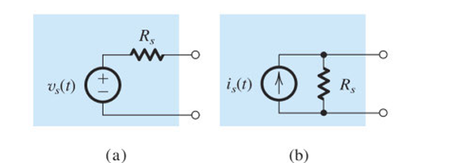

- 上图两种表示方法是等效的

## 1.2 Frequency Spectrum of Signals

- 研究信号时，一个非常重要的方式是用它的 frequency spectrum 来表示
- 通过 ****Fourier series（傅里叶级数）和 Fourier transform（傅里叶变换），能把任意信号表示成不同频率和幅度的 sine waves之和
- 所以，sinusoid 是电子学里最重要的信号形式之一

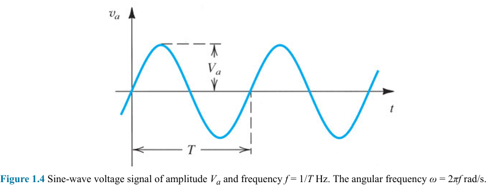

- 上图是一个 Sine-wave Voltage Signal，其表达式为

$$
v_a(t) = V_a \sin(\omega t)
$$

其中：

- \\(V_a\\)：amplitude 振幅 ，单位 V
- \\(\omega\\)：angular frequency 角频率，单位 rad/s
- f：frequency 频率，单位 Hz，关系为 \\(\omega = 2 \pi f\\)
- T：period 周期，单位 s，关系为 \\(f = 1/T\\)

### RMS Root Mean Value

- Sine Wave 常用 R**oot-Mean-Square** 来表示，这是因为 Sine Wave 图像的对称性（奇函数）导致的其在取传统 Mean 的时候正负会相互抵消，而又需要一个能反映它产生的 Energy 或者 Power 的值，于是就有了 RMS

$$
V_{rms} = \frac{V_a}{\sqrt{2}}
$$

举例：

- 家庭电源（wall power supply）标称 **120 V**，实际上是正弦波的 **rms 值**，
- 所以峰值电压是  \\(120\sqrt{2} \approx 170 V\\)

### Fourier Series

- 然而，就像前面的 Thevenin 一样， 真实情况下的 Signal 一般并不全是 Sine Wave，这导致他们无法被用一个简单的公式直接分析

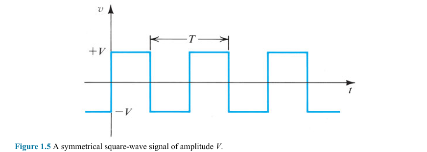

- 所以 Fourier Series 的思想就是将任意的 Complex Signals 分解成一堆 Sine Waves 的组合

> Sine Wave 就可以类比为 Signal 中的 Atoms, they made up everything
> 
- 对于上面的 Square-Wave 来说，它的傅里叶展开结果为

$$
v(t) = \frac{4V}{\pi}\left(\sin \omega_0 t + \frac{1}{3}\sin 3\omega_0 t + \frac{1}{5}\sin 5\omega_0 t + \cdots \right)
$$

- V：方波幅度
- \\(\omega_0 = \frac{2\pi}{T}\\)：Fundamental Frequency 基频角频率
- 这个公式说明：
1. Square Wave 其实是由无穷多个正弦波叠加而成
2. 其只包含odd harmonics 奇次谐波：\\(\omega_0, 3\omega_0, 5\omega_0...\\)
3. 每个谐波的 Amplitude 随着频率升高而减小（与 1/n 成正比）

### Line Spectrum

- 一个 Wave 包含了一个基波加上无数个谐波，而对于这个 Square Wave 来说，想要画出它的 Frequency 的成分，就可以通过 Line Spectrum
- 其中每一根竖线代表信号在该频率下的一个正弦波分量

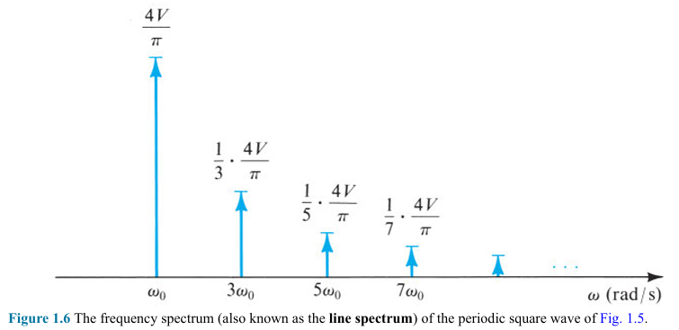

- 基频分量（\\(\omega_0\\)）的幅度是 \\(\frac{4V}{\pi}\\)
- 第三次谐波（\\(3\omega_0\\)）幅度是 \\(\frac{1}{3}\frac{4V}{\pi}\\)
- 第五次谐波（\\(5\omega_0\\)）幅度是\\(\frac{1}{5}\frac{4V}{\pi}\\)， 依此类推
- 方波看起来是“方形”的，但它实际上是这些频率分量正弦波叠加的结果。

## Representations

- 总的来说，表达 Signals 有两种方式，Time-Domain 和 Frequency-Domain
- 时域看信号随时间的波形，频域看信号的频率成分

## 1.3 Analog and Digital Signals

### Analog Signal

- Analog Signal 模拟信号，指的是这个信号是 Analogous 模拟他所表示的实际信号的
- 其中其 Amplitude 可以取任意值，其在图像中是 Continuous Variation 连续变化的

### Digital Signal 数字信号

- 通过一系列数字来表示某个时间点的 Signal Amplitude 的叫做 Digital Signal 数字信号
- 他就是从 Analog Signal 中 Sampling 得到的

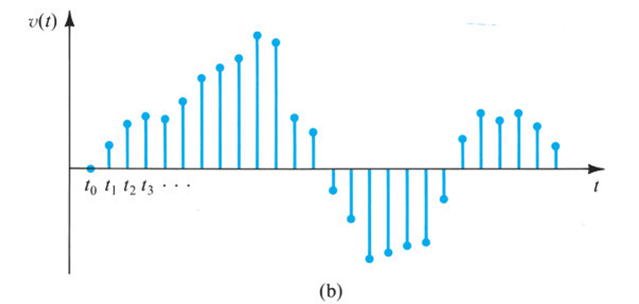

- Digital Signal 仅仅在 Sampling 的时候有定义，其不再是一个 Continue Function，而是 Discrete-Time Signal

### Type of digital signal

- 不同的 Number System 下，Digital Signal 的表示形式也将不一样
- 其中 Binary Number System 是最常见的，其只有 0 和 1，也就是高电平和低电平

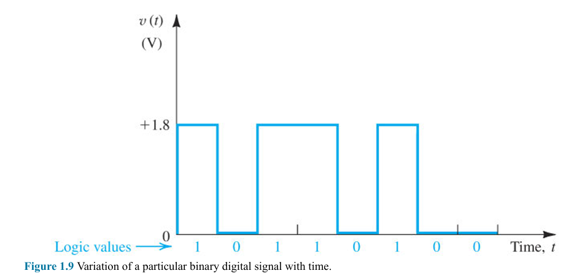

- 这张图中，蓝色波形表示一个 binary digital signal 随时间的变化
- 如果用 N binary digits, 表示模拟信号的每个采样值，那么数字化后的采样值可以写成：

$$
D = b_0 2^0 + b_1 2^1 + b_2 2^2 + \dots + b_{N-1} 2^{N-1}
$$

其中：

- \\(b_0, b_1, ..., b_{N-1}\\) 是 **比特（bits）**，取值只能是 0 或 1
- \\(b_0\\) 是 LSB least significant bit，最低有效位
- **\\(b_{N-1}\\)** 是 MSB most significant bit，最高有效位
- 这个二进制数通常写作 \\(b_{N-1} b_{N-2} ... b_0\\)
- 结果是：一个模拟采样值被量化（quantized）到 \\(2^N\\) 个可能的等级（levels）中

> 之所以是 \\(2^N\\) 是因为整个 Signal 被当做了一个 Binary Number
> 
- N 越大，数字结果就越接近真实模拟值，量化误差（quantization error）就越小，但电路更复杂、成本更高

### **A/D converter**

- **A/D converter** 模数转换器，Analog-to-Digital Converter, ADC
- 顾名思义将 Analog Input 转换为 Digital Output
- 而中间的模块首先 Sampling，在 Decent 的时间点上读取 Signal
- 之后将连续的 Voltage 逼近到 \\(2^N\\) 个能级中，举例来说有
- 假设输入电压范围是 **0 V ~ 5 V**
- 在这个范围里，电压可能是 **2.53 V**、**3.1415 V**、甚至 **4.00001 V**，理论上是无限多的可能值
- 这很合理，因为 Analog Signal 是 continuous 的，而 ADC 不能处理无限多的值，它必须用有限的比特数（二进制位）来表示
- 假设是 **3-bit ADC**（N=3）：
- 它最多能表示 \\(2^3 = 8\\) 个等级（levels）
- 那么 0~5 V 的输入范围被均匀分成 8 段，每一段宽度是：\\(\frac{5}{8} = 0.625 \, \text{V}\\)
- 于是：
- 输入 0~0.625 V → 输出 000
- 输入 0.625~1.25 V → 输出 001
- 输入 1.25~1.875 V → 输出 010
- 输入 1.875~2.5 V → 输出 011
- 输入 2.5~3.125 V → 输出 100
- 输入 3.125~3.75 V → 输出 101
- 输入 3.75~4.375 V → 输出 110
- 输入 4.375~5.0 V → 输出 111
- 将所有的 Binary Number 组合后将其表示出来最终 Encoding 得到结果
- 然后就是输出成 Analog Output

## 1.4 Amplifiers

- Signal Processing 中，一个最基本的功能就是 Signal Amplification 信号放大
- 这就需要研究 Amplifier 的作用

### 1.4.1 Signal Amplification

- Signal Amplifier 信号放大器的功能就是把微弱的信号，如 \\(\mu V,nV\\) 级别的信号放大到足够大，便于后续的处理
- 而其关键的需求就是 Linearity 线性
- 即在 Signal 被放大后，Wave 因保持不变，只是 Amplitude 更大
- 其中如果 Wave 的形状发生了改变，即 Distortion 失真
- Amplifier 的功能用公式表达出来就是

$$
v_o(t) = A v_i(t)
$$

- \\(v_i\\)：input signal（输入信号）
- \\(v_o\\)：output signal（输出信号）
- \\(A\\)：amplifier gain（放大器增益），是常数

#### Voltage Amplifier (电压放大器)

- 主要处理很小的输入电压信
- 目的：让信号幅度更大
- 示例：**preamplifier（前置放大器）**，在家庭音响系统（home stereo system）中常见

#### Power Amplifier (功率放大器)

- 功能：提供足够的功率给负载（例如 loudspeaker 扬声器）
- 特点：电压增益可能不大，但功率输出很大
- 扬声器是系统的 output transducer（输出换能器），将电信号转换为声音信号
- linear power amplifier（线性功率放大器） 能保证无论大音量还是小音量，音乐都不会失真

### 1.4.2 Amplifier Circuit Symbol

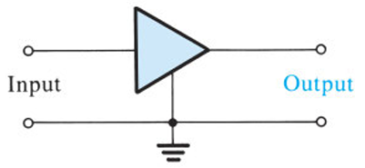

- 一个完整的 Amplifier 应如上图，存在一个 Input 和 Output，同时有 Ground

### 1.4.3 Voltage Gain

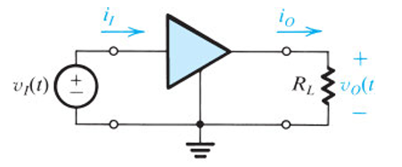

- 负载电阻：\\(R_L\\) （load resistance 负载电阻）
- 放大器把输入信号放大，输出端得到放大的复制品。
- 电压增益 (Voltage gain 电压增益) 定义为：

$$
A_v = \frac{v_o}{v_i}
$$

- 左边：输入电压 \\(v_i(t)\\)
- 三角形：电压放大器 (voltage amplifier 电压放大器)
- 右边：负载电阻 \\(R_L\\)，输出电压  \\(v_o(t)\\) 在其两端产生
- 其中整个 Transfer 过程都将是 Linear 的（理想状态下）

### 1.4.4 Power Gain and Current Gain

- 已知 Power = Current \\(\times\\) Voltage
- 所以对于 Power 的增益定义为

$$
A_p = \frac{P_L}{P_I}= \frac{v_O i_O}{v_I i_I} = A_v \times A_i
$$

### 1.4.5 Expressing Gain in Decibels

- Decibels 分贝，是一个对数数据，在工程中使用如此对数数据的好处是在多个 Amplifier 相乘的时候，Log 的运算便为 Addition
- 同时 Current，Voltage 和 Power 本质上是无纲量，于是有

$$
\text{Voltage gain (dB)} = 20 \log |A_v|
$$

$$
\text{Current gain (dB)} = 20 \log |A_i|
$$

$$
\text{Power gain (dB)} = 10 \log A_p
$$

- 这里的系数值得说明一下，首先对于 Decibels 的定义是从 Power 开始的，有

$$
G_{dB} = 10 \log_{10} \left( \frac{P_{out}}{P_{in}} \right)
$$

- 这个 “10” 是最原始的定义，和功率的物理意义绑定。
- 在相同电阻 R 下：\\(P = \frac{V^2}{R}\\)，于是有

$$
\frac{P_{out}}{P_{in}} = \left(\frac{V_{out}}{V_{in}}\right)^2
$$

$$
G_{dB} = 10 \log \left(\frac{P_{out}}{P_{in}}\right) 
= 10 \log \left(\frac{V_{out}}{V_{in}}\right)^2
= 20 \log \left(\frac{V_{out}}{V_{in}}\right)
$$

- 所以电压增益、电流增益的 dB 表达式是 **20 log**，完全是从功率的 **10 log 定义** 推出来的。
- 拿 Power Gain 举例来说，当 \\(A_p\\) 为 10 的时候，Power Gain 为 0 dB
- \\(A_p\\) 为 100 的时候，Power Gain 为 40 dB，\\(A_p\\) 为 1000 的时候，Power Gain 为 60 dB
- 这就说明了 dB 的增加实际上是底数的倍数级上升

### 1.4.6 The Amplifier Power Supplies

- 已知 Amplifier 送到 Load 的功率比从 Signal Source 获得的功率大，而那一部分多余出来的功率就是从 DC Power Supplies 直流电源 中获取

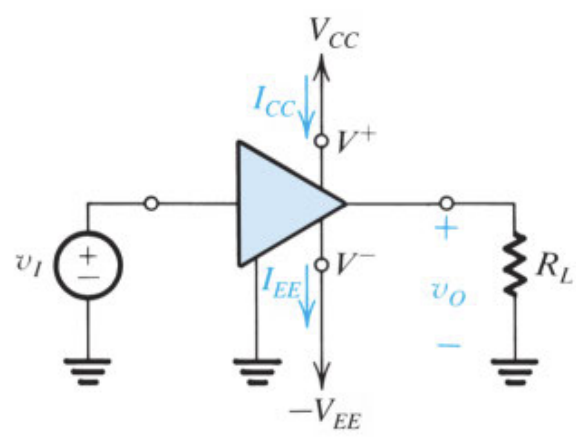

- 其中正电源为 \\(V_{CC}\\)，负电源为 \\(V_{EE}\\)
- 对于 Amplifier 来说，其存在两个端子，一个接 \\(V_{CC}\\)，一个接 \\(V_{EE}\\) 剩下的接地

#### DC power 直流功率

- 于是就可以得出 DC Power 的 DC 功率为

$$
P_{dc} = V_{CC} I_{CC} + V_{EE} I_{EE}
$$

- 有 Power-balance equation 功率平衡方程
    
    $$
    P_{dc} + P_I = P_L + P_{dissipated}
    $$
    
    - \\(P_I\\)：信号源供给的功率（power from signal source）
    - \\(P_L\\)：负载功率（power delivered to load）
    - \\(P_{dissipated}\\)：放大器内部消耗（功率转为热 dissipated power）

#### Amplifier efficiency 放大器效率

- 因为 \\(P_I\\) 很小，可以忽略，所以效率定义为：

$$
\eta = \frac{P_L}{P_{dc}} \times 100
$$

### 1.4.7 Amplifier Saturation

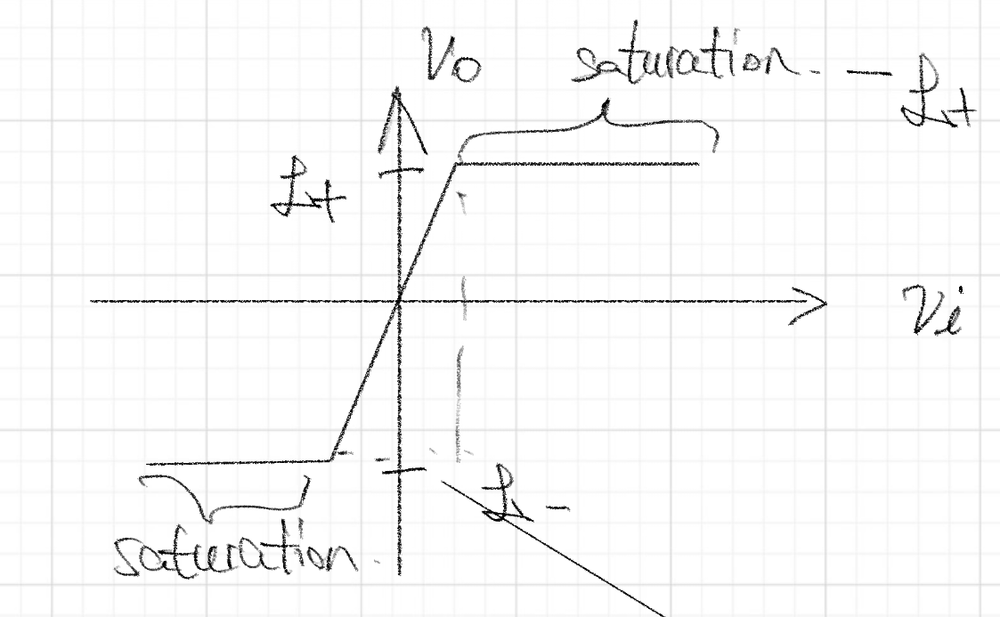

- Amplifier 在一定范围中是 Linear 的
- 但是一旦输出过大或者过小，Output 的 Voltage 就会到达电源的极限，导致其无法再继续增加或减小，Saturation 就出现了
- 图中用 \\(L_+\\) 表示 Positive saturation level 正饱和电平
- 用 \\(L_-\\) 表示 Negative saturation level 负饱和电平
- 通常 \\(L_+\\) 和 \\(L_-\\) 会比 Power Supply 电源电压）低一点点（几分之一伏），因为电路元件本身有压降

#### To Avoid Distortion

- Distortion 是一个非常宽泛的实践，其会发生在很多种不同的情况下，其中 Clipping 就是其中一种

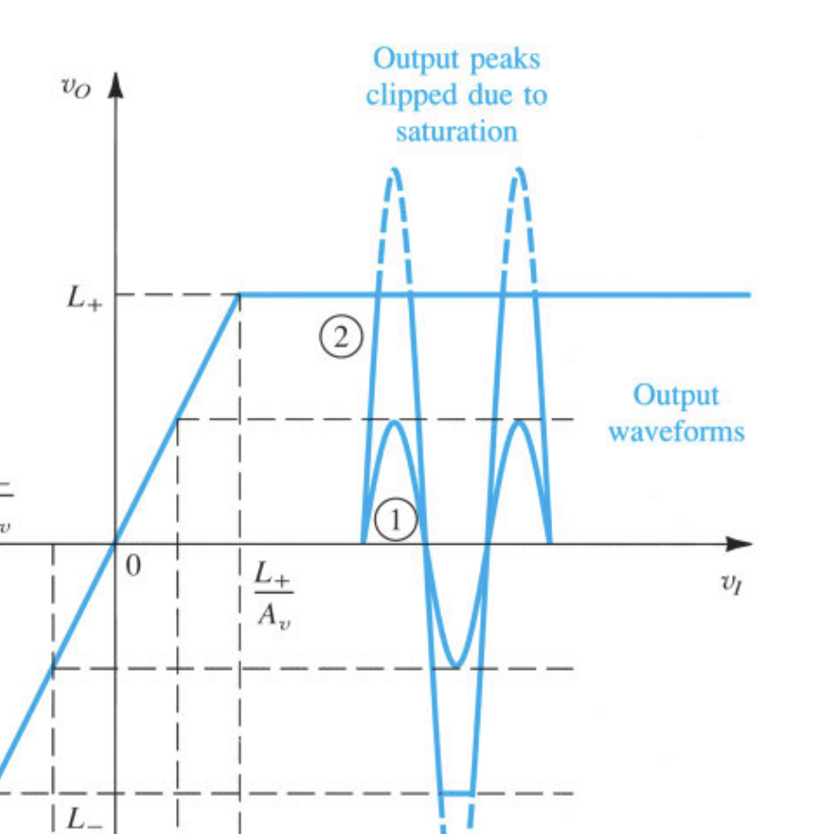

- 如图中，直线在途中说明的就是 Amplifier 的数学规律，即 Input 和 Output 的关系
- 其在输入到达一定大小的时候会不再变化
- 而 Wave 则是 Signal 随 Time 的变化情况，说明了真实信号在时间上运行的时候的行为，即 Clipping
- 而为了避免波形被 Clipping 削波，输入电压必须限制在一定范围内：

$$
\frac{L_-}{A_v} \le v_I \le \frac{L_+}{A_v}
$$

- 这里 \\(A_v\\) 是放大器 voltage gain 电压增益
- 意思是：输入信号幅度必须在这个范围，输出才不会超出线性区

### 1.4.8 Symbol Convention

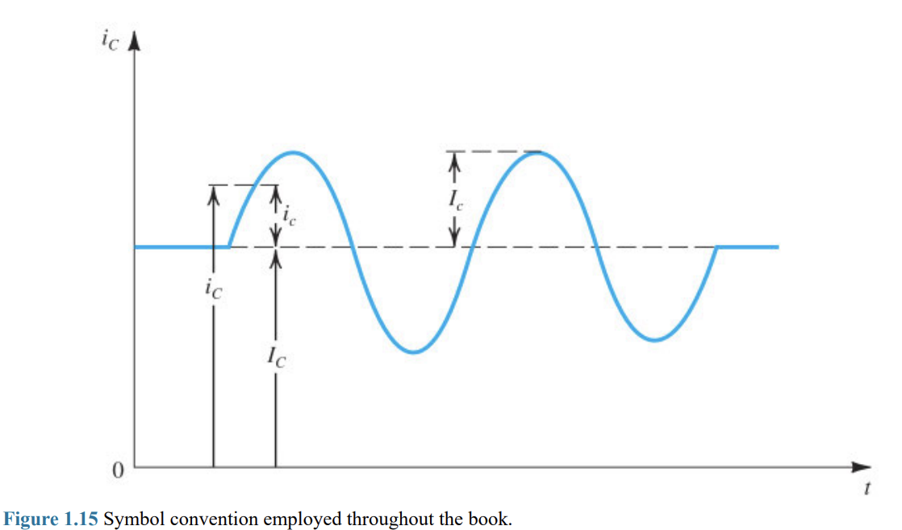

- 电流 \\(i_C(t)\\) = total instantaneous current 总瞬时电流
- 它由两部分组成：
    - DC component 直流分量）： \\(I_C\\)，是一个恒定值
    - Signal component 信号分量）： \\(i_c(t)\\)，随时间变化，一般是正弦波
- 数学式：
    
    $$
    i_C(t) = I_C + i_c(t)
    $$
    
- 如果 \\(i_c(t)\\) 是正弦波则有
    
    $$
    i_c(t) = I_c \sin \omega t
    $$
    

## 1.5 Circuit Models for Amplifiers

- 在电路设计里，amplifier 的内部结构可能很复杂，比如有的只用一个 transistor 晶体管，有的要几十个器件
- 但是我们在系统中使用放大器时，不需要关心它的内部细节，只需要关心它的 Terminal Behavior，也就是输入端和输出端是怎样的

### 1.5.1 Voltage Amplifiers

- 一个 Voltage Amplifiers 如下图

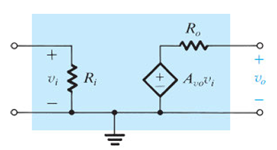

#### Voltage-Controlled Voltage Source

- 首先定义一个 Voltage-Controlled Voltage Source 电压控制电压源的 Gain Factor 增益因子为 \\(A_{vo}\\)
- 这是一个理想化的模型，意思是输出电压完全由输入电压决定
- 在这里，它的关系是

$$
v_{out} = A_{vo} \cdot v_{in}
$$

- 其中 \\(A_{vo}\\) 就是增益系数（gain factor 增益系数）
- 可以理解为：这个“源”相当于一个“自动倍增器”，把输入电压放大 \\(A_{vo}\\)  倍

#### Voltage Source

- 在介绍任何的 Circuit Element 之前，先来介绍一下 Voltage Source
- 一个 Source 并不是 Ideal 的，即其自身也存在一个 内部的 Resistor

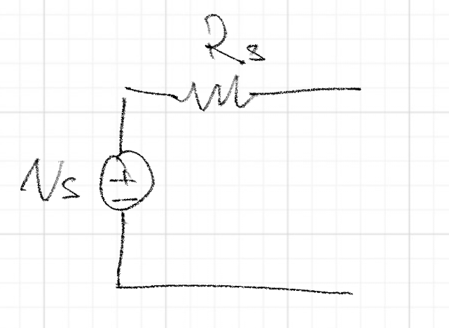

- 于是这里就出现了第一个 Resistor \\(R_S\\)

#### Input Resistance

- 当 Signal Source 把 Voltage 送入 Amplifier 时，放大器输入会端口“呈现出来”一个 Resistor
- 而将这个等效的 Resistor 称为 Input Resistance，其大小即为 \\(R_i\\)
- 到目前为止，已经理通了从 Voltage Source 到 Amplifier 的完整线路，实际的 Input Circuit 如下

$$
v_s⟶R_s⟶R_i⟶Amplifier
$$

- 由于整个 Circuit 是一个 Series 的链接，所以 Amplifier 得到的 Voltage 将会被分压，即 \\(R_s\\) 和 \\(R_i\\) 构成了一个 Voltage Divider 分压器
- 其实际得到的 Voltage 为

$$
 v_i=v_s⋅\frac{R_i}{R_s+R_i}
$$

- 现在来分析一下 \\(R_i\\) 和 \\(R_s\\) 的数值对整体 Amplifier 的影响
- 当 \\(R_i \gg R_s\\)（输入电阻非常大）

$$
v_i \approx v_s \cdot \frac{R_i}{R_i} = v_s
$$

- 输入电压几乎等于信号源电压，几乎没有损失
- 信号源几乎不用提供电流（因为电流 \\(I = v_s / (R_s + R_i)\\)，而分母很大）
- 这是理想情况
- 当 \\(R_i \ll R_s\\)（输入电阻很小）

$$
v_i \approx v_s \cdot \frac{R_i}{R_s} \ll v_s
$$

- 输入电压会被大大削弱。
- 电流 \\(I \approx v_s / R_s\\)，信号源要提供很大的电流
- 结果：放大器“吃掉”了信号源的电压，损失严重
- 所以，好的电压放大器希望 **Input Resistance** **尽可能大**

#### Output Resistance

- Amplifier 本身并不是一个 Ideal 的 Dependent Voltage Source，他也有内部的 Resistance，就是  \\(R_o\\)
- 当 Amplifier 的 Output 想要驱动最终的 Load 的时候，它和 \\(R_L\\)  形成分压

$$
v_o = A_{vo} v_i \cdot \frac{R_L}{R_L + R_o}
$$

- 同理，如果 \\(R_o\\) 较大，输出电压就会被“吃掉”一部分
- 如果 \\(R_o\\) 越小，输出电压就越接近理想值 \\(A_{vo} v_i\\)
- 所以，好的电压放大器希望 **输出电阻尽可能小**

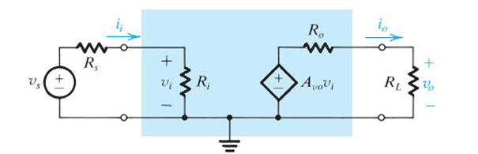

- 再加上 Source 和 Load，整个 Circuit 就完成了
- 接下来将两个 Voltage Divider 乘在一起就得到了完整的 Overall Voltage Gain

$$
\frac{v_o}{v_s} = A_{vo} \cdot \frac{R_i}{R_i + R_s} \cdot \frac{R_L}{R_L + R_o}
$$

### 1.5.2 Cascaded Amplifiers

- 可以同时添加多个 Amplifiers ，计算他们的区别就是多了几个 Voltage Divider

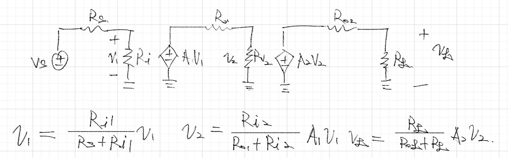

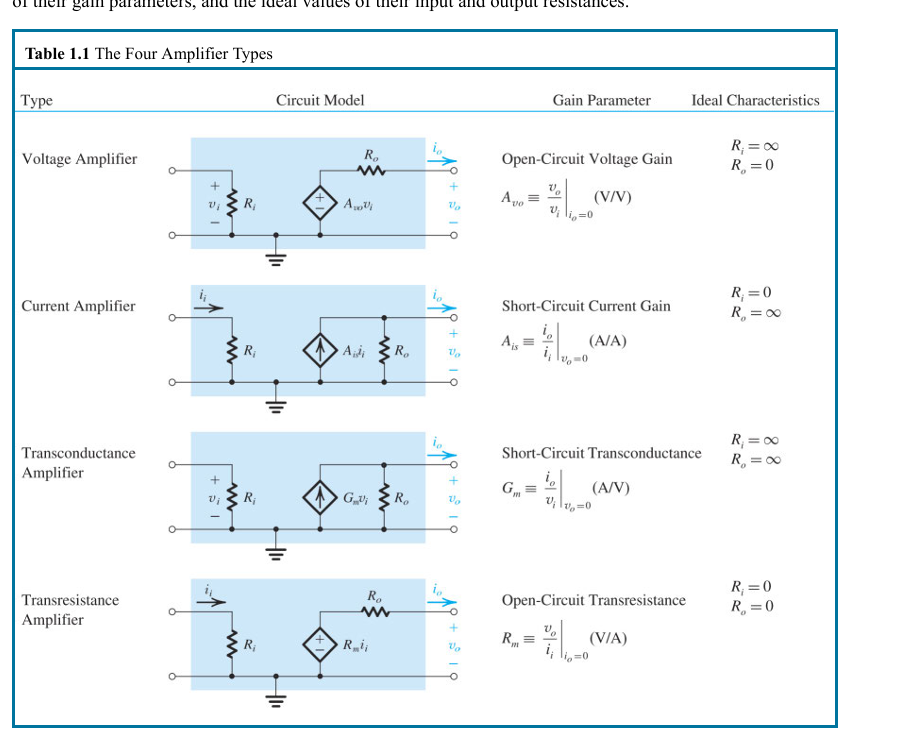