> Last Edit: 10/7/25

## 2.1 The Ideal Op Amp
### 2.1.1 The Op-Amp Terminal

- 在 IE1 中提到过 Amplifier，这里将要介绍一个更加具体的 Amplifier 叫做 Operational AMP
- 其最大的差别就是接受了两个 Signal 的进入

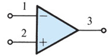

- 一共有三条线，1 代表了 Inverting Input，2 代表了 Noninverting Input
- 而 3 则是输出 Output
- 为了让 Op AMP 工作，需要接入两个 DC Power Supply

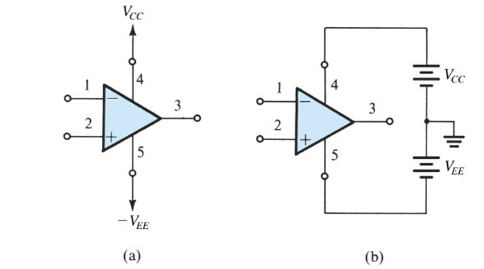

- Op AMP 的特点是，其是一个 Semi-custom Design，即它是以一个部分完成的通用放大模块
- 可以根据需要来定制它的功能，比如：反向放大，积分器，比较器等
- 其最基本的功能就是 Amplifies the Difference in the two inputs，有数学表达式

$$
V_o=A(V_2−V_1)
$$

- 同时，他还有良好的 Resistance 设计
- **Has high input resistance（高输入电阻 \\(R_{\text{in}}\\)）**
    - 这样不会“吃掉”前级电路的信号，利于级联连接
- **Has low output resistance（低输出电阻 \\(R_o\\)）**
    - 能驱动后续电路而不失真

> 具体原因后面会进一步说明
> 

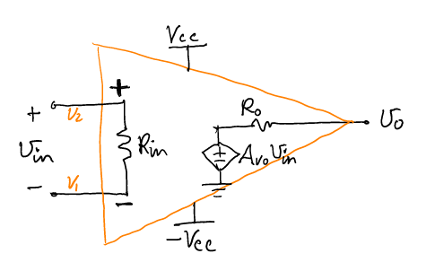

- 目前的情况下，三个 Signal（两个 Input 和一个 Output）是独立的
- 这种情况下由于 \\(A_{v0}\\) 是一个非常大的值，来到了 \\(10e5\\) 的级别
- 在 V1 和 V2 的数值有一点点细小的变化的时候，Output 会马上来到 Saturation 饱和阶段
- 所以在没有 Feedback 之前，这个 Op AMP 只适合做一个 Comparator 比较器

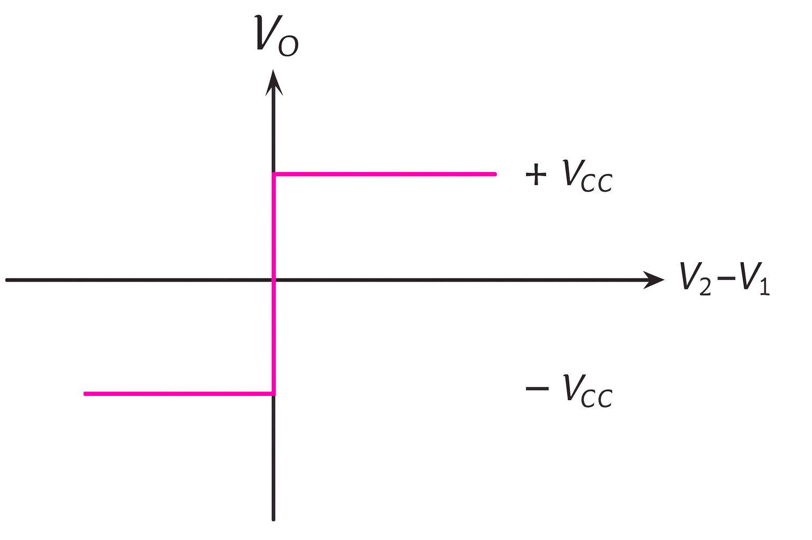

### Ideal v.s. Discrete

| 参数 | Ideal Op Amp（理想运放） | Discrete OpAmp 741（分立型） | Modern Integrated（现代集成） |
| --- | --- | --- | --- |
| \\(A_{v0}\\) | ∞ | 10510^5 | 50 ~ 100 |
| \\(R_{in}\\) | ∞ | 数兆欧（several MΩ） | 数兆欧 |
| \\(R_o\\) | 0 | < 100Ω | 几欧（several Ω） |
| BW（带宽） | ∞ | 1.5 MHz | 几 GHz |
| 功耗 Power | 0 | 80 mW | 5–10 mW |
| 成本 Cost | 0 | <\\(1 | \\)10^{-5}$ |

## 2.2 The Inverting Configuration

- 如果我们希望用运放构建具有精确可控增益的放大器，我们需要把它连接成 negative feedback 结构
- 其中，两个 Input 的 Signal 并不需要改变，只不过在 Output 前，输出 \\(v_o\\) 通过一个反馈路径回到反相端，形成 Negative Feedback

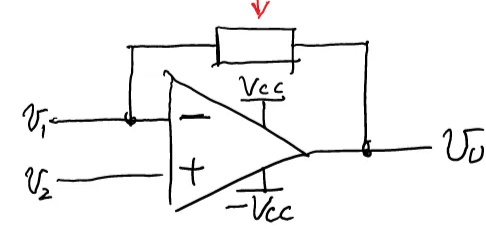

- 其输出公式仍是：

$$
v_o = A_{v0} (v_2 - v_1)
$$

- 本质上来说，由于 \\(A_{vo}\\) 是一个常数，所以希望控制 v1 和 v2 之间的差值尽可能小是设计 Negative Feedback 的诉求
- 只要差值足够小它就可以在 Linear Range 中运行

### Virtual Short

- 前面提到了 \\(v_2 \approx v_1\\)，这边就直接认为它们的 Voltage 是一样的，尽管两个 Node 之间并没有真正的一根连接线，但由于 Voltage 几乎一样，于是就叫他 Virtual Short

### Op AMP Configuration

- Op amps with negative feedback 带有负反馈的运放电路，共同满足两个重要前提条件：
1. **输入电流为 0**：\\(i_+ = i_- = 0\\)（因为输入阻抗趋近于无穷）
2. **输入端电压相等**：\\(v_+ \approx v_-\\)（因为虚短）

### 1. **Non-inverting Op Amp（同相放大器）**

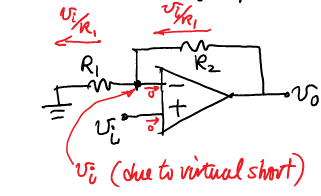

- 输入电压 \\(v_i\\) 接在 **+ 端**，所以这个 Op AMP 是一个 Noninverting input
- 负反馈电阻 \\(R_1\\) 和 \\(R_2\\) 组成一个分压器，从输出 \\(v_o\\) 接回 **– 端**

> Op AMP 负端的 Voltage 是来自 Output 的，因为它左边是 Ground，其 Voltage 是两个 In Series 的 Resistors 的分压的结果
> 
- 根据 Virtual Short，\\(v_- = v_+ = v_i\\)
- 输出电压 \\(v_o\\) 会分压成 \\(v_i\\)，也就是说：

$$
v_i = v_o \cdot \frac{R_1}{R_1 + R_2}\Rightarrow v_o = v_i \left(1 + \frac{R_2}{R_1}\right)\Rightarrow \text{Voltage gain} = \frac{v_o}{v_i} = 1 + \frac{R_2}{R_1}
$$

### 2. **Inverting Op Amp（反相放大器）**

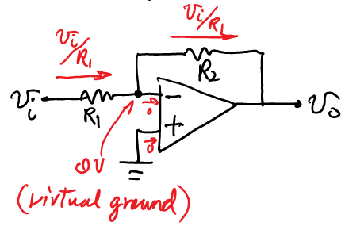

- 在这个例子下，Signal \\(v_i\\) 从负端进入，即是一个 Inverting
- 输入 \\(v_i\\) 接到 **– 端**，通过电阻 R1
- 正端接地（即 \\(v_+ = 0\\)）
- 输出端 \\(v_o\\) 通过 R2 接回 – 端，形成负反馈
- 由于正端接了地，所以 \\(v_+ = 0\\)，所以 \\(v_- \approx 0\\)
- 计算负端左边的 KCL

$$
\frac{v_i}{R_1} = \frac{-v_o}{R_2}\Rightarrow v_o = -\frac{R_2}{R_1} v_i\Rightarrow \text{Voltage gain} = \frac{v_o}{v_i} = -\frac{R_2}{R_1}
$$

### 3. **Unit-gain Buffer（电压跟随器）**

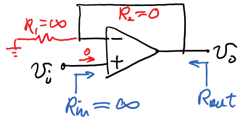

- 输入 \\(v_i\\) 接在 + 端
- 输出端直接连接到 – 端（无电阻）
- 它的特性就是 \\(R1 → ∞，R2 = 0\\)
- 是 “Non-Inverting” 的一个特例

$$
\frac{v_o}{v_i} = 1 + \frac{R_2}{R_1} = 1 + \frac{0}{\infty} = 1\Rightarrow v_o = v_i
$$

#### Buffer

- 在一般的 Input Output Circuit 中，Signal 一般都不是 Ideal 的，即其存在一个不可忽视的内阻 \\(R_{sig}\\)，如果这时候想要输出，整体就会被分压为

$$
{\text{out}} = V_{\text{sig}} \cdot \frac{R_L}{R_{\text{sig}} + R_L}
$$

- 如果 \\(R_L\\) 很小，输出电压就会比原来的 \\(V_{\text{sig}}\\) 小很多，从而无法实现型号的稳定输出
- 这叫做 Attenuation 信号衰减
- 想要解决这个问题，就可以通过一个 Buffer，让 Voltage 结构变成 \\(Vsig → Buffer → RL\\)
- 而这个 Buffer 应该有的特性为

| 作用 | 表现 |
| --- | --- |
| **不吃输入信号** | 输入阻抗极大 \\(R_{\text{in}} = \infty\\) |
| **能推得动输出** | 输出阻抗极小 \\(R_{\text{out}} \approx 0\\) |
- 左边 \\(V_{\text{sig}}\\) 不会被拉低的同时右边负载 \\(R_L\\) 也不会拉低输出
- 整体结构就来到了这样

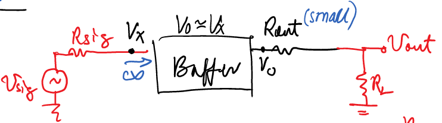

- 有 \\(V_{\text{out}} \approx V_o \approx V_{\text{sig}}\\)
- 具体原理如下，由于 Buffer 有一个很大的 \\(R_{in}\\)，所以有

$$
V_x = V_{\text{sig}} \cdot \frac{\infty}{R_{\text{sig}} + \infty} = V_{\text{sig}}
$$

- 而到了输出的时候，又给出了一个非常小的 \\(R_{out}\\)，即

$$
V_{\text{out}} = V_o \cdot \frac{R_L}{R_{\text{out}} + R_L} \approx V_o
$$

- 在这用情况下，Input 的 Signal 就几乎等同于 Output 的了

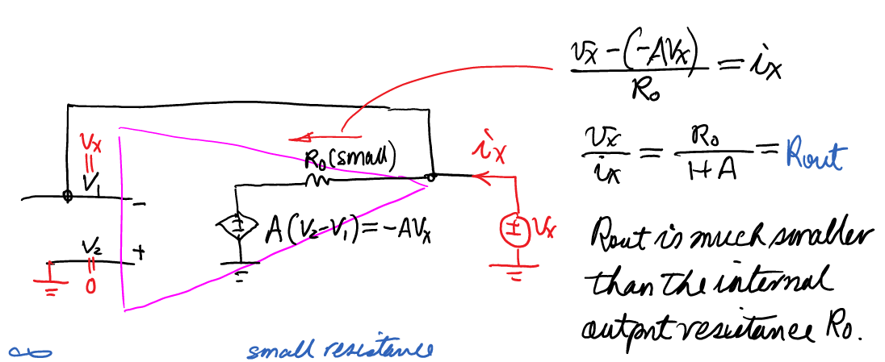

> 不知道这张图在干什么
> 

### Review of Impedance

- 在开始接下来的部分前，有必要复习一下 Impedance 和 Resistor 的区别

#### Resistor 电阻

- **符号**：R
- **性质**：只跟材料、几何尺寸有关，不随频率变化

#### Impedance 阻抗

- **符号**：Z
- **性质**：是对 交流电（AC） 的综合“阻碍”程度。
- 包含了 Resistance 和 电抗（X） 两部分：
    
    $$
    Z = R + jX
    $$
    
    - R：电阻部分，消耗能量
    - X：电抗部分，来自电容（C）或电感（L），只储能不耗能
- 单位：同样是欧姆（\\(\Omega\\)）

| 对象 | 符号 | 是否随频率变 | 组成 | 单位 |
| --- | --- | --- | --- | --- |
| **Resistor 电阻** | R | 不变 | 纯电阻 | 欧姆 |
| **Impedance 阻抗** | Z | 会变 | 电阻 + 电抗 | 欧姆 |
- 到这一步，可以总结出

<aside>
💡

- Resistor 就是 Impedance 的 Real Part
- 当只存在 DC Signal 的时候，就 Impedance 就以 Resistor 的形式出现
</aside>

- 接下去就是具体研究 X Reactance 电抗
- Reactance 来自 Inductor（电感）和 Capacitor（电容）

#### Capacitor 电容

- Capacitor 只会存储 Electric Field 能量，不消耗：

$$
Z_C = \frac{1}{j\omega C}
$$

- 高频时阻抗小（容易导通）
- 低频/直流时阻抗大（几乎断路）

#### Inductor 电感

- 电感只会存储 Magnetic Field 能量，不消耗：

$$
Z_L = j\omega L
$$

- 总结来说

<aside>
💡

Resistor, Inductor, Capacitor 都能看作是阻抗：\\(Z = R + jX\\)

- **Resistor R** → 实数部分（能量损耗）
- **L/C** → 虚数部分 jX（能量存储、相位变化）
</aside>

---

### 4. General Inverting Op amp Circuit

- 现在，在回顾完了 Impedance（阻抗）了之后，就可以进入 AC Signal 的领域

<aside>
💡

已知前面的 Resistor 是 Impedance 的特殊形式，即只有 Real Part 的情况，现在引入完整的 Impedance 作为控制系统，有公式 \\(Z = R + jX\\)

</aside>

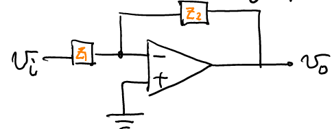

- 于是就可以得到这样的一个 Circuit，其和之前的 Op amp 分析起来并没有区别
- 可以很容易的看出这是一个 Inverting AMP，其 Gian 为

$$
\frac{v_o}{v_i} = -\frac{Z_2}{Z_1}
$$

<aside>
💡

现在将 Capacitor 和 Inductor 等能形成 Reactance 的原件引入，就可以得到更加复杂的 Op amp

</aside>

#### Miller Integrator（米勒积分器）

- 在 \\(z_2\\) 的槽中放入，Capacitor \\(C_1\\)，保持 Input Resistance 不变为 \\(R_1\\)
- 已知 Capacitor 的 Reactance（Imaginary Part of Impedance）为

$$
Z_2 = \frac{1}{C s}, \quad s = j\omega
$$

- 可以得到整体 Op amp 的 Gain 为
    
    $$
    \frac{v_o}{v_i} = -\frac{1}{R_1 C_1 j\omega}
    $$
    
- 这说明它在频域中表现为一个 Integrator（积分器）

> 具体原因和 s 和 Laplace Transform 有关，这边不做提及
> 

<aside>
💡

于是可以总结出：越低频，增益越高；频率越高，增益越低

</aside>

---

### Time Domain & Frequency Domain

- 在进入下一步前，先复习一下 Time Domain 时域，和 Frequency Domain 频域
- **Time domain** = 信号随着时间 t 的变化
- 横轴是 时间，纵轴是 信号的幅度（电压、电流等）
- 它回答的问题是：**在每个时刻，信号值是多少？**

---

- **Frequency domain（频域）**：横轴是 **频率**，纵轴是 **信号在各频率上的强度**
- 它回答的问题是：**信号里包含哪些频率成分？**
- 例如：一个方波在时域看起来是方形；但在频域，它包含很多正弦波成分

---

- 现在就可以开始分析 Miller Integrator 在 Time Domain 下的表现了
- 假设目前先只给了一个 DC 的 \\(v_{i}\\)（方便展示 Integrate 的效果）

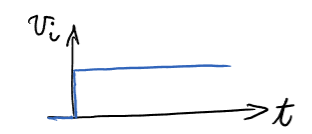

- 可以同步得到 Input Current 为 \\(i = v_i / R_1\\)
- 之后，这个突然出现的冲击 Current 将碰到 Capacitor，最后 \\(v_o\\)  变化的斜率将由 C 决定

$$
i = \frac{v_i}{R_1} = C \frac{dv_c}{dt} = C \frac{d(-v_o)}{dt}
$$

- 想要算出 \\(v_o\\)，已知 \\(\frac{v_i}{R_1} = C \frac{d(-v_o)}{dt}\\)，将其改写为

$$
\frac{dv_o}{dt} = -\frac{1}{R_1 C} v_i
$$

- 两边同时积分，即可以得到

$$
v_o = -\frac{1}{R_1 C} \int v_i \, dt
$$

- 前面，为了方便展示的清晰，将 \\(v_i\\) 设定为了 Constant，于是有

$$
v_o = -\frac{V_i}{R_1 C} t
$$

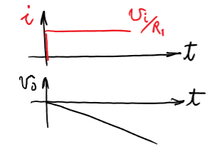

- 于是最终 Time Domain 就长这样

#### Differentiator

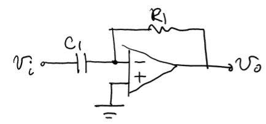

- 将 Integrator 的 C 的位置换一下就是 Differentiator 了
- 能看出这是一个 Inverting Gain，大小为

$$
\frac{v_o}{v_i} = -\frac{Z_2}{Z_1}=\frac{v_o}{v_i} = -\frac{R_1}{1/(C_1 s)} = -R_1 C_1 s
$$

- 在 Frequency Domain 中为

$$
\frac{v_o}{v_i} = -j \omega R_1 C_1
$$

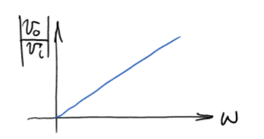

<aside>
💡

增益随频率线性增加

</aside>

- Time Domain 中

$$
v_o(t) = -R_1 C_1 \frac{dv_i(t)}{dt}
$$

#### Summing Circuit

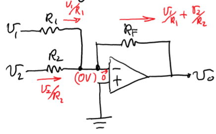

- Summing Circuit 中，两个输入电压：\\(v_1, v_2\\)，分别通过电阻 \\(R_1, R_2\\) 接到运放反相端
- 运放的反馈电阻是 \\(R_F\\)，所以这是一个 Inverting Op amp
- 进入 \\(R_F\\) 的 Current 为两个支路的 Current Sum，为

$$
i=\frac{v_1}{R_1} + \frac{v_2}{R_2}
$$

- 通过 KCL 可以得到：

$$
v_o = - R_F \left( \frac{v_1}{R_1} + \frac{v_2}{R_2} \right)
$$

- 拆一个括号就可以发现

$$
v_o = -\left( \frac{R_F}{R_1} v_1 + \frac{R_F}{R_2} v_2 \right)
$$

<aside>
💡

所以这个电路是一个 **weighted summing circuit（加权求和电路 ）**

</aside>

- 输出电压 = 各输入电压 × 权重，再求和
- Summing Circuit 的一个很好的例子就是 Mixer（混音器），其把吉他 (guitar) 和键盘 (keyboard) 信号加在一起，这就是一个实际的 **summing circuit（加法电路）** 的应用

#### Difference Amplifier

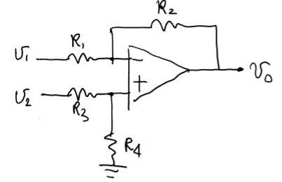

- 同样有两个 Input，不过两个接入的位置为一正一负
- 分析两个端口电压，对于 \\(v_+\\) 端来说，其电压为

$$
V^+ = \frac{R_4}{R_3 + R_4} v_2
$$

- 根据 Virtual Short 就可以得到 \\(v_-\\) 端的电压也为同样的 \\(v_+\\)，于是可以得到负端的 Current 为

$$
i_1 = \frac{V^+ - v_1}{R_1}
$$

- 根据 Node  V 可以写出 KVL方程，得到输出电压为
    
    $$
    v_o = V^+ + i_1 R_2
    $$
    
- 将两个值带入，有

$$
v_o = \frac{R_4}{R_3 + R_4} v_2 + \frac{R_4}{R_3+R_4} \cdot \frac{R_2}{R_1}(v_2 - v_1)
$$

- 化简之后可以得

$$
v_o = \frac{R_2}{R_1}\left(\frac{R_4}{R_3+R_4}(1+\frac{R_1}{R_2}) v_2 - v_1 \right)
$$

- 在上式中，如果满足电阻匹配条件：

$$
\frac{R_4}{R_3} = \frac{R_2}{R_1}
$$

- 那么公式大大简化为
    
    $$
    v_o = \frac{R_2}{R_1}(v_2 - v_1)
    $$
    
- 想要分析 Difference Op amp 还能通过 Superposition 的办法，分别分析两个 Input Voltage

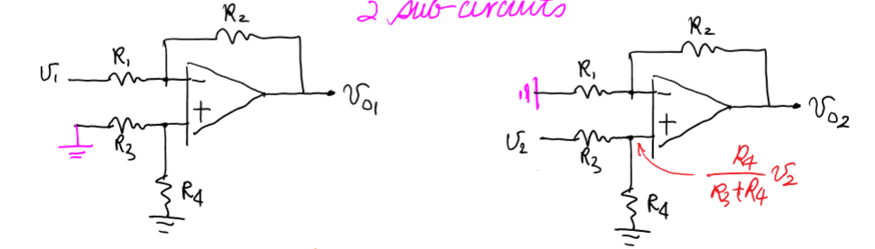

- 可以看出，左边的就是一个 Typical Inverting Op amp
- 而右边的则是一个 Typical Noninverting Op amp，不过它的 Input Voltage 有一点不同，是 \\(\frac{R_4}{R_3+R_4}v_2\\)，是一个被分压后的值
- 之后更具 Superposition 的原理，将他们相加就可以得到

$$
v_o = \left(1 + \frac{R_2}{R_1}\right)\frac{R_4}{R_3+R_4} v_2 - \frac{R_2}{R_1} v_1
$$

- 和上面的结论一样，当满足

$$
\frac{R_4}{R_3} = \frac{R_2}{R_1}
$$

- 的时候，那么表达式化简为：

$$
v_o = \frac{R_2}{R_1}(v_2 - v_1)
$$

### Input Resistance Bin

- 总结了一下常见电路类型和输入电阻 \\(R_{in}\\)

| 电路类型 (Circuit Type) | 输入电阻公式 (Input Resistance R_{in}) | 原因 (Reason) |
| --- | --- | --- |
| **反相运放 (Inverting Op Amp)** | \\(R_{in} = R_1\\) | 输入电压先经过电阻 \\(R_1\\)，再到虚短点 |
| **同相运放 (Non-inverting Op Amp)** | \\(R_{in} = \infty\\) | 输入端直接接到 + 端，理想运放输入电流≈0 |
| **分压输入 (Voltage Divider Input)** | \\(R_{in} = R_3 + R_4\\) | 输入电压先通过 \\(R_3, R_4\\) 串联分压 |
| **差分放大器 (Difference Amplifier)** | \\(R_{in} = R_1 + R_3\\) | 两个电阻 \\(R_1, R_3\\) 串联到虚短点 |

### **Cascading Op amp circuit**

- 当存在多个 Op amp 串联的情况的时候，将他们的 Gain 乘上就是 Overall Gain

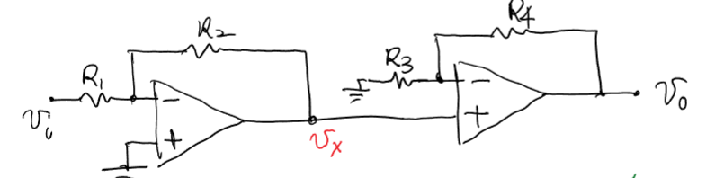

### **Instrumentation Amplifier (an improved difference amplifier)**

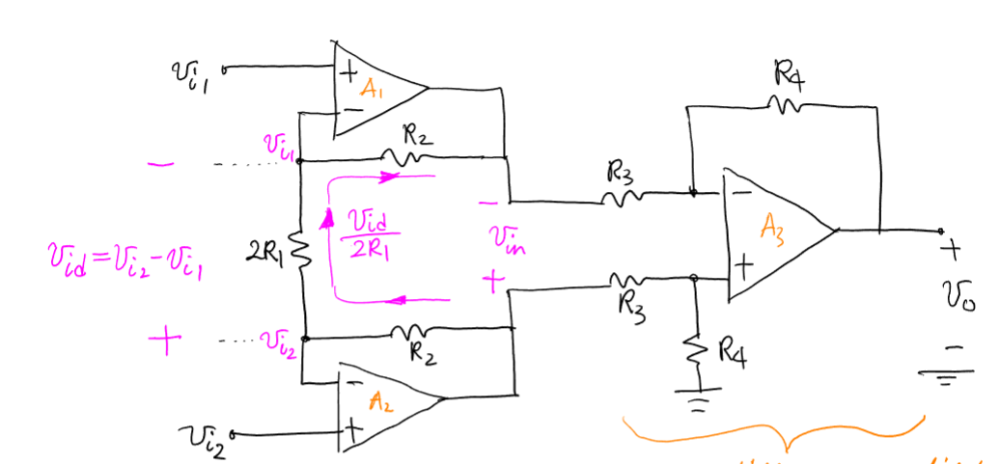

- **Instrumentation Amplifier（仪表放大器）**，它是一种 I**mproved difference amplifier 改进型差分放大器**
- 其由三个 Op amp 组成，前面有两个 Noninverting 的作为输入
- \\(A_3\\)：后面是一个 Difference amp
- 先从输出部分开始，一开始的两个 Noninverting amp 由于各自的 Virtual Short，有两个 Node 具有不同的 Voltage
- 他们的差值则为 \\(v_{id} = v_{i2} - v_{i1}\\)
- 在经过整个电路后得出等效的 Input Voltage 为

$$
v_{in} = \frac{v_{id}}{2R_1}(2R_1 + 2R_2) = v_{id}\left(1 + \frac{R_2}{R_1}\right)
$$

- 之后这个 Input Voltage 来到了 Difference amp 的位置，有 Gian 为

$$
v_o = \frac{R_4}{R_3} v_{in}
$$

- 根据上面 Cascading Op amp 的结论，把前后两级结合得

$$
v_o = \frac{R_4}{R_3} \left(1 + \frac{R_2}{R_1}\right) v_{id}
$$

<aside>
💡

仪表放大器 = 差分放大器的改进版，输入电阻更高，增益可调，抗干扰能力更强，适合用在传感器信号测量（比如心电图 ECG、压力传感器）

</aside>

## DC Imperfections

- 显示世界中，**DC imperfection** 的原因主要来自于实际制造过程中器件的不完美和不对称性
- 这一问题会造成包括  DC offsets, Input Bias Currents 等问题

### DC offsets

- 源于制造过程中的不对称性

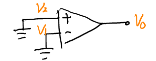

- 已知一个标准 OP amp 在当 \\(V_2=V_1\\)  的时候，输出 \\(V_0  = 0\\)，但是现实中的 Op amp 更像是加上了一个 Input Offset Voltage

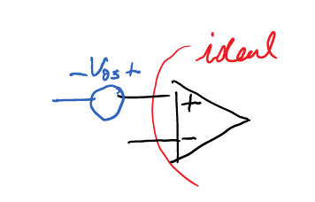

- 于是他就导致了 Output \\(V_o\\)  和 \\(V_2-V_1\\)  之间产生了 Bias，不再是 Linear 的了

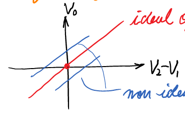

### Effect of  \\(V_{OS}\\)  on Amplifier

- 这个 V offset 也同理可以作用到 Non-Inverting（正极）和 Inverting（负极）上

#### Non-Inverting conf.

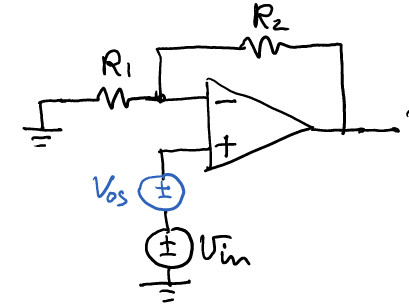

- 对于 Non-Inverting 来说，\\(V_{OS}\\)  就是一个和 \\(V_{in}\\) 被加在一块的 Input
- 所以整体这个 Op amp 产生的 output 将是

$$
V_{out} = \left(1 + \frac{R_2}{R_1}\right)(V_{in} + V_{OS})
$$

- 可以发现 **\\(V_{OS}\\)** 被 和输入信号 \\(V_{in}\\) 一样的比例放大了
- 所以即使 \\(V_{in}\\) 为 0，仍会产生一个 Biased 项，这也就是上图中的类似一次函数产生的原因

#### **Inverting conf.**

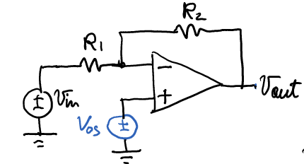

- 这次，\\(V_{in}\\) 来到了 Negative 端，而 Virtual Short 只会发生在离 Positive 端最近的旁边一个点上
- 这就导致一个 Extra Voltage 在 Positive 端的进入，可以通过 Superposition 来分析，有

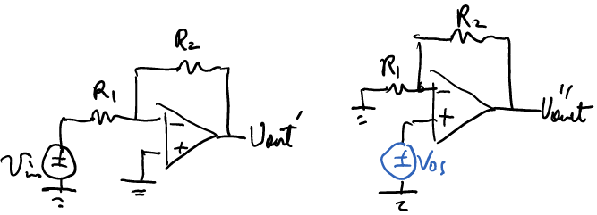

- Superposition 将 Inverting Conf. 分为了一个 Non-Inverting + 一个 Inverting 的 Conf.
- 左图中 \\(V_{out}' = -\frac{R_2}{R_1} V_{in}\\)，右图中 \\(V_{out}'' = \left(1 + \frac{R_2}{R_1}\right) V_{OS}\\)
- 于是 Overall 的 Amplification 就变成了

$$
V_{out} = V_{out}' + V_{out}'' = -\frac{R_2}{R_1} V_{in} + \left(1 + \frac{R_2}{R_1} \right) V_{OS}
$$

### Use Capacitor to Remedy the offset

- 通过在 \\(R_{in}\\) 和 \\(v_{in}\\) 中串联一个 Capacitor

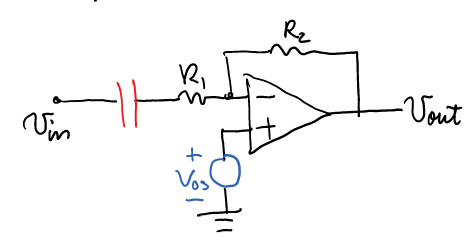

- 这个 Capacitor 会阻断直流，即不能让偏移电压直接传到电路中
- 所以虽然有 \\(V_{OS}\\)，但它不会完全被放大到输出端
- 来分析一下这个 Capacitor 具体会干什么，先将 \\(V_{in}\\) 设为 0，单独拿出 \\(V_{OS}\\) 分析

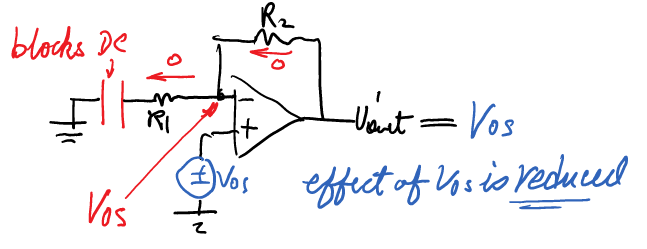

- 在只有 \\(V_{OS}\\) 的情况下，Virtual Short 导致了 Negative 端电压也是 \\(V_{OS}\\)
- 但是由于 \\(V_{OS}\\) 是一个 Dircet Current，它无法进入 Capcitor

> Capacitor 的特性 \\(i_C = C\cdot \frac{dV}{dt}\\)，只有 Voltage Change 的时候才会有 Current
> 

<aside>
💡

这就避免了 \\(V_{OS}\\) 被叠加在 \\(V_{in}\\) 的上面

</aside>

- 要具体分析什么叫做叠加在 \\(V_{in}\\) 上，就需要回顾之前没有 Capacitor 时候的情况，在那个 Circuit 中，\\(V_{OS}\\) 要么是先和 \\(V_{in}\\) 做加法，再乘上放大倍率 \\(\left(1 + \frac{R_2}{R_1}\right)(V_{in} + V_{OS})\\)，要么是 \\(\frac{R_2}{R_1} V_{in} + \left(1 + \frac{R_2}{R_1} \right) V_{OS}\\) 先加上一个倍率再和 \\(V_{in}\\) 相加
- 这一个倍率的乘数就会令 \\(V_{OS}\\) 被放大，而有了 Capacitor 就可以避免这一现象

### Miller Integrator

- 当尝试分析之前的 Miller Integrator 时

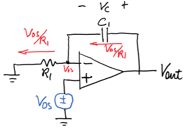

- 并没有考虑到可能出现的 DC Imperfection 可能造成的影响
- 而实际上，当多出了一个 \\(V_{OS}\\) 的情况下，会使得另一端出现 Imperfection，导致

$$
V_{\text{out}} = V_{\text{OS}} + \frac{1}{C_1} \int \frac{V_{\text{in}}}{R_1} dt
$$

- 哪怕 \\(V_{\text{OS}}\\) 很小，积分以后也会不断累积，使得 \\(V_{\text{out}}\\) 随时间线性上升，最后 saturate 到电源电压 rail 上，电路失效

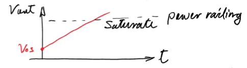

- 所以只靠理想电路设计，这个积分器不能长期稳定工作
- 所幸的是，存在修复的办法，也就是加一个电阻 \\(R_2\\) 并联在电容 \\(C_1\\) 上
- 直流电流（由 VOSV_{\text{OS}} 引起）原本无法通过电容流动，会导致积分输出发散；

> Capacitor 令 DC 无法经过，这导致在一端形成了一个永久的 Voltage Source，持续输出
> 
- 加了 \\(R_2\\) 以后，这个 DC 电流可以**改走 \\(R_2\\) 路径**，而不是一直积累在电容上

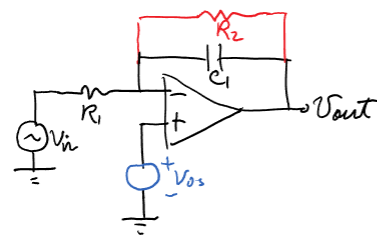

- 于是最终 \\(V_{\text{out}}\\) 会有一个有限的、稳定的直流偏移（offset），而不是无限上升；
- 在没有 \\(R_2\\) 的时候，Miller Integrator 的 Gain 为

$$
\frac{V_{\text{out}}}{V_{\text{in}}} = -\frac{1}{R_1 C_1 j\omega}
$$

- 这就是一个是一个 Ideal integrator 的 Gain
- 但是由于多了一个 DC Imperfection \\(\omega = 0\\)，可以观察 Gain 发现，在 \\(\omega\\)  为 0 的时候，Gain 直接 Diverge 了

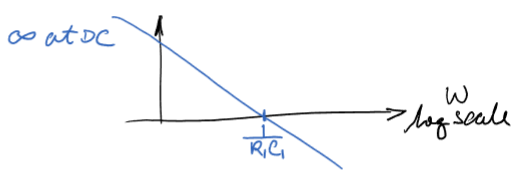

- 接下去分析有了 \\(R_2\\) 的情况，新的传递函数变成：

$$
\frac{V_{\text{out}}}{V_{\text{in}}} = -\frac{R_2 / R_1}{1 + R_2 C_1 j\omega}
$$

- Frequency Domain 也变成了

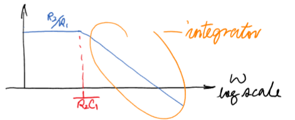

- 将 Gain Function 取模

$$
|H(j\omega)| = \frac{R_2 / R_1}{\sqrt{1 + (\omega R_2 C_1)^2}}
$$

- 当 \\(\omega \to 0\\) 的时候

$$
|H(j\omega)| \to \frac{R_2}{R_1}
$$

- 这个是常数，图上对应左边蓝色那段平的部分
- 当 \\(\omega \to \infty\\) 时，

$$
|H(j\omega)| \to \frac{R_2 / R_1}{\omega R_2 C_1} = \frac{1}{R_1 C_1 \omega}
$$

- 这是标准的积分器行为，幅度随着频率下降

### Time Domain

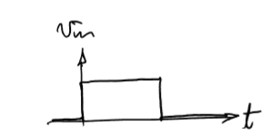

- 当一个最普通的方波输出 \\(V_{in}\\) 进入

#### Miller Integrator

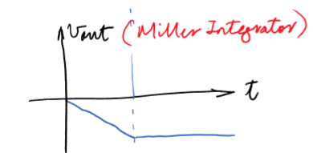

- **0 < t < T：**
    - 理想积分器，输出是对输入常数 \\(V_{in}\\) 的积分
    - 数学上是线性关系：
    
    $$
    V_{out}(t) = -\frac{1}{R_1 C_1} \int V_{in} \, dt = -\frac{V_{in}}{R_1 C_1} t
    $$
    
    - 所以曲线是线性下降的蓝色斜线
- **t > T：**
    - 输入为 0，积分器积分常数 0，输出就保持最后的值不变
    - 所以输出是一条水平线，表示“记住了”这个结果

#### Integrator with R2

- 0 < t < T（充电阶段）
    - 输入为常数，输出仍然积分：
    
    $$
    V_{out}(t) = -\frac{R_2}{R_1} V_{in} \left(1 - e^{-t / (R_2 C_1)}\right)
    $$
    
- 输出是一个**负向指数上升曲线**（因为乘了负号）
    - 随着时间推移，越来越接近极限值 \\(-\frac{R_2}{R_1} V_{in}\\)
- 图中蓝色实线写着 `charging cap.`（电容在充电）
- t > T（放电阶段）
    - 输入回到 0，输出开始衰减
    - 电容通过 R2R_2 放电，形成指数恢复：
    
    $$
    V_{out}(t) = V_{out}(T) \cdot e^{-(t - T)/R_2 C_1}
    $$
    

## Input Bias Current

- Input Bias Current 通常由 Op amp 内部的 BJT 晶体管引起
- 记为  \\(I_{B1}, I_{B2}\\)，分别是流入运放正负输入端的电流

- 他们的典型数值为
    - \\(I_{B1} \approx I_{B2} \approx 100 \, \text{nA}\\)
    - \\(I_{OS} = |I_{B2} - I_{B1}| \approx 10 \, \text{nA}\\)（**输入失调电流**）

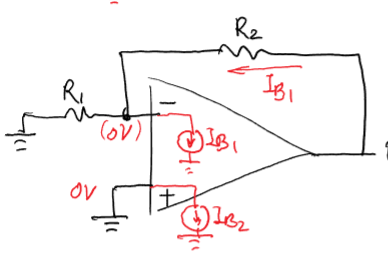

- 将两个 Input Voltage 都 Grounded（0V），但是由于有 \\(I_{B1}\\) 流过反馈电阻 \\(R_2\\)，导致输出电压不为 0
    
    $$
    V_{out} = R_2 \cdot I_{B1}
    $$
    

<aside>
💡

所以在 Bias Current 下，即使输入为 0，输出也会出现偏移（non-zero）

</aside>

- 这个东西同样也有解决方案，就是在 Positive Input 端 Parallel 一个 Resistor \\(R_1 \parallel R_2\\)

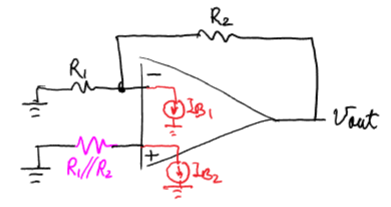

### Superposition

\\(I_{B1}\\)

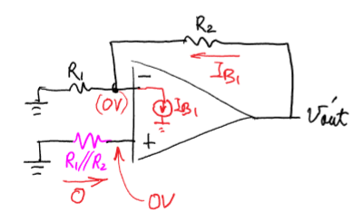

- 运放正输入端接地（0V）
- 输出产生：
    
    $$
    V_{out}' = R_2 \cdot I_{B1}
    $$
    

#### \\(I_{B2}\\)

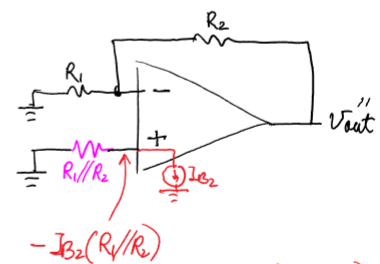

- 在正输入端加了一个等效电阻 \\(R_1 \parallel R_2\\)
- 这个电流通过该电阻向下流，并造成输出扰动：
    
    $$
    V_{out}'' = -I_{B2} \cdot (R_1 \parallel R_2) \cdot \left(1 + \frac{R_2}{R_1}\right)
    $$
    
- 最终经过代数整理得到：
    
    $$
    V_{out}'' = -R_2 \cdot I_{B2}
    $$
    
- 将他们叠加得到

$$
V_{out} = V_{out}' + V_{out}'' = R_2 (I_{B1} - I_{B2})
$$

- 如果 \\(I_{B1} \approx I_{B2}\\)，那 \\(V_{out} \approx 0\\)，偏置电流误差被“抵消”了

### Biased Current in Miller Integrator

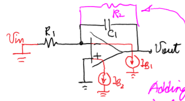

- 一标准的积分器结构：反馈路径是电容 \\(C_1\\)，但现在多了 \\(I_{B1}, I_{B2}\\)
- 输入端接地，但 \\(I_{B1}\\) 没有其他去路，只能穿过电容 **\\(C_1\\)**
- DC 偏置电流 \\(I_{B1}\\) 经过电容 \\(C_1\\)，使得输出电压持续积分，最终导致**饱和**

> 加一个并联电阻 \\(R_2\\)（跟前面分析一致）
> 

## Large-Signal Limitations of Op-amp

The Op-amp has some Limitation under large signals, those are basically 

1. Saturation voltage and current
2. Slew Rate

### Output voltage saturation

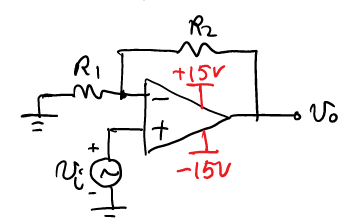

- The graph above is an example of Non-Inverting Amplifier
- As the Vcc are 15v, which means that the output voltage can’t be bigger than 15v in this case

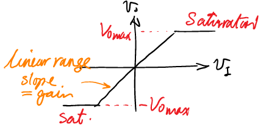

- And the part which is out of range will then be **Saturation**

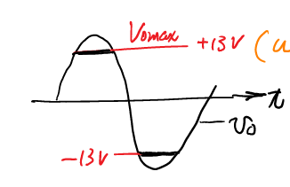

- By analyzing the waveform, we can find out that the part bigger than 13v (usually 1 or 2 v from railing) will be clipping

#### Ex. Output Saturation

We have a 1 v peak to peak sin function input, with \\(R_1=1k\\), \\(R_2 = 19k\\), aksing for the output 

---

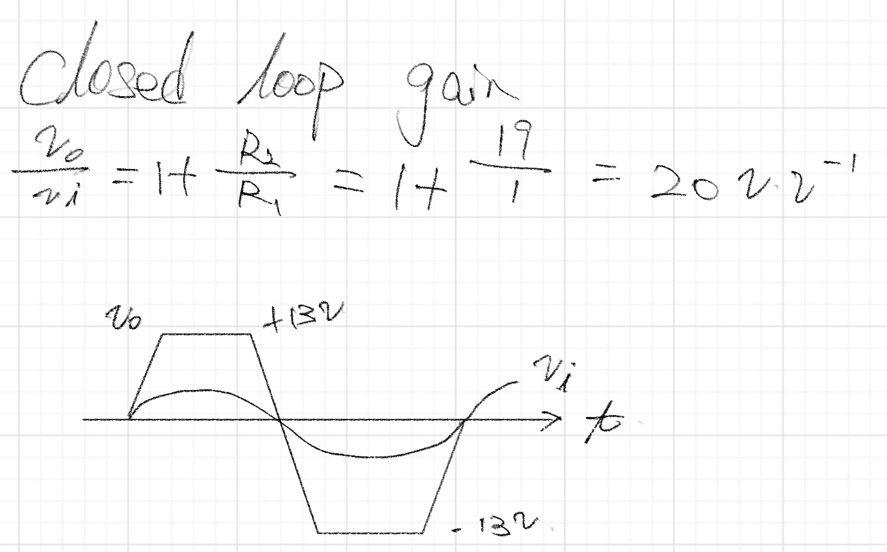

### Output Current Limit

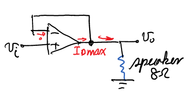

- Using this circuit, there’s a speaker load with \\(8\Omega\\), and the op-amp we are using is called the 741 Op-amp, its limited current output should be \\(20mA\\)
- Let’s assume that this buffer has \\(v_i = 1V\\), the ideal output should also be \\(v_o=1V\\)
- However there’s a speaker, so a Voltage Divider exist on the output end with \\(8\Omega\\)
- So the Current required for \\(v_o\\) to be 1V is then \\(125mA\\)

### Slew Rate

Slew Rate describe the rate of change of the output signal, its being defined as

$$
SR = \left( \frac{dV_o(t)}{dt} \right)_{max}
$$

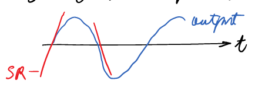

- This graph describe the highest amount of change the output can have, thus if the blue output waveform goes above the SR line, meaning its derivative exceed SR, then the waveform will distort
- The op-amp we mentioned above, which is 741, it has \\(SR = ±1V/μs = ±10^6 V/s\\)

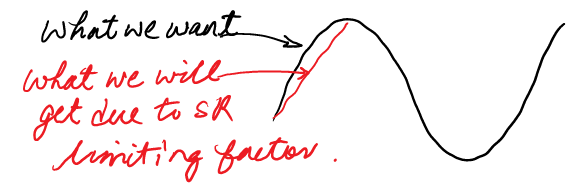

- Thus in the graph above, the black signal is the one we want, but with the limit of SR, the signal will distort

#### Ex. Distortion in op amp

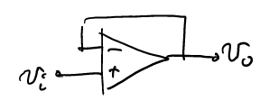

Giving a Buffer, with

$$
\omega_t = 2\pi \times 10^6 \text{ rad/s} \quad\text{(unity-gain frequency)}
$$

$$
SR = ±10^6 , \text{V/s}
$$

Find the largest step input, (\\(V_i\\)), without SR limiting

---

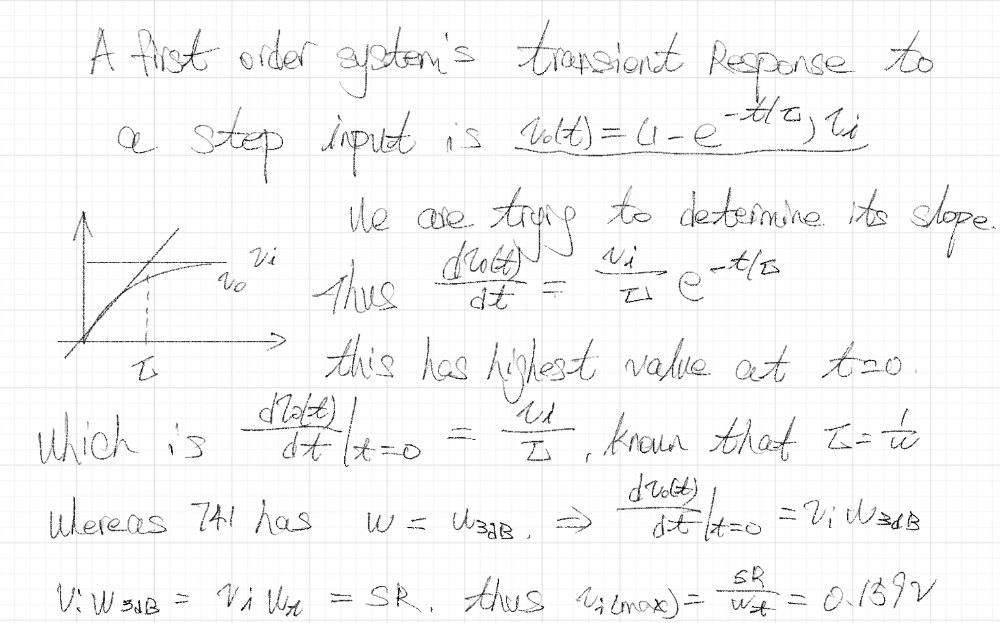

### Full-power bandwidth

\\(fm\\) is the largest frequency of waveform an op-amp can have under largest Output Voltage without Slew Rate Limiting

We know that a sin wave form can be expressed as

$$
v_o(t) = V_{o(max)} \sin(2\pi f_M t)
$$

- Whereas the only part we really care is when \\(t=0\\), the place that have the largest slope

$$
\left|\frac{dv_o(t)}{dt}\right|{max}= 2\pi f_M V{o(max)}
$$

- We want to make it equal to SR

$$
SR = 2\pi f_M V_{o(max)}
$$

- So we can get that

$$
f_M = \frac{SR}{2\pi V_{o(max)}}
$$

#### Ex. Full-power bandwidth for 741 op am

With \\(V_{o(max)} = 10,V, \quad SR = 10^6,V/s\\)

---

$$
f_M = \frac{10^6}{2\pi \times 10} = 15.9\text{kHz}
$$

- Thus for 741 op amp, the largest frequency it can have if output voltage is 10V within the SR is 15.9 kHz

### Slew Rate v.s. Amplitude

From the formula \\(SR = 2\pi f V_{o(peak)}\\) we can see that \\(SR\\) is Proportional to the frequency \\(f\\) and \\(V_{0(peak)}\\)

- So that to avoid distortion, we rather
    - Reduce the output amplitude if frequency is high
    - Or reduce the frequency when amplitude is high这叫