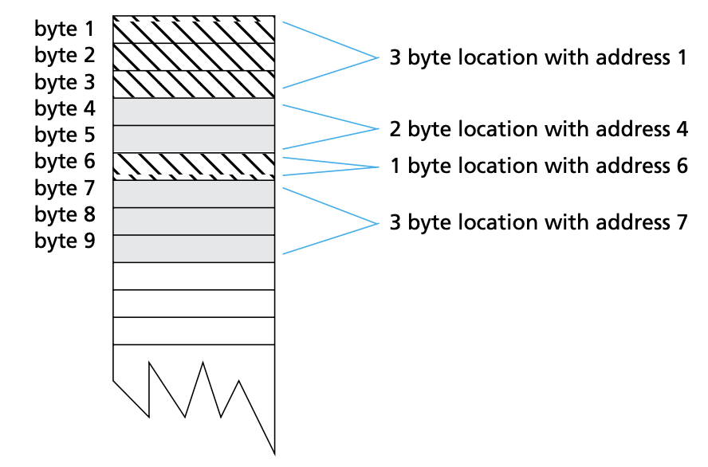
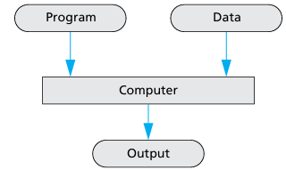
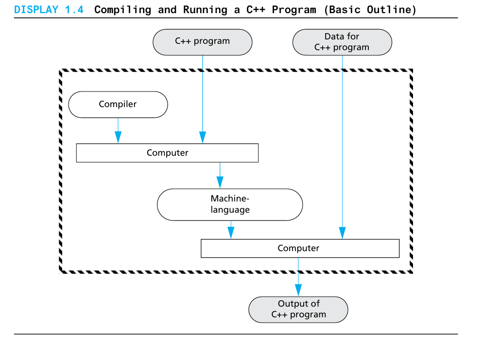
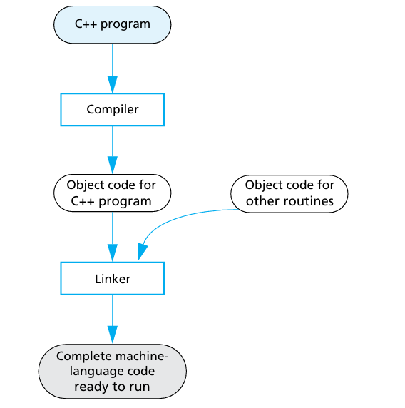

# OOPC0.Introduction

Created: 2025年9月2日 15:35

# 1.1 Computer Systems

## Computer Hardware

- 大部分 Computer Hardware 由五个主要部分组成
1. Input Device
2. Output Device
3. Central Processing unit
4. Main Memory
5. Secondary Memory

### Memory 内存

- 程序在运行的时候，会被放在 Main Memory 中
- 一个 Main Memory 存在很多 Memory Locations，他们根据 Address 进行编号
- 而一个 Memory Location 一般都是一个 8 bits 的组合，即一个 8 位的二进制数
- 现代计算机一般都以 1 个 byte，即 8 bits 作为最基本的存储单位
- 而所有的 Memory Locations 加在一起组合成了 Main Memory
- 当一个 data 超过了一个最基本的储存单位，即一个 bytes 的情况下，就会用到多个 Continuative 的 Memory Locations (bytes)
- 在这种情况下，只需要使用第一个 Memory 的位置作为整个 data 的 Address

- 在一个 Bytes 中，计算机通过特定的 Coding Schemes 来组合他们
- 这就使得不同的编码最终导向不同的数据

## Secondary Memory

- 已知 Main Memory 是主存，只在程序运行的时候被使用，而当电脑关闭后则消失
- 而 Secondary Memory 就是用来进行长期存储的，它长期的保存数据
- 其中具有很多种不同的类型，比如 Hard Disk 硬盘，Diskeets 软盘等

## RAM Random Access Memory 随机存取储存器

- RAM 是 Main Memory 的常见形式
- 其中 Random Access 指的是计算器可以直接访问任意的一个 Memory Location，而不需要顺序查找
- 这使得存取速度很快，适合运行程序
- 但同时 RAM 会在断电时丢失数据

## Software

- 在用户使用 Computer 的时候，并不会直接与 Hardware 交互，而是通过 Operating System

### Operating System 操作系统

- OS 负责分配资源，启动程序等

## Languages

- 语言，分为 High-Level Languages 和 Low-Level，其中 Low-Level 更加偏向计算机可以直接读懂的东西

### Low-Level Languages

- 低级语言，即计算机能直接理解的内容，但是语言仍是文字，而计算机语言永远是二进制
- 所以即使是 Low-Level 的 Assembly Language，仍然需要翻译成 0 和 1 才能被真正执行
- 其中这个 0 和 1 也是 Low-Level Languages 的一种，被称为 Machine Language

### High-Level Languages

- 高级语言，则更加贴近人类的语言，很多常见的 Languages 比如 C++，C，JAVA，Python 等都是和人类语言更加接近的，方便人类读写的语言
- 它的弊端就是其远比 CPU 能处理的信息复杂，这就需要一个类似转换器的东西

## Compilers 编译器

- 前面提到了 High-Level Language 无法被 CPU 直接执行的问题，而 Compilers 则负责这一翻译的任务，将 High-Level Language 翻译为 Machine Language

## Linker

- 很多时候，代码块中并不只包含 Source Code，已知 Source Code 会被翻译成 Object Code
- 但是其他的一些比如别人已经写好了的代码就需要通过 Linker 来 Link，最终生成一个完整的 Machine-Language Program

# 1.2 PROGRAMMING AND PROBLEM-SOLVING

- 对于一个 Problem 来说，相较于写出最终的编程语言，更加困难的步骤为找到解题的办法
- 一般办法找到了，自然就可以简单的将其翻译成 C++ 或其他语言