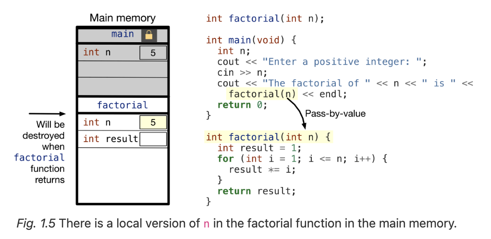

## OOPC1.ProgrammingBasics

> Last Edit: 9/15/25
> 

## **1.2. Programming Basics**

### **1.2.1. Basic Structure of a C++ Program**

- C++ 与 C 的格式几乎相同，导致他们看上去十分类似，实际上他们所做的事大相径庭
- 拿一个简单的 Hello World 代码举例

```cpp
##include <iostream>
using namespace std;

int main() {
    cout << "Hello world!" << endl;
    return 0;
}
```

- `#include <iostream>`
    - **iostream (输入输出流库)**：包含标准的输入输出功能，用于 **cin (输入)** 和 **cout (输出)**
    - 在 **C** 中对应的是 `#include <stdio.h>`
- `using namespace std;`
    - 使用 **namespace (命名空间)** 中的 **std (标准命名空间)**，方便直接调用 **cout**、**cin**，而不用写成 `std::cout`

#### std Standard Library 标准库

---

- 在 **C++ standard library** 里，有很多工具，比如 `cout`（输出）、`cin`（输入）、`string`（字符串）、`vector`（数组
- 这些东西都被放在一个“文件夹”里，这个文件夹的名字叫 **std**
- 当要使用里面的工具的时候，要写 `std::cout`、`std::cin` ，示例如下

```cpp
##include <iostream>

int main() {
    std::cout << "Hello World!" << std::endl;
    return 0;
}
```

- 而如果用了 `using namespace std;`  就直接写名字就行
- 一般来说小程序和初学者推荐这样写，但是到了大项目时，极度容易产生冲突

---

- `int main()`
- **main function (主函数)**：程序从这里开始执行
- **int (整数类型)** 表示函数返回值类型
- `cout << "Hello world!" << endl;`
    - **cout (输出流对象)**：在屏幕上打印内容
    - `<<` 是 **insertion operator (插入运算符/输出运算符)**，把右边的内容送入输出流
    - `"Hello world!"` 是字符串
    - **endl (换行符)**：让输出内容后换行
- `return 0;`
    - 表示 **程序正常结束**，返回值 0 传递给操作系统

#### **1.2.1.1. A program to input a value**

- 如果想做一个能 input 的程序，可以通过 `std::cin`

```cpp
##include <iostream>     // 引入输入输出库 iostream
using namespace std;    // 使用标准命名空间 std

int main(void) {        // 主函数，程序从这里开始
    int value = 0;      // 定义一个整数变量 value，初始值为 0

    cout << "Enter a value: ";   // cout (输出) → 在屏幕上打印提示
    cin >> value;                // cin (输入) → 等待用户输入，把值存到 value

    cout << "The value entered is " << value << endl;  
    // 再次用 cout 打印出刚刚输入的值，并换行

    return 0;          // 程序结束，返回 0
}
```

#### << & >>

1. **cout <<**
    - **cout (输出流，character output stream)** → 往屏幕输出
    - `<<` 箭头朝左，意思是把数据推出去（out of the page，往屏幕方向）
    - 可以记成：
        - `cout << "Hello";` = 把 `"Hello"` 推到屏幕
2. **cin >>**
    - **cin (输入流，character input stream)** → 从键盘输入
    - `>>` 箭头朝右，意思是把数据吸进来（into the page，流进变量）
    - 可以记成：
        - `cin >> value;` = 从键盘读入一个值，放到 `value` 变量里

### **1.2.2. Common Data Representations**

- 在 C 和 C++ 中，定义变量时需要指定 **data type (数据类型)**，例如

```cpp
int i, j;   // 声明了两个 int 类型的变量 i 和 j
```

#### **1.2.2.1. Integers**

- **Integers (整数类型)**
- 整数就是没有小数点的数，比如 0、-23、789，在 C++ 中同样存在多种 Int 类型
1. **int (整型，integer)**
    - 通常占 **32 bits**，也就是 **4 bytes**
    - 因为 1 bit 用来存储正负号，所以剩下 **31 bits** 存数字
    - 能表示的范围：\\(-2^{31} \quad 到 \quad 2^{31}-1\\)
2. **short (短整型，short integer)**
    - 通常占 **16 bits**
    - 1 bit 存符号，剩下 **15 bits** 存数字。
    - 范围：\\(−1-2^{15} \quad 到 \quad 2^{15}-1\\)
3. **long (长整型，long integer)**
    - 占用比 32 bits 更多的空间（通常 64 bits）
    - 能表示的数范围比 int 更大
    - 范围取决于编译器和机器，但肯定比 int 大
- 在本课程里，推荐使用 **int** 来存储整数，例如

```cpp
int participants = 60;   // 声明一个整型变量 participants，赋值 60
```

#### 1.2.2.2 Floating-point Numbers

- floating-point numbers 浮点数就是带小数点的数，比如 2.9，−118.763
- 在计算机内存中，它们的表示方式类似于科学记数法 (scientific notation)，比如 \\(2.89 \times 10^{14}\\) 会写成 `2.89e14` 或 `2.89E14`
- 与 Integer 一样，C/C++ 里有几种存储浮点数的数据类型 (data types)：
1. **float (单精度浮点型)**
    - 占 32 位 (32 bits)，
    - 精度大约 7 decimal digits of precision，包括小数点前和小数点后的总位数
2. **double (双精度浮点型)**
    - 64 bits
    - 精度大约 15 位十进制有效数字
3. **long double (长双精度浮点型)**
    - 通常占用比 64 位更多的存储空间
    - 精度比 double 更高
- 与 C 语言时一样，推荐使用的还是 Double

#### 1.2.2.3. Boolean

- 在 C++ 里有 **bool (布尔型)** 数据类型，用来表示 logical value，即 `true (真)` 或 `false (假)`，存储时占 8 位 (8 bits)
- 和 C 语言不同，C++ 不需要额外引入 library 就能用 `bool`

#### 1.2.2.4. Characters

- **char** 数据类型来存储 single character，占 8 bits
- 字符必须放在单引号 `' '` 中

#### 1.2.2.5. Arrays

- **Array** 存储多个 same data type 相同数据结构 的元素，通过一个 Identifier 来统一管理
- 举例来说，一个由 Integers 组成的 Array 为

```cpp
int arr[7] = {1, 2, 3, 4, 5, 6, 7};
```

- `arr` 是 Array identifier，表示一个包含 7 个 `int (整型)` 元素的数组。
- `arr[0]` 表示第一个元素 (存储的是 1)。
- `arr[6]` 表示最后一个元素 (存储的是 7)。

#### 1.2.2.6. Strings

- 在 C 语言**中，**string 实际上是一个以 Null character, **`'\0'`** 结尾的 Character array

```cpp
char h[6] = "Hello";
```

- 这里 `h` 存储 `"Hello"`，而 `h[5]` 存储的是 `'\0'`
- 想要使用更加方便的 String 管理 Function，需要包含 header file 的 `#include <string.h>`
- 有了 Header File 之后就可以用函数如 `strcmp (比较)`, `strlen (长度)`, `strcpy (拷贝)`
- 区分于 C 语言，在 C++ 中，有一个专门的数据类型 string，比 C 的字符数组更方便
- 但是想要调用它，也需要包含 `#include <string>`
- 可以直接用 `+` 拼接字符串 (concatenate)，用 `==` 比较字符串 (compare)

```cpp
##include <iostream>
##include <string>
using namespace std;

int main(void) {
    string prePhrase = "This course is ";
    string postPhrase = " Programming Fundamentals!", blank = "______";

    cout << "Fill in the blank of the following sentence" << endl;
    cout << prePhrase << blank << postPhrase << endl;

    cin >> blank;   // 从用户输入读入 blank

    if (blank == "ECE244") {   // 判断输入是否等于 "ECE244"
        cout << "Correct!" << endl;
        string sentence = prePhrase + blank + postPhrase;  // 拼接字符串
        cout << sentence << endl;
    } else {
        cout << "Incorrect!" << endl;
    }
    return 0;
}
```

### 1.2.3 Operators

- 在 C++ 里，运算符分几类：

#### Arithmetic operators (算术运算符)

- `+`,`-` ,`*` , `/`, `%`
- `%` 表示取 Remainder

#### **Assignment operators (赋值运算符)**

- `=`：把右边的值赋给左边变量

> 注意它和 `<<`  不一样，`<<`  专门用在 cont 里，表示把右边的东西送到输出流
> 
- `int x = 7 + 3;` 使 `x = 10`
- 复合赋值运算符 (compound assignment)：`+=`, `=`, `=`, `/=`, `%=`
- `x += 3` 等价于 `x = x + 3`

#### **Increment and decrement operators (自增和自减运算符)**

- `++` 表示加 1，`-` 表示减 1

#### **Relational operators (关系运算符)**

- `==` (等于), `!=` (不等于), `<` (小于), `>` (大于), `<=` (小于等于), `>=` (大于等于)
- 返回值是 `true` (真) 或 `false` (假)

#### **Logical operators (逻辑运算符)**

- `&&` (and, 与), `||` (or, 或), `!` (not, 非)

#### **sizeof() operator (求字节数运算符)**

- `sizeof()` 返回某个数据类型 (data type) 所占的字节数

#### 1.2.4. Control Structures (控制结构)

- 控制结构用来控制 flow of execution 执行的流程
- 在 C / C++ 里，if, loop, while 等的用法和 C 一样，不再赘述

## 1.3 Functions

- Function ****是一组指令，可以通过名字反复调用
- 每个程序必须至少有一个函数：
    - `main` (主函数) —— 程序的 entry point，程序运行时最先执行的函数
- 使用函数的好处：
    - 可以把代码拆分成小块，避免 reuse code
    - 让程序更容易 debug 和 maintain

#### 1.3.1. n choose k example (组合数示例)

问题：

- 从一组 `n` 个元素里选择 `k` 个元素。
- 在组合数学 (combinatorics) 里，常写作 **n choose k**，记作：

$$
\binom{n}{k} = \frac{n!}{k!(n-k)!}
$$

- 整体的设计思路就是输入 `n` 和 `k`，计算从 `n` 个元素里选出 `k` 个的组合数
- 计算过程需要两部分：
    1. 一个函数计算阶乘 `factorial(n)`
    2. 一个函数计算组合数 `n choose k`

#### 1.3.1.1 Defining a function

- Define 的部分和 C 也是一样的，也不再赘述
- 总的来说，对于上面的 Example，其完整 C++ 代码如下

```cpp
##include <iostream>
using namespace std;

// Function Prototypes
int factorial(int n);
int nChooseK(int n, int k);

// Main Function
int main(void) {
  int n, k;
  cout << "Enter the value of n: " << endl;
  cin >> n;
  cout << "Enter the value of k: " << endl;
  cin >> k;
  cout << "The number of ways to choose " << k;
  cout << " from " << n << " is ";
  cout << nChooseK(n, k) << endl;
  return 0;
}

// Function Implementations
int factorial(int n) {
  int result = 1;
  for (int i = 1; i <= n; i++) {
    result *= i;
  }
  return result;
}

int nChooseK(int n, int k) {
  return factorial(n) / (factorial(k) * factorial(n - k));
}
```

- `factorial` ：计算了 Parameter 中 Integer 的阶乘
- `nChooseK` ：调用 `factorial`  计算完整的公式 \\(\binom{n}{k} = \frac{n!}{k!(n-k)!}\\)

### 1.3.2 Pass-by-value

- 当我们把参数传进函数时（例如把 `n` 传给 `factorial` 函数），C++ 会创建一个新的 local variable，它是传入值的副本
- 这叫做 pass-by-value
- 在调用函数 `main` 里的 `n` 和 `factorial` 里的 `n` 是两个不同的变量
- 如果你在 `factorial` 函数内部修改了 `n`，它不会影响 `main` 函数里的 `n`

> 简单说就是 Function 的内部对外部 Variable 的调用算作局部的调用，它并不会影响到全局的外部函数，只是复制了他的一份
> 
- 相较 Code 来说，在 Memory 中发生的变化才是更加底层的原因
- 首先在全局，也就是 `main` 里有一个变量 `n = 5`



- 调用 `factorial(n)` 时，系统会新建一个 Stack 来存放 `factorial` 的局部变量：
    - 一个新的 `n`（值同样是 5，但和 `main` 里的 `n` 不是同一个）
    - 一个 `result` 用来计算结果
- `factorial` 函数执行完毕后，这个局部内存（被存储在了 Stack 上的）会被销毁，不再存在

## 1.4 Passing Input Parameters to Functions

- 总结来说，想要真正修改到 `main`  里面的值，Pass-by-value 是行不通的
- 要么使用 pass-by=reference，或者用 pass-by-pointer

#### 1.4.1.1 Pass-By-Pointer

- 先 Review 一下 Pointer，Pointer 是负责储存另一个 Variable Address 的 Variable

```cpp
int a;
int* ptr = &a;
```

- 通过 `int*`  声明这是一个 int variable 的 Pointer
- 通过 Address-of Operator `&` ，也就是取地址运算符得到 a 的 Address 完成 Pointer 的赋值

---

- 有了 Pointer 作为 Parameter，就可以在 Local 中完成对于 Global Variable 的更改

```cpp
void swapByPointers(int* pa, int* pb) {
    int temp = *pa;  // temp 取到 a 的值
    *pa = *pb;       // a 的位置写入 b 的值
    *pb = temp;      // b 的位置写回 temp
}
```

- 用图片表现出来就是


- 首先有 a 和 b 的两个 Variables，其中 `a = 5, b = 10` ，他们的 Pointer 也被分别传入了 function


- 注意这时候函数内的 `pa`  和 `pb`  皆为 Address，然后通过 `*`  可以完成解引用
- 也就是说，`*pa`  是 5，而 `int temp = *pa` 就是令 `temp = 5`
- 下一步是解引用 pa 的值，让它变成 pb 的值
- 在把 pb 的值变成之前的 temp 的，完整的 Swap 就完成了

> 到这里都和 C 语言的逻辑，代码一模一样
> 

#### 1.4.1.2 Pass-By-Reference 引用传递

- C++ 提供了一种比指针更简洁的方式：Reference 引用
- 引用是变量的别名 (alias)，一旦绑定到某个变量，就相当于这个变量的另一个名字
- 定义方法：在类型后加 `&`

```cpp
int a = 5;
int& ra = a;   // ra 是 a 的引用
```

- 改变 `ra` 就等价于改变 `a`

---

```cpp
##include <iostream>
using namespace std;

int main(void) {
    int a = 5, b = 12;
    int& ra = a;   // ra 是 a 的引用

    cout << "Point 1: ra = " << ra << ", a = " << a << endl;

    ra = 10;       // 改变 ra 就是改变 a
    cout << "Point 2: ra = " << ra << ", a = " << a << endl;

    ra = b;        // 注意：这是把 b 的值赋给 a，而不是让 ra 引用 b
    cout << "Point 3: ra = " << ra << ", a = " << a << endl;

    return 0;
}

```

- 输出如下

```
Point 1: ra = 5, a = 5
Point 2: ra = 10, a = 10
Point 3: ra = 12, a = 12
```

- 对于 Reference，需要注意的是 `int& r;   // 错误`，Reference 必须在定义时绑定
- 并且其不能重复绑定
- 一旦 `ra` 引用 `a`，就不能再让它引用别的变量
- Reference **不占新的内存空间**，它和被引用变量共用同一块内存。
- Reference **不是指针**，不能用 `*` 或 `&` 来解引用
    - 指针：`int* p = &a; *p = 10;`
    - 引用：`int& r = a; r = 10;`

---

- 回到上面的例子中，

```cpp
##include <iostream>
using namespace std;

void swapByRef(int& ra, int& rb) {
    int temp = ra;
    ra = rb;
    rb = temp;
}

int main(void) {
    int a = 5, b = 10;
    cout << "Before swapping: a = " << a << ", b = " << b << endl;
    swapByRef(a, b);
    cout << "After swapping: a = " << a << ", b = " << b << endl;
    return 0;
}
```

- 运行结果：

```
Before swapping: a = 5, b = 10
After swapping: a = 10, b = 5

```

#### Summary

- **Pass-by-value (值传递)**：改的是副本，原变量不变。
- **Pass-by-pointer (指针传递)**：传地址，函数内部用  操作原变量。
- **Pass-by-reference (引用传递)**：传别名，函数内部直接操作原变量，语法最简洁。

## **1.5. Program Organization and Separate Compilation**

- Function 的存在主要是为了代码整体的可读性和降低重复性，其起到了优化代码环境的作用
- 而有的时候，当代码过大，甚至连 Function 都无法解决的时候，就需要通过 Separate Files

### 1.5.1 How do we split code into separate files?

#### 1.5.1.1 Compilation of a single file

- 现在有如下的代码

```cpp
##include <iostream>
using namespace std;

void printNum(int x);
int userInputNum();

int main(void) {
    int num = userInputNum();
    printNum(num);
    return 0;
}

void printNum(int x) {
    cout << "The number is " << x << endl;
}

int userInputNum() {
    int x;
    cout << "Enter a number: ";
    cin >> x;
    return x;
}
```

- 已知前面提到了，C++ 无疑是一个 High-Level Language，在传递给 Computer 之前，需要通过 Compiler 把人类的代码翻译成 Machine Code，而这个 Compiler 叫做 g++
- 命令如下 `g++ main.cpp -o main` ，其中
- `g++`：C++ 编译器
- `main.cpp`：源代码文件
- `o main`：指定输出文件名为 `main`

#### 1.5.1.2 Split Code into Multiple Files

- 一般会把 Interface（接口）和 Implementation（实现）区分开
- **Function Declaration 函数声明：**告诉 Compiler 这里有这样的一个函数，也就是 Function 的 Prototype，而不包含具体的 Implementation
- 一般写在 .h（头文件）里
- **Function Definition 函数定义：**写出函数具体实现的部分，一般写在 .cpp 文件中
- 一个例子就是
- `print.h`：声明 `printNum`
- `input.h`：声明 `userInputNum`
- `print.cpp`：定义 `printNum`
- `input.cpp`：定义 `userInputNum`
- `main.cpp`：放主函数 `main`
- 图中显示了文件分布：
- `print.h`：`void printNum(int x);`
- `input.h`：`int userInputNum();`
- `print.cpp`：实现 `printNum`
- `input.cpp`：实现 `userInputNum`
- `main.cpp`：调用它们

#### Hidden Segment

- 每个 `.cpp` 文件里还需要包含它用到的函数声明，否则编译器不知道函数的存在。
- 例如 `main.cpp` 用到 `printNum` 和 `userInputNum`，所以它必须 `#include "print.h"` 和 `#include "input.h"`
- `print.cpp` 里要实现 `printNum`，因此也要 `#include "print.h"`
- 由于 `printNum` 使用了 `cout`，所以还要 `#include <iostream>` 和 `using namespace std;`
- `input.cpp` 同理，需要 `#include "input.h"`，再加上 `iostream` 和 `using namespace std;`，因为它用到了 `cin` 和 `cout`


- 于是最终所有的文件长这样

### 1.5.2 How are multiple files compiled?

- 编译多个文件的时候，直接用一个命令就可以

```cpp
g++ main.cpp print.cpp input.cpp -o main
```

#### Compiler Steps

- g++ 编译器分三步：
1. **Preprocessing（预处理）**
    - 把 `#include "file_name"` 替换成对应文件的内容
    - 处理完后 `.h` 文件就不再需要了
2. **Generating object files（生成目标文件）**
    - 每个 `.cpp` 会被编译成一个 `.o` 文件（目标文件）
    - `.o` 文件里是机器码，但单独的 `.o` 文件不能运行
    - 比如 `main.cpp` → `main.o`，里面有 `main` 函数的机器码，但调用 `printNum` 和 `userInputNum` 时，只是“引用”，没有具体实现
3. **Linking object files（链接目标文件）**
    - 把所有 `.o` 文件合并成一个可执行文件。
    - 链接器会找到 `print.o`、`input.o` 里的函数实现，把它们和 `main.o` 拼接在一起
    - 生成的 `main` 可执行文件就能运行


#### **1.5.2.1. Separate Compilation**

- 每一个 Source file 可以单独 Compile，再把它们 link 到一起
- 这样只需要重新编译改动过的文件，不用每次都编译所有文件 → 节省时间
- 假设修改了 `print.cpp` ，Compiler 会重新生成新的 print.o (Object File)
- 于此同时，由于没有修改其他的，所以不需要重新编译 main.cpp 和 input.cpp

```
g++ -c print.cpp
g++ main.o print.o input.o -o main
```

- 上面的情况是修改了 cpp 文件的情况
- 而如果修改的文件时 header .h 文件，任何 `#include "print.h"` 的源文件都必须重新编译（因为预处理时会替换掉内容）
- 所以需要重新编译 print.cpp 和 main.cpp

```
g++ -c print.cpp
g++ -c main.cpp
g++ main.o print.o input.o -o main
```

- 在这一过程中，order of compiling 不重要，只要所有源文件都编译过，最后统一链接就行
- 并且，Linking 比 Compilation 快的多，这就是 Separate Compile 的好处

<aside>
💡

**IDE（集成开发环境，比如 VS Code）** 和 **build tools（构建工具，比如 Make）** 会自动帮你跟踪文件变化，只重新编译需要的文件

</aside>

### 1.5.3 Why header Files ?

- headers files, .h 文件
- 里面存放的是 Function Declarations，通过 `#include "file_name"` 被复制到源文件（.cpp）里

#### Case Without header files

- 如果没有 Header Files，所有的 Function 的 Prototype 都需要在每一个 cpp 文件中被写入
- 这回导致严重的 Code Duplication

#### Case when #include cpp files

- 比如在 `main.cpp` 里写 `#include "print.cpp"`
- 这样的话，一旦 `print.cpp` 改了，就必须同时重新编译 `print.cpp` 和 `main.cpp`
- 这和分离编译的思想矛盾，因为本来只需要编译改动的部分

---

- **重复定义（duplicate definitions）错误**
- 如果多个 .cpp 都 `#include "print.cpp"`，那么函数实现会被复制到多个 .o 文件中。
- 比如 `printNum()` 既出现在 `print.o` 又出现在 `main.o`，linker 会报错**multiple definition of `printNum`**

### 1.5.4 What Happens if we include a header file multiple times ?

- 在 Project 中，同一个 Header 文件可能会被多次包含
- 比如：`a.h` 里定义了 `struct A`
- 因为 `b.h` 需要用到 `struct A` ，所以 `b.h` 里写了 `#include "a.h"`
- 在 `main.cpp` 里同时写了

```cpp
##include "a.h"
##include "b.h"
```

- 这样一来，`a.h` 就会被展开两次（一次来自 `main.cpp`，一次来自 `b.h`）
- 结果：`struct A` 被定义了两次，编译报错 **duplicate definition（重复定义）**
    
    
    
    

#### Header Guards（头文件保护）

- 作用：保证一个头文件在同一个源文件中只会被包含一次，写法是：

```cpp
##ifndef FILE_NAME_H   // 如果没有定义这个宏
##define FILE_NAME_H   // 定义宏
// 头文件内容
##endif                // 结束
```

1. 第一次包含头文件时，宏 `FILE_NAME_H` 还没定义，于是内容会展开，并且定义 `FILE_NAME_H`
2. 再次包含时，发现 `FILE_NAME_H` 已经定义，于是直接跳过，不会重复展开

---

#### Ex.

```cpp
##ifndef MATH_UTILS_H   // 如果没有定义过 MATH_UTILS_H
##define MATH_UTILS_H   // 定义宏，防止重复包含

// 函数声明
int add(int a, int b);
int multiply(int a, int b);

##endif  // MATH_UTILS_H
```

<aside>
💡

要注意 macro 是写在 Header 文件里的，不是 cpp 文件

</aside>

#### Naming Strategy

- 为了防止和 header 取到一样的名字，macro 一般用大写 H 当作文件类型
- 宏名一般取文件名全大写 + `_H`，比如：
- `a.h` → `A_H`
- `b.h` → `B_H`